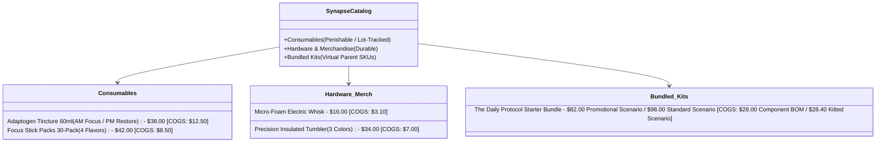
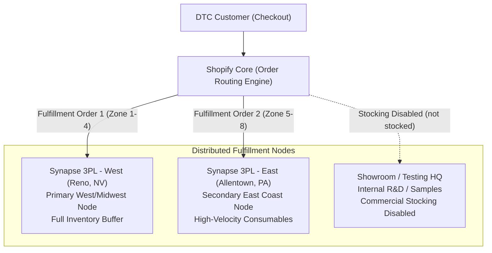

# Synapse Botanicals — Operations & Technical Architecture Blueprint

> [!NOTE] **Architectural Sandbox & Benchmark Context:**  
> Synapse Botanicals is an engineered reference architecture and technical operations sandbox built to model, stress-test, and benchmark distributed direct-to-consumer (DTC) systems. Customer identities and order fixtures are synthetic. Commercial costs are scenario inputs; calculations are reproducible. Local simulator measurements and pinned public API references are identified separately from supplied narrative telemetry. No carrier contract rate or production provider latency is established by the offline suite. This controlled environment enables verifiable failure-mode testing without exposing customer PII or proprietary merchant data.

---

## 1. Brand & Business Overview

**Synapse Botanicals** (`synapse-botanicals.myshopify.com`) is a high-growth, direct-to-consumer (DTC) functional wellness and cognitive longevity brand. The company formulates clean, nootropic-infused adaptogen tinctures, daily focus drink powders, and premium lifestyle accessories designed for daily sustained performance.

* **Business Model:** DTC E-Commerce with high subscription velocity + seasonal promotional flash sales.
* **Average Order Value (AOV):** \$85.00 – \$120.00 planning baseline (specific evaluated cohorts vary, e.g., \$82.40 across the 500-order multi-node routing cohort).
* **Target Delivery SLA:** 2-day ground shipping coverage to 90% of the contiguous United States via bi-coastal nodes (planning objective).
* **Order Velocity:** High daily order volume with significant promotional spikes (e.g., Black Friday, product drops, influencer campaigns).

---

## 2. Product Catalog Architecture

The catalog balances consumable, expiration-sensitive ingestibles with non-perishable branded merchandise across distinct inventory tracking profiles:



| Product Line | Format & SKU Handle | Variants | Unit Price | Unit COGS | Gross Margin |
| :--- | :--- | :--- | :---: | :---: | :---: |
| **Adaptogen Tincture (60ml)** | `synapse-adaptogen-tincture-60ml` | AM Focus (Lion's Mane)<br/>PM Restore (Reishi & Ashwagandha) | \$38.00 | \$12.50 | 67.1% |
| **Focus Stick Packs (30-Pack)** | `synapse-focus-stick-packs-30-pack` | Matcha Yuzu, Blood Orange,<br/>Wild Blueberry, Crisp Green Apple | \$42.00 *(Comp \$48)* | \$8.50 | 79.8% |
| **Daily Protocol Starter Bundle** | `the-daily-protocol-starter-bundle` | AM/PM Routine Kit (`Matcha / AM / Obsidian (SYN-BNDL-MAO)` / `Blood Orange / AM / Bone White (SYN-BNDL-BAB)`) | \$82.00 *(Promotional Scenario)* / \$98.00 *(Standard Scenario)* | \$28.00 *(Component BOM)*<br/>\$28.40 *(Kitted Scenario)* | 65.4% – 71.0% |
| **Precision Insulated Tumbler** | `precision-insulated-tumbler-durable-merchandise` | Matte Obsidian, Bone White, Sage Green | \$34.00 | \$7.00 | 79.4% |
| **Micro-Foam Electric Whisk** | `micro-foam-electric-whisk` | Single Variant (`SYN-ACC-WHSK`) | \$16.00 | \$3.10 | 80.6% |

*(Note on Bundle Accounting: Raw component BOM cost is \$28.00: Focus Sticks \$8.50 + AM Tincture \$12.50 + Tumbler \$7.00. The \$28.40 Capstone scenario cost incorporates \$0.40 dedicated packaging and kitting materials. These are declared cost assumptions, not historical procurement contract values).*

---

## 3. Logistical Topology & Fulfillment Network

To support rapid, cost-effective domestic fulfillment, Synapse operates a **bi-coastal distributed 3PL warehousing model** synchronized via automated API webhooks:



1. **Synapse 3PL - West (Reno, NV) — Primary Node:**
   * Full catalog distribution authorization; houses complete consumable batches, hardware, and packaging stock.
   * Holds active on-hand inventory across all 12 variants, including exclusive on-hand allocation for Adaptogen Tinctures and Starter Bundles in the evaluated routing scenarios.
   * Fulfills Pacific, Mountain, and West-Central shipments within 1–2 transit days.
2. **Synapse 3PL - East (Allentown, PA) — Secondary Node:**
   * Authorized for distributed catalog fulfillment; maintains active on-hand stock for high-velocity consumables and merchandise (Focus Stick Packs, Tumblers, and Whisks) to minimize cross-country shipping zone surcharges.
   * Fulfills Mid-Atlantic, Northeast, and Southeast customer orders.
3. **Showroom / Testing HQ — R&D Node:**
   * Used strictly for product testing, VIP sample gifting, and marketing photoshoots.
   * Commercial customer stocking is disabled (`not stocked` status in inventory records) to prevent order leakage.

---

## 4. The Technical Stack & Integration Layer

The published studies focus on the systems that shape an order from checkout through warehouse and carrier handoff:

* **Commerce platform:** **Shopify Plus**, using its Admin API and fulfillment-order state.
* **Fulfillment network:** A modeled **ShipBob 3PL WMS** with Reno and Allentown inventory nodes.
* **Order routing:** A declared decision model comparing closest-stocked fulfillment with whole-basket consolidation.
* **Coordination design:** Shopify events, an idempotency ledger, and an AWS SQS retry / dead-letter topology in the Capstone architecture.
* **Carrier recovery:** A focused offline UPS Delivery Intercept contract fixture; no live carrier request is claimed.

---

## 5. Published Case Studies

The public portfolio presents two domain studies and an integration Capstone:

1. **Order State Machine & Point-of-No-Return Protocol (Domain 1):** Manages digital-to-warehouse order synchronization, fulfillment holds, and irreversible operational cutoffs.
2. **Bi-Coastal Multi-Node Routing & Freight Optimization (Domain 2):** Compares closest-stocked parcel splits with whole-basket routing using declared inventory and rate inputs.
3. **Asynchronous Order Mutation & Cross-System Recovery (Capstone):** Brings order-state control and routing decisions into one staged incident, then specifies idempotent coordination, timeout reconciliation, and post-handoff recovery.

---

## 6. Reproducible Technical Evidence Package

The [offline Node.js suite](evidence/README.md) separates assumptions, computed outputs, measured simulator timings, and public references. It records executed checks, failures and skips, runtime, and source/input hashes. The checked-in component reports show the latest recorded workstream results; rerun the suite to generate a fresh aggregate manifest.

- [Freight](evidence/freight/summary.md): feasible synthetic shipment plans, conditional handling/cohort calculations, and scale projections. Tariff verification is outside the executed checks.
- [Coordinator](evidence/latency/summary.md): local SQLite operation identity, cutoff, reconciliation, owned-hold release, and post-effect restart assertions, with separately measured seeded workloads.
- [Costs](evidence/costs/summary.md): declared component BOM, assumed kitting material, integer-cent contribution branches, and cost sensitivity.
- [Recovery](evidence/carrier-recovery/summary.md): focused checks against a pinned official UPS contract and a local recovery model. No authenticated CIE request or actual interception is represented.
```bash
node evidence/run_all.js
```

Use `--full` for a larger local timing workload. Offline tests do not certify private merchant costs, provider latency, live workflows, SQS deployment, warehouse actions or carrier billing.
