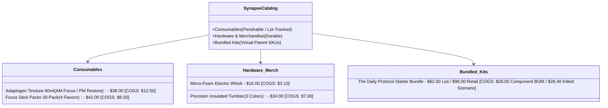
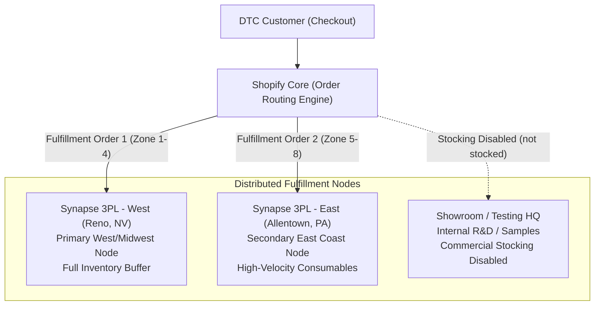

# Synapse Botanicals — Operations & Technical Architecture Blueprint

> [!NOTE] **Architectural Sandbox & Benchmark Context:**  
> Synapse Botanicals is an engineered reference architecture and technical operations sandbox built to model, stress-test, and benchmark distributed direct-to-consumer (DTC) systems. All customer profiles, order cohorts (e.g., the 500-order routing cohort, 300-order promo cohort), and telemetry logs are synthetically generated from real Shopify Plus JSON schemas, ShipBob WMS rate cards, and UPS Zone 1–8 ground freight matrices. This controlled environment enables verifiable failure-mode testing without exposing customer PII or proprietary merchant data.

---

## 1. Brand & Business Overview

**Synapse Botanicals** (`synapse-botanicals.myshopify.com`) is a high-growth, direct-to-consumer (DTC) functional wellness and cognitive longevity brand. The company formulates clean, nootropic-infused adaptogen tinctures, daily focus drink powders, and premium lifestyle accessories designed for daily sustained performance.

* **Business Model:** DTC E-Commerce with high subscription velocity + seasonal promotional flash sales.
* **Average Order Value (AOV):** \$85.00 – \$120.00 planning baseline (specific evaluated cohorts vary, e.g., \$82.40 across the 500-order multi-node routing cohort).
* **Target Delivery SLA:** 2-day ground shipping coverage to 90% of the contiguous United States via bi-coastal nodes (planning objective).
* **Order Velocity:** High daily order volume with significant promotional spikes (e.g., Black Friday, product drops, influencer campaigns).

---

## 2. Product Catalog Architecture

The catalog balances consumable, expiration-sensitive ingestibles with non-perishable branded merchandise across distinct inventory tracking profiles:



| Product Line | Format & SKU Handle | Variants | Unit Price | Unit COGS | Gross Margin |
| :--- | :--- | :--- | :---: | :---: | :---: |
| **Adaptogen Tincture (60ml)** | `synapse-adaptogen-tincture-60ml` | AM Focus (Lion's Mane)<br/>PM Restore (Reishi & Ashwagandha) | \$38.00 | \$12.50 | 67.1% |
| **Focus Stick Packs (30-Pack)** | `synapse-focus-stick-packs-30-pack` | Matcha Yuzu, Blood Orange,<br/>Wild Blueberry, Crisp Green Apple | \$42.00 *(Comp \$48)* | \$8.50 | 79.8% |
| **Daily Protocol Starter Bundle** | `the-daily-protocol-starter-bundle` | AM/PM Routine Kit (`SYN-BNDL-MAO` / `BAB`) | \$82.00 *(List)* / \$98.00 *(GMV)* | \$28.00 *(Component BOM)*<br/>\$28.40 *(Kitted Scenario)* | 65.4% – 71.4% |
| **Precision Insulated Tumbler** | `precision-insulated-tumbler-durable-merchandise` | Matte Obsidian, Bone White, Sage Green | \$34.00 | \$7.00 | 79.4% |
| **Micro-Foam Electric Whisk** | `micro-foam-electric-whisk` | Single Variant (`SYN-ACC-WHSK`) | \$16.00 | \$3.10 | 80.6% |

*(Note on Bundle Accounting: Raw component BOM cost is \$28.00: Focus Sticks \$8.50 + AM Tincture \$12.50 + Tumbler \$7.00. The \$28.40 Capstone scenario cost incorporates \$0.40 dedicated packaging and kitting materials. Historical manufacturing procurement contracts cited \$24.50 unkitted / \$26.50 landed).*

---

## 3. Logistical Topology & Fulfillment Network

To support rapid, cost-effective domestic fulfillment, Synapse operates a **bi-coastal distributed 3PL warehousing model** synchronized via automated API webhooks:



1. **Synapse 3PL - West (Reno, NV) — Primary Node:**
   * Full catalog distribution authorization; houses complete consumable batches, hardware, and packaging stock.
   * Holds active on-hand inventory across all 12 variants, including exclusive on-hand allocation for Adaptogen Tinctures and Starter Bundles in the evaluated routing scenarios.
   * Fulfills Pacific, Mountain, and West-Central shipments within 1–2 transit days.
2. **Synapse 3PL - East (Allentown, PA) — Secondary Node:**
   * Authorized for distributed catalog fulfillment; maintains active on-hand stock for high-velocity consumables and merchandise (Focus Stick Packs, Tumblers, and Whisks) to minimize cross-country shipping zone surcharges.
   * Fulfills Mid-Atlantic, Northeast, and Southeast customer orders.
3. **Showroom / Testing HQ — R&D Node:**
   * Used strictly for product testing, VIP sample gifting, and marketing photoshoots.
   * Commercial customer stocking is disabled (`not stocked` status in inventory records) to prevent order leakage.

---

## 4. The Technical Stack & Integration Layer

The brand relies on an interconnected operational stack where data integrity, speed, and automation guardrails are paramount:

* **E-Commerce Platform & Core ERP:** **Shopify Plus** (Custom Online Store 2.0 Theme, Fulfillment Orders API, GraphQL admin mutations).
* **Fulfillment & WMS Middleware:** **ShipBob 3PL WMS** (Distributed multi-node warehousing across Reno and Allentown synchronized via asynchronous REST webhooks).
* **Frontline Customer Support & Automation:** **Gorgias Helpdesk** (HTTP integration webhooks, automated order holds, macro-driven tag sanitation, and customer address mutation safeguards).
* **Order & Inventory Routing:** Native Shopify Order Routing engine with strict deterministic rules: *Minimize split fulfillments* $\rightarrow$ *Closest location priority*.
* **Workflow Automation & Idempotency:** **Shopify Flow** (Fraud risk quarantine holds, VIP high-order value routing, automated tag hygiene, and zero-loop idempotency locks).
* **Data Engineering & Catalog Migrations:** **Matrixify (Excelify)** + Native CSV ingestion pipelines paired with custom pre-flight Python regex linters.
* **Incident Alerting & Telemetry:** **Slack Webhooks** (Real-time Sev-1 order routing alerts and inventory depletion thresholds).
* **Diagnostic & Observability Tooling:** **Chrome DevTools** (Storefront API / Cart AJAX payload triage), Order Timeline transaction forensics, and gateway authorization logs.

---

## 5. Core Operational Challenges (The TechOps Mandate)

Because Synapse Botanicals operates at the intersection of perishable health supplements, multi-location logistics, and high-velocity promotional marketing, the Technical Operations role enforces six primary operational disciplines across the architecture, synthesized by an integrated Capstone:

1. **Order State Machine & Point-of-No-Return Protocol (Domain 1):** Managing physical-to-digital order synchronization across Shopify and 3PL WMS, enforcing fulfillment holds, and defining irreversible operational cutoffs.
2. **Bi-Coastal Multi-Node Logistics & Freight Cost Optimization (Domain 2):** Preventing multi-node stockouts and misallocated split shipments that trigger redundant pick/pack and carrier freight surcharges.
3. **Enterprise Matrixify Migration & Barcode Schema Governance (Domain 3):** Enforcing strict schema governance and plain-text data typing to prevent catastrophic catalog corruptions (e.g. numeric coercion of 12-digit UPC barcodes or accidental handle mutations).
4. **Business Logic Automation & Webhook Recursion Triage (Domain 4):** Building event-driven workflows in Shopify Flow equipped with state-check guards, queue-level retries, and dead-letter queues.
5. **Algorithmic Margin Defense & Storefront Cart Diagnostics (Domain 5):** Auditing multi-tier discount combinations (Product, Order, and Shipping) to eliminate negative-margin coupon stacking, while isolating client-side cart exceptions and payment gateway errors.
6. **Frontline Helpdesk Automation & HTTP Webhook Actions (Domain 6):** Standardizing Gorgias macro payloads, automated order exception holds, and SLA-governed frontline response paths.
7. **Asynchronous Order Mutations & Distributed Webhook Failure Architecture (Capstone):** Synthesizing all foundational domains (D1–D6) into an empirical autopsy of distributed state divergence ("Zombie Orders") when asynchronous webhooks fail across system seams.

---

## 6. Reproducible Technical Evidence Package

All operational assumptions, freight tariffs, integration latencies, barcode checksums, and carrier contracts across these technical dossiers are grounded in an executable, reproducible evidence suite located in [`evidence/`](evidence/README.md):

* **Workstream A (Freight Tariffs & Routing)**: [`evidence/freight/`](evidence/freight/summary.md) — Grounded in published USPS Notice 123 (Ground Advantage Commercial) and UPS Daily Rates tariffs.
* **Workstream B (Measured Staging Latency)**: [`evidence/latency/`](evidence/latency/summary.md) — High-resolution monotonic timing benchmarks of the Coordinator middleware under baseline, burst, duplicate, and cutoff race conditions.
* **Workstream C (Barcode Governance & SKU Master)**: [`evidence/barcodes/`](evidence/barcodes/summary.md) — GS1 Modulo-10 checksum validation, Excel scientific notation anomaly trapping, and software optical round-trip decoding across all 12 Universe A variants.
* **Workstream D (Transparent BOM & Cost Sensitivity)**: [`evidence/costs/`](evidence/costs/summary.md) — Multi-tier component BOM reconciliation ($28.00 raw components + $0.40 kitting materials = $28.40) and parametric contribution margin sweeps.
* **Workstream E (UPS Intercept Contract & Recovery FSM)**: [`evidence/carrier-recovery/`](evidence/carrier-recovery/summary.md) — Official UPS Delivery Intercept v2 OpenAPI schema validation and finite state machine transition simulation.

To execute the entire verification suite in a single step:
```bash
node evidence/run_all.js
```
