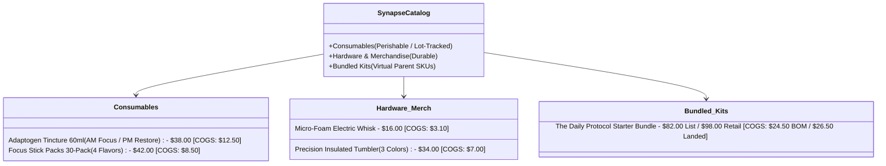
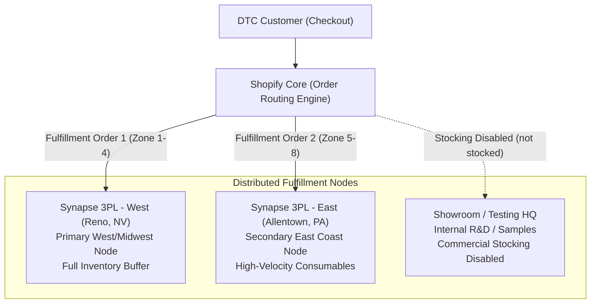

# Synapse Botanicals — Operations & Technical Architecture Blueprint

> [!NOTE] **Architectural Sandbox & Benchmark Context:**  
> Synapse Botanicals is an engineered reference architecture and technical operations sandbox built to model, stress-test, and benchmark distributed direct-to-consumer (DTC) systems. All customer profiles, order cohorts (e.g., the 500-order routing cohort, 300-order promo cohort), and telemetry logs are synthetically generated from real Shopify Plus JSON schemas, ShipBob WMS rate cards, and UPS Zone 1–8 ground freight matrices. This controlled environment enables verifiable failure-mode testing without exposing customer PII or proprietary merchant data.

---

## 1. Brand & Business Overview

**Synapse Botanicals** (`synapse-botanicals.myshopify.com`) is a high-growth, direct-to-consumer (DTC) functional wellness and cognitive longevity brand. The company formulates clean, nootropic-infused adaptogen tinctures, daily focus drink powders, and premium lifestyle accessories designed for daily sustained performance.

* **Business Model:** DTC E-Commerce with high subscription velocity + seasonal promotional flash sales.
* **Average Order Value (AOV):** \$85 – \$120
* **Target Delivery SLA:** 2-day ground shipping to 90% of the contiguous United States.
* **Order Velocity:** High daily order volume with significant promotional spikes (e.g., Black Friday, product drops, influencer campaigns).

---

## 2. Product Catalog Architecture

The catalog balances consumable, expiration-sensitive ingestibles with non-perishable branded merchandise across distinct inventory tracking profiles:

| Product Line | Format & SKU Handle | Variants | Unit Price | Unit COGS | Gross Margin |
| :--- | :--- | :--- | :---: | :---: | :---: |
| **Adaptogen Tincture (60ml)** | `synapse-adaptogen-tincture-60ml` | AM Focus (Lion's Mane) PM Restore (Reishi & Ashwagandha) | \$38.00 | \$12.50 | 67.1% |
| **Focus Stick Packs (30-Pack)** | `synapse-focus-stick-packs-30-pack` | Matcha Yuzu, Blood Orange, Wild Blueberry, Crisp Green Apple | \$42.00 *(Comp \$48)* | \$8.50 | 79.8% |
| **Daily Protocol Starter Bundle** | `the-daily-protocol-starter-bundle` | AM/PM Routine Kit (`SYN-BNDL-MAO` / `BAB`) | \$82.00 *(List)* / \$98.00 *(GMV)* | \$24.50 *(BOM)* / \$26.50 *(Landed)* | 70.1% – 73.0% |
| **Precision Insulated Tumbler** | `precision-insulated-tumbler-durable-merchandise` | Matte Obsidian, Bone White, Sage Green | \$34.00 | \$7.00 | 79.4% |
| **Micro-Foam Electric Whisk** | `micro-foam-electric-whisk` | Single Variant (`SYN-ACC-WHSK`) | \$16.00 | \$3.10 | 80.6% |

---

## 3. Logistical Topology & Fulfillment Network

To support rapid, cost-effective domestic fulfillment, Synapse operates a **bi-coastal distributed 3PL warehousing model** synchronized via automated API webhooks:

1. **Synapse 3PL - West (Reno, NV) — Primary Node:**
   * Houses the complete catalog including all consumable batches, hardware, and packaging stock.
   * Fulfills all Pacific, Mountain, and West-Central shipments within 1–2 transit days.
2. **Synapse 3PL - East (Allentown, PA) — Secondary Node:**
   * Houses high-velocity consumables (Stick Packs and Tinctures) to minimize cross-country shipping zone surcharges.
   * Fulfills Mid-Atlantic, Northeast, and Southeast customer orders.
3. **Showroom / Testing HQ — R&D Node:**
   * Used strictly for product testing, VIP sample gifting, and marketing photoshoots.
   * Commercial customer stocking is disabled (`not stocked` status in inventory records) to prevent order leakage.

---

## 4. The Technical Stack & Integration Layer

The brand relies on an interconnected operational stack where data integrity, speed, and automation guardrails are paramount:

* **E-Commerce Platform & Core ERP:** **Shopify Plus** (Custom Online Store 2.0 Theme, Fulfillment Orders API, GraphQL admin mutations).
* **Fulfillment & WMS Middleware:** **ShipBob 3PL WMS** (Distributed multi-node warehousing across Reno and Allentown synchronized via asynchronous REST webhooks).
* **Frontline Customer Support & Automation:** **Gorgias Helpdesk** (HTTP integration webhooks, automated order holds, macro-driven tag sanitation, and customer address mutation safeguards).
* **Order & Inventory Routing:** Native Shopify Order Routing engine with strict deterministic rules: *Minimize split fulfillments* $\rightarrow$ *Closest location priority*.
* **Workflow Automation & Idempotency:** **Shopify Flow** (Fraud risk quarantine holds, VIP high-order value routing, automated tag hygiene, and zero-loop idempotency locks).
* **Data Engineering & Catalog Migrations:** **Matrixify (Excelify)** + Native CSV ingestion pipelines paired with custom pre-flight Python regex linters.
* **Incident Alerting & Telemetry:** **Slack Webhooks** (Real-time Sev-1 order routing alerts and inventory depletion thresholds).
* **Diagnostic & Observability Tooling:** **Chrome DevTools** (Storefront API / Cart AJAX payload triage), Order Timeline transaction forensics, and gateway authorization logs.

---

## 5. Core Operational Challenges (The TechOps Mandate)

Because Synapse Botanicals operates at the intersection of perishable health supplements, multi-location logistics, and high-velocity promotional marketing, the Technical Operations role enforces six primary operational disciplines across the architecture:

1. **Catalog & Barcode Data Pipeline Integrity (Domain 1):** Enforcing strict schema governance and plain-text data typing to prevent catastrophic catalog corruptions (e.g., Excel coercing UPC barcodes into floating scientific notation or wiping custom metafields).
2. **Multi-Node Routing & Freight Surcharge Mitigation (Domain 2):** Preventing multi-node stockouts and misallocated shipments that force double pick-and-pack carrier surcharges across bi-coastal nodes.
3. **Business Logic Automation, Webhook Idempotency & Circuit Breaking (Domain 3):** Building robust event-driven workflows in Shopify Flow equipped with state-check idempotency guards, HTTP retry policies, and dead-letter queues.
4. **Margin Defense & Discount Collision Elimination (Domain 4):** Auditing multi-tier discount combinations (Product, Order, and Shipping) to eliminate stacking loops that cause negative-margin sales.
5. **Rapid Client-Side Cart & Network Payload Diagnostics (Domain 5):** Isolating storefront checkout friction, API status code errors (`422 Unprocessable Entity`), and payment gateway declines with <60s MTTI.
6. **Frontline Helpdesk Macro Automation & Escalation (Domain 6):** Standardizing Gorgias macro payloads, automated order exception holds, and SLA-governed frontline response paths.
7. **Asynchronous Order Mutations & Point-of-No-Return Locks (Capstone):** Coordinating distributed order edits across Shopify Admin and downstream 3PL WMS to eliminate phantom inventory drift and misdirected deliveries.
