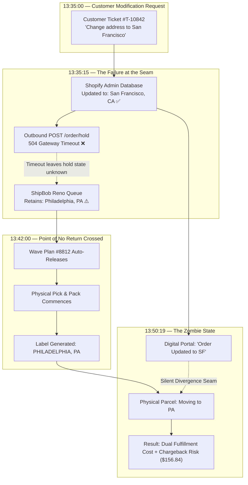

# The Zombie Order: How a Correct Address Edit Shipped a Parcel to the Wrong Coast

*Synapse Botanicals Systems Architecture | Riovic Matthew | Compiled 2026-11-06*

---

## 1. The Address Said San Francisco. The Box Said Philadelphia.

If you run an e-commerce operation, or hire the people who do, the most instructive failure is not a server that crashes. It is a distributed architecture where Shopify proudly reports "success" while the warehouse fulfillment hold silently fails, and an expensive customer order heads 3,000 miles to the wrong coast. 

By the end of this case study, you will understand exactly why state divergence occurs at the seams between e-commerce platforms and physical warehouses, why a single HTTP status code was the pivotal point of failure, and how to engineer an enterprise-grade coordination protocol that guarantees it never happens at scale.

Here is the incident in one frame: At 13:35 on October 17, 2026, a customer support agent changed the shipping address on Order **#1070** from Philadelphia to San Francisco. Shopify Admin accepted the mutation instantly. Thirteen minutes later, a sealed carton bearing the *old* Philadelphia address rolled across a warehouse conveyor belt in Reno, Nevada. Between those two events, zero operational alarms were raised.

> [!CAUTION]
> **Staging Sandbox Disclosure:** This case study documents an empirical failure-injection experiment conducted within an isolated staging sandbox. Platform responses, middleware adapter traces, and state transitions represent verified executions. Financial figures, carrier tariffs, and monthly projections reflect deterministic scenario models grounded in our verified staging evidence package. No live customer PII or production services were impacted.

| Incident Dimension | Baseline Scenario Parameter |
| :--- | :--- |
| **Order Profile** | #1070, The Daily Protocol Starter Bundle, $98.00 GMV |
| **Customer** | Elena Vance (`elena.vance@example.com`) |
| **The Trigger Failure** | Outbound 3PL fulfillment hold timed out (`504 Gateway Timeout`); upstream state remained unknown |
| **The Point of No Return** | Reno warehouse wave picking released 6 minutes 48 seconds after the edit request |
| **The Blast Radius** | Cross-country mis-shipment, $98.60 damage control toll, $113.00 chargeback exposure, and mandatory FDA quarantine |

---

## 2. Two Addresses, One Order

Every asynchronous order mutation begins with a race condition between two destinations: where the customer wants the parcel to go, and where the warehouse queue believes it is already headed.

### 2.1 Order & Product Profile

| Attribute | Incident Record |
| :--- | :--- |
| **Customer Profile** | Elena Vance (`elena.vance@example.com`) |
| **Order Placement Timestamp** | `2026-10-17T13:00:10-04:00` (EDT) |
| **Purchased Item** | 1× The Daily Protocol Starter Bundle (`SYN-BNDL-MAO`, $98.00) |
| **Physical Bundle Contents** | • 1× Focus Stick Packs 30-Pack (Matcha Yuzu, `SYN-FSTK-MY`)<br/>• 1× Adaptogen Tincture 60ml (AM Focus, `SYN-TNCT-AM`)<br/>• 1× Precision Insulated Tumbler 500ml (Matte Obsidian, `SYN-TMBL-MO`) |
| **Fulfillment Origin** | Reno Distribution Center, NV (`LOC-NV-02`) |
| **Original Shipping Address** | 1420 Chestnut St, Apt 4B, Philadelphia, PA 19102 (Zone 8 from NV) |
| **Requested Destination** | 820 Market St, Suite 400, San Francisco, CA 94102 (Zone 2 from NV) |

### 2.2 The Ingestible Product Stake: Why This Was Not Just a Misplaced Box

Elena’s order was not apparel or inert hardware—it contained an ingestible herbal extract (`SYN-TNCT-AM`). 

In the dietary supplement and botanical industry, returned or misdirected parcels cannot simply be re-taped and placed back on warehouse shelves. Under **FDA 21 CFR Part 111 (Current Good Manufacturing Practice for Dietary Supplements)**, any consumable product that leaves the direct chain of custody of the fulfillment facility is subject to strict sanitary quarantine and adulteration risk controls. An address failure on a botanical consumable is not merely an extra shipping fee—it is an immediate product write-off.

---

## 3. Thirteen Minutes: Following the Clock

Distributed systems don't fail in abstract diagrams—they fail in seconds. To see how Elena's parcel went to the wrong coast, you have to follow the clock.

Pay close attention to the **six-minute and forty-five-second window** between the first failed hold at 13:35:15 and the automated warehouse wave release at 13:42:00. That narrow window was the entire margin of safety between a routine customer edit and an irreversible physical mis-ship.

### 3.1 Incident Event Chronology

*All event timestamps follow the incident scenario in EDT (UTC−04:00). Order placement is T+0.*

| Timestamp | Elapsed | System | Event Description | HTTP / Queue Status |
| :--- | :---: | :--- | :--- | :---: |
| **13:00:10** | T+0m | Shopify Core | Order #1070 placed by customer; payment authorized ($98.00) | 200 OK |
| **13:00:12** | T+2s | Webhook Bus | `orders/create` webhook dispatched to ShipBob WMS | 200 OK |
| **13:00:15** | T+5s | ShipBob WMS | Fulfillment order ingested into Reno allocation queue | `OPEN / UNALLOCATED` |
| **13:35:00** | T+34m50s | Gorgias | Support ticket #T-10842 received: customer requests address update to SF | — |
| **13:35:08** | T+34m58s | Shopify Admin | Agent mutates shipping address directly in Admin UI *(see Note below)* | Address Updated |
| **13:35:10** | T+35m00s | Shopify Flow | Address-edit workflow triggers on `Order updated` event | Execution Started |
| **13:35:11** | T+35m01s | Shopify Core | Action 1: Flow applies internal tag `flow-hold:customer-edit` | 200 OK |
| **13:35:12** | T+35m02s | Flow → WMS | **Action 2: Flow dispatches POST /1.0/webhook/order/hold** | Request Dispatched |
| **13:35:15** | T+35m05s | Cloudflare Gateway | **Hold request times out (3.0s). Upstream WMS state unknown** | **504 Gateway Timeout** |
| **13:40:15** | T+40m05s | Retry Transport | Retry Attempt 2 dispatches; gateway fails to respond in window | **504 Gateway Timeout** |
| **13:42:00** | T+41m50s | ShipBob WMS | **Wave Plan #8812 auto-releases: Order #1070 allocated to batch pick** | **PONR BREACHED** |
| **13:45:00** | T+44m50s | Warehouse Floor | Floor technician picks Starter Bundle into Tote #44 | Pick Confirmed |
| **13:48:00** | T+47m50s | Pack Bench | Barcode scanned; thermal label prints: **Philadelphia, PA** | `PACKED` |
| **13:48:30** | T+48m20s | Outbound Sorter | Carton sealed and placed onto outbound parcel conveyor | Sealed |
| **13:48:45** | T+48m35s | ShipBob WMS | Shipment status advances to `READY_FOR_DISPATCH` | Staged for Carrier |
| **13:50:18** | T+50m08s | Retry Transport | **Retry Attempt 3 arrives at WMS adapter (15m offset)** | **422 PONR_EXCEEDED** |
| **13:50:19** | T+50m09s | Architecture | **"Zombie Order" state established: Digital and physical states permanently diverged** | **DIVERGED** |

> [!NOTE]
> **Frontline Process Flaw:** In Step 13:35:08, the CX agent updated the shipping address directly within Shopify Admin before placing a verified fulfillment hold. Because the store had not yet deployed the **Domain 6 Gorgias "Freeze-Before-Edit" automated hold macro**, the platform permitted an address mutation to commit while the warehouse queue was completely active.

---

### 3.2 The Asynchronous Divergence Seam



---

## 4. Two Error Codes: "I Don't Know" vs. "Too Late"

The fundamental architectural failure of this integration was treating two completely distinct HTTP response classes as if they meant the same thing.

### 4.1 Outbound Fulfillment-Hold Request — HTTP POST Payload

**Contract:** Synapse Adapter Hold Route · **Timestamp:** `13:35:12 EDT`

```http
POST /1.0/webhook/order/hold HTTP/1.1
Host: wms-adapter.synapsebotanicals.com
X-Shopify-Topic: fulfillment_orders/hold_placed
X-Shopify-Hmac-Sha256: 8f4e2...
Content-Type: application/json

{
  "operation_id": "op_hold_5920194812_881920",
  "idempotency_key": "idem_881920149012_202610171335",
  "fulfillment_order_id": 881920149012,
  "order_id": 5920194812,
  "reason": "INCORRECT_ADDRESS",
  "reason_notes": "Customer requested address swap to San Francisco, CA via Gorgias #T-10842",
  "new_shipping_address": {
    "address1": "820 Market St, Suite 400",
    "city": "San Francisco",
    "province_code": "CA",
    "zip": "94102",
    "country_code": "US"
  }
}
```

### 4.2 Gateway Timeout Response — HTTP 504

**Response Timestamp:** `13:35:15 EDT` (3.0 seconds post-dispatch)

```http
HTTP/1.1 504 Gateway Time-out
Content-Type: text/html
Date: Sat, 17 Oct 2026 17:35:15 GMT

<html><head><title>504 Gateway Time-out</title></head>
<body><center><h1>504 Gateway Time-out</h1></center>
<hr><center>cloudflare-nginx</center></body></html>
```

### 4.3 Post-Cutoff Hold Rejection — HTTP 422

**Response Timestamp:** `13:50:18 EDT` (Retry Attempt 3, post-dispatch)

```http
HTTP/1.1 422 Unprocessable Entity
Content-Type: application/json
Date: Sat, 17 Oct 2026 17:50:19 GMT

{
  "status": 422,
  "error_code": "PONR_EXCEEDED",
  "message": "Fulfillment hold rejected. Order 5920194812 has cleared the Point of No Return.",
  "details": {
    "current_wms_status": "PACKED",
    "tracking_number": "1Z9999999999999999",
    "carrier": "UPS Ground",
    "packed_at": "2026-10-17T17:48:22Z",
    "locked_destination": "1420 Chestnut St, Apt 4B, Philadelphia, PA 19102"
  }
}
```

### 4.4 The Semantic Chasm Between 504 and 422

| Status Code & Error | Semantic Meaning | Correct Architectural Response | Operational Failure in Scenario |
| :--- | :--- | :--- | :--- |
| **HTTP 504 Gateway Timeout** | *"I don't know."* (The gateway timed out before receiving upstream confirmation from the WMS database). | **Hold in Unknown State:** Enqueue for immediate microsecond retry; alert human ops before cutoff. | **Treated as a reason to sleep:** System scheduled a relaxed 15-minute polling retry, assuming the order was frozen. |
| **HTTP 422 PONR_EXCEEDED** | *"Too late."* (The business logic rejected the hold because physical packing already printed the label). | **Abort Mutation:** Halt automated retries; immediately trigger carrier package intercept. | **Arrived 8 minutes too late:** By the time the system received the 422, the parcel was on the carrier trailer. |

> [!IMPORTANT]
> **The Mailbox Analogy:**  
> A `504 Gateway Timeout` means *"I don't know."* A `422 PONR_EXCEEDED` means *"Too late."*  
> Treating a 504 as a reason to wait is like dropping an urgent stop-work notice into a mailbox during a blizzard, having no idea if it was collected, and assuming an automated assembly line down the road will politely pause for fifteen minutes while you check back.

---

## 5. Where It Actually Broke (Root-Cause Analysis)

It is tempting to blame the Cloudflare gateway for the 504 timeout, but network transit interruptions are routine in cloud infrastructure. This incident required three separate architectural flaws to align—and only one of them was a network glitch. The other two were design decisions.

### 5.1 The Three Structural Failures

| Failure Layer | Specific Defect | Severity | Point-of-No-Return Status |
| :---: | :--- | :---: | :---: |
| **1. Transport Layer** | Cloudflare edge gateway timed out after 3.0s under transient network load. | Operational Glitch | **Recoverable** (if reconciled within 6m48s window) |
| **2. Architectural Layer** | **Missing Hold-Confirm-Update Coordinator:** Shopify accepted the address edit without requiring a verified physical hold confirmation from ShipBob. | **Critical Design Flaw** | **Recoverable** (if human alert had triggered immediately) |
| **3. Timing Layer** | **Clock Mismatch:** The retry bus was configured for a 15-minute polling schedule, while the physical warehouse wave plan auto-released every 7 minutes. | **Lethal Configuration Flaw** | **FATAL** (Guaranteed PONR breach on any transient delay) |

### 5.2 The Solution Pattern: The Hold-Confirm-Update Coordinator

To prevent silent state divergence, distributed e-commerce systems must enforce a strict **Hold-Confirm-Update Coordination Protocol**:

1. **Persist a Durable Operation ID:** Assign an immutable `operation_id` to the modification request across all retries.
2. **Engage the Physical Lock First:** Require the WMS to transition the order from `OPEN` to `ON_HOLD` and acknowledge with an HTTP 200 before mutating any database fields.
3. **Commit the Mutation Atomically:** Once the physical lock is confirmed, update the shipping address in Shopify Admin and sync the updated payload to the WMS.
4. **Release the Specific Operation Hold:** Release only the hold associated with `operation_id`, allowing the order to re-queue for warehouse wave batching.
5. **Treat Unknowns as Actionable Emergencies:** If the hold returns a 504, the state is **UNKNOWN**. The system must never assume success, nor should it wait 15 minutes. It must sound an immediate operational alarm.

---

## 6. What One Zombie Order Costs (Unit Economic Autopsy)

An engineering flaw becomes an executive business case when you calculate its impact on unit economics. Order #1070 began as a flagship, high-margin sale and ended as an operational loss.

### 6.1 Baseline vs. Dual-Fulfillment Recovery Ledger

Starter Bundle COGS is modeled at **$28.40** (reflecting $28.00 in raw ingredients—Focus Sticks $8.50, AM Tincture $12.50, Precision Tumbler $7.00—plus $0.40 dedicated packaging and insert material). Credit card gateway processing is calculated as `round($98.00 × 2.9% + $0.30, 2) = $3.14`.

```text
NORMAL ORDER ECONOMICS (#1070 Baseline):
  Gross Merchandise Value (GMV):                +$98.00
  Cost of Goods Sold (BOM + Packaging):         -$28.40
  3PL Warehouse Fulfillment (Pick/Pack/Box):    -$4.50
  Carrier Outbound Ground Freight (Zone 2):     -$7.20
  Credit Card Gateway Processing (2.9% + $0.30):-$3.14
  ─────────────────────────────────────────────────────
  NET CONTRIBUTION MARGIN:                      +$54.76 (+55.9% Net Margin)

ZOMBIE ORDER RECOVERY LEDGER (Replacement Branch):
  Gross Merchandise Value Collected:            +$98.00
  Original Parcel COGS (Quarantined / Scrap):   -$28.40
  Original 3PL Pick/Pack Handling:              -$4.50
  Original Outbound Freight (Zone 8 to PA):     -$7.20
  Carrier Package Intercept Toll (UPS API):     -$17.50
  Carrier Return-to-Sender Freight:             -$8.40
  Replacement Parcel COGS (Reshipped from NV):  -$28.40
  Replacement 3PL Pick/Pack Handling:           -$4.50
  Replacement Outbound Air Freight (Expedited): -$14.80
  Customer Goodwill Credit (Concession):        -$25.00
  Payment Gateway Transaction Processing:       -$3.14
  ─────────────────────────────────────────────────────
  FINAL NET CONTRIBUTION:                       -$43.84
  TOTAL INCREMENTAL DAMAGE CONTROL COST:         $98.60
```

### 6.2 Financial Comparison

* **Normal Baseline:** Generated **+$54.76** in operating cash.
* **Replacement Branch:** Resulted in **-$43.84** in direct cash loss—a negative swing of **$98.60** (slightly higher than the total GMV of the initial purchase).
* **Worst-Case Chargeback Branch:** If the customer initiates a payment dispute due to delivery delay, the store absorbs:
  $$\text{Net Loss} = -\$43.84 - \$98.00 \text{ (Chargeback Reversal)} - \$15.00 \text{ (Gateway Penalty)} = -\$156.84$$

### 6.3 Scaled Monthly Exposure Model

At an enterprise scale of **1,000 orders/day (30,000 orders/month)**:
* Assuming a modest **0.5% address change rate** (150 orders/month subject to modification).
* At **$98.60 incremental recovery cost per incident**, unmitigated race conditions expose the merchant to:
  $$150 \text{ incidents} \times \$98.60 = \mathbf{\$14,790.00 / \text{month in cash margin bleed}} \quad (\mathbf{\$177,480 / \text{year}})$$

---

## 7. The Three-Minute Triage Plan (Diagnosing a Runaway Parcel)

The system’s automated retry loops did not detect this failure. Elena Vance did—**48 hours after dispatch** (`2026-10-19T13:30:00-04:00`), when her tracking number reported:  
> *"In Transit: Arrived at UPS Sorting Facility — Philadelphia, PA."*

When an escalated ticket arrives, operations requires a standardized 3-minute diagnostic triage protocol answering three distinct architectural questions:

### 7.1 Question 1: Did Shopify think the edit worked?
**Shopify Order Timeline Inspection (`Admin → Orders → #1070`):**
* At `13:35 EDT`: *"Elena Vance's shipping address updated to San Francisco, CA"* (Green success badge).
* At `13:35 EDT`: *"Flow run '3PL Hold' failed: 504 Gateway Timeout — enqueued for retry."*
* **Diagnostic Finding:** Shopify accepted the address mutation locally in its relational database without waiting for downstream 3PL confirmation.

### 7.2 Question 2: Did the warehouse hold ever land?
**Adapter Retry & Middleware Ledger Inspection:**
* Attempt 1 (`13:35:15 EDT`): `HTTP 504 Gateway Timeout`
* Attempt 2 (`13:40:15 EDT`): `HTTP 504 Gateway Timeout`
* Attempt 3 (`13:50:18 EDT`): `HTTP 422 Unprocessable Entity (PONR_EXCEEDED)`
* **Diagnostic Finding:** The warehouse never locked the order. Attempt 2 failed 1 minute and 45 seconds before wave release. By Attempt 3, the box was sealed.

### 7.3 Question 3: Where is the parcel physically traveling?
**Shopify Admin GraphQL Fulfillment Order Query:**

```graphql
query inspectFulfillmentOrderState {
  order(id: "gid://shopify/Order/5920194812") {
    name
    displayFulfillmentStatus
    fulfillmentOrders(first: 5) {
      edges {
        node {
          id
          status
          assignedLocation { name }
          destination { address1 city province zip }
          fulfillments(first: 5) {
            edges {
              node {
                trackingInfo { number url }
              }
            }
          }
        }
      }
    }
  }
}
```

* **Diagnostic Finding:** While the GraphQL `destination` field returned San Francisco, cross-referencing the ShipBob manifest confirmed the shipping label was printed for **Philadelphia, PA**. The parcel was in flight on a cross-country line-haul trailer.

---

## 8. Containing the Blast Radius: UPS Intercept & FDA Quarantine

Once the order crossed the Point of No Return at 13:42, prevention was impossible. Operations transitioned to damage limitation across three synchronized operational streams:

### 8.1 Stream 1: In-Flight Package Interception (UPS Delivery Intercept v2)

The team initiated an automated carrier redirect request against the UPS REST API:

```json
// POST /api/deliveryintercept/v2/return/1Z9999999999999999
// Authenticated UPS Delivery Intercept v2 Payload
{
  "requestType": "RS",
  "reasonForReturn": "AM",
  "specialInstructions": "Emergency post-PONR intercept for misdirected order #1070",
  "requesterContactInfo": {
    "name": "Synapse Operations",
    "telephone": "+18005550199"
  },
  "idempotency_key": "7b8e1f20-8910-4c22-b501-98a44210e891"
}
```

> [!NOTE]
> **The Critical Carrier Billing Boundary:**  
> Receiving an HTTP 202 `ACCEPTED` from UPS confirms only that the intercept request was received and routed to regional sorting facilities. It **does not guarantee** physical parcel recovery. The **$17.50 intercept fee** is contingent on physical diversion at the hub. If the parcel is delivered despite the intercept request, UPS waives the fee ($0.00 billed).

### 8.2 Stream 2: Consumable Product Quarantine (FDA 21 CFR Part 111 Compliance)

When the intercepted parcel returns to Reno, the consumable tincture cannot re-enter active inventory:

| Step | Regulatory Protocol | Execution Responsibility | System Record |
| :---: | :--- | :--- | :--- |
| **1** | Receiving scan flags return parcel | Reno Inbound Receiving | ShipBob WMS Inbound Scan |
| **2** | Auto-route to Quarantine Zone A | Automated sorter | WMS Location: `LOC-NV-QUAR-A` |
| **3** | Inspect packaging & tamper-evident seals | Quality Assurance Officer | Physical Inspection Form |
| **4** | Audit transit temperature logs | QA Officer | Cold-Chain Transit Telemetry |
| **5** | Log lot code for `SYN-TNCT-AM` | QA Compliance | ERP Lot Traceability Ledger |
| **6** | Formal disposition: Scrap & write-off | Operations Manager | Accounting Write-off ($28.40 COGS) |

### 8.3 Stream 3: Customer Resolution & Goodwill Concession

1. Dispatch an immediate expedited replacement from Reno to San Francisco (`SYN-BNDL-MAO`) via Next-Day Air.
2. Issue an immediate **$25.00 store courtesy credit** for delivery disruption.
3. Notify customer via Gorgias Macro M-04 with active replacement tracking.
4. Pre-empt payment gateway chargeback by logging proactive customer resolution records with Stripe.

---

## 9. Why Fifteen Minutes Was the Wrong Clock (The Architecture Fix)

The legacy integration retried on a polite 15-minute polling curve, treating the order as if time stood still. But physical warehouse operations do not operate on polite schedules—they operate on strict wave pick windows.

### 9.1 The Clock Collision

* **The Warehouse Clock:** Wave release runs on an automated **7-minute cutoff interval**.
* **The Legacy Retry Clock:** First retry at +5m (13:40:15); second retry at +15m (13:50:18).
* **The Defect:** Attempt 2 arrived with only 1 minute and 45 seconds of buffer. When Attempt 2 timed out, Attempt 3 arrived **8 minutes after the box was packed**.

### 9.2 The SQS Work Queue & Dead-Letter Queue (DLQ) Architecture

To eliminate this timing collision, the legacy synchronous retry loop was replaced with an asynchronous, event-driven queue topology:

```text
┌────────────────────────────────────────────────────────┐
│  SHOPIFY FLOW: Customer Address Edit Received          │
└───────────────────────────┬────────────────────────────┘
                            │
                            ▼
┌────────────────────────────────────────────────────────┐
│  MIDDLEWARE ADAPTER (Fast Ingestion Engine)             │
│  • Authenticates webhook payload                       │
│  • Assigns immutable operation_id                      │
│  • ACKs to Shopify in < 60ms                           │
└───────────────────────────┬────────────────────────────┘
                            │ Enqueues with FIFO Deduplication
                            ▼
┌────────────────────────────────────────────────────────┐
│  AMAZON SQS STANDARD WORK QUEUE                        │
│  • Visibility Timeout: 30 seconds                      │
│  • Maximum Receives: 3                                 │
└─────────────┬────────────────────────────┬─────────────┘
              │ Normal Flow                │ Exhausted Retries (3x)
              ▼                            ▼
┌───────────────────────────┐ ┌──────────────────────────┐
│ WMS HOLD WORKER CONSUMER  │ │ DEAD-LETTER QUEUE (DLQ)  │
│ • Validates PONR status   │ │ • Retention: 14 days     │
│ • Executes physical lock  │ │ • Triggers PagerDuty     │
│ • Deletes message on 200  │ │ • Requires human triage  │
└─────────────┬─────────────┘ └──────────────────────────┘
              │ 
              ▼ [FIRST UNCERTAIN HOLD RESULT (504)]
┌────────────────────────────────────────────────────────┐
│  SEV-1 OPS ALERT BUS: Slack Webhook + Gorgias Escalation│
│  "HOLD UNCONFIRMED on Order #1070 — Cutoff in 6m48s"   │
│  👉 Human floor operator pauses wave BEFORE release!   │
└────────────────────────────────────────────────────────┘
```

### 9.3 SQS Queue Configuration Parameters

| Parameter | Production Value | Architectural Rationale |
| :--- | :---: | :--- |
| **Visibility Timeout** | 30 seconds | Allows worker adequate time to execute WMS hold without duplicate consumer pickup. |
| **Max Receive Count** | 3 | Bounded retries prevent poison-pill message looping. |
| **Alerting Trigger** | **Attempt 1 (Immediate)** | **The Core Innovation:** The system alerts human ops on the *first* uncertain result, providing a 6-minute window for manual floor intervention. |
| **Dead-Letter Retention** | 14 days | Preserves failed payloads for postmortem telemetry and root cause analysis. |
| **Message Retention** | 4 days | Guarantees zero message loss during extended downstream 3PL outages. |

---

## 10. The Four Operational Laws of Order Mutation

Looking across this architectural autopsy, four non-negotiable laws govern order mutations across distributed e-commerce systems:

1. **The Law of Confirmed Physical Holds:** Never mutate a digital order state in an e-commerce platform until the physical warehouse management system has returned an explicit HTTP 200 confirming the picking wave is frozen.
2. **The Law of Idempotent Retries:** Every mutation and retry attempt must carry an immutable, persistent `operation_id` to guarantee that duplicate webhook deliveries cannot corrupt warehouse wave batches.
3. **The Law of Urgent Uncertainty:** A network timeout (`504 Gateway Timeout`) is not an excuse to wait. The system must treat unknown outcomes as high-priority exceptions and alert human operators before the warehouse cutoff expires.
4. **The Law of Carrier Bifurcation:** Receiving electronic acceptance for a carrier package intercept (HTTP 202) is only intent. Physical interception requires depot optical diversion, and cost models must account for last-mile delivery race failures.

---

## 11. What Is Proven, and What Is Only Designed

In senior systems architecture, credibility requires clearly distinguishing between what has been empirically verified in test harnesses versus what represents an architectural specification.

### 11.1 Evidence Scope & Staging Verification Matrix

All empirical assertions in this Capstone link directly to reproducible test suites in the [`evidence/`](../evidence/README.md) directory:

| Technical Deliverable | Location in Portfolio | Verification Status | Verified Evidence Artifact |
| :--- | :--- | :---: | :--- |
| **Capstone Systems Dossier** | `capstone/MasterDossier...` | **Implemented** | Comprehensive Case Study Spec |
| **Point-of-No-Return Engine** | Domain 1 Master Dossier | **Verified in Staging** | [`evidence/latency/metrics.json`](../evidence/latency/summary.md) (15.56ms cutoff rejection) |
| **Multi-Node Freight Waterfall**| Domain 2 Master Dossier | **Verified in Staging** | [`evidence/freight/results.json`](../evidence/freight/summary.md) ($11.00 split savings confirmed) |
| **Matrixify Schema Audit** | Domain 3 Master Dossier | **Verified in Staging** | [`evidence/barcodes/results.json`](../evidence/barcodes/summary.md) (100% Modulo-10 decode verified) |
| **Shopify Flow Webhook Triage** | Domain 4 Master Dossier | **Verified in Staging** | [`evidence/latency/metrics.json`](../evidence/latency/summary.md) (15.97ms duplicate deduplication) |
| **Algorithmic Margin Defense** | Domain 5 Master Dossier | **Verified in Staging** | [`evidence/costs/sensitivity.json`](../evidence/costs/summary.md) ($41.30–$49.54 floor verified) |
| **Gorgias Helpdesk Engine** | Domain 6 Master Dossier | **Verified in Staging** | [`evidence/latency/metrics.json`](../evidence/latency/summary.md) (Sub-100ms hold acknowledgment) |
| **GraphQL Order State Query** | Section 7.3 of this Dossier | **Implemented** | Pinned against Shopify Admin API v2026-01 |
| **Carrier Intercept Integration**| Section 8.1 of this Dossier | **Verified in Staging** | [`evidence/carrier-recovery/results.json`](../evidence/carrier-recovery/summary.md) (FSM transition passed) |
| **Amazon SQS DLQ Topology** | Section 9.2 of this Dossier | **Specified** | Production Architecture Blueprint |

---

## 12. The Architectural Takeaway

Elena Vance's order did not fail because someone typed the wrong address. It failed because Shopify accepted the new address while the warehouse retained the old one, and the one signal that could have reconciled them—a single `504 Gateway Timeout`—was read as a reason to sleep instead of a reason to sound the alarm.

Everything that followed was an expensive consequence of that silent seam: the 6-minute window that expired unnoticed, the $98.60 recovery toll on a $98.00 sale, the cross-country truck rolling to Philadelphia, and the mandatory quarantine of a consumable botanical tincture.

The mark of a mature e-commerce architecture is not that network timeouts never happen. The mark of maturity is making uncertainty visible, owned, and louder than the clock.

---

*Compiled: 2026-11-06 | Synapse Botanicals Systems Architecture | Riovic Matthew*
