# Asynchronous Order Mutation — Zombie Order #1070

> **Empirical staging simulation.** Synapse Botanicals is a technical operations sandbox used to stress-test e-commerce failure modes with synthetic customer and order fixtures. Commercial charges and financial outcomes are scenario inputs and calculations. The verification section distinguishes supplied trace excerpts, reproducible model results, and acceptance criteria for the designed controls. No production customer data or live fulfillment is represented.

## 1. Executive Context & Failure Mode

An address edit succeeds in Shopify while the warehouse shipment retains the original destination. Order #1070 combines asynchronous delivery, physical cutoff, customer support and recovery economics in one controlled failure scenario.

| Dimension | Scenario |
|---|---|
| Customer / ticket | Elena Vance; T-10842 |
| Display order / API ID | #1070 / 5920194812 |
| Created | 2026-10-17T13:00:10-04:00 |
| Sale | Daily Protocol Starter Bundle, $98.00; zero tax and customer shipping |
| Node | Reno, LOC-NV-02 |
| Original destination | Philadelphia, PA |
| Requested destination | San Francisco, CA |
| Standard mutation cutoff | Wave release at 13:42 EDT |
| Failure | Hold request times out; warehouse advances before confirmation |
| Successful-order contribution | +$54.76 |
| Retained-sale replacement contribution | −$43.84 |
| Contribution deterioration | **$98.60 per modeled recovery** |

The staging trace establishes the failure narrative; the carrier/physical recovery and financial branches below are explicitly modeled. It does not represent a production merchant loss or an authenticated carrier interception.

### 1.1 Basket, inventory condition and cost basis

| Component | SKU | Unit COGS |
|---|---|---:|
| Matcha Yuzu sticks, 30-pack | SYN-FSTK-MY | $8.50 |
| AM Focus tincture, 60ml | SYN-TNCT-AM | $12.50 |
| Precision Tumbler, Matte Obsidian | SYN-TMBL-MO | $7.00 |
| Bundle insert/material allocation | Non-stock cost input | $0.40 |
| **Bundle COGS** | **SYN-BNDL-MAO** | **$28.40** |

The $98 bundle compares with $42+$38+$34=$114 separate-item retail. The scenario inventory condition is that Reno can reserve the full basket while Allentown cannot. This is a routing input, not a claim that the tincture is permanently Reno-exclusive. A deployment records component ATS and reservations; no exact historic warehouse quantities are inferred here.

Protected three-pick handling is $2.50 base+$0.80 corrugate+$0.40 outbound protection+$0.80 additional picks=$4.50. The bundle insert allocation is a distinct product-material cost. Freight and intercept amounts are fixed scenario charges, not live carrier tariffs or verified ZIP-zone quotations.

## 2. Governance & Architecture Protocol

### 2.1 Digital and physical boundaries

Shopify Order, FulfillmentOrder and WMS shipment are distinct resources. A custom middleware request is not a native Shopify webhook merely because a topic header appears on it. The supplied case begins with a staff edit in Shopify and a subsequent integration hold attempt; a deployment must identify its actual Flow/app trigger and export, rather than assume an unspecified native `Order updated` trigger.

The safe control places an authorized hold **before** confirming the edit. The coordinator persists one business operation, serializes competing order revisions, and requests a conditional WMS stop before the warehouse cutoff. Shopify acknowledgment and physical hold confirmation are separate gates.

```mermaid
stateDiagram-v2
    [*] --> REQUESTED
    REQUESTED --> HOLD_PENDING: Authorized customer and eligible shipment
    HOLD_PENDING --> HOLD_CONFIRMED: Shopify and WMS confirm
    HOLD_PENDING --> UNKNOWN: Timeout or ambiguous response
    HOLD_PENDING --> REJECTED: Cutoff or business rejection
    UNKNOWN --> HOLD_CONFIRMED: Reconciliation confirms hold
    UNKNOWN --> REJECTED: Reconciliation confirms ineligibility
    HOLD_CONFIRMED --> UPDATE_PENDING: Reserve inventory and validate totals
    UPDATE_PENDING --> RECONCILE: Read back both systems
    RECONCILE --> RELEASED: Matching version; release owned hold
    RECONCILE --> MANUAL_REVIEW: Partial or unknown result
```



### 2.2 Shopify API contract

```graphql
mutation HoldForAddressEdit($id: ID!, $hold: FulfillmentOrderHoldInput!) {
  fulfillmentOrderHold(id: $id, fulfillmentHold: $hold) {
    fulfillmentOrder { id status fulfillmentHolds { id handle heldByRequestingApp } }
    userErrors { field message }
  }
}
```

Variables (replace the fulfillment-order GID with the resolved resource):

```json
{
  "id": "gid://shopify/FulfillmentOrder/881920149012",
  "hold": {
    "reason": "INCORRECT_ADDRESS",
    "reasonNotes": "Authorized address edit; Gorgias T-10842",
    "handle": "address-edit-T-10842"
  }
}
```

Send GraphQL requests to `POST https://{shop}.myshopify.com/admin/api/2026-01/graphql.json` with `Content-Type: application/json` and the server-held `X-Shopify-Access-Token`. Inspect top-level `errors` and mutation `userErrors`, even after HTTP 200. The hold operation requires `write_merchant_managed_fulfillment_orders` or `write_third_party_fulfillment_orders`, plus the applicable `fulfill_and_ship_orders` permission. Resolve access for the actual fulfillment ownership; granted scopes also limit which resources can be read.

Persist the returned hold ID and handle. Release only the intended IDs:

```graphql
mutation ReleaseOwnedHold($id: ID!, $holdIds: [ID!]!) {
  fulfillmentOrderReleaseHold(id: $id, holdIds: $holdIds) {
    fulfillmentOrder { id status fulfillmentHolds { id handle } }
    userErrors { field message }
  }
}
```

Omitting the platform's optional `holdIds` argument releases all holds; this integration always supplies it. A successful Shopify operation is followed by separate WMS confirmation. The legacy REST hold route, where an existing integration uses REST, is `/admin/api/2026-01/fulfillment_orders/{id}/hold.json` with a nested `fulfillment_hold` body; release uses `/release_hold.json`. GraphQL and REST reason casing/payloads are not interchangeable.


Address changes use `orderUpdate`; supported item changes use the order-edit session workflow. Read back Shopify and WMS addresses/allocations at the intended revision before releasing the owned hold. A partial update, lost response or expired worker lease leaves the operation pending for reconciliation or approved compensation. No atomic two-phase transaction spans Shopify, the WMS and carrier.

### 2.3 Synapse adapter request and status contract

This is an illustrative **Synapse middleware contract**, not a published ShipBob route or native webhook payload. The transport uses configured adapter authentication over TLS. The worker resolves the actual provider shipment and operation before issuing a supported provider call.

```http
POST /v1/order-mutations HTTP/1.1
Host: adapter.example.com
Content-Type: application/json
Idempotency-Key: address-edit-T-10842
```

```json
{
  "operation_id": "address-edit-T-10842",
  "order_gid": "gid://shopify/Order/5920194812",
  "fulfillment_order_gid": "gid://shopify/FulfillmentOrder/881920149012",
  "expected_version": "revision-from-current-read",
  "intent": "ADDRESS_EDIT",
  "destination": {
    "address1": "820 Market St",
    "address2": "Suite 400",
    "city": "San Francisco",
    "province_code": "CA",
    "zip": "94102",
    "country_code": "US"
  }
}
```

An accepted response means durable receipt, not completed hold. The operation resource exposes PENDING, CONFIRMED, REJECTED or UNKNOWN with shipment identity, revision and correlation ID. In this adapter contract, a late edit can return HTTP 422 and `PONR_EXCEEDED`; that custom error is not asserted to be ShipBob's native response schema.

### 2.4 Queue, deadlines and recovery ownership

The authenticated ingress adapter writes a durable operation record and enqueues work before acknowledging acceptance. An Amazon SQS **Standard source queue** feeds idempotent workers; a separate DLQ receives exhausted messages. Per-order serialization and version checks are implemented in the coordinator, not inferred from queue delivery order.

| Control | Scenario configuration | Operational meaning |
|---|---|---|
| Visibility | 30 seconds initially | Extend while processing; stop before worker lease expires |
| Long polling | 20 seconds | Receive wait, not a processing delay |
| Source retention | 4 days | Storage horizon; never overrides a mutation deadline |
| DLQ retention | 14 days | Investigation horizon, not permission to replay stale edits |
| Redrive threshold | `maxReceiveCount=3` | Receive-based safeguard, not a Shopify retry policy |
| Worker budget | At most three downstream mutation attempts | Reconcile before retry; no attempt beyond cutoff |

Use full jitter `U(0, min(60, 2**n))` seconds for retry index n=1,2, respecting provider throttling instructions and the business deadline. The worker schedules this policy; SQS does not supply it automatically. Upstream redelivery reuses the durable operation and does not reset the budget. A receive can end in reconciliation without another mutation attempt.

Before each side effect, check operation ownership, order version, current WMS state and deadline. A duplicate returns the stored result; an unknown remote outcome is reconciled; a stale message is rejected. Alert on the first unknown hold outcome. DLQ arrival is a final exception signal, not the first opportunity to stop a warehouse wave. Replay requires a new eligibility review and cannot blindly overwrite a newer address.

## 3. Decision Matrix & Recovery Economics

### 3.1 Response and cutoff decisions

| Evidence | Interpretation | Action |
|---|---|---|
| Shopify update succeeds | Commercial address changed | Verify downstream state before promising completion |
| Hold request 504 | Remote result UNKNOWN | Reconcile operation and WMS state |
| Confirmed conditional WMS hold | Affected work stopped at known revision | Apply authorized update |
| 422 + PONR_EXCEEDED | This adapter rejects the late edit | No unchanged replay; escalate recovery |
| Label exists | Label creation confirmed | Verify destination and warehouse custody |
| Carrier tender confirmed | Carrier possesses shipment | Evaluate eligible intercept/redirect/return |
| Carrier accepts request | Request accepted | Await tracking evidence before reporting success |

Wave release at 13:42:00 is the standard edit deadline. From first dispatch at 13:35:12, only **6m48s** remain. The final retry at 13:50 occurs after cutoff; a fifteen-minute transport retry interval is not the intervention corridor.

### 3.2 Carrier recovery contract

UPS Delivery Intercept v2 supplies separate eligibility and recovery operations. Query `GET /api/deliveryintercept/v2/eligibility/intercept/{tracking_number}` and use an option/reason returned as eligible for the authorized shipment/account. Return-to-sender uses `POST /api/deliveryintercept/v2/return/{tracking_number}`; redirection is a separate operation. Return is not the only possible remedy.

The following is a schema-based UPS CIE canceled-shipment fixture, not a live request for Order #1070. `AM` is the canceled-fixture reason; address-change handling must use its actual eligible reason/option.

```bash
curl --request POST \
  'https://wwwcie.ups.com/api/deliveryintercept/v2/return/1Z4096YY0316914058' \
  --header "Authorization: Bearer $UPS_API_TOKEN" \
  --header 'Content-Type: application/json' \
  --header 'transId: SIIReturn' \
  --header 'platformType: XOLT' \
  --header 'inquiryType: U' \
  --data '{"requestType":"RS","specialInstructions":"Staging return fixture","requesterContactInfo":{"name":"Sandbox Operator","telephone":"+12010000000"},"reasonForReturn":"AM"}'
```

Validate JSON `success` and error details even after HTTP 200. CIE uses stubbed responses for documented fixtures; acceptance does not prove physical interception. Record REQUESTED, ACCEPTED, SUCCEEDED or FAILED from actual evidence. The $17.50 charge below is a scenario input; the request does not establish the applicable invoice.

### 3.3 Returned inventory disposition

Returned dietary supplements are identified and quarantined for documented quality-control disposition. Synapse applies a conservative company policy against returning customer-delivered ingestibles to sellable stock. This disposal policy is separate from the regulatory requirements governing returned supplements in 21 CFR Part 111, Subpart N. Assess durable bundle components separately; inventory write-offs use cost, not retail price. Ordinary carrier tracking does not establish product temperature history. Product classification and the applicable quality procedure must be confirmed before operational deployment.

The modeled conservative branch expenses the entire original bundle's COGS and ships fresh inventory. It assumes no salvage recovery. Actual durable-component recovery would reduce the loss. Customer resolution can instead be a refund; refund, replacement and chargeback branches must not be combined without their cash/revenue effects.

### 3.4 Unit economics

Payment processing is `round_half_up(98×0.029+0.30,2)=$3.14`. The retained sale has no second payment charge. The $25 goodwill amount is modeled as an immediately expensed concession; a future unredeemed account credit requires different accounting.

| Line | Successful order | Retained-sale replacement |
|---|---:|---:|
| Merchandise collected | $98.00 | $98.00 |
| Original COGS | −$28.40 | −$28.40 |
| Original handling | −$4.50 | −$4.50 |
| Original outbound freight | −$7.20 | −$7.20 |
| Original processing | −$3.14 | −$3.14 |
| Intercept | — | −$17.50 |
| Return freight | — | −$8.40 |
| Fresh replacement COGS | — | −$28.40 |
| Replacement handling | — | −$4.50 |
| Expedited replacement freight | — | −$14.80 |
| Goodwill concession | — | −$25.00 |
| **Final contribution** | **+$54.76** | **−$43.84** |

Incremental recovery costs=$17.50+$8.40+$28.40+$4.50+$14.80+$25.00=**$98.60**. The original COGS remains in both columns; it is not expensed twice as another scrap line. The model excludes overhead, support labor, tax, acquisition and other fees.

A separate **lost-chargeback** sensitivity after replacement reverses $98 principal and adds a $15 penalty: `−43.84−98−15=−$156.84`. Do not include a contingent chargeback fee in the settled replacement outcome.

```python
from decimal import Decimal as D, ROUND_HALF_UP
fee = (D('98') * D('0.029') + D('0.30')).quantize(D('0.01'), rounding=ROUND_HALF_UP)
baseline = D('98') - D('28.40') - D('4.50') - D('7.20') - fee
recovery = sum(map(D, ['17.50','8.40','28.40','4.50','14.80','25.00']))
assert baseline == D('54.76')
assert recovery == D('98.60')
assert baseline - recovery == D('-43.84')
assert baseline - recovery - D('98') - D('15') == D('-156.84')
```

At 1,000 orders/day, a thirty-day month and a **0.5% all-order stress assumption**, 30,000×0.005=150 events; 150×$98.60=**$14,790** contribution deterioration before intervention costs. This is separate from an edit-specific model: `address edits × timeout-overlap probability × conditional misdirection probability`. A 4.2% overlap input alone cannot establish monthly misdirection counts.

## 4. Empirical Verification & Run Sheet

### 4.1 Supplied failure chronology

Times use EDT (UTC−04:00) on 2026-10-17. T+ offsets are approximate relative to the exact created timestamp. The supplied chronology has second-resolution events; no millisecond request duration is inferred from them.

| Time | Event | Evidence meaning |
|---|---|---|
| 13:00:10 | Order created | Commercial fixture |
| 13:00:12–15 | Export/import sequence | WMS already has shipment |
| 13:35:00 | Address-change ticket | Customer intent, not authorization alone |
| 13:35:08 | Staff edits Shopify | Local edit precedes physical hold gate |
| 13:35:12 | Hold dispatched | Start of deadline comparison |
| About 13:35:15 | Timeout reported | Upstream result UNKNOWN |
| About 13:40:15 | Legacy retry times out | No confirmed hold in excerpt |
| 13:42:00 | Wave releases | Standard automatic-edit cutoff |
| 13:45:00 | Pick event | Physical progression |
| 13:48:00–45 | Pack/label sequence | Original Philadelphia destination in scenario |
| About 13:50:18 | Late request rejected | PONR_EXCEEDED adapter branch |

The five/fifteen-minute legacy offsets describe the supplied failure sequence, not Shopify's native retry guarantees or the designed worker policy. Operation/WMS history, rather than timeout alone, establishes whether a hold was applied. The customer follow-up is modeled 48 hours after the request; no same-day 14:02 completed recovery is inferred. Carrier transit and remediation need their own dated events if executed.

### 4.2 Diagnostic workflow

The target is ≤180 seconds to correlate the Shopify update, adapter attempts and WMS label snapshot. Inspect Flow/app run history for its action; native webhook history is a different surface. The following schema-compatible query locates references; it does not return the physical label address:

```graphql
query InspectOrder($id: ID!, $after: String) {
  order(id: $id) {
    name
    displayFulfillmentStatus
    fulfillmentOrders(first: 5, after: $after) {
      pageInfo { hasNextPage endCursor }
      nodes {
        id
        status
        assignedLocation { name }
        destination { address1 city province zip }
        fulfillments(first: 5) {
          pageInfo { hasNextPage endCursor }
          nodes { id trackingInfo { number url } }
        }
      }
    }
  }
}
```

Use Order GID `gid://shopify/Order/5920194812`, appropriate read scopes and pagination for every affected fulfillment order and nested fulfillment connection. Fetch subsequent nested pages separately when indicated. Join shipment/fulfillment IDs to the WMS label snapshot and carrier evidence; tracking references alone do not establish the destination mismatch. Record diagnostic start/end times before reporting an achieved triage duration.

### 4.3 Acceptance cases and delivery status

| Case | Required assertion |
|---|---|
| Normal pre-wave change | Both revisions match before release |
| Timeout after hold applied | Existing result recovered; no duplicate effect |
| Wave races hold | Conditional WMS rejection; no customer success |
| Concurrent or stale edit | Serialized current version retained |
| Partial multi-location order | Every affected remaining shipment checked |
| Unrelated fraud hold | Not released |
| DLQ replay after dispatch | Old mutation rejected; eligible recovery only |
| Carrier acceptance without scan | Status remains ACCEPTED, not SUCCEEDED |

| Material | Status supported by this dossier |
|---|---|
| Failure investigation | Supplied staging chronology and adapter contract |
| Financial analysis | Reproducible scenario calculations |
| Shopify examples | Versioned schema-compatible contracts; no authenticated run claimed |
| Hold coordinator / SQS | Architecture and acceptance specification |
| UPS recovery | Official API contract and CIE fixture example; no physical intercept claimed |

A verification record captures configuration/API versions, operation and shipment IDs, revisions, fault injection, request/response times, actual assertions and failures. Other dossiers provide optional background; all cutoff, basket, contract and financial inputs needed to interpret #1070 are included here.

## 5. Technical References

- [Shopify Admin GraphQL, version 2026-01](https://shopify.dev/docs/api/admin-graphql/2026-01) — schema and mutation contracts; schema checked using the official `@shopify/dev-mcp` package's versioned introspection data.
- [Shopify 2026-01 REST fulfillment-order resource](https://github.com/Shopify/shopify-app-js/blob/1fcfb8044bdd50af1b4a09fbd6d98a90fe916da8/packages/apps/shopify-api/rest/admin/2026-01/fulfillment_order.ts).
- [21 CFR Part 111, Subpart N](https://www.ecfr.gov/current/title-21/chapter-I/subchapter-B/part-111/subpart-N) — returned dietary supplements; applicability depends on product classification.

- [UPS Delivery Intercept OpenAPI](https://github.com/UPS-API/api-documentation/blob/fd57ca9fde3c26c4ec5c2c4f4831715a223daa85/DeliveryIntercept.yaml) — v2 eligibility, return, required headers and CIE behavior.
- [Amazon SQS documentation](https://docs.aws.amazon.com/AWSSimpleQueueService/latest/SQSDeveloperGuide/welcome.html).
