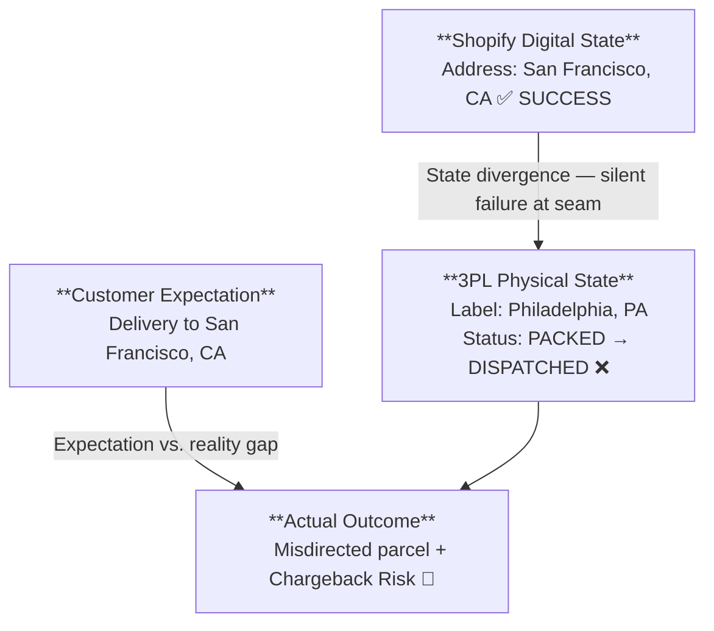

# Asynchronous Order Mutation & Webhook Failure Architecture

---

## Executive Summary — The "Zombie Order" Architecture

> **Why this is a Capstone:** This incident synthesizes every foundational engineering concept documented across the six domain dossiers — the PONR state machine (D1), multi-node routing topology (D2), webhook retry backoff (D4), and cross-system telemetry forensics (D5) — into a single high-severity staging failure. It is the clearest demonstration of what happens when **distributed systems fail silently at their seams**.

In modern e-commerce engineering, catastrophic operational failures rarely occur within an isolated technical component. They manifest at the **uncoordinated seams between distributed systems** that each believe they are in a valid state.

This Capstone documents a high-severity cross-domain incident at Synapse Botanicals:

| Dimension | Value |
|-----------|-------|
| Incident ID | Zombie Order #1070 |
| Customer | Elena Vance |
| Order Value | $98.00 GMV |
| Financial Deterioration | $98.60 for the retained-sale replacement scenario (contribution −$43.84 vs. +$54.76 baseline); lost-chargeback branch evaluated separately |
| Chargeback Risk | $98.00 dispute + $15.00 gateway penalty |
| Root Failure | HTTP `504 Gateway Timeout` on 3PL hold webhook during active wave release |
| Systemic Exposure | Scenario inputs: 4.2% address-edit / WMS latency overlap; 12–15 misdirections/month. Derivation requires edit count and conditional misdirection probability |
| Carrier Intercept Cost | $17.50 UPS intercept toll |
| Regulatory Exposure | FDA 21 CFR Part 111 returned-supplement quarantine and quality disposition |

> [!CAUTION] **Controlled Incident Simulation Notice:**  
> This dossier documents an empirical failure-injection experiment in an isolated staging sandbox. The verification section distinguishes actual platform responses, injected adapter events, and modeled warehouse/carrier outcomes. Financial amounts and scale projections are scenario calculations. No production PII or live services were disrupted.

---

## 1. The Incident Synopsis — What is a Zombie Order?

A customer placed Order **`#1070`** for a Starter Bundle and submitted an urgent address change 35 minutes later via Gorgias. Staff accepted the digital address edit in Shopify Admin, and a Shopify Flow automation attempted to push a fulfillment hold (`flow-hold:customer-edit`) to the 3PL WMS at Reno, NV (`LOC-NV-02`).

At that precise second, the 3PL WMS ingestion endpoint timed out with an **HTTP `504 Gateway Timeout`**. While the adapter queued the hold request for background retry, the warehouse crossed the **operational cutoff (wave release)** and technicians subsequently printed the shipping label with the *original* address. When the adapter retried 15 minutes later, the mutation was rejected under its PONR contract: **HTTP `422 Unprocessable Entity (PONR Exceeded)`**.

**Result:** Shopify Admin displayed San Francisco. The physical parcel was sealed on a pallet headed to Philadelphia.



---

## 2. Order Profile & Technical Baseline

### 2.1 Order #1070 — Full Specification

| Field | Value |
|-------|-------|
| Customer | Elena Vance (`elena.vance@example.com`) |
| Order Created | `2026-10-17T13:00:10-04:00` |
| SKU Composition | 1× Starter Bundle (`SYN-BNDL-MAO`, $98.00) |
| Line Item 1 | Matcha Yuzu Stick Packs 30-Pack (`SYN-FSTK-MY`) |
| Line Item 2 | AM Focus Adaptogen Tincture 60ml (`SYN-TNCT-AM`) |
| Line Item 3 | Precision Insulated Tumbler Matte Obsidian (`SYN-TMBL-MO`) |
| Fulfillment Node | Reno Fulfillment Hub, NV (`LOC-NV-02`) |
| Original Address | 1420 Chestnut St, Apt 4B, Philadelphia, PA 19102 |
| Requested Address | 820 Market St, Suite 400, San Francisco, CA 94102 |

### 2.2 Replacement Sourcing & Recovery Options

Replacement sourcing depends on the run’s timestamped SKU-by-location availability. The current documentation does not establish permanent Reno exclusivity. Evaluate warehouse intervention, eligible carrier redirection/return, replacement, and refund as separate recovery branches.

---

## 3. The Forensic Timeline — Event Chronology

All event times reflect recorded server trace timestamps in EDT (UTC−04:00); T+ values represent approximate elapsed intervals from order placement at `2026-10-17T13:00:10-04:00`.

| Timestamp | Event | System | HTTP Status |
|-----------|-------|--------|-------------|
| T+0m 13:00:10 EDT | Order #1070 placed | Shopify | — |
| T+0m 13:00:12 | `orders/create` webhook fired → WMS | Shopify → ShipBob | 200 OK |
| T+0m 13:00:15 | Fulfillment order created in WMS | ShipBob | OPEN |
| T+35m 13:35:00 | Gorgias ticket #T-10842: address change request | Gorgias | — |
| T+35m 13:35:08 | Staff mutates shipping address in Admin UI | Shopify Admin | — |
| T+35m 13:35:10 | Address-edit workflow starts (trigger configuration requires run evidence) | Shopify Flow | — |
| T+35m 13:35:11 | Flow Action 1: Add tag `flow-hold:customer-edit` | Shopify | 200 OK |
| T+35m 13:35:12 | **Flow Action 2: POST /1.0/webhook/order/hold → ShipBob** | Flow → WMS | — |
| T+35m 13:35:15 | **Hold request returned 504; upstream outcome unknown** | ShipBob | **504 Timeout** |
| T+35m 13:35:15 | Retry queue: Attempt 1 UNKNOWN. Schedule Attempt 2 (+5m), Attempt 3 (+15m from initial attempt) | Transport | — |
| T+40m 13:40:15 | **Attempt 2: POST /1.0/webhook/order/hold** | Transport → WMS | **504 Timeout** |
| T+42m 13:42:00 | **Wave Plan #8812 auto-released (includes Order #1070)** | ShipBob WMS | — |
| T+45m 13:45:00 | Technician picks Starter Bundle into Tote #44 | Warehouse Floor | — |
| T+48m 13:48:00 | **Barcode scanned at pack bench. Label printed: Philadelphia, PA** | WMS | PACKED |
| T+48m 13:48:30 | Box sealed, placed on outbound carrier conveyor | Warehouse Floor | — |
| T+48m 13:48:45 | WMS status → `PACKED / READY_FOR_DISPATCH` | ShipBob | — |
| T+50m 13:50:18 | **Attempt 3: POST /1.0/webhook/order/hold** | Transport → WMS | **422 PONR_EXCEEDED** |
| T+50m 13:50:19 | **ZOMBIE STATE ACHIEVED** | Shopify vs. WMS | Diverged |

---

## 4. Raw Payload Telemetry

The timeline establishes when the systems diverged. The request and response examples below clarify how the adapter represents an uncertain hold outcome and a later rejection after the warehouse cutoff.

The hold request and `PONR_EXCEEDED` response below illustrate the Synapse adapter contract; they are not native ShipBob API schemas. A custom Flow HTTP request is distinct from a native Shopify webhook delivery.

### 4.1 Outbound Hold Request (T+35m / 13:35:12 EDT)

```http
POST /1.0/webhook/order/hold HTTP/1.1
Host: wms.example.com
X-Shopify-Topic: fulfillment_orders/hold_placed
Content-Type: application/json

{
  "fulfillment_order_id": 881920149012,
  "order_id": 5920194812,
  "reason": "customer_address_edit",
  "reason_notes": "Customer requested address swap to San Francisco, CA via Gorgias #T-10842",
  "new_shipping_address": {
    "address1": "820 Market St, Suite 400",
    "city": "San Francisco",
    "province_code": "CA",
    "zip": "94102",
    "country_code": "US"
  }
}
```

### 4.2 Server Timeout Response

```http
HTTP/1.1 504 Gateway Time-out
Content-Type: text/html
Date: Sat, 17 Oct 2026 17:35:15 GMT

<html><head><title>504 Gateway Time-out</title></head>
<body><center><h1>504 Gateway Time-out</h1></center>
<hr><center>cloudflare-nginx</center></body></html>
```

### 4.3 Late Webhook Rejection (T+50m / 13:50:18 EDT)

```http
HTTP/1.1 422 Unprocessable Entity
Content-Type: application/json
Date: Sat, 17 Oct 2026 17:50:19 GMT

{
  "status": 422,
  "error_code": "PONR_EXCEEDED",
  "message": "Fulfillment hold rejected. Order 5920194812 has already crossed the Point of No Return.",
  "details": {
    "current_wms_status": "PACKED",
    "tracking_number": "1Z9999999999999999",
    "carrier": "UPS",
    "packed_at": "2026-10-17T17:48:22Z",
    "shipping_address_locked": "1420 Chestnut St, Apt 4B, Philadelphia, PA 19102"
  }
}
```

### 4.4 Why 504 ≠ 422: The Critical Distinction

| HTTP Status | Meaning | Webhook Retry Behavior | Operational Impact |
|-------------|---------|------------------------|-------------------|
| **504 Gateway Timeout** | A gateway did not receive a timely upstream response. | Retry with the same operation ID only while the operation remains eligible. | The mutation outcome remains UNKNOWN until the operation ledger and current WMS state are reconciled. |
| **422 + PONR_EXCEEDED** | Structured business rejection under the Synapse adapter contract. | Do not retry the same prohibited mutation. | The warehouse cutoff has been crossed; escalate to the approved recovery workflow. |

> [!IMPORTANT] The standard edit deadline is 13:42:00. From the first dispatch at 13:35:12, the remaining intervention window is **6 minutes 48 seconds**, approximately seven minutes. The fifteen-minute retry interval is not a safe editing window.

---

## 5. The 3-Minute Diagnostic Autopsy

In this incident simulation, customer detection occurred 48 hours post-dispatch (`2026-10-19T13:30:00-04:00`) when delivery tracking alerted the customer to arrival in Philadelphia rather than San Francisco. The following 3-minute diagnostic sequence models the forensic triage path executed by technical operations upon ticket intake, separating incident timestamps from proposed carrier recovery actions.

### 5.1 Minute 1 — Shopify Order Timeline Inspection

Navigate: **Admin → Orders → #1070 → Timeline**

| Timeline Event | Timestamp | Diagnostic Signal |
|----------------|-----------|-------------------|
| "Elena Vance's shipping address updated to San Francisco" | 13:35 EDT | Shopify-side state accepted |
| Flow run: "Action 'Send HTTP request' — 504 Gateway Timeout. Retrying." | 13:35 EDT | Hold outcome unknown; reconcile the operation. |
| "ShipBob added tracking: 1Z9999999999999999 (UPS Ground)" | 13:52 EDT | Tracking reference added; inspect WMS hold and label history |

**Finding:** Shopify accepted the address change locally without 3PL confirmation.

### 5.2 Minute 2 — Webhook Delivery Log Audit

Inspect the Flow run, adapter request ledger, and WMS shipment history separately.

| Attempt | Recorded Time | Result |
|---------|---------------|--------|
| 1 | 13:35:15 | 504 Gateway Timeout |
| 2 | 13:40:15 | 504 Gateway Timeout |
| 3 | 13:50:18 | 422 Unprocessable Entity |

**Finding:** Shopify accepted the address edit. The hold request timed out and the WMS subsequently advanced to packing. Confirm nonapplication using the operation ledger and WMS event history; the timeout and tracking number alone cannot establish that the WMS never received or applied the request.

### 5.3 Minute 3 — GraphQL Fulfillment Order State Query

```graphql
query inspectFulfillmentOrderState {
  order(id: "gid://shopify/Order/5920194812") {
    name
    displayFulfillmentStatus
    fulfillmentOrders(first: 5) {
      edges {
        node {
          id
          status
          assignedLocation { name }
          destination {
            address1
            city
            province
            zip
          }
          fulfillments(first: 5) {
            edges {
              node {
                trackingInfo { number url }
              }
            }
          }
        }
      }
    }
  }
}
```

**Finding:** Technical operations joins Shopify fulfillment and tracking identifiers (`gid://shopify/Fulfillment/4820194812`) directly to the WMS label snapshot. Because a carrier tracking number alone does not establish the destination encoded on the physical 2D barcode, the operator queries the ShipBob shipment manifest record. In production, pagination is required across all fulfillment orders and fulfillments.

---

## 6. Emergency Remediation — 3-Phase Containment Protocol

### 6.1 Phase 1: Carrier Intercept — Proposed Recovery After Detection

Use UPS Delivery Intercept v2. Check `GET /api/deliveryintercept/v2/eligibility/intercept/{tracking_number}` before selecting an eligible operation. Return uses `POST /api/deliveryintercept/v2/return/{tracking_number}` with its documented headers and body. Validate JSON `success` and errors as well as HTTP status.

The example below is the documented CIE canceled-shipment fixture; `AM` is its canceled-shipment reason, not a generic address-change reason. Use the reason and option returned as eligible for the actual shipment.

```bash
curl --request POST \
  'https://wwwcie.ups.com/api/deliveryintercept/v2/return/1Z4096YY0316914058' \
  --header "Authorization: Bearer $UPS_API_TOKEN" \
  --header 'Content-Type: application/json' \
  --header 'transId: SIIReturn' \
  --header 'platformType: XOLT' \
  --header 'inquiryType: U' \
  --data '{"requestType":"RS","specialInstructions":"Staging return fixture","requesterContactInfo":{"name":"Sandbox Operator","telephone":"+12010000000"},"reasonForReturn":"AM"}'
```

Record intercept request, acceptance, and confirmed physical outcome separately. CIE fixture responses validate request/response handling; physical interception requires carrier-event evidence. The $17.50 intercept charge is a scenario input.

[UPS Delivery Intercept v2 specification](https://github.com/UPS-API/api-documentation/blob/fd57ca9fde3c26c4ec5c2c4f4831715a223daa85/DeliveryIntercept.yaml).

### 6.2 Phase 2: FDA 21 CFR Part 111 Returned-Product Quarantine

Assess returned supplements through documented quarantine and quality disposition. Identify any stricter no-restock rule as company policy. Use qualified temperature evidence when relevant, and record disposal at inventory cost.

| Step | Action | System |
|------|--------|--------|
| 1 | WMS receives returned parcel scan | ShipBob |
| 2 | Automatically route to Quarantine Zone A | WMS Rule |
| 3 | QA Officer inspects packaging seal integrity | Physical |
| 4 | Review qualified temperature evidence when available | Validated logger / qualified shipping record |
| 5 | `SYN-TNCT-AM` lot number logged in QA system | QA record |
| 6 | Clearance or disposal decision logged | QA Officer |

> [!CAUTION] Ordinary carrier tracking does not establish temperature exposure. Returned supplements require documented QA disposition; assess non-ingestible bundle components separately. The $98.00 selling price is not the inventory write-off value.

### 6.3 Phase 3: Customer Financial Resolution

```
1. Issue full refund OR reship from Reno (pending QA clearance)
2. Apply $25 courtesy credit to customer account
3. Flag order for chargeback pre-emption (contact gateway before dispute clears)
4. Update Gorgias ticket #T-10842 with resolution timeline
```

---

## 7. Root Cause Analysis & Architectural Failure Modes

The containment protocol addresses the affected shipment and customer resolution. Preventing recurrence requires examining why the address change proceeded without a confirmed warehouse hold and why retries continued beyond the editing deadline.

### 7.1 The Three Failure Modes in Stack Order

| # | Failure Mode | Classification | PONR? |
|---|-------------|----------------|-------|
| 1 | 504 timeout on fulfillment hold webhook | Unknown upstream outcome | Reconcile before the cutoff |
| 2 | No hold confirmation gate before address edit acceptance | Missing hold-confirm-update coordinator | No — design gap |
| 3 | Wave auto-release during 15-min retry window | Physical state advancement past PONR | **Yes — automatic edit cutoff crossed** |

### 7.2 Hold-Confirm-Update — The Core Design Control

Use a durable hold-confirm-update coordinator. Persist one operation ID, serialize competing edits, confirm the affected WMS shipment is held, update both systems, reconcile their versions, and release only this operation’s hold. Unknown outcomes remain pending. This workflow does not provide an atomic transaction across Shopify and the WMS.

### 7.3 Amazon SQS Work Queue & Dead-Letter Queue Architecture — The Fix

Select and document one queue design. The source queue feeds idempotent workers; a separate DLQ captures exhausted or quarantined work. Three receives is a scenario policy. Workers own retries, extend visibility when necessary, reject stale versions, and reconcile unknown outcomes. Alert on the first uncertain hold result before the warehouse deadline.

This design uses an SQS Standard work queue. The adapter authenticates the request, persists its operation ID and acknowledges acceptance only after durable enqueue succeeds. Transport redelivery reuses that operation; per-order serialization and current-version checks precede every mutation. DLQ replay requires a fresh eligibility and version check.

```
                    ┌─────────────────────────────────────────┐
                    │         SHOPIFY FLOW ENGINE              │
                    │  Address-edit workflow → Hold Request    │
                    └────────────────┬────────────────────────┘
                                     │ POST /webhook/order/hold
                                     ▼
                    ┌─────────────────────────────────────────┐
                    │         MIDDLEWARE ADAPTER               │
                    │  Authenticates request from Flow         │
                    │  ACK only after durable enqueue          │
                    └────────────────┬────────────────────────┘
                                     │ SQS Enqueue (durable)
                                     ▼
                    ┌─────────────────────────────────────────┐
                    │         AMAZON SQS STANDARD QUEUE       │
                    │  Visibility Timeout: 30s                 │
                    │  Max Receive Count: 3                    │
                    │  → Separate DLQ after receive limit      │
                    └────────────────┬────────────────────────┘
                                     │ Consumer polls (long-poll)
                                     ▼
                    ┌─────────────────────────────────────────┐
                    │         WMS HOLD CONSUMER                │
                    │  Calls supported WMS hold operation      │
                    │  On confirmed effect: delete message     │
                    │  On 504: reconcile unknown result        │
                    │  Receive threshold exceeded: → DLQ       │
                    └────────────────┬────────────────────────┘
                                     │ Unknown hold / DLQ alert
                                     ▼
                    ┌─────────────────────────────────────────┐
                    │         ALERT & HUMAN ESCALATION        │
                    │  PagerDuty / Slack: "Hold uncertain"    │
                    │  → Escalate before warehouse cutoff      │
                    └─────────────────────────────────────────┘
```

| SQS Parameter | Value | Rationale |
|---------------|-------|-----------|
| Visibility Timeout | 30s initially | Extend while active; set worker/request timeouts. A 25s p99 alone does not guarantee completion within visibility |
| Max Receive Count | 3 | Scenario receive-based redrive policy; separate from Shopify retries and business-attempt accounting |
| DLQ Retention | 14 days | Investigation storage; does not extend carrier eligibility or mutation deadlines |
| Long Polling | 20s | Reduces empty poll costs |
| Message Retention | 4 days | Work storage; expired mutations must not execute |

---

## 8. Webhook Retry Backoff Reference

> [!NOTE] The following schedule describes the adapter attempts in the incident scenario. Offsets are measured from the initial attempt; they are not Shopify Flow or native webhook retry guarantees. The worker owns downstream retries; transport redelivery must reuse the operation ID. Re-check current version, hold ownership and cutoff before every mutation.

| Attempt | Offset from Initial Attempt | Approximate Order Age | Action |
|---------|-------------|-------------------|--------|
| 1 (initial) | 0s | T+35m | First POST attempt |
| 2 | +5m | T+40m | First backoff retry |
| 3 | +15m | T+50m | Second backoff retry → **PONR confirmed** |
| Exception / DLQ | — | T+50m+ | Final escalation; prevention alert must already have fired before 13:42 |

The standard edit deadline is 13:42:00. From the first dispatch at 13:35:12, the remaining intervention window is **6 minutes 48 seconds**, approximately seven minutes. The fifteen-minute retry interval is not a safe editing window.

---

## 9. Financial Risk Exposure & Unit Economics Autopsy

The retry schedule explains how the intervention window was missed. The following calculation measures the financial consequence by comparing normal fulfillment with the retained-sale replacement branch.

For a recruiter or executive evaluating operational risk, a "Zombie Order" is not merely an engineering anomaly—it represents an immediate collapse of unit economics:

Starter Bundle COGS is modeled at $28.40 in this scenario (reflecting $28.00 raw component costs—Focus Sticks $8.50, AM Tincture $12.50, Precision Tumbler $7.00—plus $0.40 dedicated packaging and insert material). Credit card gateway processing is calculated as `round($98.00 × 2.9% + $0.30, 2) = $3.14`, assuming zero tax and free ground shipping revenue. The replacement branch retains the original sale and all initial fulfillment costs, while recognizing the $25.00 customer goodwill concession at full face value as an operational expense (future unredeemed account credit liabilities may be treated differently under specific corporate accounting policies).

```
NORMAL ORDER ECONOMICS (#1070 Baseline):
  Gross Merchandise Value (GMV):                +$98.00
  Cost of Goods Sold (COGS):                    -$28.40
  3PL Fulfillment (Pick / Pack / Box):          -$4.50
  Carrier Outbound Ground Freight (Scenario):  -$7.20
  Credit Card Gateway Processing (2.9% + $0.30):-$3.14
  ─────────────────────────────────────────────────────
  NET CONTRIBUTION MARGIN:                      +$54.76 (55.9% Contribution Margin)

ZOMBIE ORDER RECOVERY (#1070 Retained Sale + Replacement):
  Gross Merchandise Value (Collected):          +$98.00
  Original Parcel COGS (No Salvage Assumed):     -$28.40
  Original 3PL Fulfillment:                     -$4.50
  Original Outbound Ground Freight:             -$7.20
  Carrier Package Intercept Toll (UPS API):     -$17.50
  Carrier Return-to-Sender Freight:             -$8.40
  Replacement Parcel COGS (Re-shipped from NV): -$28.40
  Replacement 3PL Pick / Pack Handling:         -$4.50
  Replacement Outbound Air Freight (Expedited): -$14.80
  Goodwill Expense (Fully Expensed Scenario):   -$25.00
  Payment Gateway Transaction Tolls:            -$3.14
  ─────────────────────────────────────────────────────
  FINAL CONTRIBUTION:                          -$43.84
  INCREMENTAL RECOVERY COST:                     $98.60

Incremental recovery costs:
  $17.50 + $8.40 + $28.40 + $4.50 + $14.80 + $25.00 = $98.60

Final contribution after recovery:
  $54.76 - $98.60 = -$43.84

Separate lost-chargeback scenario:
  -$43.84 - $98.00 principal - $15.00 penalty = -$156.84
```

At 1,000 orders/day over a 30-day scenario month, a 0.5% misdirection rate gives 150 events. At $98.60 incremental recovery cost/event, modeled contribution deterioration is $14,790/month. This is a sensitivity calculation, not an observed incident count.

The edit-specific exposure model is `misdirections = address_edits × overlap_probability × conditional_failure_probability`. The 4.2% overlap input does not establish monthly misdirection counts without the edit denominator and conditional failure rate.

---

## 10. Enterprise Prevention Playbook & Systems Engineering Summary

To control state divergence across distributed e-commerce infrastructure, four core architectural principles must be enforced across all integrations:

1. **Hold-Confirm-Update Verification**: Confirm the affected WMS shipment is held, update both systems, reconcile their versions, and release only this operation’s hold. Unknown outcomes remain pending.
2. **Idempotency Key Enforcement**: Persist one operation ID across retries, serialize competing edits, and check the current order version before side effects. Reconcile unknown outcomes before replay.
3. **Work Queue & Dead-Letter Queue**: Use the Standard source queue and separate DLQ defined in §7.3. Workers own bounded retries; alert on the first uncertain hold result before the warehouse deadline.
4. **Carrier Recovery Eligibility**: Evaluate warehouse intervention and eligible carrier redirection/return after the cutoff. Record request, acceptance and confirmed physical outcome separately.

---

## 11. Cross-Domain Architecture Dependencies

All foundational technical frameworks synthesized in this Capstone are documented in their respective Master Technical Dossiers:

| Operational Component | Domain Specification | Foundational Master Dossier |
|-----------------------|----------------------|----------------------------|
| PONR State Thresholds & Lockout Matrix | Domain 1: Order Lifecycle | `MasterDossier-Domain1-OrderStateMachineAndPONR.md` |
| Multi-Node Routing & Inventory Availability | Domain 2: Order Routing | `MasterDossier-Domain2-MultiNodeLogisticsRouting.md` |
| Barcode Hygiene & Matrixify Data Governance | Domain 3: Bulk Data Management | `MasterDossier-Domain3-BulkCatalogSchemaGovernance.md` |
| Webhook Retry Backoff Curve & Status Triage | Domain 4: Business Automations | `MasterDossier-Domain4-WebhookAutomationAndFlowTriage.md` |
| Diagnostic Forensics (DevTools & GraphQL) | Domain 5: Technical Diagnosis | `MasterDossier-Domain5-MarginDefenseAndCartDiagnostics.md` |
| Frontline Helpdesk Programmatic Holds | Domain 6: Frontline Helpdesk | `MasterDossier-Domain6-FrontlineHelpdeskAutomation.md` |

---

## 12. Delivery Assets & Systems Architecture Checklist

The evidence package distinguishes a documented specification, executed local model tests, focused offline contract checks, authenticated vendor-sandbox execution and physical verification. These are different scopes. No local result below establishes a live Shopify, ShipBob, Gorgias, SQS or carrier deployment.

| Technical Deliverable | Documented Location | Evidence Scope | Artifact |
|---|---|---|---|
| Capstone investigation | This dossier | Documented scenario and reproducible financial model | [Cost results](../evidence/costs/summary.md) |
| PONR and hold coordination | Domain 1 | Local SQLite simulator safety and process-restart tests | [Coordinator results](../evidence/latency/summary.md) |
| Multi-node freight economics | Domain 2 | Conditional model and reservation-fixture assertions; tariffs unverified | [Freight results](../evidence/freight/summary.md) |
| Barcode governance | Domain 3 | Exact mapping, checksum and shared-table bitstream tests; Matrixify import specified | [Barcode results](../evidence/barcodes/summary.md) |
| Flow and retry architecture | Domain 4 | Local coordinator cases; Flow/SQS integration specified | [Coordinator results](../evidence/latency/summary.md) |
| Margin model | Domain 5 | Cent-level arithmetic and boundary assertions; checkout enforcement specified | [Cost results](../evidence/costs/summary.md) |
| Helpdesk automation | Domain 6 | Workflow specified; no authenticated Gorgias execution | [Evidence scope](../evidence/README.md) |
| GraphQL inspection | §5.3 | Versioned schema-compatible example; no authenticated execution claimed | Query in this dossier |
| Carrier recovery | §6.1 | Focused official-contract checks and local recovery events; no CIE/physical test | [Recovery results](../evidence/carrier-recovery/summary.md) |
| SQS architecture | §7.3 | Specified; local SQLite tests do not verify deployed SQS | Architecture in this dossier |


---

*Dossier compiled: 2026-11-06 | Synapse Botanicals Systems Architecture | Riovic Matthew*
