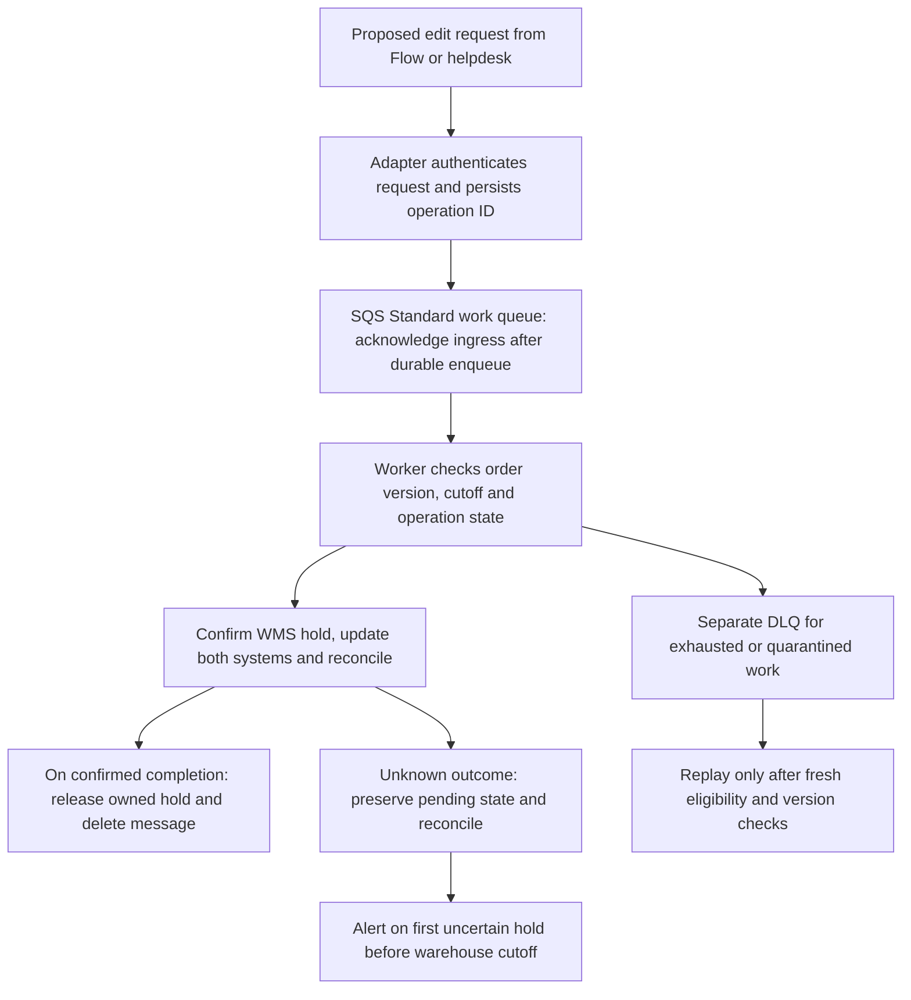

# The Zombie Order: The Address Said San Francisco, the Label Said Philadelphia

*Synapse Botanicals Systems Architecture | Riovic Matthew*

At 13:35:08 on October 17, 2026, Shopify accepted a change to Order **#1070**: Elena Vance's Starter Bundle should go to San Francisco instead of Philadelphia. Thirteen minutes later, the staged warehouse sequence produced a label for the old address. The edit had succeeded locally; the workflow had never confirmed that warehouse execution had stopped.

> **Controlled incident simulation.** This case examines an empirical failure-injection simulation in an isolated staging environment. The incident chronology reconstructs the scenario; warehouse and carrier outcomes are modeled. The repository's executed evidence consists of local simulator tests, financial calculations and focused offline contract checks, identified below. Those artifacts do not establish authenticated vendor execution or physical shipment outcomes. Customer details are synthetic, financial amounts are scenario inputs or calculations, and no production PII or live services were disrupted.

My analysis centers on the decision between those two events: the address edit was accepted before the hold was confirmed. A `504 Gateway Timeout` left the hold unresolved, but the warehouse deadline continued to advance. The retained-sale replacement branch would consume **$98.60** in additional costs, turning **+$54.76** of normal contribution into **−$43.84**.

## One bundle made the wrong destination more than a shipping problem

The conflicting addresses explain the delivery failure; the contents of the parcel explain why recovery is costly. Elena's bundle includes consumable products that require quality disposition if returned, alongside a tumbler that must be assessed separately.

| Field | Value |
|-------|-------|
| Customer | Elena Vance (`elena.vance@example.com`) |
| Order Created | `2026-10-17T13:00:10-04:00` |
| SKU Composition | 1× Starter Bundle (`SYN-BNDL-MAO`, $98.00) |
| Line Item 1 | Matcha Yuzu Stick Packs 30-Pack (`SYN-FSTK-MY`) |
| Line Item 2 | AM Focus Adaptogen Tincture 60ml (`SYN-TNCT-AM`) |
| Line Item 3 | Precision Insulated Tumbler Matte Obsidian (`SYN-TMBL-MO`) |
| Fulfillment Node | Reno Fulfillment Hub, NV (`LOC-NV-02`) |
| Original Address | 1420 Chestnut St, Apt 4B, Philadelphia, PA 19102 |
| Requested Address | 820 Market St, Suite 400, San Francisco, CA 94102 |

Reno is the assigned fulfillment node in this case, not proof that the bundle can only ever ship from Reno. Any replacement decision needs timestamped SKU-by-location availability. I therefore keep warehouse intervention, eligible carrier redirection or return, replacement, and refund as separate recovery branches.

Before choosing a recovery branch, I need to establish where the address change lost coordination with the warehouse.

## The warehouse kept moving while the hold stayed unresolved

The decisive interval begins with the hold request, not with the later error that finally rejects it. The following events show why waiting for another retry was an operational decision with a deadline.

| Time, EDT | Scenario event | Consequence |
|---|---|---|
| 13:35:08 | Shopify accepts the address edit | The storefront now shows San Francisco |
| 13:35:12 | Adapter dispatches the fulfillment hold | Warehouse confirmation is still required |
| 13:35:15 | The request returns `504` | The hold outcome is unknown |
| 13:40:15 | A second attempt also times out | Only 1 minute 45 seconds remain before wave release |
| 13:42:00 | Wave Plan #8812 releases Order #1070 | The standard automatic-edit cutoff is crossed |
| 13:48:00 | The modeled pack-bench sequence prints Philadelphia on the label | The physical workflow retains the original destination |
| 13:50:18 | The third attempt receives `422 PONR_EXCEEDED` | The adapter rejects the prohibited mutation |

From first dispatch at **13:35:12** to wave release at **13:42:00**, the intervention window is **6 minutes 48 seconds**. From the first timeout response, it is already three seconds shorter. The nominal retry offsets are +5 and +15 minutes from the initial attempt; the scenario timestamps include request/response timing and are not exact dispatch offsets. The [full chronology](#exhibit-a) retains the order creation, picking and packing events.

This is the “zombie order”: Shopify displays an accepted change while the modeled fulfillment sequence proceeds on the old instruction. The later rejection exposes the conflict; it does not mark the first moment the records disagreed.

## The timeout left a question that the later rejection could not repair

At 13:35, the workflow needed an answer to “Is this shipment held?” A timeout did not supply one. Treating it as permission to leave the edit accepted allowed an unresolved operation to outlive its intervention window.

| Response | What it establishes | Decision it supports |
|---|---|---|
| `504 Gateway Timeout` | A gateway did not receive a timely upstream response; the hold may or may not have taken effect | Keep the operation pending, inspect the operation ledger and current WMS state, then retry with the same operation ID only if still eligible |
| `422` with `PONR_EXCEEDED` | Under the Synapse adapter contract, the requested mutation is now ineligible | Stop retrying that prohibited mutation and evaluate approved recovery |

I cannot infer nonreceipt or nonapplication from the timeout alone. The operation ledger and warehouse event history must resolve that uncertainty. Conversely, “too late” is the meaning of this adapter's **`PONR_EXCEEDED`** rejection, not a universal interpretation of HTTP `422`.

The [request and response exhibits](#exhibit-b) use a custom Synapse adapter contract, not native ShipBob API schemas. They show the distinction between an uncertain result and a known rejection without implying that these illustrative payloads are captured vendor responses.

That distinction determines how I would investigate a customer report: first establish what each system knows, then decide what can still be changed.

## Three checks separate an accepted edit from a confirmed destination

In the scenario, a customer follow-up at `2026-10-19T13:30:00-04:00`, roughly two days later, exposes the Philadelphia destination. The “three-minute autopsy” is a modeled triage sequence for that ticket, not a measured completion time or service-level guarantee.

| Diagnostic step | Question | Evidence to inspect | Interpretation |
|---|---|---|---|
| Minute 1: Shopify timeline | Did the storefront accept the edit? | Address-change entry, Flow attempt and tracking reference | Shopify accepted San Francisco locally; a tracking entry does not establish a warehouse hold |
| Minute 2: operation history | Did the hold take effect? | Flow run, adapter operation ledger and WMS events | Two timeouts followed by a cutoff rejection do not independently prove what happened upstream during either timeout |
| Minute 3: shipment correlation | Which destination reached the label? | Shopify fulfillment-order/tracking data and the separate WMS label or manifest snapshot | Compare the requested address with the destination used by the fulfillment sequence |

I use the [Shopify query and correlation procedure](#exhibit-c) to identify the relevant fulfillment records. The query does not retrieve a ShipBob manifest; that is a separate lookup. A tracking number alone cannot establish the address encoded on a physical label.

The case's modeled label snapshot supplies the Philadelphia destination. A live investigation would need the corresponding WMS record before making that finding. Once the standard editing cutoff has passed, support must evaluate recovery instead of representing another address edit as a completed fulfillment change.

## After the cutoff, recovery depends on what remains possible

The late rejection narrows the options, but it does not prove that a carrier can redirect the parcel. My proposed containment path checks current eligibility before choosing how to resolve the shipment and the customer's request.

**First, establish whether intervention is still available.** Check the current warehouse and carrier state. For UPS Delivery Intercept v2, query `GET /api/deliveryintercept/v2/eligibility/intercept/{tracking_number}` before selecting an eligible option. If delivery is already complete or an option is unavailable, it cannot be treated as an available intercept branch. The [return-request exhibit](#exhibit-d) preserves the official fixture and its limits.

An intercept request, electronic acceptance, and confirmed physical recovery are three separate events. Validate JSON `success` and errors as well as HTTP status. The **$17.50** intercept charge is a model input, not an authenticated billing result.

**Second, determine the disposition of anything returned.** Returned supplements require documented quarantine and quality disposition under FDA 21 CFR Part 111. Any stricter no-restock requirement is company policy. Ordinary tracking cannot establish temperature exposure; qualified temperature evidence and QA findings govern that assessment. The [disposition sequence](#exhibit-d) records the tincture lot, seal inspection and clearance or disposal decision. Non-ingestible components are assessed separately, and a disposal write-off uses inventory cost rather than the $98.00 selling price.

**Third, resolve the customer's order.** The scenario offers a refund or a replacement sourced from eligible inventory, a $25.00 courtesy credit, and an updated resolution timeline in Gorgias ticket `#T-10842`. Any use of returned stock depends on QA clearance. Dispute handling follows the gateway's process; contacting it does not guarantee prevention of a chargeback. The financial branch below assumes a fresh replacement from Reno, retention of the original sale, and no salvage value.

Those are recovery decisions for an affected order. Preventing the next divergence requires changing the condition under which the edit is allowed to proceed.

## The edit needed a confirmation gate, not another unobserved retry

The timeout exposed the design gap: the workflow accepted the address change before confirming the hold. A confirmed hold must precede mutation, and an unresolved result must have an owner until it is reconciled or escalated.

| Failure in the scenario | Required control |
|---|---|
| Hold request times out with no confirmed outcome | Preserve the operation and reconcile its effect before retrying |
| Shopify accepts the edit before WMS confirmation | Gate mutation on a confirmed hold of the affected shipment |
| Wave release occurs while retries remain scheduled | Check current state, version and eligibility before every mutation; escalate before the cutoff |

My proposed workflow persists one operation ID, serializes competing edits to the same order, confirms the affected WMS shipment is held, applies the updates, reconciles both versions, and releases only the hold owned by that operation. If an update is uncertain, the workflow remains pending instead of reporting completion or releasing the hold prematurely.

This is a hold-confirm-update coordinator, not an atomic transaction spanning Shopify and the WMS. Its purpose is to make partial progress and recovery explicit. The local tests described below exercise selected coordination behaviors; they do not establish a deployed cross-vendor transaction.

### The deadline determines when a person must be alerted

The confirmation gate prevents an unresolved edit from being called complete, but it cannot stop the clock by itself. The first uncertain hold result must trigger reconciliation and escalation while intervention is still possible.

| Scenario attempt | Nominal offset from initial attempt | Required interpretation |
|---|---|---|
| Initial | 0 seconds | Request confirmation; on timeout, retain an unknown outcome |
| Retry 2 | +5 minutes | Reconcile before replay and re-check the warehouse deadline |
| Retry 3 | +15 minutes | In this case, the 13:42 cutoff has passed; reject the prohibited edit |
| Exception / DLQ handling | After exhausted or quarantined work | Investigation and controlled recovery; prevention must not wait for this stage |

These are the scenario adapter's attempts, not Shopify Flow or native webhook retry guarantees. At 13:40:15, the second attempt still left 105 seconds before wave release. By the third attempt, even a reliable transport could not make the original edit eligible again. An early alert creates an opportunity for intervention; it does not guarantee a human response within that window.

### A work queue preserves the operation; a dead-letter queue preserves failed work

The deadline rule also shapes retry ownership. I specify an **SQS Standard work queue** feeding idempotent workers, with a **separate dead-letter queue** for exhausted or quarantined work.



Ingress acknowledgment means the work is durably accepted, not that the warehouse hold is complete. The worker owns downstream retries; transport redelivery reuses the same operation ID. Visibility is extended while a worker remains active, stale versions are rejected, and unknown outcomes are reconciled before replay. The [queue parameter exhibit](#exhibit-f) records the initial timeout, receive limit and retention assumptions.

The queue architecture is specified. The executed SQLite simulator evaluates local operation ownership and recovery; it does not verify SQS delivery or a live warehouse stop. With those boundaries explicit, the remaining question is what the failure costs under the declared recovery branch.

## The replacement consumed more than the original sale collected

The retained-sale branch leaves the original fulfillment costs in place and adds the cost of recovering and replacing the parcel. I compare those two ledgers so that the economic deterioration is not confused with a second write-off of the original inventory.

| Contribution calculation | Amount |
|---|---:|
| Original sale | +$98.00 |
| Original COGS | −$28.40 |
| Original pick / pack / box | −$4.50 |
| Original outbound freight | −$7.20 |
| Original processing fee | −$3.14 |
| **Normal contribution** | **+$54.76** |
| Additional retained-sale recovery costs | −$98.60 |
| **Contribution after recovery** | **−$43.84** |

The bundle's **$28.40** COGS comprises Focus Sticks **$8.50**, AM Tincture **$12.50**, and Precision Tumbler **$7.00**, plus **$0.40** of dedicated packaging and insert material. That material allowance is separate from outbound fulfillment service. Processing is `round($98.00 × 2.9% + $0.30, 2) = $3.14`, with zero tax and zero shipping receipts in this scenario. Normal contribution is **55.9%** of the sale, rounded to one decimal place.

The additional costs are `$17.50 intercept + $8.40 return freight + $28.40 replacement COGS + $4.50 replacement handling + $14.80 replacement freight + $25.00 goodwill = $98.60`. The goodwill credit is fully expensed at face value here; an unredeemed credit liability may receive different treatment under the applicable accounting policy. The [complete ledger](#exhibit-e) retains every line item and the separate lost-chargeback branch: `−$43.84 − $98.00 principal − $15.00 penalty = −$156.84`.

These are contribution calculations under declared inputs, not fully allocated net profit. They exclude overhead, acquisition costs and other costs outside the printed model.

At a planning scale of **1,000 orders/day × 30 days × 0.5% misdirection**, the model produces **150 events**. Multiplying by **$98.60** gives **$14,790/month** of contribution deterioration. This is sensitivity analysis, not an observed incident count or realized savings.

The separate edit-specific model is `misdirections = address_edits × overlap_probability × conditional_failure_probability`. A **4.2%** overlap assumption cannot establish a monthly frequency, including a suggested **12–15 events/month**, without the edit denominator and conditional failure probability. I keep that uncertainty out of the quantified monthly result.

The financial case makes the control worth investigating. The strength of the engineering claim still depends on what the repository actually tests.

## What I can defend from the executed evidence

The proposed controls address the failure described above; the evidence evaluates narrower, reproducible behaviors. I use the recorded runs to distinguish a calculated result or a local safety check from an integration that would still need vendor and operational validation.

The [recorded smoke run](../evidence/sample-run/run.json) contains **150 passed checks, 0 failed checks and 3 explicit skips**. Of those, **34** belong to the local coordinator suite, **11** to the cost suite, and **34** to carrier recovery. The remaining checks cover freight and barcodes. These are fixture assertions, not a universal correctness guarantee or a count of production incidents prevented. The evidence links below point to that fixed run so the stated checks and reports can be inspected together.

| Technical deliverable | Executed or documented scope | Evidence |
|---|---|---|
| Capstone investigation | Reconstructed incident scenario and reproducible financial model | This dossier; [cost results](../evidence/sample-run/costs/summary.md) |
| PONR and hold coordination | Local SQLite tests of duplicate outcomes, cutoff races, stale revisions, reconciliation, selective release and process-restart recovery | [Coordinator results](../evidence/sample-run/latency/summary.md) |
| Multi-node freight economics | Conditional cost calculations and feasible reservation fixtures; tariff verification is skipped | [Freight results](../evidence/sample-run/freight/summary.md) |
| Barcode governance | Synthetic mappings, checksums and shared-table bitstream checks; Matrixify import and physical scanning are not established | [Barcode results](../evidence/sample-run/barcodes/summary.md) |
| Flow and retry architecture | Workflow specified; local coordinator tests do not establish authenticated Flow or SQS execution | [Coordinator results](../evidence/sample-run/latency/summary.md) |
| Margin model | Cent-level arithmetic and boundary assertions; checkout enforcement is specified | [Cost results](../evidence/sample-run/costs/summary.md) |
| Helpdesk automation | Workflow specified; no authenticated Gorgias execution established | [Evidence scope](../evidence/README.md) |
| GraphQL inspection | Versioned schema-compatible example; no authenticated execution claimed | [Query exhibit](#exhibit-c) |
| Carrier recovery | Focused offline checks against the pinned UPS contract and local recovery events; authenticated CIE and physical/billing checks are skipped | [Recovery results](../evidence/sample-run/carrier-recovery/summary.md) |
| SQS architecture | Specified; local SQLite tests do not verify a deployed queue | [Queue design](#exhibit-f) |

The coordinator tests include a timeout after a persisted virtual-WMS effect, a cutoff changing during a request, duplicate pending and rejected operations, and a worker terminated after the effect was persisted. Those cases exercise the uncertainty that the incident exposes. Restart recovery is local process recovery, not evidence of multi-host or power-failure durability.

The smoke timing workloads contain **440 attempts** with seeded delays. Elapsed times are measured locally; nearest-rank percentiles include pending, rejected and unknown responses. They are response timings, not provider-network or physical-hold confirmation latency. Reproduction commands and interpretation are in [Exhibit G](#exhibit-g).

For the next address edit, the requirement I would enforce is concrete: keep the operation pending until the affected warehouse hold and subsequent updates are confirmed and reconciled. If that cannot be resolved before the cutoff, stop the prohibited mutation and escalate. In Order #1070, the difference between an accepted address and a confirmed fulfillment change is where the **$98.60** recovery exposure begins.

---

<a id="exhibit-a"></a>

## Exhibit A — Reconstructing the interval before wave release

The narrative turns on a small set of deadlines; this complete chronology preserves the intervening events needed to inspect their sequence. Times are the incident scenario's reconstructed timestamps in EDT (UTC−04:00), with approximate T+ intervals from `2026-10-17T13:00:10-04:00`; they are not the local harness's measured timings or a supplied set of authenticated vendor logs.

| Timestamp | Event | System | HTTP Status |
|-----------|-------|--------|-------------|
| T+0m 13:00:10 EDT | Order #1070 placed | Shopify | — |
| T+0m 13:00:12 | `orders/create` webhook fired → WMS | Shopify → ShipBob | 200 OK |
| T+0m 13:00:15 | Fulfillment order created in WMS | ShipBob | OPEN |
| T+35m 13:35:00 | Gorgias ticket #T-10842: address change request | Gorgias | — |
| T+35m 13:35:08 | Staff mutates shipping address in Admin UI | Shopify Admin | — |
| T+35m 13:35:10 | Address-edit workflow starts (trigger configuration requires run evidence) | Shopify Flow | — |
| T+35m 13:35:11 | Flow Action 1: Add tag `flow-hold:customer-edit` | Shopify | 200 OK |
| T+35m 13:35:12 | **Flow Action 2: POST /1.0/webhook/order/hold → ShipBob** | Flow → WMS | — |
| T+35m 13:35:15 | **Hold request returned 504; upstream outcome unknown** | ShipBob | **504 Timeout** |
| T+35m 13:35:15 | Retry queue: Attempt 1 UNKNOWN. Schedule Attempt 2 (+5m), Attempt 3 (+15m from initial attempt) | Transport | — |
| T+40m 13:40:15 | **Attempt 2: POST /1.0/webhook/order/hold** | Transport → WMS | **504 Timeout** |
| T+42m 13:42:00 | **Wave Plan #8812 auto-released (includes Order #1070)** | ShipBob WMS | — |
| T+45m 13:45:00 | Technician picks Starter Bundle into Tote #44 | Warehouse Floor | — |
| T+48m 13:48:00 | **Barcode scanned at pack bench. Label printed: Philadelphia, PA** | WMS | PACKED |
| T+48m 13:48:30 | Box sealed, placed on outbound carrier conveyor | Warehouse Floor | — |
| T+48m 13:48:45 | WMS status → `PACKED / READY_FOR_DISPATCH` | ShipBob | — |
| T+50m 13:50:18 | **Attempt 3: POST /1.0/webhook/order/hold** | Transport → WMS | **422 PONR_EXCEEDED** |
| T+50m 13:50:19 | **Divergence confirmed by the late rejection** | Shopify vs. WMS | Diverged |

The 13:50 rejection confirms the cutoff under the adapter contract. Whether either earlier request had an effect still requires operation-ledger and WMS-history reconciliation.

<a id="exhibit-b"></a>

## Exhibit B — The request that stayed uncertain and the rejection that ended eligibility

The chronology identifies when the hold became uncertain. These illustrative wire examples show the custom adapter's requested change and the distinction between a gateway timeout and its later business rejection. A custom Flow HTTP action is distinct from native Shopify webhook delivery; the topic header below does not establish a native delivery or authenticate the request.

### The hold request at 13:35:12

The requested San Francisco address is present in the outbound payload. Sending it does not establish that the WMS applied a hold or changed its label destination.

```http
POST /1.0/webhook/order/hold HTTP/1.1
Host: wms.example.com
X-Shopify-Topic: fulfillment_orders/hold_placed
Content-Type: application/json

{
  "fulfillment_order_id": 881920149012,
  "order_id": 5920194812,
  "reason": "customer_address_edit",
  "reason_notes": "Customer requested address swap to San Francisco, CA via Gorgias #T-10842",
  "new_shipping_address": {
    "address1": "820 Market St, Suite 400",
    "city": "San Francisco",
    "province_code": "CA",
    "zip": "94102",
    "country_code": "US"
  }
}
```

### The gateway response at 13:35:15

The gateway returns an HTML timeout instead of an operation result. Its lack of a confirmed outcome is why reconciliation is required before another eligible attempt.

```http
HTTP/1.1 504 Gateway Time-out
Content-Type: text/html
Date: Sat, 17 Oct 2026 17:35:15 GMT

<html><head><title>504 Gateway Time-out</title></head>
<body><center><h1>504 Gateway Time-out</h1></center>
<hr><center>cloudflare-nginx</center></body></html>
```

### The later PONR rejection

The late response identifies a locked Philadelphia address and a packed state. Its `packed_at` field is `17:48:22Z` (13:48:22 EDT), between the scenario's label-print and box-seal events.

```http
HTTP/1.1 422 Unprocessable Entity
Content-Type: application/json
Date: Sat, 17 Oct 2026 17:50:19 GMT

{
  "status": 422,
  "error_code": "PONR_EXCEEDED",
  "message": "Fulfillment hold rejected. Order 5920194812 has already crossed the Point of No Return.",
  "details": {
    "current_wms_status": "PACKED",
    "tracking_number": "1Z9999999999999999",
    "carrier": "UPS",
    "packed_at": "2026-10-17T17:48:22Z",
    "shipping_address_locked": "1420 Chestnut St, Apt 4B, Philadelphia, PA 19102"
  }
}
```

<a id="exhibit-c"></a>

## Exhibit C — Correlating storefront records with the warehouse label

The response history cannot independently reveal the label's destination. Start with Shopify's timeline and fulfillment-order identifiers, then correlate them with a separately obtained WMS label or manifest snapshot.

Navigate to **Admin → Orders → #1070 → Timeline**. The scenario provides these entries:

| Timeline Event | Timestamp | Diagnostic Signal |
|----------------|-----------|-------------------|
| "Elena Vance's shipping address updated to San Francisco" | 13:35 EDT | Shopify-side state accepted |
| Flow run: "Action 'Send HTTP request' — 504 Gateway Timeout. Retrying." | 13:35 EDT | Hold outcome unknown; reconcile the operation. |
| "ShipBob added tracking: 1Z9999999999999999 (UPS Ground)" | 13:52 EDT | Tracking reference added; inspect WMS hold and label history |

The query below retrieves fulfillment-order IDs, destinations and tracking references. The scenario's separate linked fulfillment reference is `gid://shopify/Fulfillment/4820194812`; this query does not request that fulfillment-level ID or retrieve the WMS record itself. A complete inspection must paginate all fulfillment orders and fulfillments rather than assuming the first five are exhaustive.

```graphql
query inspectFulfillmentOrderState {
  order(id: "gid://shopify/Order/5920194812") {
    name
    displayFulfillmentStatus
    fulfillmentOrders(first: 5) {
      edges {
        node {
          id
          status
          assignedLocation { name }
          destination {
            address1
            city
            province
            zip
          }
          fulfillments(first: 5) {
            edges {
              node {
                trackingInfo { number url }
              }
            }
          }
        }
      }
    }
  }
}
```

<a id="exhibit-d"></a>

## Exhibit D — An eligible return request still needs a physical outcome

Carrier recovery begins with the eligibility check described in the narrative. The example below preserves the documented UPS CIE canceled-shipment fixture: `AM` is its canceled-shipment reason, not a generic address-change reason. A real request needs an eligible option, valid account access, and a reason appropriate to that operation.

```bash
curl --request POST \
  'https://wwwcie.ups.com/api/deliveryintercept/v2/return/1Z4096YY0316914058' \
  --header "Authorization: Bearer $UPS_API_TOKEN" \
  --header 'Content-Type: application/json' \
  --header 'transId: SIIReturn' \
  --header 'platformType: XOLT' \
  --header 'inquiryType: U' \
  --data '{"requestType":"RS","specialInstructions":"Staging return fixture","requesterContactInfo":{"name":"Sandbox Operator","telephone":"+12010000000"},"reasonForReturn":"AM"}'
```

The [pinned UPS Delivery Intercept v2 specification](https://github.com/UPS-API/api-documentation/blob/fd57ca9fde3c26c4ec5c2c4f4831715a223daa85/DeliveryIntercept.yaml) supplies the contract. The repository checks selected constraints offline; it does not perform authenticated CIE calls or provide full OpenAPI certification. A successful fixture response cannot establish physical interception.

If a supplement is returned, the recovery branch continues through a documented quality decision rather than automatic restocking. The proposed disposition record is:

| Step | Action | System |
|------|--------|--------|
| 1 | WMS receives returned parcel scan | ShipBob |
| 2 | Automatically route to Quarantine Zone A | WMS Rule |
| 3 | QA Officer inspects packaging seal integrity | Physical |
| 4 | Review qualified temperature evidence when available | Validated logger / qualified shipping record |
| 5 | `SYN-TNCT-AM` lot number logged in QA system | QA record |
| 6 | Clearance or disposal decision logged | QA Officer |

The physical steps in this table are an operational protocol. The local recovery simulator's injected events do not verify warehouse receipt, inspection, temperature evidence or disposal.

<a id="exhibit-e"></a>

## Exhibit E — Following every dollar through the replacement branch

The compact financial comparison retains the original sale and original costs. This full ledger makes the additional recovery charges and the separate chargeback branch independently reproducible without assuming a second write-off of the original COGS.

```
NORMAL ORDER ECONOMICS (#1070 Baseline):
  Gross Merchandise Value (GMV):                +$98.00
  Cost of Goods Sold (COGS):                    -$28.40
  3PL Fulfillment (Pick / Pack / Box):          -$4.50
  Carrier Outbound Ground Freight (Scenario):  -$7.20
  Credit Card Gateway Processing (2.9% + $0.30):-$3.14
  ─────────────────────────────────────────────────────
  CONTRIBUTION:                                +$54.76 (55.9% Contribution Margin)

ZOMBIE ORDER RECOVERY (#1070 Retained Sale + Replacement):
  Gross Merchandise Value (Collected):          +$98.00
  Original Parcel COGS (No Salvage Assumed):     -$28.40
  Original 3PL Fulfillment:                     -$4.50
  Original Outbound Ground Freight:             -$7.20
  Carrier Package Intercept Toll (UPS API):     -$17.50
  Carrier Return-to-Sender Freight:             -$8.40
  Replacement Parcel COGS (Re-shipped from NV): -$28.40
  Replacement 3PL Pick / Pack Handling:         -$4.50
  Replacement Outbound Air Freight (Expedited): -$14.80
  Goodwill Expense (Fully Expensed Scenario):   -$25.00
  Payment Gateway Transaction Tolls:            -$3.14
  ─────────────────────────────────────────────────────
  FINAL CONTRIBUTION:                          -$43.84
  INCREMENTAL RECOVERY COST:                     $98.60

Incremental recovery costs:
  $17.50 + $8.40 + $28.40 + $4.50 + $14.80 + $25.00 = $98.60

Final contribution after recovery:
  $54.76 - $98.60 = -$43.84

Separate lost-chargeback scenario:
  -$43.84 - $98.00 principal - $15.00 penalty = -$156.84
```

<a id="exhibit-f"></a>

## Exhibit F — Queue storage does not extend the editing deadline

The proposed queue gives work a durable place to wait, but retention cannot restore a mutation's eligibility. These parameters govern transport and investigation; the order's current state and cutoff still govern every attempted effect.

| SQS parameter | Scenario value | Rationale |
|---|---|---|
| Visibility timeout | 30 seconds initially | Extend while active and set worker/request timeouts; even an assumed 25-second p99 would not guarantee completion within visibility |
| Max receive count | 3 | Receive-based redrive policy, separate from Shopify retries and business-attempt accounting |
| DLQ retention | 14 days | Investigation storage; does not extend carrier eligibility or mutation deadlines |
| Long polling | 20 seconds | Reduces empty-poll cost |
| Message retention | 4 days | Work storage; expired mutations must not execute |

Replay requires a fresh eligibility and version check. A message surviving in a queue is evidence that work remains, not permission to apply an outdated address change.

<a id="exhibit-g"></a>

## Exhibit G — Reproducing the checks behind the claims

The evidence table distinguishes local execution from vendor validation. These commands reproduce the local checks so a reviewer can inspect the inputs, results and boundaries rather than relying on the narrative alone.

From the portfolio repository root, use **Node.js 24 or later with built-in SQLite support**. The suites require no external packages, credentials or network access. The checked-in smoke report records **Node v24.22.1**; SQLite may emit an experimental-feature notice.

```bash
# All five suites, using the smoke timing profile
node evidence/run_all.js

# Optional larger local workload: 10,000 attempts per each of six timing workloads
node evidence/run_all.js --full

# Individual workstreams
node evidence/freight/calculate_freight.js
node evidence/latency/coordinator_simulator.js
node evidence/barcodes/validate_barcodes.js
node evidence/costs/run_cost_model.js
node evidence/carrier-recovery/test_recovery.js
```

Each execution records runtime, source/input hashes, named checks and report hashes. Failed assertions produce a nonzero exit status; the runner also rejects missing or stale reports. Reports and raw timing records are archived under `evidence/runs/<run-id>/`, with the latest summary in `evidence/latest_run.json`. Local run archives are ignored by Git; the committed [sample run](../evidence/sample-run/run.json) provides a fixed reference.

The three skips in that smoke report concern dated tariff/zone verification, authenticated UPS CIE execution, and physical carrier/billing verification. A reproduced passing suite does not change those evidence limits. Seeded delays are reproducible; operating-system scheduling and measured response times vary.

The Capstone combines controls developed across the six domain dossiers. Their specifications provide further detail, while the incident, decision logic and financial calculation remain readable here:

| Operational Component | Domain Specification | Foundational Master Dossier |
|-----------------------|----------------------|----------------------------|
| PONR State Thresholds & Lockout Matrix | Domain 1: Order Lifecycle | `MasterDossier-Domain1-OrderStateMachineAndPONR.md` |
| Multi-Node Routing & Inventory Availability | Domain 2: Order Routing | `MasterDossier-Domain2-MultiNodeLogisticsRouting.md` |
| Barcode Hygiene & Matrixify Data Governance | Domain 3: Bulk Data Management | `MasterDossier-Domain3-BulkCatalogSchemaGovernance.md` |
| Webhook Retry Backoff Curve & Status Triage | Domain 4: Business Automations | `MasterDossier-Domain4-WebhookAutomationAndFlowTriage.md` |
| Diagnostic Forensics (DevTools & GraphQL) | Domain 5: Technical Diagnosis | `MasterDossier-Domain5-MarginDefenseAndCartDiagnostics.md` |
| Frontline Helpdesk Programmatic Holds | Domain 6: Frontline Helpdesk | `MasterDossier-Domain6-FrontlineHelpdeskAutomation.md` |

---

*Case compiled: 2026-11-06 | Narrative revised: 2026-11-10 | Synapse Botanicals Systems Architecture | Riovic Matthew*
