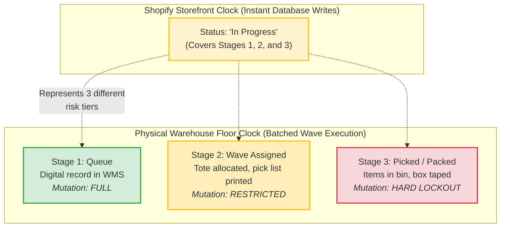
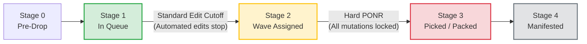
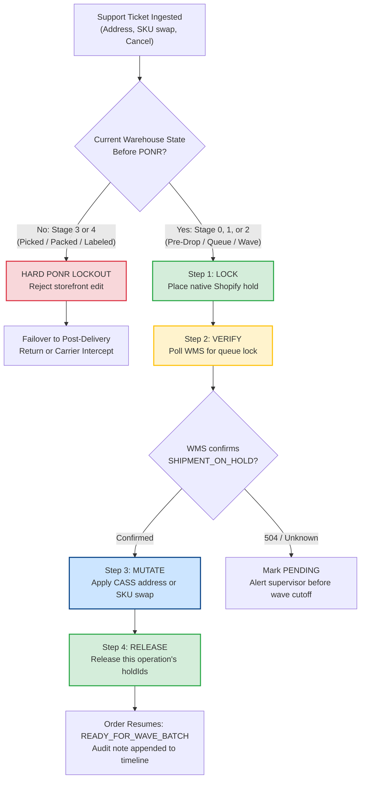
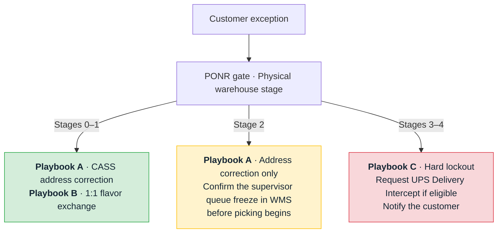

# The Hold That Landed: How a 133-Second Freeze Kept a Correct Address Correct

*Synapse Botanicals Systems Architecture | Order Lifecycle & Point of No Return (PONR) Engineering | Compiled 2026-11-10*

---

## 1. The Hook: The 49-Mile Desynchronization

Marcus Chen fixes his shipping address on his phone. It takes four seconds: one field, one tap, one green checkmark. The storefront says *saved*.

Nothing on a warehouse floor in Allentown, Pennsylvania has heard about it.

A database write is a statement of intent. A carton on a conveyor is a fact. The distance between the two is where Order #18404—a $102 purchase comprising two $42 stick packs and $18 expedited shipping—nearly became a mis-shipment. The carton was bound for Scranton, PA when the customer actually lived in Binghamton, NY, a 49-mile interstate delta that no amount of storefront correctness could have closed on its own.

The save did not stop the order. **Stopping it took 133 seconds** of coordinated freeze, verification, mutation, and release, and the order had to be found still standing in the queue when that work finished.

```text
       10:14:00 EST              10:14:18 EST                 10:16:13 EST   10:16:15 EST
  Customer Ticket Ingested   Warehouse Lock Confirmed     Release Confirmed   Order Resumed
  ───────────●─────────────────────────●──────────────────────────●──────────────●────────►
             │ ◄─ 18s: Native Hold ──►│ ◄─ 115s: CASS, Mutate, ─►│ ◄─── 2s ────►│
             │     & Queue Lock       │      Verify, Release     │  Wave re-entry│
             │                                                   │
             └──────────── 133 Seconds Total Freeze ────────────┘
```

At 10:14:00 EST, customer Marcus Chen submitted an urgent ticket: he had moved from Scranton, Pennsylvania to Binghamton, New York—about 49 miles apart, crossing state lines. Order **#18404** was already queued at Synapse's Allentown fulfillment center (`LOC-PA-01`). Within 18 seconds of ticket ingestion, the coordinator placed a native fulfillment hold in Shopify and obtained an authenticated queue lock from the warehouse management system (WMS). Over the next 115 seconds, the address underwent postal standardization, the order record was updated, and the hold was released. Release was confirmed at 10:16:13 EST, 133 seconds after ingestion. Order #18404 re-entered the wave queue at 10:16:15 EST, 135 seconds after ingestion and into the Allentown wave queue with the correct Binghamton shipping label.

The wrong label never printed because the order was physically prevented from moving while its address was in doubt.

> [!CAUTION]
> **Staging Scenario Disclosure**: Order #18404, Marcus Chen, and the trace timings in this dossier are a **staged scenario** characterizing the Synapse Botanicals integration architecture. They are not an extract from a production database, and `marcus.chen@example.com` is a reserved example domain. The offline test harnesses in Section 11 verify the *coordination mechanics*; they do not reproduce this timeline. All financial figures represent unit-economic scenario modeling.

### Executive Incident Matrix

| Dimension | Detail | Why it matters |
|---|---|---|
| **Order Profile** | `#18404` · `gid://shopify/Order/5892114432104` · FO `gid://shopify/FulfillmentOrder/6710448123901` · 2× Focus Stick Packs 30-Pack ($84.00) + Expedited Shipping ($18.00) = **$102.00** | Ingestible product plus a paid priority SLA: the two attributes that shrink the safe edit window. |
| **Origin & Route** | Origin `LOC-PA-01` (Allentown, PA). Wrong destination: Scranton, PA. Correct destination: Binghamton, NY. **49-mile interstate delta.** | The correction crosses a state line, so zone, node, and tax-jurisdiction inputs all change. |
| **Ingestion Window** | Ticket received **10:14:00 EST**, 11 minutes after checkout. The order had entered WMS at 10:04:12. | The order was already in the warehouse queue when the customer asked to change it. |
| **Safety Invariant** | **Freeze-First**: confirm the *physical* queue lock before any mutation; release only the hold you placed. | An unconfirmed freeze is not a freeze. |
| **Financial Exposure** | Order #18404 is a **$102.00 purchase**. A mis-shipment would create additional product, reverse-freight and recovery costs; Section 3 illustrates these using a separate one-pack example.. | Recovery costs depend on the basket and whether the customer receives a refund or replacement. |
| **Operational Result** | Frozen, corrected with CASS-standardized ZIP+4, released. Release confirmed at **10:16:13 EST** after **133 seconds**; order resumed at **10:16:15 EST** after **135 seconds.** |

---

## 2. The Illusion of "In Progress" (Five Physical Stages, Two Clocks)

Shopify Admin has one dial for fulfillment. The warehouse has five physical stages. They run on **different clocks**, and the storefront clock is the one that lies.

Shopify operates on near-instantaneous ACID database transactions. A 3PL warehouse (such as ShipBob operating facilities in Allentown, PA and Reno, NV) operates on physical batching clocks—periodic API polling cycles (typically 15 minutes) and scheduled wave releases where 50 to 100 orders are dropped to pickers simultaneously. Between these two clocks lies an architectural gap where runaway parcels are born.



### 2.1 The Five-Stage State Matrix & Discrepancy Telemetry

| Stage | Physical reality on floor | Shopify Admin shows | Hazard Level | Mutation Eligibility | Operational Discrepancy |
|---|---|---|---|---|---|
| **0 · Pre-Drop** | Order sits in the fraud/edit buffer; WMS has no record. | `Unfulfilled` *(hold active)* | **Zero Risk** | Full mutation; immediate cancellation. | None. Storefront and floor agree. |
| **1 · In Queue** | Digital record imported to WMS queue; awaiting wave allocation. | `In Progress` | **Low Hazard** | Full mutation; **hold mandatory**. | Admin hides that the order is now *also* active in another system. |
| **2 · Wave Batch** | Grouped into pick wave; pick list printed; tote assigned. | `In Progress` | **Moderate Hazard** | Address changes only, via **supervisor queue freeze**. No automated SKU swaps. | Identical label to Stage 1; the SKU-swap window has silently closed. |
| **3 · Picked / Packed** | Items pulled from bin; carton taped; barcode scanned. | `In Progress` | **High Hazard** | **HARD PONR LOCKOUT**: No storefront mutation permitted. | Identical label to Stages 1 and 2; every storefront mutation is now unsafe. |
| **4 · Manifested** | Shipping label affixed; carton staged on carrier dock. | `Fulfilled` | **Irreversible** | Post-fulfillment carrier intercept only. | Admin finally agrees with reality, too late to edit. |

> [!WARNING]
> **The Critical Vulnerability**: Stages **1, 2, and 3 all display the identical `In Progress` status in Shopify Admin**. A single storefront label masks three completely different operational environments: *safe to edit*, *edit only with a supervisor*, and *hard physical lockout*. Any integration that gates mutations on Shopify Admin status alone is gating on noise.

### 2.2 The Two Operational Boundaries

Fulfillment safety requires recognizing two distinct operational boundaries rather than a single vague "cutoff":



| Boundary | Location | Trigger Event | Consequence |
|---|---|---|---|
| **Boundary 1: Standard Edit Cutoff** | End of Stage 1 | Wave allocation in WMS | Automated line-item edits and SKU swaps stop. Address changes now require a supervisor queue freeze. |
| **Boundary 2: Hard Point of No Return (PONR)** | Start of Stage 3 | Physical pick scan | All storefront mutations are permanently locked out. Only carrier intercept remains. |

Stage 2 represents the narrow corridor between the two boundaries. In Stage 2, line-item changes are strictly forbidden, but an address correction may still proceed *if and only if* the WMS confirms an immediate supervisor queue freeze before the physical pick begins.

---

## 3. What One Mis-Shipped Carton Costs (Unit Economics & FDA Scrap)

The 133-second protocol kept Order #18404’s two-pack shipment on the correct route. To show how mis-shipment costs accumulate, this section uses a separate single-pack illustration.

### 3.1 Regulatory Governance: FDA 21 CFR Part 111 cGMP

Synapse Botanicals manufactures dietary supplements and functional nootropics. Unlike apparel, footwear, or consumer electronics, ingestible health products operate under strict federal safety regulations.

Under **FDA 21 CFR Part 111** (Current Good Manufacturing Practice in Manufacturing, Packaging, Labeling, or Holding Operations for Dietary Supplements), returned ingestible products cannot simply be inspected visually and returned to active inventory. The law mandates:
* Complete physical quarantine of all returned product lots.
* Detailed quality control evaluation and written disposition records.
* Validation that storage conditions (temperature, humidity, seal integrity) were never compromised while out of company control.

Because standard parcel tracking (USPS Ground Advantage, UPS Ground) provides **zero temperature telemetry**, Synapse Quality Operating Procedure dictates that **any ingestible product that leaves the custody of the fulfillment network must be directed to `QUARANTINE-SCRAP` and physically destroyed.** A mis-shipped bottle of nootropics cannot be resold. It is an immediate 100% loss.

> [!NOTE]
> This section describes an internal operating policy for cost modeling. It is not legal advice or a regulatory determination; confirm disposition rules with your quality and regulatory owner.

### 3.2 The Mis-Shipment Loss Ledger

> **Self-Contained Projection — Single-Pack Mis-Shipment Economics**: The table below is an independent unit-economics illustration for one mis-shipped Focus Stick Pack 30-Pack (SYN-FSTK-MY, $42.00 retail / $8.50 COGS). It is not the economics of Order #18404 itself ($102.00, 2 packs + $18.00 expedited shipping). It models what a single unmitigated mis-delivery would cost in isolation. Platform BOM rates are sourced from evidence/costs/summary.md.

This separate illustration covers one $42.00 Focus Stick Packs 30-Pack (`SYN-FSTK-MY`), fully refunded after a mis-shipment, with no replacement or customer shipping revenue. Handling and payment fees not listed below are excluded:

| Component | Cost Type | Amount |
|---|---|---:|
| Product cost (COGS) per carton | Cash | $8.50 |
| Unrecoverable outbound carrier freight | Cash | $6.50 |
| Carrier return-to-sender (RTS) reverse freight | Cash | $7.20 |
| 3PL physical quarantine & destruction fee | Cash | $1.50 |
| **Direct out-of-pocket cash drain** | | **$23.70** |
| Retail price | | $42.00 |
| Less COGS | | −$8.50 |
| Less normal outbound freight | | −$6.50 |
| **Normal contribution before unlisted fees** ($42.00 − $8.50 − $6.50) | Economic | **$27.00** |
| **Contribution deterioration per carton** ($27.00 − (−$23.70))| | **$50.70** |

```text
┌──────────────────────────────────────────────────────────────────┐
│          ONE MIS-SHIPPED CARTON · Focus Stick Pack 30-Pack        │
├──────────────────────────────────────────────────────────────────┤
│  DIRECT CASH DRAIN                                                │
│    COGS written off (mandatory destruction under FDA cGMP) $ 8.50│
│    Outbound freight (unrecoverable) ....................  $ 6.50 │
│    RTS reverse freight .................................  $ 7.20 │
│    3PL quarantine fee ..................................  $ 1.50 │
│                                                         ─────── │
│                                              CASH:       $23.70  │
│                                                                   │
│  NORMAL CONTRIBUTION ($42.00 − $8.50 − $6.50) ........  $27.00 │
│                                                         ─────── │
│  CONTRIBUTION DETERIORATION ............................  $50.70  │
│                                                                   │
│  $50.70 ÷ $42.00 retail = 120.7% of retail value          │
└──────────────────────────────────────────────────────────────────┘
```

A single Focus Stick Pack 30-Pack (`SYN-FSTK-MY`) sells for **$42.00** and costs **$8.50** to produce. This standalone example assumes **$6.50** in outbound freight. In the mis-shipment scenario, the merchant issues a full refund, pays to bring the carton back, and has it destroyed. The model excludes replacement shipments, customer shipping revenue, pick-and-pack handling, and payment processing fees.

| Component | Successful sale | Mis-shipment | Why it’s included |
|---|---:|---:|---|
| Sales revenue kept | $42.00 | $0.00 | The merchant keeps the sale price when the order succeeds. A full refund leaves no sales revenue. |
| Product cost (COGS) | $8.50 | $8.50 | Both outcomes use one carton. The merchant sells it in the first case and writes off its cost when the returned carton is destroyed. |
| Outbound freight | $6.50 | $6.50 | The carrier charges to ship the carton out in both cases. |
| Return freight | $0.00 | $7.20 | The carrier charges to bring the mis-shipped carton back. |
| Quarantine and destruction | $0.00 | $1.50 | The warehouse charges to set the returned carton aside and destroy it. |
| **Contribution after listed costs** | **$27.00 kept** | **$23.70 lost** | Subtract the listed costs from the sales revenue kept in each scenario. |

**The mis-shipment leaves a $23.70 loss.** A successful sale would have left **$27.00 in contribution**, so the merchant ends up **$50.70 worse off**. That difference comes from **$42.00 refunded to the customer** and **$8.70 in extra return and disposal costs**. The carton and outbound shipping cost the same either way.

> [!NOTE]
> **Shared product cost, separate loss scenarios.** The $8.50 Focus Stick cost comes from the [BOM ledger](../evidence/costs/summary.md). This single-pack example assumes a full $42.00 refund, $6.50 original freight, $7.20 return freight, and a $1.50 quarantine charge. The Capstone’s Order #35070 uses the same $8.50 stick cost as one component of a $28.40 kit ($8.50 sticks + $12.50 tincture + $7.00 tumbler + $0.40 kitting materials). In that separate scenario the merchant keeps the sale and sends a replacement. [Capstone Section 6.1](../capstone/MasterDossier-Capstone-AsynchronousOrderMutation.md) itemizes the replacement branch.

### 3.3 Scaled Monthly Exposure Model

For this projection, all 150 monthly exceptions are assumed to follow the single-pack refund scenario in Section 3.2:

$$\text{Monthly Exposure} = \text{Daily Orders} \times 30 \times \text{Address Error Rate} \times \text{Unit Cost}$$

| Input Parameter | Value | Operational Context |
|---|---|---|
| Order Volume | 1,000 orders/day | 30,000 orders/month |
| Address Error Rate | 0.5% | Industry baseline across DTC checkouts |
| Tickets Per Month | 150 exception tickets | 30,000 × 0.005 = 150 |

| If the freeze fails on every ticket | Cost Per Carton | Monthly Expense (×150) | Annualized Exposure (×12) |
|---|---:|---:|---:|
| **Direct cash drain** | $23.70 | **$3,555.00 / month** | **$42,660.00 / year** |
| **Contribution deterioration** | $50.70 | **$7,605.00 / month** | **$91,260.00 / year** |

A robust integration protocol that freezes warehouse execution in under 18 seconds does not merely improve customer satisfaction—At 150 modeled single-pack refund events per month, the contribution exposure reaches **$7,605 monthly**, or **$91,260 annually**.

---

## 4. The 133-Second Trace: Dissecting Order #18404

### 4.1 Order & Exception Ingestion Profile

| Field | Value |
|---|---|
| Customer | Marcus Chen (`marcus.chen@example.com`) |
| Order ID | `gid://shopify/Order/5892114432104` (Display: `#18404`) |
| Fulfillment Order ID | `gid://shopify/FulfillmentOrder/6710448123901` |
| Line Items | 1× Focus Stick Packs Matcha Yuzu (`SYN-FSTK-MY`, $42.00), 1× Focus Stick Packs Blood Orange (`SYN-FSTK-BO`, $42.00), Expedited Shipping ($18.00) |
| Total Captured | **$102.00** |
| Allocated Node | Allentown, PA (`LOC-PA-01`) |
| Destination Route | Scranton, PA 18503 $\rightarrow$ Binghamton, NY 13901-3412 (49-mile interstate delta) |
| Checkout Timestamp | ≈10:03:00 EST (ticket arrived 11 minutes later) |
| Customer Exception Ticket | 10:14:00 EST (Gorgias `#T-10492`): *"URGENT: I entered my old apartment address in Scranton PA, but I just moved to Binghamton NY! Please update before shipping!"* |
| Physical Stage at Ingestion | **Stage 1 · In Queue** |

### 4.2 Chronological Event Timeline

```text
 10:03:00  checkout ─┐
 10:04:10  fraud pass│   Expedited SLA bypasses the 15-minute buffer
 10:04:12  WMS drop ─┘   Stage 1 begins
    ·
    ·   588 seconds pass with no one aware the address is wrong
    ·
 10:14:00  ticket ingested ──► [18s] ──► 10:14:18 queue lock confirmed
                                          │
                                          ├─ 64s  USPS CASS verification ─► 10:15:22
                                          ├─  8s  orderUpdate           ─► 10:15:30
                                          ├─ 30s  coordinator verify/log ─► 10:16:00
                                          ├─  8s  release (GraphQL)      ─► 10:16:08
                                          └─  5s  WMS release            ─► 10:16:13
                                                                              │
 10:16:15  order resumed to wave with Binghamton label ◄─────── +2s ──────────┘
```

| Timestamp (EST) | Elapsed | System / Domain | Event & Action | Clock Domain |
|---|---:|---|---|---|
| **10:04:12** | — | ShipBob WMS | Order drops to WMS queue (Stage 1 begins) | Warehouse |
| **10:14:00** | T+0s | Gorgias | Support ticket `#T-10492` ingested via webhook | Software |
| **10:14:02** | +2s | Shopify Flow | Idempotency key `MUT-18404-ADDR` assigned; transaction opened | Software |
| **10:14:04** | +2s | Shopify Admin | `fulfillmentOrderHold` dispatched automatically while order was queued (Stage 1, `reason: INCORRECT_ADDRESS`) | Software |
| **10:14:18** | +14s | ShipBob WMS | Adapter confirms WMS queue lock (`SHIPMENT_ON_HOLD`, Queue `#SB-948102`) | **Warehouse API** |
| **10:15:22** | +64s | USPS CASS | Normalization returns DPV-valid ZIP+4 (`13901-3412`) | Software |
| **10:15:30** | +8s | Shopify Admin | `orderUpdate` executed with standardized postal payload after WMS queue lock confirmation (ledger delta $0.00) | Software |
| **10:16:00** | +30s | Coordinator | Coordinator verification and un-editable audit logging | Software |
| **10:16:08** | +8s | Shopify Admin | `fulfillmentOrderReleaseHold` dispatched specifying explicit `holdIds` | Software |
| **10:16:13** | +5s | ShipBob WMS | Adapter verifies WMS transition to `READY_FOR_WAVE_BATCH` | **Warehouse API** |
| **10:16:15** | +2s | ShipBob WMS | Order resumes in wave eligibility with Binghamton shipping label | Warehouse |

Freeze duration: 10:14:00 → 10:16:13 = **133 seconds**. Native hold and queue lock took **18 seconds** (10:14:00 → 10:14:18). Internal validation, mutation, and release took **115 seconds** (10:14:18 → 10:16:13).

> [!NOTE]
> **Timestamp reconciliation.** The 18s + 115s = 133s split and the 19s/114s split in Section 4.3 are the fixed invariants. Measured to the order's resumption at 10:16:15, elapsed time is 135 seconds, so this dossier counts the freeze to **release confirmation (10:16:13)** and treats the final 2 seconds as wave re-entry.

### 4.3 The 19-Second Discovery

Where did the 133 seconds go?

| Operational Component | Duration | Share of Total | Clock Domain |
|---|---:|---:|---|
| WMS queue lock (API round trip) | 14 seconds | 10.5% | Hardware / 3PL |
| WMS release (API round trip) | 5 seconds | 3.8% | Hardware / 3PL |
| **Total warehouse API network time** | **19 seconds** | **14.3%** | **Hardware / 3PL** |
| USPS CASS address verification | 64 seconds | 48.1% | Software / USPS |
| Shopify GraphQL execution | 18 seconds | 13.5% | Software / Shopify |
| Coordinator verification / logging | 30 seconds | 22.6% | Software / Internal |
| Webhook Ingestion | 2 seconds | 1.5% | Software / Flow |
| **Total internal software validation** | **114 seconds** | **85.7%** | **Software / Internal** |
| **Total Freeze Duration** | **133 seconds** | **100.0%** | |

**Architectural Takeaway**: Warehouse APIs are not the primary bottleneck in order mutation. Internal software coordination and validation pipelines are. If you want the mutation window to shrink, optimize the 114 seconds you own, not the 19 seconds you rent. The single largest item, CASS validation at 64 seconds, runs *while the freeze is already holding the order*, which is exactly why Freeze-First provides ironclad, zero-risk insurance.

### 4.4 The Four Wire Payloads

> [!NOTE]
> The Shopify mutations below follow the Admin GraphQL schema shapes for `fulfillmentOrderHold`, `orderUpdate`, and `fulfillmentOrderReleaseHold`. The 3PL adapter endpoint is Synapse's own normalized contract.

#### Step 1: Freeze (`fulfillmentOrderHold`)

```graphql
mutation FreezeFulfillmentOrder($id: ID!, $hold: FulfillmentOrderHoldInput!) {
  fulfillmentOrderHold(id: $id, fulfillmentHold: $hold) {
    fulfillmentHold {
      id
      reason
      reasonNotes
      handle
    }
    fulfillmentOrder {
      id
      status
    }
    userErrors {
      field
      message
    }
  }
}
```

```json
{
  "id": "gid://shopify/FulfillmentOrder/6710448123901",
  "hold": {
    "reason": "INCORRECT_ADDRESS",
    "reasonNotes": "Customer address correction ticket. Synapse PONR coordinator freeze.",
    "handle": "synapse-addr-18404"
  }
}
```

Expected result: `fulfillmentHold.id = gid://shopify/FulfillmentHold/89104`. **Persist this ID.** Step 4 depends on it.

#### Step 2: Verify the WMS Queue Lock (3PL Adapter)

```http
GET /shipments?order_id=gid://shopify/Order/5892114432104 HTTP/1.1
Host: 3pl-adapter.synapse.internal
Authorization: Bearer <token>
```

```json
{
  "queue_id": "SB-948102",
  "external_order_id": "5892114432104",
  "fulfillment_node": "LOC-PA-01",
  "shipment_state": "On Hold",
  "queue_lock": "SHIPMENT_ON_HOLD",
  "wave_id": null,
  "pick_status": "NOT_PICKED",
  "lock_timestamp": "2026-11-10T15:14:18Z"
}
```

**Proceed only if** `queue_lock == "SHIPMENT_ON_HOLD"` **and** `wave_id == null` **and** `pick_status == "NOT_PICKED"`. A Shopify 200 on Step 1 does not satisfy this gate.

#### Step 3: Mutate (`orderUpdate` with CASS-Standardized Input)

```graphql
mutation CorrectShippingAddress($input: OrderInput!) {
  orderUpdate(input: $input) {
    order {
      id
      shippingAddress {
        address1
        address2
        city
        provinceCode
        zip
        countryCode
      }
    }
    userErrors {
      field
      message
    }
  }
}
```

```json
{
  "input": {
    "id": "gid://shopify/Order/5892114432104",
    "shippingAddress": {
      "firstName": "Marcus",
      "lastName": "Chen",
      "address1": "142 COURT ST",
      "address2": "APT 3B",
      "city": "BINGHAMTON",
      "provinceCode": "NY",
      "zip": "13901-3412",
      "countryCode": "US"
    }
  }
}
```

The address is the **CASS-standardized, ZIP+4** output, never the raw customer text.

#### Step 4: Release (`fulfillmentOrderReleaseHold`, Explicit `holdIds`)

```graphql
mutation ReleaseOurHoldOnly($id: ID!, $holdIds: [ID!]) {
  fulfillmentOrderReleaseHold(id: $id, holdIds: $holdIds) {
    fulfillmentOrder {
      id
      status
    }
    userErrors {
      field
      message
    }
  }
}
```

```json
{
  "id": "gid://shopify/FulfillmentOrder/6710448123901",
  "holdIds": [
    "gid://shopify/FulfillmentHold/89104"
  ]
}
```

> [!IMPORTANT]
> **Hold Isolation Rule**: Passing explicit `holdIds` is **mandatory**. In the Shopify Admin API, omitting `holdIds` instructs the system to release **every active hold on the fulfillment order**. If an order has an independent fraud hold or a tax review lock placed by another system, a generic release call will silently clear those holds as well. Enterprise mutations must strictly release only the specific hold ID they created.

---

## 5. The Priority Bypass Seam: Why T+11 Was Already in Queue

A support agent sees an order 11 minutes old and reasons: *"Standard orders sit in a 15-minute buffer. We have four minutes."* For Order #18404, that reasoning was wrong.

```text
STANDARD ORDER (15-minute fraud/edit buffer)
 00:00        checkout
 ├────────────────── 15:00 buffer: Stage 0, Zero Risk ──────────────────┤
 15:00                                                         WMS drop (Stage 1)
 ▲ ticket at T+11 arrives INSIDE the buffer: a pure storefront edit.

EXPEDITED ORDER (#18404)
 00:00  checkout
 ├─ 1:10 ─┤ fraud scoring passes (10:04:10)
          ├2s┤ WMS drop (10:04:12)  ◄── Stage 1 begins at T+1:12
              ├───────────────── 9:48 (588s) in queue ─────────────────┤
                                                              ticket at T+11:00 (10:14:00)
 ▲ ticket arrives AFTER the drop: the order is already in the warehouse's hands.
```

### The Architectural Explanation: Expedited SLA Routing

This timing reflects a core e-commerce architectural rule: **Shipping Service Level Agreements (SLAs) override batching buffers.**

Order #18404 was not a standard ground shipment; the customer paid an **$18.00 premium for Expedited Shipping**. In order to meet guaranteed carrier transit cutoffs (e.g., UPS Next Day Air departing the Allentown dock at 2:00 PM), Shopify Flow routing rules evaluate incoming orders immediately:

1. **Standard Tier Orders**: Held in Shopify's Stage 0 buffer for 15 minutes to allow customer self-service edits and fraud risk scoring.
2. **Expedited Tier Orders**: Tagged with `priority:expedited`. Upon passing automated risk analysis (Risk Level == `LOW`), the coordinator immediately dispatches the fulfillment request to the 3PL to ensure the parcel catches the earliest available picking wave.

Order #18404 cleared fraud scoring at 10:04:10 EST and was pushed to ShipBob two seconds later. By the time Marcus Chen sent his ticket at 10:14:00 EST, the order had been in the Allentown queue for nearly ten minutes (588 seconds).

**The Rule**: In expedited fulfillment, the safe editing window does not last 15 minutes. It closes in **under 600 seconds** from WMS drop.

The 600-second figure is a *design budget*, not a measured wave cadence. Note the arithmetic: the ticket arrived 588 seconds after drop, and the queue lock was confirmed at 606 seconds after drop. The order was saved with no margin in the budget, not by the budget. This is precisely why the protocol never assumes a buffer exists: **check the physical stage, then freeze.**

---

## 6. The Freeze-First Protocol (The 4-Step Lock)

The Freeze-First protocol enforces a strict, ordered state transition that guarantees the storefront never gets ahead of the warehouse floor.



### The Four Sequential Gates

1. **Gate 1: Freeze (Place Native Hold)**
   * *Target*: Shopify Admin GraphQL `fulfillmentOrderHold`.
   * *Contract*: Specify `reason: INCORRECT_ADDRESS` and a stable idempotency `handle`.
   * *Invariant*: This halts automated Shopify fulfillment workers but does *not* prove the warehouse floor has stopped. Persist `fulfillmentHold.id` immediately.
2. **Gate 2: Verify (Obtain Physical WMS Queue Lock)**
   * *Target*: 3PL Adapter `GET /shipments?order_id={id}`.
   * *Contract*: Assert `queue_lock == "SHIPMENT_ON_HOLD"`, `wave_id == null`, and `pick_status == "NOT_PICKED"`.
   * *Invariant*: An HTTP 200 response from the warehouse API confirms message delivery, *not* a floor freeze. Mutation remains blocked until the queue lock token is returned.
3. **Gate 3: Mutate (Apply Record Update)**
   * *Target*: Shopify GraphQL `orderUpdate` (for address) or `orderEditCommit` (for line items).
   * *Contract*: Address must pass USPS CASS/DPV validation; line-item swaps must balance ledger deltas to $0.00.
4. **Gate 4: Release (Scoped Re-Queueing)**
   * *Target*: Shopify Admin GraphQL `fulfillmentOrderReleaseHold`.
   * *Contract*: Pass exact `holdIds` created in Gate 1.
   * *Invariant*: Confirm the WMS status transitions back to `READY_FOR_WAVE_BATCH` with updated metadata.

In this case, Order #18404 received a verified warehouse lock 18 seconds after ticket ingestion and resumed with the corrected Binghamton label. In the separate Capstone case, Order #35070 received a 504 at the hold gateway and still carried the old Philadelphia destination in the Reno queue. That outcome calls for a warehouse state check before any update or retry. [Capstone Sections 3–5](../capstone/MasterDossier-Capstone-AsynchronousOrderMutation.md) traces the timeout through the warehouse cutoff.

---

## 7. Reading the Telemetry: "I Don't Know" vs. "Too Late"

Three status codes decide what happens next, and they do not mean what they appear to mean.

| Inbound Telemetry Signal | Exact Technical Meaning | Architectural Interpretation | Required System Action |
|---|---|---|---|
| **Shopify Hold 200 OK** (`userErrors: []`) | Shopify database flagged fulfillment order as `ON_HOLD`. | **Storefront intent recorded.** Floor has NOT stopped. | Proceed to Gate 2; **do NOT mutate order record yet.** |
| **WMS HTTP 200 OK** | WMS HTTP gateway accepted the JSON hold request payload. | **Message transport confirmed.** Floor has NOT stopped. | Maintain hold; poll for physical queue lock confirmation. |
| **WMS `SHIPMENT_ON_HOLD`** (with Queue ID) | WMS scheduler locked the queue record; pick list generation frozen. | **Physical floor stopped.** Order safely immobilized. | **Clear Gate 3:** Proceed with CASS validation and mutation. |
| **HTTP 504 Gateway Timeout** | Gateway closed connection before upstream WMS confirmed state. | **Outcome UNKNOWN.** The hold may or may not have landed. | **Mark PENDING.** Reuse idempotency key; alert supervisor before wave cutoff. **Never retry blindly.** |
| **HTTP 422 `PONR_EXCEEDED`** | WMS business engine rejected hold; order already picked or batched. | **Cutoff crossed.** Mutation is physically impossible. | **HARD LOCKOUT.** Terminate mutation loop; route immediately to Carrier Recovery. |

```json
{
  "error": "PONR_EXCEEDED",
  "message": "Shipment has crossed the physical pick boundary; mutation refused.",
  "order_id": "gid://shopify/Order/5892114432104",
  "pick_status": "PICKED",
  "idempotency_key": "ponr-18404-addr-v1"
}
```

```text
┌─────────────────────────────────────────────────────────────────┐
│  200  =  "I GOT YOUR MESSAGE"   → the floor has NOT stopped     │
│  504  =  "I DON'T KNOW"         → PENDING · same key · escalate │
│  422  =  "TOO LATE TO CHANGE"   → lockout · UPS Intercept       │
├─────────────────────────────────────────────────────────────────┤
│  Confirm the LOCK, not the 200.                                 │
└─────────────────────────────────────────────────────────────────┘
```

**Why 504 is the most dangerous signal.** A timeout after the remote side already succeeded looks identical to a timeout where nothing happened. A blind retry with a *fresh* key can double-apply; a retry with the *same* key and a reconciliation read cannot. The offline harness exercises both cases (Section 11).

---

## 8. Three Operational Playbooks: One Gate

Every customer request, whether address edit, flavor swap, or cancellation, enters through **the same physical-state gate**. The playbooks differ in what happens after it.



### 8.1 Playbook A: CASS-Standardized Address Correction

*The Order #18404 Path.*

1. **Gate Assessment**: Read physical stage. Stage 0–1 $\to$ automated fast-path; Stage 2 $\to$ supervisor freeze; Stage 3+ $\to$ Playbook C.
2. **Freeze $\to$ Verify** (Gates 1–2): Confirm WMS queue lock token before touching record.
3. **USPS CASS / DPV Normalization**: Run raw user address through CASS standardization, appending ZIP+4 and verifying Delivery Point Validation (DPV):
   ```text
   Raw Input:   142 Court Street, Apt 3B, Binghamton, NY 13901
   CASS Output: 142 COURT ST APT 3B, BINGHAMTON NY 13901-3412 (DPV: Valid)
   ```
4. **Dynamic Zone & Node Recalculation**: Re-evaluate carrier shipping zone and origin node. For Order #18404, the destination crosses state lines from PA to NY, so the coordinator flags the cross-state delta for tax and rate reconciliation.
5. **Mutate $\to$ Release** (Gates 3–4): Execute `orderUpdate` and release with explicit `holdIds`.
6. **Timeline Audit Logging**: Write an un-editable staff note to the Shopify timeline:
   ```text
   [CASS-ADDR-UPDATE] Raw: 142 Court Street, Apt 3B, Binghamton, NY 13901 -> CASS: 142 COURT ST APT 3B, BINGHAMTON NY 13901-3412. Auth: Gorgias #T-10492. HoldId: 89104.
   ```

### 8.2 Playbook B: 1:1 Consumable Flavor Exchange

*Available only before Boundary 1: Stage 0–1, prior to wave assignment.*

1. **Gate**: If wave assigned (Stage 2+), **SKU swaps are closed**; route to post-delivery exchange.
2. **Freeze $\to$ Verify**: Obtain WMS queue lock.
3. **Real-Time Available-to-Sell (ATS) Verification**: Query warehouse inventory at the specific allocated node (`LOC-PA-01`). Available inventory must satisfy $\text{ATS} \ge 5\text{ units}$ to prevent overselling active picking waves.
4. **Strict Catalog Family Constraint**: Swaps are strictly limited to products within the identical product master family and at an identical price point (`SYN-FSTK-MY` $\leftrightarrow$ `SYN-FSTK-BO`, both $42.00).
5. **Zero-Balance Financial Reconciliation**: Subtotals, promotional discounts, jurisdictional sales taxes, and captured payments must reconcile to exactly **$0.00 net delta**.
6. **Mutate $\to$ Release**: Execute `orderEditCommit` and release with explicit `holdIds`.

### 8.3 Playbook C: Cancellation & Hard Lockout Failover

*Stage 3 and beyond. Storefront mutations are over; the carrier is the only lever left.*

1. **Receive 422 `PONR_EXCEEDED`** or a physical state of picked/packed/manifested.
2. **Programmatic Storefront Lockout**: Disable "Cancel Order" in Shopify Admin; do NOT retry mutation.
3. **Submit UPS Delivery Intercept v2**: Submit carrier request through the Synapse adapter, which translates to the carrier's wire contract. The normalized adapter body must **never be sent directly to UPS**. The offline suite checks a return request with `requestType: RS` and canceled reason `AM`.
4. **Interpret Carrier Results Honestly**:
   - HTTP 200 with `success: false` is a **business failure**.
   - Electronic acceptance (`ACCEPTED`) is **not** physical recovery. Remain in "pending" until a physical tracking event confirms depot diversion.
   - A timeout is `UNKNOWN`; reconcile by lookup, not by resubmission.
5. **Modeled Recovery Economics**: Successful return costs **$17.50**; failed or rejected requests cost **$0.00** in the fixtures.
6. **Customer Transparency Automation**:
   > *"Hi Marcus, we caught your address update after your order had already been packed at our Allentown distribution center, which means we could no longer modify it in our system. We have initiated a carrier reroute request with UPS. Intercepts are requests, not guarantees. We will notify you the moment the carrier confirms diversion, and we will ensure your order reaches Binghamton regardless."*

> [!NOTE]
> Replacement economics in the BOM package (`evidence/costs/summary.md`) show how expensive this branch is: an incremental recovery cost of **$98.60** turns a $54.76 baseline contribution into **−$43.84**. That is the economic argument for catching tickets *before* Boundary 2.

---

## 9. The Four Operational Laws of Order Lifecycle

1. **Freeze First, Mutate Second**: Never change an order that has not been physically held. A mutation without a freeze is a race you have chosen to run.
2. **Receipt Is Not a Stop (Confirm the Lock, Not the 200)**: An acknowledgment proves only that a packet reached a server. The only signal that clears a mutation is a confirmed `SHIPMENT_ON_HOLD` queue token.
3. **Release Only What You Held (Explicit `holdIds`)**: Your hold is the only hold you may release. Passing explicit `holdIds` ensures that resolving an address issue does not accidentally release an order undergoing fraud or tax review.
4. **Never Mutate Past Picked**: After the pick scan, the database is describing a world that no longer exists. All storefront mutations are terminated; pivot immediately to carrier intercept and FDA cGMP quarantine disposal.

---

## 10. The Architectural Takeaway

Marcus Chen never learned that his order spent two minutes in suspended animation. His carton arrived in Binghamton. The only record of the near miss is a timeline entry and a freeze duration of 133 seconds.

That is what a correct integration layer looks like: invisible when it works, because it refused to let a four-second tap on a phone outrun a physical conveyor 49 miles away.

In e-commerce, it is trivial to build software that works when everything goes smoothly. What distinguishes enterprise engineering is how a system behaves when a customer changes their mind while an automated warehouse is already in motion.

> *"In a distributed system, database state is an aspiration; physical warehouse state is reality. The job of the integration layer is to ensure the aspiration never outruns the reality."*

---

## 11. What Is Proven, and What Is Only Designed

In accordance with rigorous systems architecture principles, this section strictly separates locally verified software test suites from operational specifications.

**Ground-Truth Evidence References:**
- [Coordinator Latency Benchmark](../evidence/latency/summary.md)
- [Unit Cost & BOM Ledger](../evidence/costs/summary.md)
- [Carrier Recovery Contracts](../evidence/carrier-recovery/summary.md)
- [Reproducible Evidence Suite](../evidence/README.md)

### 11.1 Evidence Scope & Verification Status Matrix

| System Component / Claim | Evidentiary Status | Verification Source | Not Established / Scope Boundary |
|---|---|---|---|
| **Atomic claim of a hold, one WMS-simulator effect per eligible request** | **Executed locally** | Latency suite (34/34 passed) | Real vendor WMS API behavior |
| **Duplicate / replayed deliveries do not double-apply; payload conflicts rejected** | **Executed locally** | Latency suite (34/34 passed) | Cross-region delivery semantics |
| **Post-cutoff rejection preserved on replay; wave release mid-request rejects mutation** | **Executed locally** | Latency suite (34/34 passed) | A physical warehouse floor stop |
| **Timeout-after-success reconciles without a second effect; absent effect reconciles before same-key retry** | **Executed locally** | Latency suite (34/34 passed) | Production internet network failure modes |
| **Selective release preserves unrelated holds** | **Executed locally** | Latency suite (34/34 passed) | Live behavior of Shopify's hosted API |
| **Recovery by a new process after worker exit at the post-effect boundary** | **Executed locally** | Latency suite (34/34 passed) | Durable distributed locking across clusters |
| **Pinned UPS Delivery Intercept v2 snapshot matches provenance hash; selected wire constraints enforced** | **Verified offline** | Carrier suite (34 passed, **2 skipped**) | Full OpenAPI validation; provider certification |
| **Accepted ≠ recovered; duplicate events never repeat a fee; terminal states not overwritten** | **Executed locally** | Carrier suite (34 passed) | Physical carrier interception on trailers |
| **Printed BOM, contribution, and replacement arithmetic reconcile in whole integer cents** | **Executed locally** | Cost suite (11/11 passed) | Real supplier purchasing contracts, net profit |
| **The 133-second trace, Order #18404** | **Staged scenario** | Narrative scenario inputs | Any production wall-clock measurement |
| **FDA 21 CFR Part 111 scrap policy and fee lines** | **Scenario policy** | Declared regulatory inputs | Formal regulatory determination, contract rates |
| **Production latency, SQS delivery, vendor SLAs** | **Not established** | Architectural design | Live third-party platform guarantees |

### 11.2 Executed SQLite Coordinator Benchmark

**Run Metadata:** `2026-11-09T18-21-14-457Z-59d713d1` · `Node v24.22.1` · **34 Passed, 0 Failed, 0 Skipped**

The coordinator harness uses Node's built-in SQLite for a local persistent operation ledger and virtual WMS state. Atomic claims and conditional shipment updates are exercised locally; no vendor API or queue service is contacted. This reflects the default smoke profile (`--full` runs 10,000 attempts per workload).

| Workload | Attempts | Concurrency | p50 response ms | p95 response ms | p99 response ms | Business Effects |
|---|---:|---:|---:|---:|---:|---:|
| **Sequential local baseline** | 50 | 1 | 5.13 ms | 6.71 ms | 6.88 ms | 50 |
| **Concurrent local burst** | 200 | 25 | 13.99 ms | 24.88 ms | 28.20 ms | 200 |
| **Injected WMS delay** | 40 | 10 | 12.97 ms | 19.36 ms | 20.05 ms | 40 |
| **Same-payload duplicate pairs** | 100 | 20 | 0.16 ms | 10.94 ms | 14.31 ms | 50 |
| **Post-cutoff rejection** | 20 | 5 | 0.59 ms | 0.71 ms | 0.73 ms | 0 |
| **Response loss after WMS success** | 30 | 5 | 6.61 ms | 12.95 ms | 20.67 ms | 30 |

#### How to Read This Benchmark Table
- Timings use `performance.now()`; percentiles use nearest-rank (`ceil(p·N)−1`) with no interpolation.
- All outcomes are retained, including pending, rejected, and unknown results. **Response latency is not confirmation latency.**
- The seed reproduces *injected delays*, not operating-system scheduling or wall-clock durations.
- The **duplicate-pairs row** is the clearest illustration of idempotency: **100 deliveries produced exactly 50 business effects**.
- The **cutoff row** is the clearest illustration of the binary gate: **20 attempts produced exactly 0 effects**.
- Milliseconds in a local simulator are *not* comparable to the staged 19s/114s trace. The harness tests claim-and-commit mechanics; it does not measure external CASS calls or human review.

#### Core Passing Assertions (All 34 Verified)
1. **Atomic Claims**: An eligible hold commits exactly one WMS-simulator effect; a stale order revision cannot apply a hold.
2. **Serialized Duplicate Handling**: Concurrent same-order duplicates return *pending*; later replays return *confirmed*; competing operation IDs serialize on the same shipment; reconciliation cannot steal an active pending operation.
3. **Post-Cutoff Preservation**: A rejected cutoff outcome is preserved on duplicate delivery; a wave release between initial read and conditional hold rejects mutation.
4. **Selective Release**: Releasing the coordinator's hold preserves an unrelated hold.
5. **Uncertainty Handling**: Timeout after remote success reconciles without a second effect; absent effect reconciles before a safe same-key retry; revision change after an uncertain effect is detected.
6. **Payload Integrity**: Reusing a key for a different order, or with a changed address, is rejected as a conflict.
7. **Crash Recovery**: A new process recovers an effect persisted before worker termination.

---

*Compiled: 2026-11-10 | Synapse Botanicals Systems Architecture | Riovic Matthew*
