# Order State Machine & Point of No Return

> **Empirical staging simulation.** Synapse Botanicals is a technical operations sandbox used to stress-test e-commerce failure modes with synthetic customer and order fixtures. Commercial charges and financial outcomes are scenario inputs and calculations. The verification section distinguishes supplied trace excerpts, reproducible model results, and acceptance criteria for the designed controls. No production customer data or live fulfillment is represented.

## 1. Executive Context & Failure Mode

A commercial order can show an updated address while its warehouse shipment still carries the previous address. The operational hazard is the interval between a local Shopify update and downstream confirmation. At the modeled 800–1,200 orders/day load, preventing an incorrect release matters more than returning a fast but premature success message.

The control objective is **confirmed physical hold before mutation, followed by cross-system reconciliation before release**. Unknown outcomes remain pending; a single successful trace is not a guarantee of zero desynchronization.

## 2. Governance & Architecture Protocol

### 2.1 Resource and state mapping

| Normalized warehouse state | Physical interpretation | Customer-edit policy |
|---|---|---|
| NOT_EXPORTED | No downstream shipment yet | Edit only while export is gated |
| QUEUED | Imported, before wave release | Confirm hold before editing |
| WAVE_RELEASED | Work released to picking | Automatic edit rejected; warehouse escalation |
| PICKED / PACKED | Physical work underway | Require authorized physical stop/rework |
| LABELED | Label exists | Confirm warehouse custody; label alone is not tender |
| CARRIER_TENDERED | Carrier possession confirmed | Evaluate eligible carrier recovery |

These are Synapse adapter states. Shopify Order display status, FulfillmentOrder status and raw WMS status are different resources. Resolve the actual Order ID, all affected FulfillmentOrder IDs, shipment IDs and unfulfilled quantities. Display name `#1004` is not an API ID.

```mermaid
stateDiagram-v2
    [*] --> REQUESTED
    REQUESTED --> HOLD_PENDING: Authorized customer and eligible shipment
    HOLD_PENDING --> HOLD_CONFIRMED: Shopify and WMS confirm
    HOLD_PENDING --> UNKNOWN: Timeout or ambiguous response
    HOLD_PENDING --> REJECTED: Cutoff or business rejection
    UNKNOWN --> HOLD_CONFIRMED: Reconciliation confirms hold
    UNKNOWN --> REJECTED: Reconciliation confirms ineligibility
    HOLD_CONFIRMED --> UPDATE_PENDING: Reserve inventory and validate totals
    UPDATE_PENDING --> RECONCILE: Read back both systems
    RECONCILE --> RELEASED: Matching version; release owned hold
    RECONCILE --> MANUAL_REVIEW: Partial or unknown result
```



### 2.2 Shopify hold contract

```graphql
mutation HoldForAddressEdit($id: ID!, $hold: FulfillmentOrderHoldInput!) {
  fulfillmentOrderHold(id: $id, fulfillmentHold: $hold) {
    fulfillmentOrder { id status fulfillmentHolds { id handle heldByRequestingApp } }
    userErrors { field message }
  }
}
```

Variables (replace the fulfillment-order GID with the resolved resource):

```json
{
  "id": "gid://shopify/FulfillmentOrder/881920149012",
  "hold": {
    "reason": "INCORRECT_ADDRESS",
    "reasonNotes": "Authorized address edit; Gorgias T-10842",
    "handle": "address-edit-T-10842"
  }
}
```

Send GraphQL requests to `POST https://{shop}.myshopify.com/admin/api/2026-01/graphql.json` with `Content-Type: application/json` and the server-held `X-Shopify-Access-Token`. Inspect top-level `errors` and mutation `userErrors`, even after HTTP 200. The hold operation requires `write_merchant_managed_fulfillment_orders` or `write_third_party_fulfillment_orders`, plus the applicable `fulfill_and_ship_orders` permission. Resolve access for the actual fulfillment ownership; granted scopes also limit which resources can be read.

Persist the returned hold ID and handle. Release only the intended IDs:

```graphql
mutation ReleaseOwnedHold($id: ID!, $holdIds: [ID!]!) {
  fulfillmentOrderReleaseHold(id: $id, holdIds: $holdIds) {
    fulfillmentOrder { id status fulfillmentHolds { id handle } }
    userErrors { field message }
  }
}
```

Omitting the platform's optional `holdIds` argument releases all holds; this integration always supplies it. A successful Shopify operation is followed by separate WMS confirmation. The legacy REST hold route, where an existing integration uses REST, is `/admin/api/2026-01/fulfillment_orders/{id}/hold.json` with a nested `fulfillment_hold` body; release uses `/release_hold.json`. GraphQL and REST reason casing/payloads are not interchangeable.

### 2.3 Update and release controls

Persist a stable operation ID and expected order version; atomically serialize competing edits. The WMS hold must be conditional on current shipment eligibility, not a stale status read. Adapter status requests return shipment identity, raw provider state, normalized state, revision and confirmation time. The provider endpoint and mappings are selected from the deployed integration's documented API; normalized names are not sent as invented ShipBob operations.

An address change uses `orderUpdate`. Line changes use `orderEditBegin`, supported quantity/variant changes and `orderEditCommit`, with `write_order_edits` access. Only eligible unfulfilled lines are edited. Bundle/subscription or partially fulfilled exceptions require their supported workflow.

For a flavor swap, verify customer authorization, confirm the WMS hold, reserve replacement quantity, and recalculate discounts, tax, shipping and amount due. The scenario safety-stock rule requires at least five available units **after reservation**. It is a company buffer, not a Shopify rule. Same retail price does not by itself prove a zero financial delta. Release the original allocation only after the replacement commit is confirmed.

Normalize US addresses through a CASS-certified provider and inspect the actual DPV result and warnings. CASS/ZIP+4 does not establish customer identity. Ambiguous addresses require customer confirmation; an address change triggers lane/service re-evaluation.

## 3. Decision Matrix & Financial Exposure

Hard eligibility gates precede risk prioritization:

| Condition | Action |
|---|---|
| Identity/order match unresolved | No mutation; request verification |
| WMS hold pending or unknown | Keep edit pending; reconcile and escalate |
| Wave released | Reject automatic edit; request warehouse decision |
| Replacement cannot be reserved | Retain original allocation; do not commit swap |
| Totals change | Obtain authorized collection/refund decision |
| Shopify/WMS revisions disagree | Retain owned hold; reconcile |
| Matching revision and safe physical state | Release only owned hold IDs |

Financial and handling exposure prioritize escalation; no uncalibrated composite score overrides these gates.

Returned dietary supplements are identified and quarantined for documented quality-control disposition. Synapse applies a conservative company policy against returning customer-delivered ingestibles to sellable stock. This disposal policy is separate from the regulatory requirements governing returned supplements in 21 CFR Part 111, Subpart N. Assess durable bundle components separately; inventory write-offs use cost, not retail price. Ordinary carrier tracking does not establish product temperature history. Product classification and the applicable quality procedure must be confirmed before operational deployment.

A fully refunded single-unit example uses retail $48.00, COGS $14.40, outbound freight $6.50, return freight $7.20 and disposal $1.50:

```text
Net sales after full refund = 48.00 − 48.00 = 0.00
Final contribution = 0 − 14.40 − 6.50 − 7.20 − 1.50 = −29.60
Successful comparison = 48.00 − 14.40 − 6.50 = +27.10
Contribution deterioration = 27.10 − (−29.60) = 56.70
```

This example excludes processing, handling and support costs. It does not add lost retail revenue again as an expense.

## 4. Empirical Verification & Run Sheet

### 4.1 Order #1004 fixture and supplied trace

Elena Vance (`elena.vance@example.com`), ticket `T-10492`, requests an address correction for an Allentown shipment. Basket: one `SYN-NB-001` at $48 and one `SYN-NB-002` at $48, plus $18 expedited shipping; total $114 with zero scenario tax. Both are 60ct variants; the simulated edit leaves merchandise and shipping charges unchanged.

| EDT time | Trace event | Interpretation |
|---|---|---|
| 10:14:00 | Customer ticket | Start of customer-request interval |
| 10:14:02 | Integration receives request | Start of integration interval |
| 10:14:05 | Shopify hold acknowledgment | Digital confirmation only |
| 10:14:18 | WMS hold confirmation reported | Downstream gate in supplied excerpt |
| 10:15:22 | Address normalization | Inspect provider response before approval |
| 10:15:40 | Shopify address update | Read back commercial address |
| 10:16:10 | Release requested | Only after matching WMS revision |
| 10:16:15 | WMS release confirmation reported | End of integration interval |

Integration elapsed time is 133 seconds; ticket-to-confirmation is 135 seconds. This is an already-imported shipment, not a no-export fraud-buffer test. A polling interval does not prove how much time remains before a wave. The trace illustrates one supplied execution excerpt; it does not establish a measured fleet-wide SLA or physical inventory count.

### 4.2 Acceptance run sheet

| Test | Required assertion |
|---|---|
| Valid queued address edit | Both addresses match before owned-hold release |
| Timeout after downstream success | Read back existing hold; no duplicate effect |
| Concurrent edits | One serialized revision; stale request rejected |
| Wave releases during request | Conditional WMS hold rejects; no edit confirmation |
| Unrelated fraud hold | Remains active after this workflow releases |
| Multi-node/partial fulfillment | Every affected remaining shipment checked |
| Flavor swap | Replacement reserved; committed financial delta verified |
| Release timeout | UNKNOWN; reconcile before notifying customer |

A completed run records operation/hold/shipment IDs, revisions, request and response times, expected and actual state, and pass/fail. The coordinator's designed failure cases are acceptance criteria; the supplied success excerpt does not establish that each has been executed.

## 5. Technical References

- [Shopify Admin GraphQL, version 2026-01](https://shopify.dev/docs/api/admin-graphql/2026-01) — schema and mutation contracts; schema checked using the official `@shopify/dev-mcp` package's versioned introspection data.
- [Shopify 2026-01 REST fulfillment-order resource](https://github.com/Shopify/shopify-app-js/blob/1fcfb8044bdd50af1b4a09fbd6d98a90fe916da8/packages/apps/shopify-api/rest/admin/2026-01/fulfillment_order.ts).
- [21 CFR Part 111, Subpart N](https://www.ecfr.gov/current/title-21/chapter-I/subchapter-B/part-111/subpart-N) — returned dietary supplements; applicability depends on product classification.
