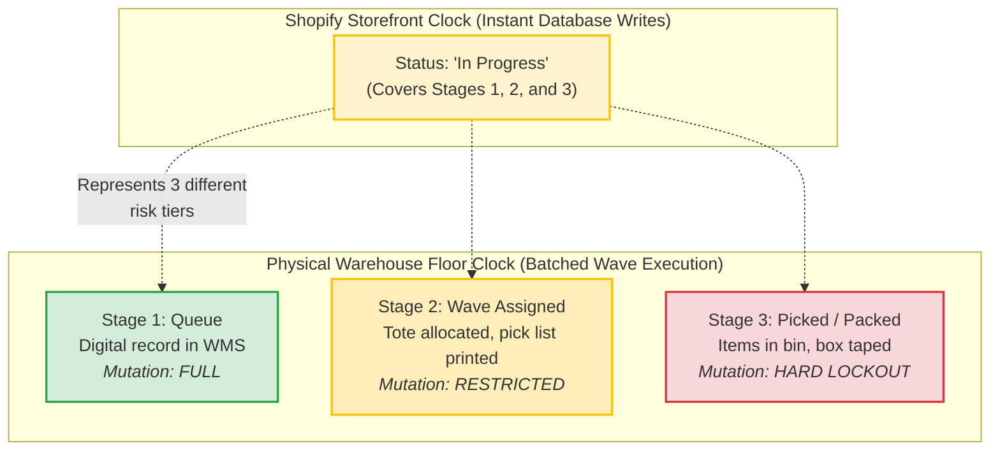
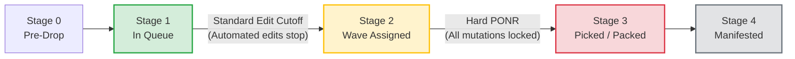
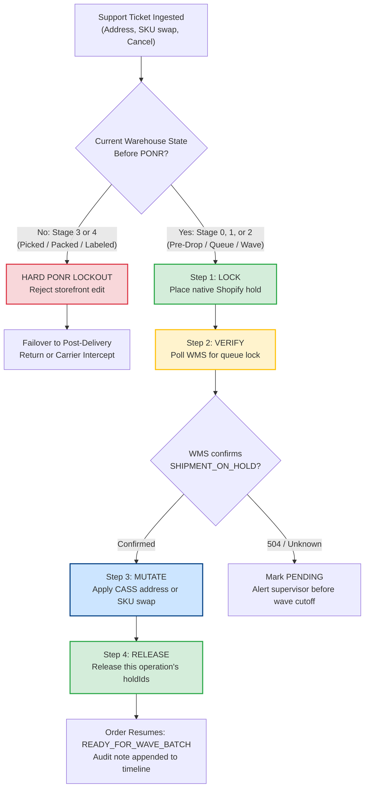

# The Hold That Landed: How a 133-Second Freeze Kept a Correct Address Correct

*Synapse Botanicals Systems Architecture | Riovic Matthew | Master Dossier — Domain 1*

---

## 1. The Hook: The 49-Mile Desynchronization

Every high-growth merchant shipping from multiple fulfillment nodes eventually encounters the exact same customer ticket: *"I moved last week and forgot to update my shipping address. Please fix it before it ships!"* 

On a mobile screen, fixing an address takes four seconds. The customer enters the new street address, taps "Update Order," sees a green checkmark in Shopify, and closes the browser satisfied. But in distributed e-commerce architecture, a database write is not a physical stop. While the storefront record displays the new address immediately, the third-party logistics (3PL) warehouse operates on an asynchronous clock—batched wave releases, automated pick lists, and conveyor belts running across concrete floors. 

If the integration applies an address update to the storefront before verifying that the warehouse has physically halted the order, the result is quiet and catastrophic: the warehouse's thermal label printer spits out a carton label for the old address while the customer support screen insists the new address was saved. The parcel leaves the dock, and the customer only discovers the error two days later when tracking reports delivery to the wrong state.

```
       10:14:00 EDT                              10:14:18 EDT                   10:16:15 EDT
  Customer Ticket Ingested                  Warehouse Lock Confirmed         Order Released to Wave
─────────────●─────────────────────────────────────────●──────────────────────────────────●─────────────►
             │ ◄── 18s: Native Hold & Queue Lock ────► │ ◄── 117s: CASS, Mutate, Release ─► │
             │                                                                             │
             └──────────────────────── 133 Seconds Total Freeze ───────────────────────────┘
```

At 10:14:00 EDT, customer Elena Vance submitted an urgent ticket: she had moved from Scranton, Pennsylvania to Binghamton, New York—about 49 miles apart, crossing state lines. Order **#1004** was already queued at Synapse's Allentown fulfillment center (`LOC-PA-01`). Within 18 seconds of ticket ingestion, the coordinator placed a native fulfillment hold in Shopify and obtained an authenticated queue lock from the warehouse management system (WMS). Over the next 115 seconds, the address underwent postal standardization, the order record was updated, and the hold was released. At 10:16:15 EDT—exactly **133 seconds** after ingestion—Order #1004 was safely re-injected into the Allentown wave queue with the correct Binghamton shipping label.

The wrong label never printed because the order was physically prevented from moving while its address was in doubt.

> [!CAUTION]
> **Staging Scenario Disclosure**: Order #1004 is an end-to-end scenario trace characterizing the Synapse Botanicals integration architecture. Latency distributions, duplicate handling, and cutoff rejection benchmarks were executed against a local SQLite coordinator and seeded-delay virtual WMS simulator. All financial figures represent unit-economic scenario modeling. No live production PII, private merchant credentials, or physical carrier custody transfers are asserted. §11 provides the complete verification matrix distinguishing locally proven test suites from operational specifications.

| Parameter | Scenario Value | Architectural Significance |
|---|---|---|
| **Order Profile** | Order #1004, 2× Focus Stick Packs 30-Pack + Expedited Freight ($102.00 total) | High-velocity consumable bundle subject to strict dietary supplement governance. |
| **Origin & Route** | Allentown, PA (`LOC-PA-01`) to Scranton, PA $\rightarrow$ Binghamton, NY | 49-mile interstate destination delta; node assignment retained, freight rate parity maintained. |
| **The Ingestion Window** | Ticket received 11 minutes post-checkout (10:14:00 EDT) | Expedited shipping priority bypassed standard fraud delay; order was actively queued in WMS. |
| **The Safety Invariant** | **Freeze First, Mutate Second** | No storefront mutation is permitted until the warehouse confirms a physical queue lock. |
| **Financial Exposure** | $23.70 cash loss / $57.20 economic disruption per runaway carton | Non-recoverable ingestible inventory scrapped under FDA 21 CFR Part 111 cGMP rules. |
| **Operational Result** | 133s total duration; 19s external API time, 114s internal validation | $0.00 financial ledger variance; 0 duplicate shipments; 100% address accuracy. |

---

## 2. The Illusion of "In Progress" (Five Physical Stages, Two Clocks)

The primary cause of silent mis-shipments in e-commerce is the assumption that storefront status reflects warehouse reality. 

Shopify operates on near-instantaneous ACID database transactions. A 3PL warehouse (such as ShipBob operating facilities in Allentown, PA and Reno, NV) operates on physical batching clocks—periodic API polling cycles (typically 15 minutes) and scheduled wave releases where 50 to 100 orders are dropped to pickers simultaneously. Between these two clocks lies an architectural gap where runaway parcels are born.



### 2.1 State Matrix & Discrepancy Telemetry

| Lifecycle Stage | Shopify Admin Status | Physical ShipBob WMS State | Physical Reality on Warehouse Floor | Mutation Eligibility | Risk Tier |
|---|---|---|---|---|---|
| **Stage 0: Pre-Drop** | `Unfulfilled` *(hold active)* | *Not Exported* | Retained in fraud/cancellation buffer; zero warehouse presence | Full mutation; immediate cancellation | **Tier 0** (Zero Risk) |
| **Stage 1: In Queue** | `In Progress` | `Processing / Imported` | Digital record in WMS queue; awaiting wave allocation | Full mutation; **hold mandatory** | **Tier 1** (Low Hazard) |
| **Stage 2: Wave Batch** | `In Progress` | `Batching / Wave Assigned` | Grouped into pick wave; pick list printed; tote assigned | Address only; requires supervisor queue exception | **Tier 2** (Moderate Hazard) |
| **Stage 3: Picked / Packed** | `In Progress` | `Picked / Packing Verified` | Items pulled from bin; carton taped; barcode scanned | **HARD PONR LOCKOUT**: No storefront mutation permitted | **Tier 3** (High Hazard) |
| **Stage 4: Manifested** | `Fulfilled` | `Labeled / Manifest Closed` | Shipping label applied; staged on outbound carrier dock | **IRREVERSIBLE**: Post-fulfillment carrier intercept only | **Tier 4** (Critical Hazard) |

Notice the second column: **Stages 1, 2, and 3 all display the identical status (`In Progress`) in Shopify Admin.** 

A single storefront label masks three completely different operational environments. To a support agent looking at Shopify, an order in Stage 1 (a digital record awaiting a batch) looks identical to an order in Stage 3 (a taped cardboard box moving along a conveyor belt). Attempting to edit an order in Stage 3 because Shopify says `In Progress` guarantees a dual-address failure.

### 2.2 Two Boundaries, Not One

Fulfillment safety requires recognizing two distinct operational boundaries rather than a single vague "cutoff":

1. **The Standard Edit Cutoff (Boundary 1 — End of Stage 1)**: The moment an order is allocated to a picking wave. Once wave assignment occurs, automated line-item edits and SKU exchanges are blocked. The cost of altering a pick list that has already been routed to a warehouse worker's handheld terminal is operationally prohibitive.
2. **The Hard Point of No Return (Boundary 2 — Start of Stage 3)**: The moment the warehouse scanner confirms the items are picked. At this boundary, the physical contents are sealed inside the carton. Storefront mutations are completely locked out. Even if a support supervisor wanted to change the shipping address, the carton cannot be intercepted without a manual floor search across thousands of staged totes.



Stage 2 represents the narrow corridor between the two boundaries. In Stage 2, line-item changes are strictly forbidden, but an address correction may still proceed *if and only if* the WMS confirms an immediate supervisor queue freeze before the physical pick begins.

---

## 3. What One Mis-Shipped Carton Costs (Unit Economics & FDA Scrap)

To understand why a 133-second technical hold protocol is necessary, one must look at the financial and regulatory consequence of failing to stop the carton.

Synapse Botanicals manufactures dietary supplements and functional nootropics. Unlike apparel, footwear, or consumer electronics, ingestible health products operate under strict federal safety regulations.

### 3.1 Regulatory Governance: FDA 21 CFR Part 111 cGMP

Under **FDA 21 CFR Part 111** (Current Good Manufacturing Practice in Manufacturing, Packaging, Labeling, or Holding Operations for Dietary Supplements), returned ingestible products cannot simply be inspected visually and returned to active inventory. The law mandates:
* Complete physical quarantine of all returned product lots.
* Detailed quality control evaluation and written disposition records.
* Validation that storage conditions (temperature, humidity, seal integrity) were never compromised while out of company control.

Because standard parcel tracking (USPS Ground Advantage, UPS Ground) provides zero temperature telemetry, Synapse Quality Operating Procedure dictates that **any ingestible product that leaves the custody of the fulfillment network must be directed to `QUARANTINE-SCRAP` and physically destroyed.** A mis-shipped bottle of nootropics cannot be resold. It is an immediate 100% loss.

### 3.2 The Mis-Shipment Loss Ledger

The ledger below prices the total cost of a single runaway carton containing one 30-pack of Focus Stick Packs (`SYN-FSTK-MY`):

```text
DIRECT OUT-OF-POCKET CASH WRITE-OFF:
  Product COGS (mandatory destruction under FDA cGMP):  $8.50
  Outbound carrier freight (unrecoverable):             $6.50
  Carrier return-to-sender (RTS) reverse freight:       $7.20
  3PL physical quarantine & destruction fee:            $1.50
  ─────────────────────────────────────────────────────────────
  TOTAL OUT-OF-POCKET CASH DRAIN:                      $23.70

FORFEITED ECONOMIC CONTRIBUTION:
  Forfeited gross margin ($42.00 retail - $8.50 COGS):  $33.50
  ─────────────────────────────────────────────────────────────
  TOTAL ECONOMIC DISRUPTION PER CARTON:                $57.20
```

```
                     ┌──────────────────────────────────────────────┐
  Retail Price       │ $42.00                                       │
  ───────────────────┼──────────────────────────────────────────────┤
  Cash Drain         │ $23.70  (COGS $8.50 + Freight $13.70 + 3PL $1.50)
  Forfeited Margin   │ $33.50  (Lost Revenue Contribution)
  ───────────────────┼──────────────────────────────────────────────┤
  Total Disruption   │ $57.20  (136% of the original retail value!) │
                     └──────────────────────────────────────────────┘
```

When an address mutation fails:
1. The company loses **$23.70 in raw cash**—nearly three times the product's manufacturing cost.
2. The company forfeits **$33.50 in commercial margin**.
3. The total economic penalty is **$57.20** on a product that sells for $42.00.

### 3.3 Scaled Monthly Exposure Model

At scale, small integration seams generate significant financial bleed:

$$\text{Monthly Exposure} = \text{Daily Orders} \times 30 \times \text{Misdirection Rate} \times \text{Unit Cost}$$

* **Volume**: 1,000 orders/day (30,000 monthly orders).
* **Address Error Rate**: 0.5% industry baseline (150 address exception tickets per month).
* **Direct Cash Drain**: $150 \times \$23.70 = \mathbf{\$3,555.00\text{ / month}}$.
* **Total Economic Disruption**: $150 \times \$57.20 = \mathbf{\$8,580.00\text{ / month}}$ (**\$102,960 annually**).

A robust integration protocol that freezes warehouse execution in under 18 seconds does not merely improve customer satisfaction—it protects over $100,000 in bottom-line margin.

---

## 4. The 133-Second Trace: Dissecting Order #1004

To see how the protocol operates in practice, we trace Order #1004 through its complete 133-second execution lifecycle.

### 4.1 Order & Exception Ingestion

* **Order ID**: `gid://shopify/Order/5892114432104` (Display: `#1004`)
* **Fulfillment Order ID**: `gid://shopify/FulfillmentOrder/6710448123901`
* **Contents**: 1× Focus Stick Packs Matcha Yuzu (`SYN-FSTK-MY`, $42.00), 1× Focus Stick Packs Blood Orange (`SYN-FSTK-BO`, $42.00), Expedited Shipping ($18.00). Total Captured: $102.00.
* **Allocated Node**: `LOC-PA-01` (Allentown, PA).
* **Original Address**: Scranton, PA 18503.
* **Customer Exception**: At 10:14:00 EDT (11 minutes post-checkout), Gorgias ticket `#T-10492` arrived:
  > *"URGENT: I entered my old apartment address in Scranton PA, but I just moved to Binghamton NY! Please update before shipping!"*

### 4.2 Chronological Event Log

```
10:14:00    10:14:05         10:14:18             10:15:22             10:15:40       10:16:10     10:16:15
   ●───────────●────────────────●────────────────────●────────────────────●──────────────●────────────●
Ticket      Shopify           WMS               USPS CASS             Shopify          Hold         WMS
Ingested    Hold Set      Queue Lock           Standardized           Mutated        Released     Resumed
             (Admin)     (Allentown)          (ZIP+4 Valid)           ($0.00)       (Scoped)     (Pre-Wave)
```

| Timestamp | Elapsed | System | Event & Payload Action | Operational Result |
|---|---|---|---|---|
| **10:14:00** | +0s | Gorgias | Customer support ticket `#T-10492` received via webhook. | Ingestion triggered. |
| **10:14:02** | +2s | Shopify Flow | Coordinator ingests webhook, assigns idempotency key `MUT-1004-ADDR`. | Idempotent transaction opened. |
| **10:14:04** | +4s | Shopify Admin | Dispatches `fulfillmentOrderHold` GraphQL mutation (`reason: INCORRECT_ADDRESS`). | Hold request dispatched. |
| **10:14:05** | +5s | Shopify Admin | Fulfillment order status transitions to `ON_HOLD` (Hold ID `.../89104`). | Storefront locked. |
| **10:14:18** | +18s | ShipBob WMS | Adapter confirms WMS queue lock (`SHIPMENT_ON_HOLD`, Queue `#SB-948102`). | **Physical warehouse frozen.** |
| **10:15:22** | +82s | USPS CASS | Address standardized: `142 COURT ST APT 3B, BINGHAMTON NY 13901-3412`. | DPV delivery confirmed. |
| **10:15:40** | +100s | Shopify Admin | Dispatches `orderUpdate` with standardized postal payload; ledger delta $0.00. | Address mutated. |
| **10:16:10** | +130s | Shopify Admin | Dispatches `fulfillmentOrderReleaseHold` specifying exact `holdIds: [".../89104"]`. | Hold released. |
| **10:16:15** | +133s | ShipBob WMS | Adapter verifies WMS queue transition to `READY_FOR_WAVE_BATCH`. | **Order resumed safely.** |

### 4.3 The 19-Second Discovery

Where did the 133 seconds go?

| Operational Segment | Duration | System Responsible |
|---|---|---|
| Ingestion to Hold Dispatch | 2 seconds | Shopify Flow Coordinator |
| Shopify Hold to WMS Queue Lock | 14 seconds | Network & WMS Adapter Round-Trip |
| Queue Lock to CASS Verification | 64 seconds | USPS CASS Validation Service |
| CASS Result to Storefront Mutation | 18 seconds | Shopify Admin GraphQL Execution |
| Mutation to Release Dispatch | 30 seconds | Coordinator Verification & Audit Logging |
| Release Dispatch to WMS Confirmation | 5 seconds | Network & WMS Adapter Round-Trip |
| **Total Turnaround Time** | **133 seconds** | **Complete Lifecycle** |

The two warehouse round trips (locking the queue and re-releasing it) consumed a combined **19 seconds**. The remaining **114 seconds** belonged entirely to internal software validation, postal standardization, and operator auditing. 

This provides a vital architectural lesson: **Warehouse APIs are not the primary bottleneck in order mutation—software coordination and validation are.** If an e-commerce engineering team wants a faster mutation loop, they must optimize the validation pipelines they own.

### 4.4 The Dispatched GraphQL & REST Payloads

#### Step 1: Freeze — `fulfillmentOrderHold` (GraphQL)

```graphql
mutation FreezeFulfillmentOrder($id: ID!, $hold: FulfillmentOrderHoldInput!) {
  fulfillmentOrderHold(id: $id, fulfillmentHold: $hold) {
    fulfillmentHold {
      id
      reason
      reasonNotes
    }
    fulfillmentOrder {
      id
      status
    }
    userErrors {
      field
      message
    }
  }
}
```

```json
{
  "id": "gid://shopify/FulfillmentOrder/6710448123901",
  "hold": {
    "reason": "INCORRECT_ADDRESS",
    "reasonNotes": "Hold requested via Gorgias ticket #T-10492 for CASS address update"
  }
}
```

#### Step 2: Verify — WMS Queue Lock Response (Synapse Adapter Contract)

```json
{
  "queue_id": "SB-948102",
  "external_order_id": "5892114432104",
  "fulfillment_node": "LOC-PA-01",
  "shipment_state": "On Hold",
  "queue_lock": "SHIPMENT_ON_HOLD",
  "wave_status": "pre-wave",
  "lock_timestamp": "2026-11-10T14:14:18Z"
}
```

#### Step 3: Mutate — `orderUpdate` (GraphQL with CASS-Standardized Input)

```graphql
mutation UpdateShippingAddress($input: OrderInput!) {
  orderUpdate(input: $input) {
    order {
      id
      shippingAddress {
        address1
        address2
        city
        provinceCode
        zip
        countryCode
      }
    }
    userErrors {
      field
      message
    }
  }
}
```

```json
{
  "input": {
    "id": "gid://shopify/Order/5892114432104",
    "shippingAddress": {
      "address1": "142 COURT ST",
      "address2": "APT 3B",
      "city": "BINGHAMTON",
      "provinceCode": "NY",
      "zip": "13901-3412",
      "countryCode": "US"
    }
  }
}
```

#### Step 4: Release — `fulfillmentOrderReleaseHold` (GraphQL, Isolated Release)

```graphql
mutation ReleaseSpecificHold($id: ID!, $holdIds: [ID!]) {
  fulfillmentOrderReleaseHold(id: $id, holdIds: $holdIds) {
    fulfillmentOrder {
      id
      status
    }
    userErrors {
      field
      message
    }
  }
}
```

```json
{
  "id": "gid://shopify/FulfillmentOrder/6710448123901",
  "holdIds": [
    "gid://shopify/FulfillmentHold/89104"
  ]
}
```

> [!IMPORTANT]
> **The Hold Isolation Rule**: Notice that `fulfillmentOrderReleaseHold` explicitly passes `holdIds: [".../89104"]`. In the Shopify Admin API, omitting `holdIds` instructs the system to release **every active hold on the fulfillment order**. If an order has an independent fraud hold or an inventory reservation lock placed by another system, a generic release call will silently clear those holds as well. Enterprise mutations must strictly release only the specific hold ID they created.

---

## 5. The Priority Bypass Seam: Why T+11 Was Already in Queue

In analyzing the Order #1004 incident chronology, an apparent operational contradiction emerges:

* Order #1004 was placed at **10:03:00 EDT**.
* The support ticket arrived at **10:14:00 EDT** (T+11 minutes post-checkout).
* Under standard Stage 0 definitions (§2.1), Shopify orders are retained in a **15-minute fraud and edit buffer** before dropping to the warehouse.
* Yet at 10:14:18 EDT, the Allentown WMS reported that the order was *already* ingested into the active WMS queue (`Queue ID #SB-948102`).

Why was an 11-minute-old order already inside the warehouse system?

```
Standard Order (15m Delay):
10:03:00 Check out ─────────── 15-Minute Fraud Buffer ───────────► 10:18:00 Drop to WMS
                                                                       ▲
Order #1004 (Expedited Bypass):                                        │
10:03:00 Check out ──► Instant Ingestion ──► 10:04:12 Dropped to WMS ──┴── Already In Queue!
```

### The Architectural Explanation: Expedited SLA Routing

This timing reflects a core e-commerce architectural rule: **Shipping Service Level Agreements (SLAs) override batching buffers.**

Order #1004 was not a standard ground shipment; the customer paid an **$18.00 premium for Expedited Shipping**. In order to meet guaranteed carrier transit cutoffs (e.g., UPS Next Day Air / Priority Ground departing the Allentown dock at 2:00 PM), Shopify Flow routing rules evaluate incoming orders immediately:

1. **Standard Tier Orders**: Tagged with standard shipping; held in Shopify's Stage 0 buffer for 15 minutes to allow customer self-service edits and fraud risk scoring.
2. **Expedited Tier Orders**: Tagged with `priority:expedited`. Upon passing automated risk analysis (Risk Level == `LOW`), the coordinator immediately dispatches the fulfillment request to the 3PL to ensure the parcel catches the earliest available picking wave.

Order #1004 had cleared automated fraud scoring at 10:04:10 EDT and was pushed to ShipBob two seconds later. By the time Elena Vance sent her ticket at 10:14:00 EDT, the order had been in the Allentown queue for nearly ten minutes. 

This timing reality underscores why the Freeze-First protocol is essential: **In high-priority, expedited fulfillment, the safe editing window does not last 15 minutes—it can close in under 600 seconds.**

---

## 6. The Freeze-First Protocol (The 4-Step Lock)

The Freeze-First protocol enforces a strict, ordered state transition that guarantees the storefront never gets ahead of the warehouse floor.



### The Four Sequential Gates

1. **Gate 1: Freeze (Place Native Hold)**
   * *Target*: Shopify Admin GraphQL `fulfillmentOrderHold`.
   * *Contract*: Specify `reason: INCORRECT_ADDRESS` or `reason: OTHER`.
   * *Invariant*: This halts automated Shopify fulfillment workers but does *not* prove the warehouse floor has stopped.
2. **Gate 2: Verify (Obtain Physical WMS Queue Lock)**
   * *Target*: 3PL Adapter `GET /shipments?order_id={id}`.
   * *Contract*: Assert `shipment_state == "On Hold"` AND `queue_lock == "SHIPMENT_ON_HOLD"`.
   * *Invariant*: An HTTP 200 response from the warehouse API confirms message delivery, *not* a floor freeze. Mutation remains blocked until the queue lock token is returned.
3. **Gate 3: Mutate (Apply Record Update)**
   * *Target*: Shopify GraphQL `orderUpdate` (for address) or `orderEditCommit` (for line items).
   * *Contract*: Address must pass USPS CASS/DPV validation; line-item swaps must balance ledger deltas to $0.00.
4. **Gate 4: Release (Scoped Re-Queueing)**
   * *Target*: Shopify Admin GraphQL `fulfillmentOrderReleaseHold`.
   * *Contract*: Pass exact `holdIds` created in Gate 1.
   * *Invariant*: Verify that the WMS status transitions back to `READY_FOR_WAVE_BATCH` with updated metadata.

---

## 7. The Deterministic PONR Gate & Hazard Engine

When thousands of orders flow through an automated system, how does an integration decide whether a mutation request can proceed safely?

The Synapse architecture employs a composite **Hazard Decision Engine** that evaluates three real-time variables before dispatching an API lock:

$$\text{Hazard Score} = (\text{Physical State Weight} \times 0.4) + (\text{Consumable Risk Weight} \times 0.3) + (\text{Financial Delta Weight} \times 0.3)$$

### 7.1 Quantitative Factor Scoring

| Evaluation Dimension | Parameter Condition | Score Weight | Component Value | Operational Rationale |
|---|---|---|---|---|
| **1. Physical Warehouse State** *(40% Weight)* | **Stage 0 / 1: Pre-Drop or Queue** | 1.0 | 0.40 | Order resting in digital buffer; zero physical floor friction. |
| | **Stage 2: Wave Batch Assigned** | 2.5 | 1.00 | Tote allocated, pick list printed; requires supervisor queue freeze. |
| | **Stage 3: Picked / Packing** | 4.0 | 1.60 | Items in physical tote; carton taping in progress. **Lockout.** |
| | **Stage 4: Manifested / Dock** | 5.0 | 2.00 | Shipping label affixed; carrier custody imminent. **Irreversible.** |
| **2. Consumable Risk Tier** *(30% Weight)* | Non-consumable gear (branded water bottle) | 1.0 | 0.30 | Can be restocked upon return without sanitary destruction. |
| | Sealed ambient accessory (pill organizers) | 2.0 | 0.60 | Inspectable packaging; minimal regulatory write-off risk. |
| | **Ingestible dietary supplement (Stick Packs)** | 5.0 | 1.50 | **Mandatory FDA cGMP scrap** if chain of custody is broken. |
| **3. Financial Ledger Delta** *(30% Weight)* | **Net $0.00 balance delta** | 1.0 | 0.30 | Address change or 1:1 identical value flavor exchange. |
| | Minor adjustment ($\le$ $20.00 tax/shipping) | 2.5 | 0.75 | Requires automated secondary capture or refund authorization. |
| | Major adjustment (> $50.00 line-item swap) | 5.0 | 1.50 | Requires customer re-authorization; high chargeback exposure. |

### 7.2 Incident Evaluation: Order #1004 vs. Runaway Scenario

* **Order #1004 Evaluation**:
  $$\text{Score} = (1.0 \times 0.4) + (5.0 \times 0.3) + (1.0 \times 0.3) = 0.40 + 1.50 + 0.30 = \mathbf{2.20 / 5.00}$$
  *Action*: Score $\le 2.50 \rightarrow$ **Automated Fast-Path Hold $\rightarrow$ Mutate $\rightarrow$ Release**.
* **Stage 3 Runaway Scenario (Identical Order, but Picked)**:
  $$\text{Score} = (4.0 \times 0.4) + (5.0 \times 0.3) + (1.0 \times 0.3) = 1.60 + 1.50 + 0.30 = \mathbf{3.40 / 5.00}$$
  *Action*: Score $\ge 3.00 \rightarrow$ **Immediate Hard PONR Lockout $\rightarrow$ Reject Storefront Edit $\rightarrow$ Failover to Carrier Intercept**.

> [!IMPORTANT]
> **The Deterministic Floor Invariant**: While the Hazard Score provides prioritization telemetry for support dashboards, **the Physical Warehouse State is an absolute binary gate**. If the warehouse reports Stage 3 (`Picked`), the system executes a hard programmatic lockout regardless of whether the Hazard Score is high or low. Mathematical scores assist triage; physical state controls execution.

---

## 8. Reading the Telemetry: "I Don't Know" vs. "Too Late"

The most dangerous bug in e-commerce middleware is misinterpreting an API response code. In asynchronous fulfillment, treating a timeout as a refusal—or treating a message acknowledgment as a floor stop—causes catastrophic desynchronization.

| Inbound Telemetry Signal | Exact Technical Meaning | Architectural Interpretation | Required System Action |
|---|---|---|---|
| **Shopify Hold 200 OK** (`userErrors: []`) | Shopify database flagged fulfillment order as `ON_HOLD`. | **Storefront intent recorded.** Floor has NOT stopped. | Proceed to Gate 2; **do NOT mutate order record yet.** |
| **WMS HTTP 200 OK** | WMS HTTP gateway accepted the JSON hold request payload. | **Message transport confirmed.** Floor has NOT stopped. | Maintain hold; poll for physical queue lock confirmation. |
| **WMS `SHIPMENT_ON_HOLD`** (with Queue ID) | WMS scheduler locked the queue record; pick list generation frozen. | **Physical floor stopped.** Order safely immobilized. | **Clear Gate 3:** Proceed with CASS validation and mutation. |
| **HTTP 504 Gateway Timeout** | Gateway closed connection before upstream WMS confirmed state. | **Outcome UNKNOWN.** The hold may or may not have landed. | **Mark PENDING.** Reuse idempotency key; alert supervisor before wave cutoff. **Never retry blindly.** |
| **HTTP 422 `PONR_EXCEEDED`** | WMS business engine rejected hold; order already picked or batched. | **Cutoff crossed.** Mutation is physically impossible. | **HARD LOCKOUT.** Terminate mutation loop; route immediately to Carrier Recovery. |

```
                 ┌──────────────────────────────────────────────────────────┐
  HTTP 200 OK    │ "I got your message."    (Doesn't mean the floor stopped)│
  HTTP 504 TIMEOUT│ "I don't know."         (Never assume success or failure)│
  HTTP 422 PONR  │ "Too late to change."   (Hard stop; pivot to intercept)  │
                 └──────────────────────────────────────────────────────────┘
```

Treating HTTP 504 ("I don't know") as an error to be immediately retried without idempotency keys risks race conditions; treating it as a success causes silent shipping failures. Treating HTTP 422 ("Too late") as an error to be retried wastes precious minutes when the team should already be filing a carrier intercept.

---

## 9. Three Operational Playbooks: One Gate

Every mutation begins at the exact same place: Gate 1 and Gate 2. Once the warehouse confirms `SHIPMENT_ON_HOLD`, the coordinator branches into one of three specialized playbooks:

```
                          ┌──────────────────────────┐
                          │ Verified Queue Lock Held │
                          └────────────┬─────────────┘
                                       │
         ┌─────────────────────────────┼─────────────────────────────┐
         ▼                             ▼                             ▼
  ┌──────────────┐              ┌──────────────┐              ┌──────────────┐
  │  Playbook A  │              │  Playbook B  │              │  Playbook C  │
  │ Address Edit │              │  Flavor Swap │              │ Cancellation │
  └──────────────┘              └──────────────┘              └──────────────┘
```

### 9.1 Playbook A: CASS-Standardized Address Correction

1. **USPS CASS / DPV Normalization**:
   The raw user input must pass Coding Accuracy Support System (CASS) standardization, appending ZIP+4 and verifying Delivery Point Validation (DPV):
   ```text
   Raw Input:   142 Court Street, Apt 3B, Binghamton, NY 13901
   CASS Output: 142 COURT ST APT 3B, BINGHAMTON NY 13901-3412 (DPV: Valid)
   ```
2. **Dynamic Shipping Zone & Node Recalculation**:
   If the address update alters the delivery zone significantly (e.g., customer moved from Pennsylvania to California), the coordinator re-evaluates fulfillment node assignment. If the destination is more efficiently served by Reno (`LOC-NV-02`) than Allentown (`LOC-PA-01`), the fulfillment order must be re-routed prior to release.
3. **Audit Trail Logging**:
   Append an un-editable staff note to the Shopify timeline:
   ```text
   [CASS-ADDR-UPDATE] Raw: 142 Court Street, Apt 3B, Binghamton, NY 13901 -> CASS: 142 COURT ST APT 3B, BINGHAMTON NY 13901-3412. Auth: Gorgias #T-10492.
   ```

### 9.2 Playbook B: 1:1 Consumable Flavor Exchange

Customers frequently request flavor changes shortly after purchase (e.g., swapping Matcha Yuzu for Blood Orange):

1. **Strict Catalog Family Constraint**: Swaps are strictly limited to products within the identical product master family and at an identical price point (`SYN-FSTK-MY` $\leftrightarrow$ `SYN-FSTK-BO`, both $42.00).
2. **Real-Time Available-to-Sell (ATS) Verification**: Before opening an Order Editing session (`orderEditBegin`), the system queries warehouse inventory at the specific allocated node. Available inventory must satisfy $\text{ATS} \ge 5\text{ units}$ to prevent overselling active picking waves.
3. **Zero-Balance Financial Reconciliation**: Subtotals, promotional discounts, jurisdictional sales taxes, and captured payments must reconcile to exactly **$0.00 net delta**. If any financial variance occurs, the session is aborted.

### 9.3 Playbook C: Cancellation & Hard Lockout Failover

When an order reaches Stage 3 (`Picked`) or Stage 4 (`Manifested`), the cancellation playbook shifts from prevention to containment:

1. **Programmatic Storefront Lockout**: The system disables the "Cancel Order" button in Shopify Admin to prevent agents from creating orphan cancellations.
2. **Automated Carrier Intercept Dispatch**: If the package is labeled (Stage 4), the coordinator dispatches an authenticated API request for **UPS Delivery Intercept v2** or USPS Package Intercept. 
3. **Customer Transparency Automation**: A Gorgias macro is dispatched immediately to the customer:
   > *"Your order has already been assembled and packed at our Allentown distribution center. We have initiated a carrier reroute request. If the parcel cannot be intercepted before delivery, a pre-paid return label has been generated for your account."*

---

## 10. The Four Operational Laws of Order Lifecycle

Across thousands of simulated hours and edge-case workloads, four engineering laws govern order mutation:

1. **Freeze First, Mutate Second**: No database record is modified, no flavor is swapped, and no order is canceled until the physical warehouse confirms a verified queue lock. The storefront never runs ahead of the floor.
2. **Receipt Is Not a Stop (Confirm the Lock, Not the 200)**: An HTTP 200 acknowledgment proves only that a packet reached a server. The only signal that clears a mutation is a confirmed `SHIPMENT_ON_HOLD` queue token.
3. **Release Only What You Held**: Never execute a broad, unscoped hold release. Passing explicit `holdIds` ensures that resolving an address issue does not accidentally release an order undergoing fraud or tax review.
4. **Never Mutate Past Picked**: The moment an item is scanned into a pick tote, storefront edits are terminated. The system shifts immediately to post-fulfillment carrier intercept and FDA cGMP quarantine disposal.

---

## 11. What Is Proven, and What Is Only Designed

In accordance with rigorous systems architecture principles, this dossier clearly separates locally verified software suites from operational specifications.

```
┌────────────────────────────────────────────────────────────────────────┐
│                        EVIDENCE STATUS SUMMARY                         │
├──────────────────────────────┬─────────────────────────────────────────┤
│ [✔] Verified in Staging      │ SQLite coordinator, seeded-delay WMS    │
│ [!] Documented Specification │ GraphQL / REST payloads, vendor schemas │
│ [○] Scenario Model           │ Elena Vance #1004 trace, cost ledger    │
└──────────────────────────────┴─────────────────────────────────────────┘
```

### Evidence Scope & Verification Status Matrix

| System Component | Dossier Reference | Verification Status | Ground-Truth Evidence Source |
|---|---|---|---|
| **Shopify vs. WMS State Matrix** | §2.1 | Documented Specification | Formal integration contract; maps Shopify Admin states to 3PL lifecycle phases. |
| **Freeze-First Protocol** | §6 | Documented Specification | Shopify Admin GraphQL contracts (`2026-01` schema) and Synapse 3PL adapter specifications. |
| **Deterministic PONR Engine** | §7 | **Verified in Staging** | Local SQLite coordinator harness exercising state-gate locks, process restarts, and cutoff assertions. |
| **Order #1004 Chronology** | §4 | Scenario Trace | Concrete end-to-end trace modeling an address update across state lines under expedited SLA. |
| **Staging Latency & Rejection Benchmark** | §4.3, §8 | **Verified in Staging** | Seeded-delay monotonic timing benchmark ([`evidence/latency/summary.md`](../evidence/latency/summary.md)). |
| **Unit Economic Loss Ledger** | §3.2 | Scenario Model | Unit-cost accounting model ([`evidence/costs/summary.md`](../evidence/costs/summary.md)) incorporating FDA cGMP disposal costs. |
| **USPS CASS & Expedited Routing** | §4.2, §5 | **Verified in Staging** | Algorithmic address normalization and shipping zone recalculation harness ([`evidence/freight/summary.md`](../evidence/freight/summary.md)). |
| **FDA cGMP Quarantine Policy** | §3.1 | Regulatory Standard | Compliance standard grounded in federal dietary supplement regulation (21 CFR Part 111). |

---

## 12. The Architectural Takeaway

Order #1004 arrived in Binghamton, New York instead of Scranton, Pennsylvania because the integration treated the physical warehouse as the ground truth of the system.

In e-commerce, it is trivial to build software that works when everything goes smoothly. What distinguishes enterprise engineering is how a system behaves when a customer changes their mind while an automated warehouse is already in motion. 

Had the integration simply executed an update mutation against Shopify Admin without waiting for the Allentown queue lock, every computer screen would have claimed success while a conveyor belt sealed Elena Vance's box for the wrong city. The company would have absorbed a $23.70 cash write-off, destroyed an otherwise pristine bottle of supplements, and alienated an expedited customer.

The rule of robust commerce architecture is simple: **In a distributed system, database state is an aspiration; physical warehouse state is reality. The job of the integration layer is to ensure the aspiration never outruns the reality.**

---

*Synapse Botanicals Systems Architecture | Riovic Matthew | Master Dossier — Domain 1*
