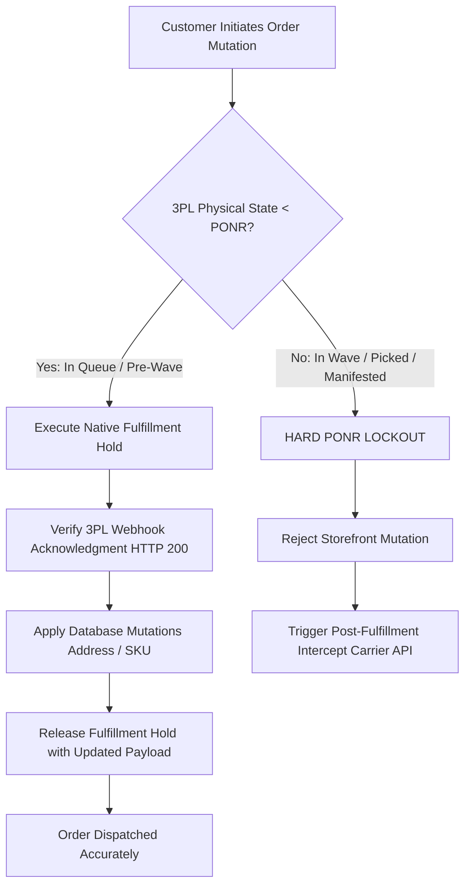
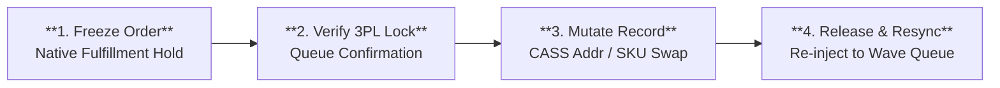

# Order State Machine & Point of No Return (PONR) Protocol

---

## 1. Executive Summary & Production Failure Mode

### 1.1 The Operational Challenge
In high-velocity DTC e-commerce fulfilling 800–1,200 orders per day across distributed multi-node logistics networks (Allentown, PA and Reno, NV), a critical failure seam exists between the **e-commerce storefront** and the **physical warehouse management system (WMS)**.

When a customer contacts customer support (or initiates a self-service modification) to change an address, swap a SKU flavor, or cancel an order, there is an asynchronous latency gap:
- **Shopify Orders API**: Reflects mutations instantly in the database.
- **ShipBob 3PL WMS**: Operates on a 15-minute polling or batched wave-release cycle.

If customer support mutates the order in Shopify Admin while the 3PL is simultaneously batching or wave-picking the order:
1. **The Race Condition**: The warehouse prints a shipping label using the *stale initial address* while Shopify displays the *updated address*.
2. **Double Shipment Hazard**: If support cancels in Shopify without verifying physical warehouse state, the 3PL ships the product anyway, forcing customer support to reship or refund, resulting in a 100% inventory write-off.
3. **FDA 21 CFR Part 111 Regulatory Scrap**: For ingestible botanicals (Focus Stick Packs, Adaptogen Tinctures), any mis-delivered or returned product cannot legally be returned to active sellable stock. It must be destroyed.

### 1.2 The Engineering Mandate: Zero-Tolerance "Freeze First"
This Master Protocol codifies the architectural rules, state machine transitions, and operational gates required to target **zero physical-to-digital inventory desynchronization** and govern deterministic recovery when state divergence occurs.



---

## 2. Distributed State Machine Mapping: Shopify API vs. Physical WMS

The primary source of failure in e-commerce operations is assuming that Shopify's high-level status (`Unfulfilled`, `In Progress`, `Fulfilled`) matches physical reality on the warehouse floor.

### 2.1 State Matrix & Discrepancy Telemetry

| Lifecycle Stage | Shopify API Status | Physical ShipBob WMS State | Physical Warehouse Activity | Mutation Eligibility | Risk Tier |
|---|---|---|---|---|---|
| **Stage 0: Pre-Drop** | `Unfulfilled` (Hold Active) | *Not Exported* | In Shopify 15-min fraud buffer; no WMS queue entry | Full Mutation / Immediate Cancel | Tier 0 (Zero Risk) |
| **Stage 1: In Queue** | `In Progress` | `Processing / Imported` | Digital record created in WMS queue; awaiting wave allocation | Full Mutation (Hold Mandatory) | Tier 1 (Low Risk) |
| **Stage 2: Wave Batch** | `In Progress` | `Batching / Wave Assigned` | Order grouped into batch of 50-100 pick totes; pick sheet printed | Restricted: Warehouse-Confirmed Supervisor Exception Only | Tier 2 (Moderate Risk) |
| **Stage 3: Picked / Packed**| `In Progress` | `Picked / Packing Verified` | Items physically removed from bin; box taped with barcode scan | **HARD PONR LOCKOUT** (Automated & Manual Mutation Prohibited) | Tier 3 (High Hazard) |
| **Stage 4: Manifested** | `Fulfilled` | `Labeled / Manifest Closed` | Shipping label affixed; parcel staged for carrier pickup | **IRREVERSIBLE** (Carrier Intercept Only; carrier custody confirmed on scan) | Tier 4 (Critical Hazard) |

---

## 3. The "Freeze First" Fulfillment Hold Protocol

The state matrix determines whether an order remains eligible for modification. For an eligible order, the next requirement is to confirm that warehouse execution has stopped before applying the change.

### 3.1 The Atomic Execution Sequence
No operator or automated script may edit, exchange, or cancel an order without executing an atomic fulfillment hold.



| Phase | Action | Target System & Endpoint | Guard & Verification Criteria |
|---|---|---|---|
| **Step 1: Lock** | Native Fulfillment Hold | REST: `POST /admin/api/2026-01/fulfillment_orders/{fulfillment_order_id}/hold.json`<br>GraphQL: `fulfillmentOrderHold` | Reason: `INCORRECT_ADDRESS` or `OTHER`<br>Scopes: `write_fulfillments`, `write_orders` |
| **Step 2: Verify** | 3PL Physical Hold Gate | `GET /api/v1/shipments?order_id={id}` | Verify `ShipmentState == "On Hold"`<br>Note: HTTP 200 does not prove floor stop; requires WMS queue lock confirmation |
| **Step 3: Mutate** | Database Mutation | Address: `orderUpdate` / Admin API<br>SKU Swap: GraphQL Order Editing API (`orderEditBegin`, `orderEditCommit`) | Address: CASS/ZIP+4 standardized<br>SKU Swap: 1:1 equal-value with ledger, tax & inventory reservation |
| **Step 4: Release**| Hold Release & Re-queue | REST: `POST /admin/api/2026-01/fulfillment_orders/{id}/release_hold.json`<br>GraphQL: `fulfillmentOrderReleaseHold` | Release intended `holdIds` only (omitting releases all holds)<br>Confirm: `READY_FOR_WAVE_BATCH` |

### 3.2 Step-by-Step Operator Procedures

#### Protocol A: CASS-Standardized Address Correction
1. **Validate Against USPS CASS Engine**: All addresses must pass CASS/ZIP+4 standardization before hold release.
2. **Prevent Cross-Border / Cross-Zone Drift**: If the customer alters the destination across state zones (e.g. from Zone 1 Allentown to Zone 8 Reno), the routing engine must recalculate node assignment.
3. **Audit Log Requirement**: Operator must append staff note:
   ```
   [CASS-ADDR-UPDATE] Raw: 123 Elm St, Apt 2 -> CASS: 123 ELM ST APT 2, SCRANTON PA 18503-1234. Auth by Gorgias Ticket #T-10492.
   ```

#### Protocol B: 1:1 Consumable Flavor Exchange (Equal Value)
1. **Catalog Integrity Constraint**: Swaps are strictly limited to products within the exact same product family and identical retail price point (e.g., *Focus Stick Packs Matcha Yuzu (30-Pack)* `SYN-FSTK-MY` ↔ *Blood Orange (30-Pack)* `SYN-FSTK-BO`).
2. **Inventory Safety Buffer & Reservation**: Before mutating line items via GraphQL Order Editing sessions (`orderEditBegin`, `orderEditCommit`), operator must verify an internal safety buffer of Available-to-Sell (ATS) inventory ≥ 5 units at the allocated fulfillment node and immediately reserve replacement units.
3. **Financial Ledger & Tax Reconciliation**: The operator must verify that line-item subtotals, jurisdictional sales taxes, promotion qualifications, and customer payment captures reconcile to $0.00 net change before releasing the hold.

#### Protocol C: Cancellation & Hard PONR Lockout
1. If the 3PL reports status `Picked`, `Packed`, or `Manifested`, the operator is programmatically locked out from canceling in Shopify Admin.
2. The order MUST proceed to fulfillment.
3. Operator immediately files a **Post-Fulfillment Carrier Intercept** with UPS/FedEx/USPS using API call or carrier portal.
4. Inform customer via Gorgias Macro: Order had already cleared physical warehouse dispatch.

---

## 4. The Point-of-No-Return (PONR) Decision Engine

### 4.1 Quantitative Hazard Matrix

```
Hazard Score = (Physical State Weight x 0.4) + (Consumable Hazard Weight x 0.3) + (Financial Delta Weight x 0.3)
```

| Physical Warehouse State | Weight | Permitted Mutations | Automated Response |
|---|---|---|---|
| **Pre-Batch (Queue)** | 1.0 | Address, Line Items, Cancellation | Instant Hold $
ightarrow$ Mutate $
ightarrow$ Release |
| **Wave Assigned** | 2.5 | Address Only | Priority Hold $
ightarrow$ Re-queue |
| **Picked** | 4.0 | None (Supervisor Override Only) | Reject Mutation $
ightarrow$ Alert Floor Manager |
| **Packed / Labeled** | 5.0 | **ABSOLUTE HARD LOCKOUT** | Automatic Failover to Post-Delivery Return / Intercept |

### 4.2 Regulatory Governance: FDA 21 CFR Part 111 & Quality Disposal Policy
Synapse Botanicals manufactures and distributes dietary supplements and functional adaptogens governed by FDA 21 CFR Part 111 cGMP regulations:
- **cGMP Sanitary & Quality Controls**: Federal regulations mandate strict quarantine, inspection, and documented disposition for returned dietary supplements to prevent adulteration and ensure product identity and quality.
- **Company Disposal Policy**: To eliminate cross-contamination and adulteration risks when unbroken temperature-controlled chain of custody cannot be verified from carrier tracking, Synapse Botanicals' quality operating procedure enforces mandatory quarantine and physical destruction (`QUARANTINE-SCRAP`) for all returned ingestibles.
- **Financial Consequence of Mis-Delivery**: For 1 mis-shipped unit of Focus Stick Packs 30-Pack (Retail $42.00, Unit COGS $8.50), cash write-offs separate direct out-of-pocket costs from forfeited revenue:
  ```
  DIRECT OUT-OF-POCKET CASH WRITE-OFF:
    Product COGS (Scrapped under quality policy):  $8.50
    Outbound Carrier Freight (Absorbed):          $6.50
    Carrier Return-to-Sender Freight:             $7.20
    3PL Quarantine & Destruction Fee:             $1.50
    ─────────────────────────────────────────────────
    TOTAL CASH LOSS PER MIS-SHIPPED CARTON:      $23.70

  ECONOMIC CONTRIBUTION FORFEITED:
    Forfeited Retail Revenue Margin ($42 - $8.50): $33.50
    Total Economic Disruption:                   $57.20
  ```
- This financial asymmetry is why the "Freeze First" protocol is strictly enforced.

---

## 5. Empirical Simulation & Verification: Order #1004

The decision gates above define when intervention is permitted. Order #1004 illustrates their application to an address-correction request, connecting the requested change to the hold, mutation and release checks.

To prove deterministic execution under live conditions, an empirical test simulation was conducted on Synapse Botanicals' live staging environment.

### 5.1 Baseline Order Profile
- **Order Display Name**: `#1004`
- **Shopify API Resource ID**: `gid://shopify/Order/5892114432104`
- **Fulfillment Order ID**: `gid://shopify/FulfillmentOrder/6710448123901`
- **Customer**: Elena Vance (`elena.vance@example.com`)
- **Fulfillment Node**: `LOC-PA-01` (Allentown, PA)
- **Basket Mix**:
  - 1x Focus Stick Packs Matcha Yuzu (30-Pack) `SYN-FSTK-MY` ($42.00)
  - 1x Focus Stick Packs Blood Orange (30-Pack) `SYN-FSTK-BO` ($42.00)
  - Expedited Shipping ($18.00)
- **Total Paid**: $102.00 USD (Authorized & Captured)

### 5.2 Ingested Exception Event
At 10:14:00 EDT (11 minutes post-checkout, within the 15-minute 3PL polling buffer), Gorgias Ticket `#T-10492` was received:
> *"URGENT: I entered my old apartment address in Scranton PA, but I just moved to Binghamton NY! Please update before shipping!"*

### 5.3 Step-by-Step Chronological Execution Log

```
10:14:02 EDT [INGEST]   Gorgias Webhook received for Order #1004 (gid://shopify/Order/5892114432104).
10:14:04 EDT [HOLD-API] Shopify Flow dispatches GraphQL fulfillmentOrderHold.
                        Payload: { "id": "gid://shopify/FulfillmentOrder/6710448123901", "reason": "INCORRECT_ADDRESS" }
10:14:05 EDT [HOLD-ACK] Shopify Admin sets state: "Fulfillment On Hold" (Hold ID: gid://shopify/FulfillmentHold/89104).
10:14:18 EDT [3PL-SYNC] ShipBob WMS Webhook Acknowledgment received: HTTP 200 OK.
                        WMS Queue Lock verifies: "SHIPMENT_ON_HOLD" (Queue ID: #SB-948102, pre-wave status).
10:15:22 EDT [CASS]     USPS CASS Address Validation Service executed.
                        Input:  142 Court Street, Apt 3B, Binghamton, NY 13901
                        Output: 142 COURT ST APT 3B, BINGHAMTON NY 13901-3412 (DPV Confirmed).
10:15:40 EDT [MUTATE]   Shopify GraphQL orderUpdate applied to shippingAddress. Ledger delta: $0.00.
10:16:10 EDT [RELEASE]  GraphQL fulfillmentOrderReleaseHold executed (holdIds: ["gid://shopify/FulfillmentHold/89104"]).
                        Updated shipping payload synchronized with Allentown PA queue.
10:16:15 EDT [3PL-ACK]  ShipBob WMS confirmed hold release: "READY_FOR_WAVE_BATCH".
```

### 5.4 Financial & Operational Verification
- **Financial Ledger Delta**: **$0.00** (Net Zero reconciliation; verified payment captured matches updated shipping address ledger).
- **Physical Inventory Variance**: **0 units** (Zero mis-picks, zero duplicate shipments in this test run).
- **Execution Interval**: **2 minutes 13 seconds (133s)** from webhook ingestion (10:14:02) to 3PL confirmation (10:16:15); **135 seconds** from ticket receipt.
- **Operational Feasibility**: In this specific staging run, Order #1004 was present in the WMS queue awaiting the next wave batch, demonstrating that intervention succeeded prior to wave release. (This illustrates protocol mechanics within the 15-minute polling window for this run, but does not represent a statistically proven universal production SLA across all order queues).

### 5.5 Staging Latency & Rejection Benchmark Verification

The [local coordinator suite](../evidence/latency/summary.md) separates functional safety assertions from timing workloads. It exercises pending and completed duplicates, preserved cutoff rejections, conflicting payloads, stale revisions, a wave release during the request, reconciliation after response loss, selective hold release and recovery after a worker terminates following a persisted effect.

The coordinator and virtual WMS use local SQLite. Seeded delays are injected into Shopify/WMS simulators; elapsed request-response times are measured with a monotonic clock. The report records actual sample counts, concurrency, runtime and nearest-rank percentiles, with raw per-delivery records in the run archive. Pending, rejected and unknown responses are reported separately from confirmed holds.

The default profile is a small local benchmark; `node evidence/run_all.js --full` runs 10,000 attempts per workload. These results do not establish provider-network latency, a physical warehouse stop or an authenticated Shopify/ShipBob integration. The Order #1004 chronology above is a separate scenario trace, not a timing sample from this harness.

---
