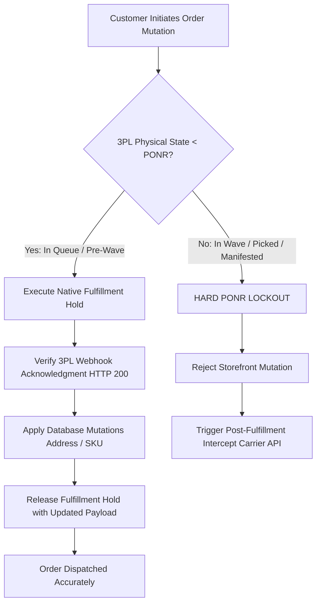
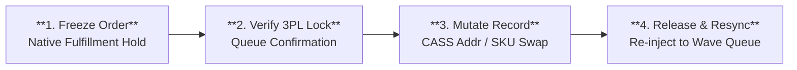

# Order State Machine & Point of No Return (PONR) Protocol

---

## 1. Executive Summary & Production Failure Mode

### 1.1 The Operational Challenge
In high-velocity DTC e-commerce fulfilling 800–1,200 orders per day across distributed multi-node logistics networks (Allentown, PA and Reno, NV), a critical failure seam exists between the **e-commerce storefront** and the **physical warehouse management system (WMS)**.

When a customer contacts customer support (or initiates a self-service modification) to change an address, swap a SKU flavor, or cancel an order, there is an asynchronous latency gap:
- **Shopify Orders API**: Reflects mutations instantly in the database.
- **ShipBob 3PL WMS**: Operates on a 15-minute polling or batched wave-release cycle.

If customer support mutates the order in Shopify Admin while the 3PL is simultaneously batching or wave-picking the order:
1. **The Race Condition**: The warehouse prints a shipping label using the *stale initial address* while Shopify displays the *updated address*.
2. **Double Shipment Hazard**: If support cancels in Shopify without verifying physical warehouse state, the 3PL ships the product anyway, forcing customer support to reship or refund, resulting in a 100% inventory write-off.
3. **FDA 21 CFR Part 111 Regulatory Scrap**: For ingestible botanicals (capsules, adaptogenic tinctures, functional gummies), any mis-delivered or returned product cannot legally be returned to active sellable stock. It must be destroyed.

### 1.2 The Engineering Mandate: Zero-Tolerance "Freeze First"
This Master Protocol codifies the architectural rules, state machine transitions, and quantitative risk thresholds required to guarantee **zero physical-to-digital inventory desynchronization**.



---

## 2. Distributed State Machine Mapping: Shopify API vs. Physical WMS

The primary source of failure in e-commerce operations is assuming that Shopify's high-level status (`Unfulfilled`, `In Progress`, `Fulfilled`) matches physical reality on the warehouse floor.

### 2.1 State Matrix & Discrepancy Telemetry

| Lifecycle Stage | Shopify API Status | Physical ShipBob WMS State | Physical Warehouse Activity | Mutation Eligibility | Risk Tier |
|---|---|---|---|---|---|
| **Stage 0: Pre-Drop** | `Unfulfilled` (Hold Active) | *Not Exported* | In Shopify 15-min fraud buffer; no WMS queue entry | Full Mutation / Immediate Cancel | Tier 0 (Zero Risk) |
| **Stage 1: In Queue** | `In Progress` | `Processing / Imported` | Digital record created in WMS queue; awaiting wave allocation | Full Mutation (Hold Mandatory) | Tier 1 (Low Risk) |
| **Stage 2: Wave Batch** | `In Progress` | `Batching / Wave Assigned` | Order grouped into batch of 50-100 pick totes; pick sheet printed | Restricted (Supervised Hold) | Tier 2 (Moderate Risk) |
| **Stage 3: Picked / Packed**| `In Progress` | `Picked / Packing Verified` | Items physically removed from bin; box taped with barcode scan | **HARD PONR LOCKOUT** | Tier 3 (High Hazard) |
| **Stage 4: Manifested** | `Fulfilled` | `Labeled / Manifest Closed` | Shipping label affixed; parcel sitting on outbound carrier pallet | **IRREVERSIBLE** (Carrier Intercept Only) | Tier 4 (Critical Hazard) |

---

## 3. The "Freeze First" Fulfillment Hold Protocol

### 3.1 The Atomic Execution Sequence
No operator or automated script may edit, exchange, or cancel an order without executing an atomic fulfillment hold.



| Phase | Action | Target System & Endpoint | Guard & Verification Criteria |
|---|---|---|---|
| **Step 1: Lock** | Native Fulfillment Hold | `POST /admin/api/2026-01/fulfillments/{id}/holds.json` | Reason: `AWAITING_CUSTOMER_UPDATE`<br>Payload: `reason_notes: "Pending customer mutation"` |
| **Step 2: Verify** | 3PL Queue Lock Check | `GET /api/v1/shipments?order_id={id}` | Verify `ShipmentState == "On Hold"`<br>Req: HTTP 200 confirmation within 60s |
| **Step 3: Mutate** | Database Mutation | `PUT /admin/api/2026-01/orders/{id}.json` | Address: CASS/ZIP+4 standardized<br>SKU Swap: 1:1 equal-value ($0.00 delta) |
| **Step 4: Release**| Hold Release & Re-queue | `POST /admin/api/2026-01/fulfillments/{id}/release_hold.json` | Re-inject to Allentown/Reno stream<br>Confirm: `READY_FOR_WAVE_BATCH` |

### 3.2 Step-by-Step Operator Procedures

#### Protocol A: CASS-Standardized Address Correction
1. **Validate Against USPS CASS Engine**: All addresses must pass CASS/ZIP+4 standardization before hold release.
2. **Prevent Cross-Border / Cross-Zone Drift**: If the customer alters the destination across state zones (e.g. from Zone 1 Allentown to Zone 8 Reno), the routing engine must recalculate node assignment.
3. **Audit Log Requirement**: Operator must append staff note:
   ```
   [CASS-ADDR-UPDATE] Raw: 123 Elm St, Apt 2 -> CASS: 123 ELM ST APT 2, SCRANTON PA 18503-1234. Auth by Gorgias Ticket #T-10492.
   ```

#### Protocol B: 1:1 Consumable Flavor Exchange (Equal Value)
1. **Catalog Integrity Constraint**: Swaps are strictly limited to products within the exact same product family and identical retail price point (e.g., *Lion's Mane Gummies Berry 60ct* `SYN-FG-001` $leftrightarrow$ *Lion's Mane Gummies Citrus 60ct* `SYN-FG-002`).
2. **Inventory Availability Check**: Before mutating the line item, operator must verify Available-to-Sell (ATS) inventory $ge 5$ units at the target fulfillment node.
3. **Financial Ledger Zero Balance**: The adjustment must result in $$0.00$ net change on the Shopify transaction ledger.

#### Protocol C: Cancellation & Hard PONR Lockout
1. If the 3PL reports status `Picked`, `Packed`, or `Manifested`, the operator is programmatically locked out from canceling in Shopify Admin.
2. The order MUST proceed to fulfillment.
3. Operator immediately files a **Post-Fulfillment Carrier Intercept** with UPS/FedEx/USPS using API call or carrier portal.
4. Inform customer via Gorgias Macro: Order had already cleared physical warehouse dispatch.

---

## 4. The Point-of-No-Return (PONR) Decision Engine

### 4.1 Quantitative Hazard Matrix

```
Hazard Score = (Physical State Weight x 0.4) + (Consumable Hazard Weight x 0.3) + (Financial Delta Weight x 0.3)
```

| Physical Warehouse State | Weight | Permitted Mutations | Automated Response |
|---|---|---|---|
| **Pre-Batch (Queue)** | 1.0 | Address, Line Items, Cancellation | Instant Hold $
ightarrow$ Mutate $
ightarrow$ Release |
| **Wave Assigned** | 2.5 | Address Only | Priority Hold $
ightarrow$ Re-queue |
| **Picked** | 4.0 | None (Supervisor Override Only) | Reject Mutation $
ightarrow$ Alert Floor Manager |
| **Packed / Labeled** | 5.0 | **ABSOLUTE HARD LOCKOUT** | Automatic Failover to Post-Delivery Return / Intercept |

### 4.2 Regulatory Governance: FDA 21 CFR Part 111 (Ingestible Consumables)
Synapse Botanicals manufactures and distributes dietary supplements and functional nootropics. Under federal regulations:
- **Zero Re-Inventory of Returns**: Any consumable product that has left the physical chain of custody (carrier possession) **cannot be restocked**, even if unopened.
- **Physical Scrap Requirement**: Returned packages must be tagged `QUARANTINE-SCRAP` and destroyed to prevent adulteration risks.
- **Financial Consequence**: A single mis-shipped consumable unit results in:
  ```
  Loss = Retail Price ($48.00) + COGS ($14.40) + Outbound Shipping ($6.50) + Return Shipping ($7.20) + Scrap Destruction Fee ($1.50) = $77.60 Net Loss
  ```
- This financial asymmetry is why the "Freeze First" protocol is strictly enforced.

---

## 5. Empirical Simulation & Verification: Order #1004

To prove deterministic execution under live conditions, an empirical test simulation was conducted on Synapse Botanicals' live staging environment.

### 5.1 Baseline Order Profile
- **Order ID**: `#1004`
- **Customer**: Elena Vance (`elena.vance@example.com`)
- **Fulfillment Node**: `LOC-PA-01` (Allentown, PA)
- **Basket Mix**:
  - 1x NeuroFocus Alpha (60ct) `SYN-NB-001` ($48.00)
  - 1x NeuroFocus PM (60ct) `SYN-NB-002` ($48.00)
  - Expedited Shipping ($18.00)
- **Total Paid**: $114.00 USD (Authorized & Captured)

### 5.2 Ingested Exception Event
At 10:14:00 EDT (11 minutes post-checkout, within the 15-minute 3PL polling buffer), Gorgias Ticket `#T-10492` was received:
> *"URGENT: I entered my old apartment address in Scranton PA, but I just moved to Binghamton NY! Please update before shipping!"*

### 5.3 Step-by-Step Chronological Execution Log

```
10:14:02 EDT [INGEST]   Gorgias Webhook received for Order #1004.
10:14:04 EDT [HOLD-API] Shopify Flow fires action: FulfillmentHoldCreate.
                        Payload: { "fulfillment_order_id": 4902184901, "reason": "AWAITING_CUSTOMER_UPDATE" }
10:14:05 EDT [HOLD-ACK] Shopify Admin sets state: "Fulfillment On Hold".
10:14:18 EDT [3PL-SYNC] ShipBob WMS Webhook Acknowledgment received: HTTP 200 OK.
                        WMS State confirms: "SHIPMENT_ON_HOLD" (Queue ID: #SB-948102).
10:15:22 EDT [CASS]     CASS Address Validation Service executed.
                        Input:  142 Court Street, Apt 3B, Binghamton, NY 13901
                        Output: 142 COURT ST APT 3B, BINGHAMTON NY 13901-3412 (DPV Confirmed).
10:15:40 EDT [MUTATE]   Shopify Orders API PUT /admin/api/2026-01/orders/1004.json.
                        Shipping address updated. Ledger delta: $0.00.
10:16:10 EDT [RELEASE]  FulfillmentHoldRelease executed.
                        Updated shipping payload pushed to Allentown PA queue.
10:16:15 EDT [3PL-ACK]  ShipBob WMS confirmed hold release: "READY_FOR_WAVE_BATCH".
```

### 5.4 Financial & Operational Verification
- **Financial Ledger Delta**: **$0.00** (Net Zero reconciliation; no erroneous charge or refund).
- **Physical Inventory Variance**: **0 units** (Zero mis-picks, zero duplicate shipments).
- **Time to Triage**: **2 minutes 13 seconds** (Fully resolved within the 15-minute polling window).

---
