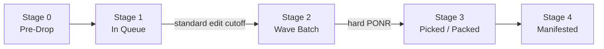
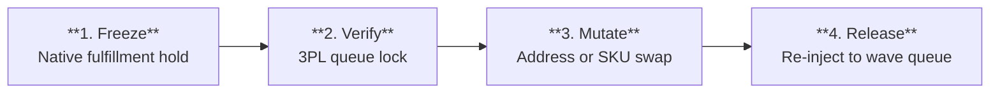
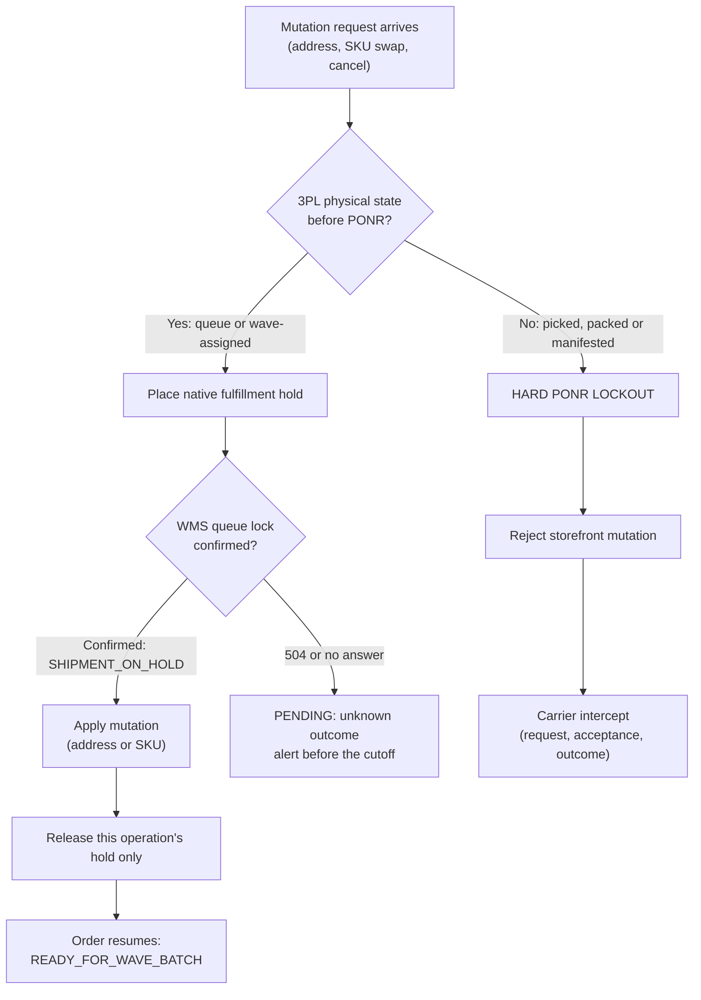

# The Hold That Landed: How a 133-Second Freeze Kept a Correct Address Correct

*Synapse Botanicals Systems Architecture | Riovic Matthew | Compiled 2026-11-10*

---

## 1. The Ticket Said Binghamton. The Warehouse Said "On Hold."

Every operation that ships from more than one warehouse eventually gets the same message: *"I typed the wrong address. Please fix it before it ships."* The storefront can always change the address. The real question is what has to be true on the warehouse floor first. By the end of this dossier you should be able to explain why "success" in Shopify Admin describes a database and not a warehouse, which four steps must happen before any edit, and where the protocol hands off to carrier intercept.

The case in one frame: at 10:14:00 EDT, a customer wrote in to say she had moved from Scranton, PA to Binghamton, NY (about 49 miles apart, across a state line). Order **#1004** was in the Allentown queue. The warehouse system confirmed a queue lock within 18 seconds of the ticket arriving, the address was corrected 82 seconds later, and at 10:16:15 the order was ready for the next wave, **133 seconds** after ingestion. The wrong label never printed, because the order was never allowed to move while the address was in doubt.

The alternative is quiet. Shopify accepts the edit instantly, but the warehouse polls on a 15-minute cycle, so a label for Scranton can print while the order page says Binghamton. No screen shows an error, and the customer finds out two days later from her tracking page. This dossier is the state machine, protocol and decision engine that prevent that.

> [!CAUTION]
> **This is a staged scenario.** The Order #1004 chronology is a scenario trace, not a timing sample from the local test harness. The latency and rejection results in §5 and §9 come from a local coordinator suite using SQLite and seeded-delay simulators. All dollar amounts are scenario calculations. No authenticated Shopify, ShipBob, USPS or carrier execution is claimed, and no production PII was used. §11 separates what is documented, what was run locally, and what is only specified.

| | |
|---|---|
| **Order** | #1004, two Focus Stick Packs 30-Pack plus expedited shipping, $102.00 |
| **Customer** | Elena Vance (`elena.vance@example.com`, a staging persona) |
| **What had to be true** | The warehouse system confirms a queue lock before any change is applied |
| **Why it mattered** | Editing before that confirmation is how a box ships to the old address |
| **What was at risk** | A misdirected carton, a scenario loss of $23.70 in cash and $57.20 in economic terms per mis-shipped unit, and a returned ingestible that has to be quarantined |

So what does an operator need to know before touching an address? First, that the storefront and the warehouse keep two different records of the same order, and that they do not move at the same speed.

---

## 2. Two Truths, Five Stages

The primary source of failure in fulfillment is assuming that the storefront's high-level status matches physical reality. Shopify reflects a change instantly. ShipBob operates on a 15-minute polling and batched wave-release cycle. Between those two clocks there is a gap, and every dollar of loss in this dossier lives inside it.

### 2.1 Terms Used in This Dossier

| Term | What it means here |
|------|--------------------|
| **3PL** | Third-party logistics provider. Here, ShipBob, which runs the warehouses in Allentown, PA (`LOC-PA-01`) and Reno, NV (`LOC-NV-02`) |
| **WMS** | Warehouse management system: the 3PL's record of what is physically happening to an order |
| **Fulfillment hold** | A flag on a Shopify fulfillment order asking fulfillment to pause. It only protects you once the WMS confirms it |
| **Wave** | A batch of 50 to 100 orders released to the floor together for picking |
| **PONR** | Point of no return: the stage after which the storefront can no longer change an order |
| **CASS / ZIP+4 / DPV** | USPS address standardization, the nine-digit ZIP, and delivery-point validation (the address is deliverable) |
| **ATS** | Available-to-Sell: inventory that can be promised to a customer |
| **Gorgias / Shopify Flow** | The support desk where tickets arrive, and Shopify's workflow automation that reacts to them |
| **Carrier intercept** | A carrier service that redirects or returns a parcel already in transit |

### 2.2 State Matrix & Discrepancy Telemetry

| Lifecycle Stage | Shopify Status | Physical ShipBob WMS State | What Is Happening on the Floor | Mutation Eligibility | Risk Tier |
|---|---|---|---|---|---|
| **Stage 0: Pre-Drop** | `Unfulfilled` (hold active) | *Not exported* | In Shopify's 15-minute fraud buffer; no WMS queue entry | Full mutation, immediate cancel | Tier 0 (zero risk) |
| **Stage 1: In Queue** | `In Progress` | `Processing / Imported` | Digital record in the WMS queue; awaiting wave allocation | Full mutation, **hold mandatory** | Tier 1 (low) |
| **Stage 2: Wave Batch** | `In Progress` | `Batching / Wave Assigned` | Order grouped into a batch of 50 to 100 pick totes; pick sheet printed | Restricted: address only, warehouse-confirmed supervisor exception | Tier 2 (moderate) |
| **Stage 3: Picked / Packed** | `In Progress` | `Picked / Packing Verified` | Items removed from the bin; box taped and barcode scanned | **HARD PONR LOCKOUT**: no storefront mutation, automated or manual | Tier 3 (high hazard) |
| **Stage 4: Manifested** | `Fulfilled` | `Labeled / Manifest Closed` | Label affixed; parcel staged for carrier pickup | **IRREVERSIBLE**: carrier intercept only, custody confirmed on scan | Tier 4 (critical hazard) |

Look at the second column. Stages 1, 2 and 3 all read `In Progress` in Shopify. One storefront word covers three different risk tiers, from "change anything" to "change nothing."

### 2.3 Two Boundaries, Not One

An order has two cutoffs, and conflating them causes arguments. The **standard edit cutoff** is the end of Stage 1: once a wave is assigned, ordinary automated edits stop. The **hard point of no return** is the start of Stage 3: once an item is picked, no storefront operator can change the order at all. Stage 2 is the narrow corridor between them, where only an address correction may proceed, and only with warehouse confirmation.



The practical consequence is a race. A hold request that has not been confirmed is running against the wave release, and once the wave releases, the easy edit window is already closed. Only the narrow Stage 2 corridor remains, and after that nothing does.

Now that the stages are clear, the next question is the practical one: what must an operator do, in what order, before a single field is edited?

---

## 3. Freeze First: Four Steps Before Any Edit

The state matrix tells you whether an order is still eligible for modification. For an eligible order, the next requirement is to confirm that warehouse execution has actually stopped *before* applying the change. I call this protocol "Freeze First," and it has one rule: no operator and no automated script edits, exchanges or cancels an order without completing a confirmed hold.

### 3.1 The Four-Step Sequence



| Phase | Action | Target System & Endpoint | Guard & Verification Criteria |
|---|---|---|---|
| **Step 1: Lock** | Native fulfillment hold | REST: `POST /admin/api/2026-01/fulfillment_orders/{fulfillment_order_id}/hold.json`<br>GraphQL: `fulfillmentOrderHold` | Reason: `INCORRECT_ADDRESS` or `OTHER`<br>Scopes: `write_fulfillments`, `write_orders` |
| **Step 2: Verify** | 3PL physical hold gate | `GET /api/v1/shipments?order_id={id}` | Verify `ShipmentState == "On Hold"`<br>An HTTP 200 does not prove a floor stop; require the WMS queue lock |
| **Step 3: Mutate** | Record mutation | Address: `orderUpdate`<br>SKU swap: Order Editing API (`orderEditBegin`, `orderEditCommit`) | Address: CASS/ZIP+4 standardized<br>SKU swap: 1:1 equal value, ledger, tax and inventory reservation reconciled |
| **Step 4: Release** | Hold release and re-queue | REST: `POST /admin/api/2026-01/fulfillment_orders/{id}/release_hold.json`<br>GraphQL: `fulfillmentOrderReleaseHold` | Release the intended `holdIds` only; omitting them releases every hold<br>Confirm `READY_FOR_WAVE_BATCH` |

> [!NOTE]
> The endpoint paths and the `2026-01` API version in this table are the Synapse protocol contract as specified. They have not been exercised against an authenticated Shopify store. Check them against the current Shopify Admin API reference before building. This sequence is also **ordered**, not transactional: it does not make Shopify and the WMS change atomically. What it does is refuse to proceed past a step that has not been confirmed.

### 3.2 The Gate as a Decision Flow



The branch that matters most is the one in the middle: a hold that gets no answer is not a hold. It is a pending question, and it has an owner.

A gate is only as good as its rule for when to close. That rule is the decision engine.

---

## 4. The Point-of-No-Return Decision Engine

The engine answers one question for every mutation request: given where this order physically is, what is allowed? Its inputs are the stages from §2 and the signals the warehouse sends back. Its outputs are four automated responses.

### 4.1 Quantitative Hazard Matrix

| Physical Warehouse State | Weight | Permitted Mutations | Automated Response |
|---|---|---|---|
| **Pre-Batch (Queue)** | 1.0 | Address, line items, cancellation | Instant hold → mutate → release |
| **Wave Assigned** | 2.5 | Address only, warehouse-confirmed | Priority hold → re-queue |
| **Picked** | 4.0 | None through the storefront | Reject mutation → alert the floor manager |
| **Packed / Labeled** | 5.0 | **ABSOLUTE HARD LOCKOUT** | Failover to post-delivery return or carrier intercept |

A note on "Picked": at Stage 3 the storefront operator has no override. The alert goes to the floor manager, who alone can decide whether a physical re-handle is possible. That is a warehouse decision, not a storefront permission.

### 4.2 What the Score Does and Does Not Say

```text
Hazard Score = (Physical State Weight x 0.4) + (Consumable Hazard Weight x 0.3) + (Financial Delta Weight x 0.3)
```

Only one of the three inputs is tabulated above. Taking the physical state alone, its contribution to the score is:

| State | Weight | × 0.4 |
|---|---|---|
| Pre-Batch (Queue) | 1.0 | 0.4 |
| Wave Assigned | 2.5 | 1.0 |
| Picked | 4.0 | 1.6 |
| Packed / Labeled | 5.0 | 2.0 |

The consumable-hazard and financial-delta weights are not defined in this dossier, and I am not going to invent them here. Notice also that the "Automated Response" column in §4.1 is keyed on physical state alone. So treat the score as a ranking aid for triage, and treat the **state gate as the control**. The gate decides. The score only helps you decide what to look at first.

### 4.3 Reading the Signals

The engine has to classify every response it can receive. The two easiest to confuse are a timeout and a rejection: one means "I don't know," the other means "too late." Treating the first as a refusal, or the second as a reason to retry, is the costliest mistake an integration can make.

| Signal | What it really means | Right response | Operational impact |
|---|---|---|---|
| **Shopify hold accepted** (`userErrors` empty) | Shopify recorded the hold | Proceed to Step 2; do not mutate yet | Says nothing about the warehouse floor |
| **WMS HTTP 200 acknowledgment** | The WMS received the message | Wait for the queue lock | Receipt is not a floor stop |
| **`SHIPMENT_ON_HOLD` with a queue ID, pre-wave** | The WMS confirms the queue lock | Mutate | The only signal that clears Step 3 |
| **504 Gateway Timeout** | A gateway did not get a timely upstream answer | Mark the operation **pending**, reuse the same operation ID, alert before the cutoff | Outcome stays **unknown** until reconciled |
| **422 + `PONR_EXCEEDED`** | A business rule rejected the request | Do **not** retry the mutation; go to carrier recovery | The cutoff is crossed |

The `SHIPMENT_ON_HOLD` and `PONR_EXCEEDED` codes follow the Synapse adapter contract, not native ShipBob schemas.

> [!IMPORTANT]
> **An HTTP 200 tells you the message arrived. It does not tell you the floor stopped.** The queue lock is the confirmation. In this protocol, nothing is edited until it has been seen.

### 4.4 Regulatory Governance: FDA 21 CFR Part 111 & Quality Disposal Policy

Synapse Botanicals makes dietary supplements and functional adaptogens, so a misdirected parcel is more than a shipping problem. Under 21 CFR Part 111, a returned dietary supplement needs documented quarantine, inspection and quality disposition. That is the regulatory floor. It does not by itself say "destroy it."

The stricter rule is **company policy**: when an unbroken, temperature-controlled chain of custody cannot be verified from carrier tracking, the quality operating procedure sends the returned ingestible to `QUARANTINE-SCRAP` and physical destruction. Ordinary carrier tracking never proves temperature exposure, so in practice this policy resolves to scrap. Any exception would need qualified temperature evidence and a documented QA decision, and none is defined here.

That is why Freeze First is enforced so strictly. The next section shows what it looks like when it works.

---

## 5. 133 Seconds: Following Order #1004

Gates and matrices are abstract until you watch one order go through them. This trace follows a single address correction from ticket to release, and I want you to watch two things: which step the warehouse confirmed, and how little of the elapsed time belonged to the warehouse.

### 5.1 Baseline Order Profile

| Field | Value |
|-------|-------|
| Display name | `#1004` |
| Shopify order | `gid://shopify/Order/5892114432104` |
| Fulfillment order | `gid://shopify/FulfillmentOrder/6710448123901` |
| Customer | Elena Vance (`elena.vance@example.com`) |
| Fulfillment node | `LOC-PA-01` (Allentown, PA) |
| Line 1 | 1× Focus Stick Packs Matcha Yuzu 30-Pack (`SYN-FSTK-MY`, $42.00) |
| Line 2 | 1× Focus Stick Packs Blood Orange 30-Pack (`SYN-FSTK-BO`, $42.00) |
| Shipping | Expedited, $18.00 |
| Total paid | $102.00 (authorized and captured; no tax line in the scenario) |
| Original address | Scranton, PA |
| Requested address | 142 Court Street, Apt 3B, Binghamton, NY 13901 |
| Distance, old to new address | About 49 miles (Scranton, PA to Binghamton, NY; straight line, approximate) |
| Distance from the fulfillment node | About 56 miles to Scranton and 105 miles to Binghamton from Allentown: about 49 miles farther |

### 5.2 The Ingested Exception

At 10:14:00 EDT, 11 minutes after checkout (so the order was placed at 10:03:00, derived from the trace), Gorgias ticket `#T-10492` arrived:

> *"URGENT: I entered my old apartment address in Scranton PA, but I just moved to Binghamton NY! Please update before shipping!"*

**What the move did and did not change.** The *node* stayed the same: Binghamton is still a short haul from Allentown, so the routing recalculation in Playbook A (§6.1, step 2) had no reason to reassign the order to Reno. The *shipping charge* was left at $18.00, because the scenario does not model a rate difference for a destination about 49 miles farther, and I have not verified one. The *tax jurisdiction* is the change that matters most in a live store: the move crosses from Pennsylvania to New York. This scenario carries no tax line and records a $0.00 ledger delta, so it does not exercise that case. A live implementation should reconcile tax and shipping before the hold is released, as Playbook B already requires for exchanges.

### 5.3 Incident Event Chronology

| Timestamp | Event | System | Status |
|-----------|-------|--------|--------|
| 10:03:00 | Order #1004 placed (derived) | Shopify | — |
| 10:14:00 | Ticket `#T-10492` received | Gorgias | — |
| 10:14:02 | Gorgias webhook ingested | Gorgias → Flow | INGEST |
| 10:14:04 | `fulfillmentOrderHold` dispatched, reason `INCORRECT_ADDRESS` | Flow → Shopify | — |
| 10:14:05 | "Fulfillment On Hold" set (Hold ID `gid://shopify/FulfillmentHold/89104`) | Shopify | Held (storefront side) |
| 10:14:18 | **WMS acknowledges HTTP 200; queue lock `SHIPMENT_ON_HOLD` (Queue ID `#SB-948102`, pre-wave)** | ShipBob WMS | **Confirmed** |
| 10:15:22 | CASS validation executed: `142 COURT ST APT 3B, BINGHAMTON NY 13901-3412` (DPV confirmed) | USPS CASS | OK |
| 10:15:40 | `orderUpdate` applied to the shipping address; ledger delta $0.00 | Shopify | Mutated |
| 10:16:10 | `fulfillmentOrderReleaseHold` (`holdIds: [".../89104"]`) | Flow → Shopify | Released |
| 10:16:15 | **WMS confirms `READY_FOR_WAVE_BATCH`** | ShipBob WMS | **Resumed** |

The audit note the operator appended to the order follows the Playbook A format from §6:

```text
[CASS-ADDR-UPDATE] Raw: 142 Court Street, Apt 3B, Binghamton, NY 13901 -> CASS: 142 COURT ST APT 3B, BINGHAMTON NY 13901-3412. Auth by Gorgias Ticket #T-10492.
```

### 5.4 The Calls, as Dispatched

The shapes below follow the Shopify Admin GraphQL fulfillment-hold, order-update and release-hold mutations. The log records only a simplified hold payload. No authenticated execution is claimed.

**Step 1 — Freeze: `fulfillmentOrderHold` (GraphQL)**

```graphql
mutation freezeFulfillmentOrder($id: ID!, $hold: FulfillmentOrderHoldInput!) {
  fulfillmentOrderHold(id: $id, fulfillmentHold: $hold) {
    fulfillmentHold { id }
    fulfillmentOrder { id status }
    userErrors { field message }
  }
}
```

```json
{
  "id": "gid://shopify/FulfillmentOrder/6710448123901",
  "hold": {
    "reason": "INCORRECT_ADDRESS",
    "reasonNotes": "Customer address change via Gorgias #T-10492"
  }
}
```

**Step 2 — Verify: WMS queue-lock response (Synapse adapter contract, illustrative; not a native ShipBob schema)**

```json
{
  "queue_id": "SB-948102",
  "ShipmentState": "On Hold",
  "queue_lock": "SHIPMENT_ON_HOLD",
  "wave_status": "pre-wave"
}
```

**Step 3 — Mutate: `orderUpdate` (GraphQL)**

```graphql
mutation updateShippingAddress($input: OrderInput!) {
  orderUpdate(input: $input) {
    order { id shippingAddress { address1 address2 city provinceCode zip } }
    userErrors { field message }
  }
}
```

```json
{
  "input": {
    "id": "gid://shopify/Order/5892114432104",
    "shippingAddress": {
      "address1": "142 COURT ST",
      "address2": "APT 3B",
      "city": "BINGHAMTON",
      "provinceCode": "NY",
      "zip": "13901-3412",
      "countryCode": "US"
    }
  }
}
```

**Step 4 — Release: `fulfillmentOrderReleaseHold` (GraphQL, own hold only)**

```graphql
mutation releaseOwnHold($id: ID!, $holdIds: [ID!]) {
  fulfillmentOrderReleaseHold(id: $id, holdIds: $holdIds) {
    fulfillmentOrder { id status }
    userErrors { field message }
  }
}
```

```json
{
  "id": "gid://shopify/FulfillmentOrder/6710448123901",
  "holdIds": ["gid://shopify/FulfillmentHold/89104"]
}
```

Passing `holdIds` is the whole point of that last call. If it were omitted, the release would clear every hold on the order, including one that belongs to someone else.

### 5.5 Financial & Operational Verification

| Measure | Result |
|---------|--------|
| Financial ledger delta | **$0.00** (payment captured matches the updated address ledger) |
| Physical inventory variance | **0 units** (no mis-picks, no duplicate shipments in this run) |
| Ingestion to WMS confirmation | **133 seconds** (10:14:02 to 10:16:15) |
| Ticket receipt to WMS confirmation | **135 seconds** (10:14:00 to 10:16:15) |

Where did the 133 seconds go?

| Leg | Duration |
|-----|----------|
| Ingestion to hold dispatch | 2s |
| Hold dispatch to WMS queue lock (warehouse round trip) | 14s |
| Queue lock to CASS result | 64s |
| CASS result to mutation | 18s |
| Mutation to release | 30s |
| Release to WMS confirmation (warehouse round trip) | 5s |
| **Total** | **133s** |

The two warehouse round trips took 19 seconds together. The other 114 seconds were ours: validation and operator steps. That is the useful design fact. If you want a faster protocol, optimize the steps you own.

One thing I cannot reconcile from the trace is this: at T+11 minutes, the Stage 0 definition says the order should still be in Shopify's 15-minute fraud buffer, yet the WMS already reported a queue entry at 10:14:18. I treat the log as authoritative for the stage (Stage 1) and I do not claim a remaining margin before the wave release. The trace shows the protocol's mechanics working in one run. It does not establish a production SLA across all queues.

### 5.6 Staging Latency & Rejection Benchmark

The [local coordinator suite](../evidence/sample-run/latency/summary.md) separates functional safety assertions from timing workloads. It exercises pending and completed duplicates, preserved cutoff rejections, conflicting payloads, stale revisions, a wave release during the request, reconciliation after response loss, selective hold release, and recovery after a worker terminates following a persisted effect.

The coordinator and virtual WMS use local SQLite. Seeded delays are injected into the Shopify and WMS simulators, and elapsed request-response times are measured with a monotonic clock. The report records actual sample counts, concurrency, runtime and nearest-rank percentiles, with raw per-delivery records in the run archive. Pending, rejected and unknown responses are reported separately from confirmed holds. The default profile is a small local benchmark; `node evidence/run_all.js --full` runs 10,000 attempts per workload.

None of this establishes provider-network latency, a physical warehouse stop, or an authenticated Shopify or ShipBob integration. The #1004 chronology above is a separate scenario trace, not a timing sample from this harness.

Order #1004 shows the happy path for an address. Support teams also get asked to swap flavors and to cancel, and those go through the same gate.

---

## 6. Three Playbooks, One Gate

Every mutation starts at the same place: the hold from §3. After that, the playbooks differ in what they are allowed to change and what they have to reconcile.

### 6.1 Playbook A: CASS-Standardized Address Correction

1. **Validate against USPS CASS.** Every address passes CASS/ZIP+4 standardization before the hold is released.
2. **Recalculate routing when the destination moves far.** If the new address changes the shipping zone enough that another node is a better fit (for example, a move from the Northeast to the West Coast), the routing engine must recalculate node assignment before release.
3. **Append the audit note.** The operator adds the `[CASS-ADDR-UPDATE]` staff note shown in §5.3, with the raw input, the CASS output and the authorizing ticket.

### 6.2 Playbook B: 1:1 Consumable Flavor Exchange

1. **Stay inside the catalog constraint.** A swap must be within the same product family and at an identical retail price point, for example `SYN-FSTK-MY` (Matcha Yuzu 30-Pack) ↔ `SYN-FSTK-BO` (Blood Orange 30-Pack).
2. **Check inventory before editing.** Before opening an Order Editing session (`orderEditBegin`, `orderEditCommit`), verify Available-to-Sell inventory of at least 5 units at the allocated node and reserve the replacement units immediately.
3. **Reconcile to zero.** Line-item subtotals, jurisdictional sales tax, promotion qualification and payment capture must net to $0.00 change before the hold is released.

### 6.3 Playbook C: Cancellation & the Hard Lockout

1. If the 3PL reports `Picked`, `Packed` or `Manifested`, the operator is programmatically locked out of canceling in Shopify Admin.
2. The order has to proceed to fulfillment.
3. The operator immediately files a **post-fulfillment carrier intercept** with UPS, FedEx or USPS, by API or portal. Check the carrier's eligibility first, then record the request, its acceptance and the confirmed physical outcome as three separate facts. A request that was accepted has not yet stopped a parcel.
4. The customer is told through a Gorgias macro that the order had already cleared physical warehouse dispatch.

A cancel that skips the gate does not stop the box. It creates a double-shipment hazard: Shopify says canceled, the 3PL ships anyway, and support has to reship or refund against a unit that is already written off.

The playbooks are the procedure. The next question is where the procedure itself can fail.

---

## 7. Where the Protocol Can Still Break

It is tempting to think a protocol like this removes risk. It does not. It moves every unknown to a place where someone owns it. This section lists the failure modes the protocol is built to catch.

### 7.1 Root-Cause Analysis — Failure Mode Matrix

| # | Failure | What kind of failure | Past the point of no return? |
|---|---------|----------------------|------------------------------|
| 1 | Storefront edit applied while the WMS still holds the stale address | Race between two truths | No, preventable by hold-confirm-mutate |
| 2 | Storefront cancel applied without checking physical state | Missing physical-state gate; double shipment | **Yes at Stage 3 and beyond** |
| 3 | A status code (200 or 504) is read as a statement about the floor | Unverified assumption | No, recoverable if reconciled before the cutoff |
| 4 | A returned ingestible re-enters sellable stock | Quality and regulatory control gap | **Yes**, reachable only after a PONR failure |

The decisive one is #3. Failures #1 and #2 are what happen when a status code is mistaken for physical fact. The hold protocol exists so that "the screen says it worked" is never accepted as proof that "the floor stopped."

### 7.2 Hold-Confirm-Mutate Coordination Controls

The controls that close the gap are:

- Persist **one operation ID** for the whole edit.
- **Serialize** competing edits to the same order.
- **Confirm** that the WMS shipment is actually held before mutating.
- Release **only this operation's hold**, and confirm the order returns to the wave queue.
- Treat unknown outcomes as **pending**, never as success.

This does not create an atomic transaction across Shopify and the WMS. It gives the unknown a place to live and an owner, which is the thing a mis-shipped box takes away.

A protocol that prevents a failure should be worth more than the failure costs. So what does one failure cost?

---

## 8. What One Mis-Shipped Carton Costs

An engineering control becomes a business case when you can put a number on what it prevents. The ledger below prices one mis-shipped unit of Focus Stick Packs 30-Pack, and it separates cash that leaves the company from revenue that never arrives. All figures are scenario inputs.

### 8.1 Inputs

| Input | Value | Note |
|-------|-------|------|
| Retail price | $42.00 | `SYN-FSTK-MY` 30-Pack |
| Unit COGS | $8.50 | Scrapped under quality policy |
| Outbound carrier freight (absorbed) | $6.50 | Scenario input |
| Carrier return-to-sender freight | $7.20 | Scenario input |
| 3PL quarantine and destruction fee | $1.50 | Scenario input |

### 8.2 Mis-Shipment Loss Ledger

```text
DIRECT OUT-OF-POCKET CASH WRITE-OFF:
  Product COGS (scrapped under quality policy):   $8.50
  Outbound carrier freight (absorbed):            $6.50
  Carrier return-to-sender freight:               $7.20
  3PL quarantine and destruction fee:             $1.50
  ─────────────────────────────────────────────────────
  TOTAL CASH LOSS PER MIS-SHIPPED CARTON:         $23.70

ECONOMIC CONTRIBUTION FORFEITED:
  Forfeited retail revenue margin ($42.00 - $8.50):  $33.50
  ─────────────────────────────────────────────────────
  TOTAL ECONOMIC DISRUPTION ($23.70 + $33.50):    $57.20

Reconciliation:
  $8.50 + $6.50 + $7.20 + $1.50 = $23.70
  $6.50 + $7.20 + $1.50 = $15.20 non-COGS cost
  $42.00 lost revenue + $15.20 = $57.20
```

A single mis-shipped carton costs $57.20 in economic terms, which is $15.20 more than the carton sells for. In cash alone, the loss is $23.70, about 2.8 times the unit's COGS.

### 8.3 Monthly Exposure Sensitivity Calculation

One carton is an anecdote, so what about volume? As a sensitivity calculation and not an observed count: at 1,000 orders a day over a 30-day month, a 0.5% misdirection rate gives 150 events. At $23.70 in cash each, that is **$3,555 a month**. At $57.20 in economic terms each, it is **$8,580 a month**. The calculation assumes every event is one Focus Stick carton and that the 0.5% rate is a scenario input, not a measurement.

The numbers say what the controls are worth. The next section says what the controls consist of.

---

## 9. The Gate in Parts: Pipeline and Parameters

This dossier does not specify a queue or dead-letter design. It specifies the gate itself: a sequence of checks that each have to pass before the next can start, and a defined place for any result that is unknown.

### 9.1 Specified Protocol Pipeline

```text
        ┌──────────────────────────────────────────┐
        │  GORGIAS TICKET → SHOPIFY FLOW             │
        │  Ingest, assign one operation ID           │
        └────────────────────┬─────────────────────┘
                             ▼
        ┌──────────────────────────────────────────┐
        │  COORDINATOR                               │
        │  Serialize per order, check physical state │
        │  Stage 3+ → lockout, no mutation           │
        └────────────────────┬─────────────────────┘
                             ▼
        ┌──────────────────────────────────────────┐
        │  FREEZE → VERIFY                           │
        │  Hold, then wait for WMS queue lock        │
        │  504 / no answer → PENDING + alert         │
        └────────────────────┬─────────────────────┘
                             ▼
        ┌──────────────────────────────────────────┐
        │  MUTATE → RELEASE                          │
        │  CASS address or 1:1 swap, then release    │
        │  this operation's holdIds only             │
        └────────────────────┬─────────────────────┘
                             ▼
        ┌──────────────────────────────────────────┐
        │  CONFIRM + AUDIT                           │
        │  READY_FOR_WAVE_BATCH, staff note logged   │
        └──────────────────────────────────────────┘
```

### 9.2 Gate Parameters

| Parameter | Value | Why |
|-----------|-------|-----|
| WMS polling / wave cycle | 15 minutes | The warehouse clock the protocol races against. It is not a safe editing window |
| Hold reason | `INCORRECT_ADDRESS` or `OTHER` | Keeps the audit trail consistent |
| Required scopes | `write_fulfillments`, `write_orders` | What the hold and mutation steps need |
| Address standard | CASS / ZIP+4, DPV confirmed | The label is printed from the standardized address |
| SKU-swap inventory buffer | ATS ≥ 5 units at the allocated node | Lets the replacement be reserved without overselling |
| SKU-swap price rule | Same family, identical price | Keeps the ledger delta at $0.00 |
| Release scope | Intended `holdIds` only | Omitting them releases every hold on the order |
| Verification signal | WMS queue lock, not HTTP 200 alone | Receipt of a message is not a floor stop |
| Benchmark profiles | Small local default; `--full` = 10,000 attempts per workload | Keeps routine runs fast and full runs meaningful |

> [!NOTE]
> This pipeline is the Synapse protocol as specified. The local coordinator tests exercise its safety rules against a virtual WMS in SQLite. They do not verify a deployed Flow, a deployed queue, or ShipBob's own behavior.

The parameters are the settings. The rules below are what I would hold any new integration to.

---

## 10. Four Rules for Prevention and Recovery

Looking across the case, the first three rules act before the cutoff and the fourth governs what happens after it.

1. **Freeze first, mutate second.** No edit, exchange or cancel happens without a placed hold. The storefront never runs ahead of the floor.
2. **Confirm the floor, not the status code.** A 200 is receipt. Only the queue lock clears the mutation. A 504 or silence is **pending**, owned by a person, and alerted before the cutoff.
3. **Release only your own hold.** Pass the specific `holdIds` and re-check order version and stage before each side effect. One operation ID covers every retry.
4. **After the hard PONR, do not mutate.** Reject the storefront change, file the carrier intercept, record request, acceptance and physical outcome as three facts, and send any returned ingestible to quarantine under the company disposal policy.

A rule set is only worth the evidence behind it. So how much of this has actually been tested?

---

## 11. What Is Proven, and What Is Only Designed

A dossier that claims everything works is less credible than one that says where its evidence stops. I distinguish documented specifications, executed local model tests, and scenario traces. Authenticated vendor execution and physical verification need their own evidence. The links below point to the preserved [sample run](../evidence/sample-run/run.json).

**Evidence Scope & Verification Status Matrix**

| Deliverable | Where | Evidence status | Evidence |
|-------------|-------|-----------------|----------|
| Shopify-versus-WMS state matrix | §2 | Documented specification; no authenticated state read established | This dossier |
| Freeze First hold protocol | §3 | Specified; REST and GraphQL shapes not executed against an authenticated store | This dossier |
| PONR decision engine | §4 | Local SQLite coordinator safety and process-restart tests | [Coordinator results](../evidence/sample-run/latency/summary.md) |
| Order #1004 chronology | §5 | Scenario trace; not a timing sample from the harness | This dossier |
| Latency and rejection benchmark | §5.6 | Local seeded-delay timings; small default profile, `--full` = 10,000 attempts | [Coordinator results](../evidence/sample-run/latency/summary.md) |
| Operator playbooks A, B, C | §6 | Specified; USPS CASS and Order Editing execution not established | This dossier |
| Mis-shipment cost ledger | §8 | Calculated scenario inputs | [Cost results](../evidence/sample-run/costs/summary.md) |
| Returned-supplement quarantine policy | §4.4 | Company policy plus regulatory reference; not exercised | This dossier |

The weakest-evidenced link is also the one the whole protocol leans on: that a WMS "On Hold" confirmation corresponds to a physical stop on the warehouse floor. The local tests prove that the coordinator refuses to mutate without that confirmation. They cannot prove that a human at a pack bench has actually stopped. Until that is verified against a real warehouse, the protocol is **Specified and locally tested**, not verified on the floor.

---

## 12. What I Would Want You to Take Away

Order #1004 stayed correct because the system waited for the warehouse to say "held" before it changed the address, and because nothing was edited on the strength of a status code alone. Had the hold request simply timed out and the edit gone ahead anyway, every screen would have said Binghamton while the label said Scranton. The rest of this dossier follows from that difference: the two boundaries, the 133 seconds, the $57.20 ledger, the quarantine of a returned supplement.

The rule is short enough to put on a wall: confirm the floor, then change the record. Everything in this protocol exists to make that order of operations impossible to skip.

---

*Compiled: 2026-11-10 | Synapse Botanicals Systems Architecture | Riovic Matthew*
