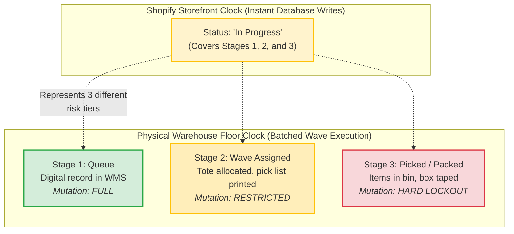
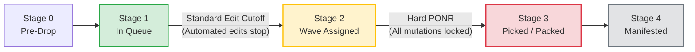
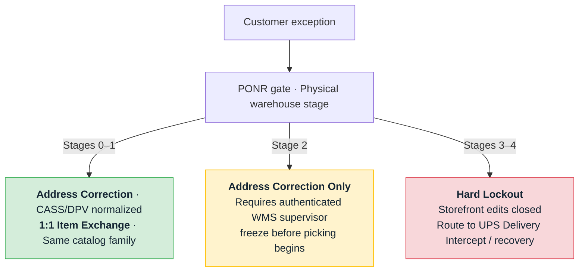

# One Label, Five Realities: Why Shopify’s ‘In Progress’ Misled Operations

**A systems investigation into storefront-to-warehouse state compression, why expedited orders silently lose their edit cushion, and how a lock-verified coordinator replaces operational guesswork.**

*Synapse Botanicals Systems Architecture | Order Lifecycle & State Synchronization | Technical Study — Domain 1*

---

## 1. The Paradox of ‘In Progress’: Four Seconds on a Phone vs. 133 Seconds on a Warehouse Floor

*Why an 11-minute-old order looked safe to edit in Shopify Admin—even though it was already queued in Allentown—and how a 133-second lock-first trace stopped a wrong label from printing.*

### 1.1 Symptom vs. Reality: A Database Write Cannot Stop a Conveyor

Marcus Chen fixes his shipping address on his phone. It takes four seconds: one field, one tap, one green checkmark. The storefront says *saved*.

Nothing on a warehouse floor in Allentown, Pennsylvania has heard about it.

A database write is a statement of intent. A carton on a conveyor is a fact. Between those two sits the gap where Order #18404—a $102.00 purchase of two $42.00 stick packs plus $18.00 expedited shipping—nearly became an interstate mis-shipment. The parcel was queued for Scranton, PA while the customer lived 49 miles across state lines in Binghamton, NY.

Stopping the label did not happen when the support agent clicked save. **Stopping it took 133 seconds** of coordinated freeze, verification, mutation, and release—and the order had to still be standing unpicked in the warehouse queue when that verification completed.

```text
       10:14:00 EST              10:14:18 EST                 10:16:13 EST   10:16:15 EST
  Customer Ticket Ingested   Warehouse Lock Confirmed     Release Confirmed   Order Resumed
  ───────────●─────────────────────────●──────────────────────────●──────────────●────────►
             │ ◄─ 18s: Native Hold ──►│ ◄─ 115s: CASS, Mutate, ─►│ ◄─── 2s ────►│
             │     & Queue Lock       │      Verify, Release     │  Wave re-entry│
             │                                                   │
             └──────────── 133 Seconds Total Freeze ────────────┘
```

At 10:14:00 EST, 11 minutes after checkout, customer Marcus Chen submitted urgent ticket `#T-10492`: he had moved from Scranton, Pennsylvania to Binghamton, New York. Order **#18404** was already queued inside Synapse’s Allentown fulfillment node (`LOC-PA-01`). Within 18 seconds of ticket ingestion, the coordinator placed a native fulfillment hold in Shopify and received an authenticated queue lock from the warehouse management system (WMS). Over the next 115 seconds, the address cleared postal standardization, the order record updated, and the coordinator released only its own hold. Release was confirmed at 10:16:13 EST (133 seconds), and Order #18404 re-entered the Allentown wave queue at 10:16:15 EST (135 seconds) carrying the corrected Binghamton label.

The wrong label never printed—not because support read the Shopify status correctly, but because the architecture refused to trust the storefront status alone.

> [!CAUTION]
> **Staging Scenario Disclosure**: Order #18404, Marcus Chen, and the trace timings in this case study are a **staged scenario** characterizing the Synapse Botanicals integration architecture. They are not an extract from a production database, and `marcus.chen@example.com` is a reserved example domain. The offline test harnesses in Section 7 verify the *coordination mechanics*; they do not reproduce this timeline. All financial figures represent unit-economic scenario modeling.

### 1.2 Diagnostic Snapshot: Order #18404

| Dimension | Detail | Why it matters |
|---|---|---|
| **Order Profile** | `#18404` · `gid://shopify/Order/5892114432104` · FO `gid://shopify/FulfillmentOrder/6710448123901` · 2× Focus Stick Packs 30-Pack ($84.00) + Expedited Shipping ($18.00) = **$102.00** | Ingestible product plus a paid priority SLA: the two attributes that shrink the safe edit window. |
| **Origin & Route** | Origin `LOC-PA-01` (Allentown, PA). Wrong destination: Scranton, PA. Correct destination: Binghamton, NY. **49-mile interstate delta.** | The correction crosses a state line, so zone, node, and tax-jurisdiction inputs all change. |
| **Ingestion Window** | Ticket received **10:14:00 EST**, 11 minutes after checkout. The order had entered WMS at 10:04:12. | The order was already in the warehouse queue when the customer asked to change it. |
| **Safety Invariant** | **Freeze-First**: confirm the *physical* queue lock before any mutation; release only the hold this operation placed. | An unconfirmed freeze is not a freeze. |
| **Financial Exposure** | Order #18404 is a **$102.00 purchase**. A mis-shipment creates additional product, reverse-freight, and recovery costs; Section 3 isolates these in a single-pack model. | Recovery costs depend on the basket and whether the customer receives a refund or replacement. |
| **Operational Result** | Frozen, corrected with CASS-standardized ZIP+4, released. Release confirmed at **10:16:13 EST** after **133 seconds**; order resumed at **10:16:15 EST** after **135 seconds.** | In this staged trace, the wrong label never printed: the order was held, corrected, and released before re-entering the wave queue. |

---

## 2. Three Blindspots Behind One Status Label

*Breaks down the three structural causes behind storefront–warehouse desynchronization: UI state compression, expedited buffer bypass, and misleading HTTP telemetry.*

When support or middleware inspects an order in Shopify Admin and decides whether it can still be changed, three invisible architectural flaws conspire to produce false confidence.

### 2.1 Blindspot 1: Five Physical Warehouse Stages Compressed into ‘In Progress’

Shopify Admin has one dial for active fulfillment. The warehouse has five physical stages. They run on **different clocks**, and the storefront clock obscures the physical transition.

Shopify operates on near-instantaneous ACID database transactions. A 3PL warehouse (such as ShipBob operating facilities in Allentown, PA and Reno, NV) operates on physical batching clocks—periodic API polling cycles (typically 15 minutes) and scheduled wave releases where 50 to 100 orders are dropped to pickers simultaneously.



#### The Five-Stage State Matrix

| Stage | Physical reality on floor | Shopify Admin shows | Hazard Level | Mutation Eligibility | Operational Discrepancy |
|---|---|---|---|---|---|
| **0 · Pre-Drop** | Order sits in the fraud/edit buffer; WMS has no record. | `Unfulfilled` *(hold active)* | **Zero Risk** | Full mutation; immediate cancellation. | None. Storefront and floor agree. |
| **1 · In Queue** | Digital record imported to WMS queue; awaiting wave allocation. | `In Progress` | **Low Hazard** | Full mutation; **hold mandatory**. | Admin hides that the order is now *also* active in another system. |
| **2 · Wave Batch** | Grouped into pick wave; pick list printed; tote assigned. | `In Progress` | **Moderate Hazard** | Address changes only, via **supervisor queue freeze**. No automated SKU swaps. | Identical label to Stage 1; the SKU-swap window has silently closed. |
| **3 · Picked / Packed** | Items pulled from bin; carton taped; barcode scanned. | `In Progress` | **High Hazard** | **HARD PONR LOCKOUT**: No storefront mutation permitted. | Identical label to Stages 1 and 2; every storefront mutation is now unsafe. |
| **4 · Manifested** | Shipping label affixed; carton staged on carrier dock. | `Fulfilled` | **Irreversible** | Post-fulfillment carrier intercept only. | Admin finally agrees with reality, too late to edit. |

> [!WARNING]
> **The Critical Vulnerability**: Stages **1, 2, and 3 all display the identical `In Progress` status in Shopify Admin**. A single storefront label masks three incompatible physical states: *safe to edit with a lock*, *address-only via supervisor intervention*, and *hard physical lockout*. Any integration that gates mutations on Shopify Admin status alone is gating on noise.

#### The Two Operational Boundaries

Fulfillment safety requires separating two distinct operational cutoffs rather than relying on one vague "cutoff" concept:



| Boundary | Location | Trigger Event | Consequence |
|---|---|---|---|
| **Boundary 1: Standard Edit Cutoff** | End of Stage 1 | Wave allocation in WMS | Automated line-item edits and SKU swaps stop. Address changes now require a verified supervisor queue freeze. |
| **Boundary 2: Hard Point of No Return (PONR)** | Start of Stage 3 | Physical pick scan | All storefront mutations are permanently locked out. Only carrier recovery remains. |

Stage 2 is the narrow corridor between those two boundaries. Line-item changes stay closed. An address correction may proceed only after the WMS confirms a completed supervisor queue freeze or wave deallocation before physical pick. In this contract, `supervisor_override == true` represents authenticated warehouse evidence tied to the shipment and current operation—never a flag supplied by the customer, helpdesk widget, or middleware to waive the floor check. A supervisor can stop an unpicked carton; a Boolean cannot stop a picker.

---

### 2.2 Blindspot 2: The Expedited SLA Trap (No Four-Minute Cushion)

An operator sees an order placed 11 minutes ago and reasons: *"Standard orders sit in a 15-minute buffer. We still have four minutes before the warehouse sees it."*

For Order #18404, that mental model was wrong by nearly ten minutes.

```text
STANDARD ORDER (15-minute fraud/edit buffer)
 00:00        checkout
 ├────────────────── 15:00 buffer: Stage 0, Zero Risk ──────────────────┤
 15:00                                                         WMS drop (Stage 1)
 ▲ ticket at T+11 arrives INSIDE the buffer: a pure storefront edit.

EXPEDITED ORDER (#18404)
 00:00  checkout
 ├─ 1:10 ─┤ fraud scoring passes (10:04:10)
          ├2s┤ WMS drop (10:04:12)  ◄── Stage 1 begins at T+1:12
              ├───────────────── 9:48 (588s) in queue ─────────────────┤
                                                              ticket at T+11:00 (10:14:00)
 ▲ ticket arrives AFTER the drop: the order is already in the warehouse's hands.
```

This reflects a core e-commerce architectural rule: **Shipping Service Level Agreements (SLAs) override batching buffers.**

Order #18404 carried an **$18.00 premium for Expedited Shipping**. To make guaranteed carrier transit cutoffs (such as UPS Next Day Air departing Allentown at 2:00 PM), Shopify Flow routing evaluates priority orders immediately:

1. **Standard Tier Orders**: Held in Shopify’s Stage 0 buffer for 15 minutes to allow customer self-service edits and fraud scoring.
2. **Expedited Tier Orders**: Tagged `priority:expedited`. Upon passing automated risk analysis (`Risk Level == LOW`), the order skips the buffer and dispatches immediately to the 3PL to catch the earliest picking wave.

Order #18404 cleared fraud scoring at 10:04:10 EST and dropped into ShipBob two seconds later. By the time Marcus Chen opened his ticket at 10:14:00 EST, the order had already spent **588 seconds** in the Allentown queue.

**The 600-Second Design Budget:** In expedited fulfillment, the safe editing window does not last 15 minutes; it closes inside a **600-second design budget** from WMS drop—a budget, not a guaranteed wave cadence. Notice the arithmetic: the ticket arrived 588 seconds after drop, and the queue lock was confirmed at **606 seconds** after drop. Order #18404 was saved with zero remaining margin in the design budget, proving why an integration must never assume a buffer exists: **query and lock the physical stage first.**

---

### 2.3 Blindspot 3: Wire Signals That Look Like Answers (`200` ≠ Stopped, `504` ≠ Failed)

Even when middleware stops trusting the Shopify UI and calls the warehouse API directly, standard HTTP status codes create a third observability trap. Three signals decide what happens next, and none of them mean what they appear to mean at first glance:

| Inbound Telemetry Signal | Exact Technical Meaning | Architectural Interpretation | Required System Action |
|---|---|---|---|
| **Shopify Hold `200 OK`** (`userErrors: []`) | Shopify database flagged fulfillment order as `ON_HOLD`. | **Storefront intent recorded.** Floor has NOT stopped. | Proceed to WMS verification; **do NOT mutate order record yet.** |
| **WMS HTTP `200 OK`** | WMS HTTP gateway accepted the JSON hold payload. | **Message transport confirmed.** Floor has NOT stopped. | Maintain hold; poll for physical queue lock confirmation. |
| **WMS `SHIPMENT_ON_HOLD`** (with Queue ID) | WMS scheduler locked the queue record; pick list generation frozen. | **Physical floor stopped.** Order safely immobilized. | **Clear to mutate:** Proceed with validation and order update. |
| **HTTP `504 Gateway Timeout`** | Gateway closed connection before upstream WMS confirmed state. | **Outcome UNKNOWN.** The hold may or may not have landed. | **Mark `PENDING` / `UNKNOWN`.** Keep idempotency key; reconcile or escalate before cutoff. **Never retry blindly.** |
| **HTTP `422 PONR_EXCEEDED`** (with confirmed physical pick) | WMS rejected the hold because the physical pick boundary was crossed. | **Hard PONR crossed.** Storefront mutation is closed. Wave assignment alone does not establish this state. | **HARD LOCKOUT.** Terminate mutation and route to carrier recovery. A pre-pick wave refusal requires authenticated supervisor intervention, not a blind retry. |

```json
{
  "error": "PONR_EXCEEDED",
  "message": "Shipment has crossed the physical pick boundary; mutation refused.",
  "order_id": "gid://shopify/Order/5892114432104",
  "pick_status": "PICKED",
  "idempotency_key": "ponr-18404-addr-v1"
}
```

```text
┌─────────────────────────────────────────────────────────────────┐
│  200  =  "I GOT YOUR MESSAGE"   → the floor has NOT stopped     │
│  504  =  "I DON'T KNOW"         → UNKNOWN · same key · reconcile│
│  422 + PICKED = HARD LOCKOUT    → carrier recovery              │
├─────────────────────────────────────────────────────────────────┤
│  Confirm the LOCK, not the 200.                                 │
└─────────────────────────────────────────────────────────────────┘
```

**Why `504` is the highest-risk signal.** A timeout after remote execution succeeds looks identical over the wire to a timeout before execution began. Generating a fresh key on retry creates a second competing intent; keeping the original key and payload, querying the authoritative operation-owned outcome, and retrying only after confirming the first effect did not land avoids double-application. A stale or unowned `ON_HOLD` status cannot settle ownership. *(The local coordinator harness exercises those branches; [Capstone Sections 3–5](../capstone/TechnicalStudy-Capstone-AsynchronousOrderMutation.md) traces what happens when a `504` is swallowed silently before wave release on Order #35070.)*

---

## 3. Why Guessing Wrong Costs $50.70 Per Carton: Regulatory Quarantine and Unit Economics

*Walks through an illustrative single-pack mis-shipment ledger, why Synapse’s QA policy bars restocking returned supplements, and how 150 monthly exception tickets scale the exposure.*

The 133-second lock kept Order #18404’s two-pack shipment on the right route. To quantify why tolerating UI ambiguity around `In Progress` is financially unacceptable, this section isolates the economics of a single unmitigated mis-delivery.

### 3.1 Regulatory Governance: FDA 21 CFR Part 111 cGMP

Synapse Botanicals manufactures dietary supplements and functional nootropics. Unlike apparel, footwear, or consumer electronics, ingestible health products operate under strict federal safety regulations.

Under **21 CFR Part 111, Subpart N**, receiving identifies and quarantines returned supplements until quality control records a material review and disposition. Sections 111.515–111.525 permit QC-approved salvage or reprocessing under the required controls; visual inspection alone does not authorize release.

The financial model below applies a stricter **declared Synapse QA policy**: returned supplements with unverifiable handling history go to quarantine and scrap after QA disposition. Standard parcel tracking does not supply the thermal evidence needed by that policy. The $8.50 write-off follows this scenario decision; federal law does not impose blanket destruction on every returned supplement. The Capstone separately applies `SOP-QA-402` to its combination kit.

[Returned supplement requirements](https://www.ecfr.gov/current/title-21/chapter-I/subchapter-B/part-111/subpart-N)

### 3.2 Self-Contained Single-Pack Mis-Shipment Loss Ledger

> **Self-Contained Projection — Single-Pack Mis-Shipment Economics**: The table below is an independent unit-economics illustration for one mis-shipped Focus Stick Packs 30-Pack (`SYN-FSTK-MY`, $42.00 retail / $8.50 COGS). It is not the economics of Order #18404 itself ($102.00, 2 packs + $18.00 expedited shipping). It models what a single unmitigated mis-delivery costs in isolation. Platform BOM rates are sourced from [evidence/costs/summary.md](../evidence/costs/summary.md).

This illustration covers one $42.00 Focus Stick Packs 30-Pack (`SYN-FSTK-MY`), fully refunded after a mis-shipment, with no replacement or customer shipping revenue. Handling and payment fees not listed below are excluded:

```text
┌──────────────────────────────────────────────────────────────────┐
│          ONE MIS-SHIPPED CARTON · Focus Stick Pack 30-Pack       │
├──────────────────────────────────────────────────────────────────┤
│  DIRECT CASH DRAIN                                               │
│    COGS written off (declared Synapse QA scrap policy) $ 8.50    │
│    Outbound freight (unrecoverable) ....................  $ 6.50 │
│    RTS reverse freight .................................  $ 7.20 │
│    3PL quarantine fee ..................................  $ 1.50 │
│                                                         ───────  │
│                                              CASH:       $23.70  │
│                                                                  │
│  NORMAL CONTRIBUTION ($42.00 − $8.50 − $6.50) ........  $27.00   │
│                                                         ───────  │
│  CONTRIBUTION DETERIORATION ............................  $50.70 │
│                                                                  │
│  $50.70 ÷ $42.00 retail = 120.7% of retail value                 │
└──────────────────────────────────────────────────────────────────┘
```

| Financial Line Item | Successful Sale Baseline | Mis-Shipment Branch | Cost Type | Operational Context |
|---|---:|---:|---|---|
| **Customer Retail Revenue** | $42.00 | $0.00 | Revenue | Full refund issued to customer upon mis-delivery. |
| **Product COGS (`SYN-FSTK-MY`)** | −$8.50 | −$8.50 | Direct Cash | Original inventory scrapped under declared QA policy after quarantine and disposition. |
| **Outbound Carrier Freight** | −$6.50 | −$6.50 | Direct Cash | Initial postage incurred on dispatched carton. |
| **Carrier Return-to-Sender (RTS)** | $0.00 | −$7.20 | Direct Cash | Reverse logistics freight billed by carrier to return parcel. |
| **3PL Quarantine & Destruction Fee** | $0.00 | −$1.50 | Direct Cash | Warehouse receiving, cGMP lot documentation, and physical scrap. |
| **Net Contribution Ledger** | **+$27.00** | **−$23.70** | Cash & Economic | Net retained contribution vs. direct out-of-pocket cash loss. |
| **Net Contribution Deterioration** | — | **−$50.70** | Delta | Direct cash drain ($23.70) + lost normal contribution ($27.00). |

**The mis-shipment creates a $23.70 direct cash loss.** Because a successful sale would have generated **$27.00 in contribution**, the merchant finishes **$50.70 worse off per carton** (120.7% of product retail value)—composed of the **$42.00 refund** plus **$8.70 in reverse logistics and disposal charges**.

> [!NOTE]
> **Shared product cost, separate loss scenarios.** The $8.50 Focus Stick cost comes from the [BOM ledger](../evidence/costs/summary.md). This single-pack example assumes a full $42.00 refund, $6.50 original freight, $7.20 return freight, and a $1.50 quarantine charge. The Capstone’s Order #35070 uses the same $8.50 stick cost inside a $28.40 kit ($8.50 sticks + $12.50 tincture + $7.00 tumbler + $0.40 kitting materials), where the merchant keeps the sale and sends a replacement. [Capstone Section 7.1](../capstone/TechnicalStudy-Capstone-AsynchronousOrderMutation.md#71-baseline-vs-dual-fulfillment-recovery-ledger) itemizes that branch.

### 3.3 Scaled Monthly Exposure Model

Assuming all 150 monthly exceptions follow the single-pack refund scenario in Section 3.2:

$$\text{Monthly Exposure} = \text{Daily Orders} \times 30 \times \text{Address Error Rate} \times \text{Unit Cost}$$

| Input Parameter | Value | Operational Context |
|---|---|---|
| Order Volume | 1,000 orders/day | 30,000 orders/month |
| Address Error Rate | 0.5% | Industry baseline across DTC checkouts |
| Tickets Per Month | 150 exception tickets | 30,000 × 0.005 = 150 |

| If storefront edits miss the floor lock on every ticket | Cost Per Carton | Monthly Expense (×150) | Annualized Exposure (×12) |
|---|---:|---:|---:|
| **Direct cash drain** | $23.70 | **$3,555.00 / month** | **$42,660.00 / year** |
| **Contribution deterioration** | $50.70 | **$7,605.00 / month** | **$91,260.00 / year** |

At 150 modeled events per month, relying on `In Progress` intuition exposes the business to **$7,605 monthly ($91,260 annually)** in contribution deterioration. Eliminating that exposure cannot rest on training agents to work faster—it requires changing the order of operations in software.

---

## 4. The Architectural Fix: Replacing Guesswork with a Lock-Verified State Coordinator

*Shows how a four-gate coordinator enforces physical-state verification before any storefront write, isolates operation-owned holds, and deterministically branches by physical stage.*

### 4.1 From Human Heuristics to Enforced State Coordination

Teaching support agents to guess whether an 11-minute-old order is "probably still queued" does not survive expedited SLAs or network timeouts. Instead of leaving stage evaluation to human judgment, the architecture places a **Freeze-First state coordinator** between incoming edit requests and Shopify mutations.

The coordinator enforces three core properties (verified locally in `evidence/latency/coordinator.js`):
1. **Atomic operation ownership & payload fingerprinting:** One active operation owns one shipment at a time; reusing an operation key with a modified payload is rejected as a conflict.
2. **Conditional physical-state lock before mutation:** A storefront write cannot execute until the WMS confirms an active lock on an unpicked shipment at the expected revision.
3. **Scoped hold release:** Releasing the coordinator’s lock passes explicit `holdIds`, preventing an address update from silently clearing an unrelated fraud or tax hold.

### 4.2 The Four-Gate Coordinator Flow (Freeze → Verify → Mutate → Release)


1. **Gate 1 — Freeze (`fulfillmentOrderHold`):** Places a native Shopify fulfillment hold with `reason: INCORRECT_ADDRESS` and a stable `handle`, and persists `fulfillmentHold.id`. This pauses Shopify workers, but does *not* prove the warehouse stopped.
2. **Gate 2 — Verify (`GET /shipments?order_id={id}`):** Requires `queue_lock == "SHIPMENT_ON_HOLD"`, `pick_status == "NOT_PICKED"`, and either `wave_id == null` or an authenticated WMS `supervisor_override` tied to this shipment and operation. Mutation remains blocked on a mere HTTP `200` transport acknowledgement.
3. **Gate 3 — Mutate (`orderUpdate` / `orderEditCommit`):** Executes only after Gate 2 passes, using USPS CASS/DPV-standardized payloads (for addresses) or `$0.00`-balanced catalog swaps (for pre-wave line items).
4. **Gate 4 — Release (`fulfillmentOrderReleaseHold`):** Passes the exact `holdIds` array created in Gate 1 and confirms transition back to `READY_FOR_WAVE_BATCH`.

> [!IMPORTANT]
> **Hold Isolation Invariant**: Passing explicit `holdIds` is mandatory. In Shopify’s Admin GraphQL API, omitting `holdIds` releases **every active hold on the fulfillment order**. If another system placed an independent fraud or tax review hold, an unscoped release silently clears it. Reference payloads for all four gates appear in [Appendix A](#appendix-a--integration-wire-contracts).

### 4.3 Deterministic Exception Routing by Physical Stage

Every customer modification request enters through the same physical-state gate, which routes the request deterministically based on stage and mutation class:



* **Address Correction (Stages 0–1 Automated; Stage 2 Supervisor-Verified):**
  1. Freeze and confirm `SHIPMENT_ON_HOLD` (or authenticated WMS supervisor freeze/deallocation at Stage 2).
  2. Standardize raw input through USPS CASS/DPV to ZIP+4 (`142 Court Street, Apt 3B, Binghamton, NY 13901` → `142 COURT ST APT 3B, BINGHAMTON NY 13901-3412 (DPV: Valid)`).
  3. Recalculate shipping zone, origin node, and cross-state tax/rate flags (e.g., PA → NY on Order #18404).
  4. Execute `orderUpdate`, release only the operation’s `holdIds`, and log an immutable audit entry on the Shopify timeline (`[CASS-ADDR-UPDATE] ... Auth: Gorgias #T-10492. HoldId: 89104.`).
* **1:1 Consumable Item Exchange (Stages 0–1 Only; Closed at Stage 2+):**
  1. Automatically rejected past Boundary 1 (`Stage 2+`), routing instead to post-delivery exchange.
  2. Verifies real-time Available-to-Sell (`ATS ≥ 5 units`) at the allocated node (`LOC-PA-01`) to avoid overselling active pick waves.
  3. Restricts exchanges to identical product-family and price-point parity (`SYN-FSTK-MY` ↔ `SYN-FSTK-BO`, both $42.00) with `$0.00` net financial delta across subtotals, discounts, taxes, and captured payment.
  4. Executes `orderEditCommit` under confirmed lock and releases explicit `holdIds`.
* **Hard Lockout & Carrier Failover (Stages 3–4):**
  1. On `422 PONR_EXCEEDED` or physical state `PICKED`/`PACKED`/`MANIFESTED`, storefront edits and cancellations lock out permanently—no retry loop is permitted.
  2. Failover triggers UPS Delivery Intercept v2 through the normalized Synapse adapter (`requestType: RS` and cancel reason `AM` in the offline test fixtures; the normalized adapter payload is never sent directly to UPS).
  3. Carrier status codes obey strict evidence semantics: HTTP `200` with `success: false` is a business failure; electronic `ACCEPTED` stays `pending` until a physical depot diversion event confirms recovery; a timeout is `UNKNOWN` and reconciled by lookup, never blind resubmission.
  4. In the offline carrier fixtures, a confirmed return incurs **$17.50** while failed/rejected requests incur **$0.00**. Customer notifications state explicitly that an intercept is a carrier request rather than a guarantee.

> [!NOTE]
> Replacement economics in [evidence/costs/summary.md](../evidence/costs/summary.md) illustrate why catching edits before Boundary 2 matters: an incremental recovery cost of **$98.60** turns a $54.76 baseline contribution into **−$43.84** in the Capstone replacement branch.

---

## 5. Staged Execution & Latency Discovery: Inside Order #18404’s 133 Seconds

*Traces Order #18404 step by step and reveals that 85.7% of total cycle time sat inside internal validation—explaining why locking first eliminates the race against picking waves.*

### 5.1 Order & Exception Profile

| Field | Value |
|---|---|
| Customer | Marcus Chen (`marcus.chen@example.com`) |
| Order ID | `gid://shopify/Order/5892114432104` (Display: `#18404`) |
| Fulfillment Order ID | `gid://shopify/FulfillmentOrder/6710448123901` |
| Line Items | 1× Focus Stick Packs Matcha Yuzu (`SYN-FSTK-MY`, $42.00), 1× Focus Stick Packs Blood Orange (`SYN-FSTK-BO`, $42.00), Expedited Shipping ($18.00) |
| Total Captured | **$102.00** |
| Allocated Node | Allentown, PA (`LOC-PA-01`) |
| Destination Route | Scranton, PA 18503 → Binghamton, NY 13901-3412 (49-mile interstate delta) |
| Checkout Timestamp | ≈10:03:00 EST (ticket arrived 11 minutes later) |
| Customer Exception Ticket | 10:14:00 EST (Gorgias `#T-10492`): *"URGENT: I entered my old apartment address in Scranton PA, but I just moved to Binghamton NY! Please update before shipping!"* |
| Physical Stage at Ingestion | **Stage 1 · In Queue** |

### 5.2 Chronological Trace (`10:04:12` → `10:16:15`)

```text
 10:03:00  checkout ─┐
 10:04:10  fraud pass│   Expedited SLA bypasses the 15-minute buffer
 10:04:12  WMS drop ─┘   Stage 1 begins
    ·
    ·   588 seconds pass with no one aware the address is wrong
    ·
 10:14:00  ticket ingested ──► [18s] ──► 10:14:18 queue lock confirmed
                                          │
                                          ├─ 64s  USPS CASS verification ─► 10:15:22
                                          ├─  8s  orderUpdate           ─► 10:15:30
                                          ├─ 30s  coordinator verify/log ─► 10:16:00
                                          ├─  8s  release (GraphQL)      ─► 10:16:08
                                          └─  5s  WMS release            ─► 10:16:13
                                                                              │
 10:16:15  order resumed to wave with Binghamton label ◄─────── +2s ──────────┘
```

| Timestamp (EST) | Elapsed | System / Domain | Event & Action | Clock Domain |
|---|---:|---|---|---|
| **10:04:12** | — | ShipBob WMS | Order drops to WMS queue (Stage 1 begins) | Warehouse |
| **10:14:00** | T+0s | Gorgias | Support ticket `#T-10492` ingested via webhook | Software |
| **10:14:02** | +2s | Shopify Flow | Idempotency key `MUT-18404-ADDR` assigned; transaction opened | Software |
| **10:14:04** | +2s | Shopify Admin | `fulfillmentOrderHold` dispatched automatically while queued (Stage 1, `reason: INCORRECT_ADDRESS`) | Software |
| **10:14:18** | +14s | ShipBob WMS | Adapter confirms WMS queue lock (`SHIPMENT_ON_HOLD`, Queue `#SB-948102`) | **Warehouse API** |
| **10:15:22** | +64s | USPS CASS | Normalization returns DPV-valid ZIP+4 (`13901-3412`) | Software |
| **10:15:30** | +8s | Shopify Admin | `orderUpdate` executed with standardized postal payload after WMS lock confirmation (ledger delta $0.00) | Software |
| **10:16:00** | +30s | Coordinator | Coordinator verification and un-editable audit logging | Software |
| **10:16:08** | +8s | Shopify Admin | `fulfillmentOrderReleaseHold` dispatched specifying explicit `holdIds` | Software |
| **10:16:13** | +5s | ShipBob WMS | Adapter verifies WMS transition to `READY_FOR_WAVE_BATCH` | **Warehouse API** |
| **10:16:15** | +2s | ShipBob WMS | Order resumes wave eligibility with Binghamton shipping label | Warehouse |

Freeze duration: 10:14:00 → 10:16:13 = **133 seconds**. Native hold and queue lock took **18 seconds** (10:14:00 → 10:14:18). Internal validation, mutation, and release took **115 seconds** (10:14:18 → 10:16:13).

> [!NOTE]
> **Timestamp reconciliation.** The 18s + 115s = 133s split and the 19s / 114s split in Section 5.3 are the fixed invariants. Measured to the order's resumption at 10:16:15, elapsed time is 135 seconds, so this case study counts the freeze to **release confirmation (10:16:13)** and treats the final 2 seconds as wave re-entry.

### 5.3 The Latency Discovery: 114 Seconds Internal vs. 19 Seconds Warehouse

Where did the 133 seconds actually go?

| Operational Component | Duration | Share of Total | Clock Domain |
|---|---:|---:|---|
| WMS queue lock (API round trip) | 14 seconds | 10.5% | Hardware / 3PL |
| WMS release (API round trip) | 5 seconds | 3.8% | Hardware / 3PL |
| **Total warehouse API network time** | **19 seconds** | **14.3%** | **Hardware / 3PL** |
| USPS CASS address verification | 64 seconds | 48.1% | Software / USPS |
| Shopify GraphQL execution | 18 seconds | 13.5% | Software / Shopify |
| Coordinator verification / logging | 30 seconds | 22.6% | Software / Internal |
| Webhook Ingestion | 2 seconds | 1.5% | Software / Flow |
| **Total internal software validation** | **114 seconds** | **85.7%** | **Software / Internal** |
| **Total Freeze Duration** | **133 seconds** | **100.0%** | |

**Architectural Takeaway:** In this staged trace, internal validation and orchestration consume **114 of the 133 seconds (85.7%)**, while warehouse round trips consume **19 seconds (14.3%)**. The single slowest step—**64 seconds of USPS CASS validation**—runs *after* the queue lock lands at 10:14:18. Had the integration validated first and frozen afterward, it would have stayed exposed to wave release for more than a minute longer. Freeze-First removes slow validation from racing an advancing pick wave—provided the warehouse honors the hold, preserves its owner, and rejects conflicting or stale work.

---

## 6. Four Coordinator Invariants & Architectural Takeaway

*Synthesizes the four system invariants enforced by the coordinator and the boundary between digital aspiration and physical warehouse state.*

1. **Freeze Before Mutate:** Never write an order mutation against an unheld shipment. A storefront edit without a confirmed warehouse hold is a race condition by design.
2. **Confirm the Lock, Not the `200`:** An HTTP `200` proves only that a server accepted a request. Only a confirmed `SHIPMENT_ON_HOLD` queue token clears Gate 3.
3. **Release Only Owned `holdIds`:** Passing explicit `holdIds` ensures resolving a shipping edit never strips an independent fraud or tax hold.
4. **Fail Closed Past Picked:** Once a physical pick scan occurs, database writes describe a world that no longer exists; mutations terminate immediately in favor of carrier intercept and cGMP quarantine governance.

Marcus Chen never learned that his order spent two minutes paused in Allentown. His carton arrived in Binghamton with the only artifact being a timeline entry and a 133-second lock window. That is what a sound integration layer looks like: invisible when it works, because it refuses to let a four-second tap on a storefront outrun a physical conveyor 49 miles away.

> *"In a distributed system, database state is an aspiration; physical warehouse state is reality. The job of the integration layer is to ensure the aspiration never outruns the reality."*

---

## 7. Verification & Evidence Boundary: Locally Executed Checks vs. Staged Claims

*Sorts every claim in this study by evidence level—from locally executed checks to staged and unestablished claims—then details the coordinator’s executed test suite.*

Architectural invariants earn credibility through reproducible boundaries. The offline harness exercises selected hold-coordination behaviors locally—operation ownership, payload-bound replay, revision checks, conditional hold acquisition, reconciliation, selective release, and crash recovery—while leaving the staged Order #18404 trace and live vendor SLAs strictly separated.

**Ground-Truth Evidence References:**
- [Coordinator Latency Benchmark](../evidence/latency/summary.md)
- [Unit Cost & BOM Ledger](../evidence/costs/summary.md)
- [Carrier Recovery Contracts](../evidence/carrier-recovery/summary.md)
- [Reproducible Evidence Suite](../evidence/README.md)

### 7.1 Evidence Scope & Verification Status Matrix

| System Component / Claim | Evidentiary Status | Verification Source | Not Established / Scope Boundary |
|---|---|---|---|
| **Atomic claim of a hold, one WMS-simulator effect per eligible request** | **Executed locally** | Latency suite (34/34 passed) | Real vendor WMS API behavior |
| **Duplicate / replayed deliveries do not double-apply; payload conflicts rejected** | **Executed locally** | Latency suite (34/34 passed) | Cross-region delivery semantics |
| **Post-cutoff rejection preserved on replay; wave release mid-request rejects mutation** | **Executed locally** | Latency suite (34/34 passed) | A physical warehouse floor stop |
| **Timeout-after-success reconciles without a second effect; absent effect reconciles before same-key retry** | **Executed locally** | Latency suite (34/34 passed) | Production internet network failure modes |
| **Selective release preserves unrelated holds** | **Executed locally** | Latency suite (34/34 passed) | Live behavior of Shopify's hosted API |
| **Recovery by a new process after worker exit at the post-effect boundary** | **Executed locally** | Latency suite (34/34 passed) | Durable distributed locking across clusters |
| **Pinned UPS Delivery Intercept v2 snapshot matches provenance hash; selected wire constraints enforced** | **Verified offline** | Carrier suite (34 passed, **2 skipped**) | Full OpenAPI validation; provider certification |
| **Accepted ≠ recovered; duplicate events never repeat a fee; terminal states not overwritten** | **Executed locally** | Carrier suite (34 passed) | Physical carrier interception on trailers |
| **Printed BOM, contribution, and replacement arithmetic reconcile in whole integer cents** | **Executed locally** | Cost suite (11/11 passed) | Real supplier purchasing contracts, net profit |
| **The 133-second trace, Order #18404** | **Staged scenario** | Narrative scenario inputs | Any production wall-clock measurement |
| **FDA 21 CFR Part 111 scrap policy and fee lines** | **Scenario policy** | Declared regulatory inputs | Formal regulatory determination, contract rates |
| **Production latency, SQS delivery, vendor SLAs** | **Not established** | Architectural design | Live third-party platform guarantees |

### 7.2 Executed SQLite Coordinator Benchmark

**Use the recorded run, not a remembered millisecond.** The [coordinator report](../evidence/latency/summary.md) carries the run ID, Node runtime, executed checks, and measured percentile table. Keep presentation figures tied to that evidence instead of a second copied table.

The harness uses Node’s built-in SQLite for a local persistent operation ledger and virtual WMS state. It exercises atomic claims and conditional hold writes without contacting Shopify, ShipBob, or SQS. The default smoke workloads establish local response timings, not vendor confirmation latency; `--full` increases the workload to 10,000 attempts per case.

#### How to Read the Benchmark
- Timings use `performance.now()`; percentiles use nearest-rank (`ceil(p·N)−1`) with no interpolation.
- All outcomes are retained, including pending, rejected, and unknown results. **Response latency is not confirmation latency.**
- The seed reproduces *injected delays*, not operating-system scheduling or wall-clock durations.
- The **duplicate-pairs workload** illustrates idempotency directly: **100 deliveries produced exactly 50 business effects**.
- The **cutoff workload** illustrates the binary gate directly: **20 attempts produced exactly 0 effects**.
- Milliseconds in a local simulator are *not* comparable to the staged 19s/114s trace. The harness tests claim-and-commit mechanics; it does not measure external CASS calls or human review.

#### Core Passing Assertions (All 34 Verified)
1. **Atomic Claims**: An eligible hold commits exactly one WMS-simulator effect; a stale order revision cannot apply a hold.
2. **Serialized Duplicate Handling**: Concurrent same-order duplicates return *pending*; later replays return *confirmed*; competing operation IDs serialize on the same shipment; reconciliation cannot steal an active pending operation.
3. **Post-Cutoff Preservation**: A rejected cutoff outcome is preserved on duplicate delivery; a wave release between initial read and conditional hold rejects mutation.
4. **Selective Release**: Releasing the coordinator’s hold preserves an unrelated hold.
5. **Uncertainty Handling**: Timeout after remote success reconciles without a second effect; absent effect reconciles before a safe same-key retry; revision change after an uncertain effect is detected.
6. **Payload Integrity**: Reusing a key for a different order, or with a changed address, is rejected as a conflict.
7. **Crash Recovery**: A new process recovers an effect persisted before worker termination.

---

<a id="appendix-a--integration-wire-contracts"></a>
## Appendix A — Integration Wire Contracts

*Reference GraphQL mutations and normalized 3PL adapter contract for the four Freeze-First coordinator gates.*

> [!NOTE]
> The Shopify mutations below follow the Admin GraphQL schema shapes for `fulfillmentOrderHold`, `orderUpdate`, and `fulfillmentOrderReleaseHold`. The 3PL adapter endpoint is Synapse’s normalized internal contract.

### A.1 Gate 1: Freeze (`fulfillmentOrderHold`)

```graphql
mutation FreezeFulfillmentOrder($id: ID!, $hold: FulfillmentOrderHoldInput!) {
  fulfillmentOrderHold(id: $id, fulfillmentHold: $hold) {
    fulfillmentHold {
      id
      reason
      reasonNotes
      handle
    }
    fulfillmentOrder {
      id
      status
    }
    userErrors {
      field
      message
    }
  }
}
```

```json
{
  "id": "gid://shopify/FulfillmentOrder/6710448123901",
  "hold": {
    "reason": "INCORRECT_ADDRESS",
    "reasonNotes": "Customer address correction ticket. Synapse PONR coordinator freeze.",
    "handle": "synapse-addr-18404"
  }
}
```

Expected result: `fulfillmentHold.id = gid://shopify/FulfillmentHold/89104`. **Persist this ID** for Gate 4.

### A.2 Gate 2: Verify the WMS Queue Lock (3PL Adapter)

```http
GET /shipments?order_id=gid://shopify/Order/5892114432104 HTTP/1.1
Host: 3pl-adapter.synapse.internal
Authorization: Bearer <token>
```

```json
{
  "queue_id": "SB-948102",
  "external_order_id": "5892114432104",
  "fulfillment_node": "LOC-PA-01",
  "shipment_state": "On Hold",
  "queue_lock": "SHIPMENT_ON_HOLD",
  "wave_id": null,
  "pick_status": "NOT_PICKED",
  "lock_timestamp": "2026-11-10T15:14:18Z"
}
```

**Proceed only if** `queue_lock == "SHIPMENT_ON_HOLD"` **and** (`wave_id == null` or `supervisor_override == true`) **and** `pick_status == "NOT_PICKED"`. The adapter sets `supervisor_override` solely from authenticated WMS confirmation of a completed supervisor freeze or wave deallocation for this shipment and operation—never from a client-supplied flag.

### A.3 Gate 3: Mutate (`orderUpdate` with CASS-Standardized Input)

```graphql
mutation CorrectShippingAddress($input: OrderInput!) {
  orderUpdate(input: $input) {
    order {
      id
      shippingAddress {
        address1
        address2
        city
        provinceCode
        zip
        countryCode
      }
    }
    userErrors {
      field
      message
    }
  }
}
```

```json
{
  "input": {
    "id": "gid://shopify/Order/5892114432104",
    "shippingAddress": {
      "firstName": "Marcus",
      "lastName": "Chen",
      "address1": "142 COURT ST",
      "address2": "APT 3B",
      "city": "BINGHAMTON",
      "provinceCode": "NY",
      "zip": "13901-3412",
      "countryCode": "US"
    }
  }
}
```

The payload supplies the **CASS-standardized, ZIP+4** address rather than unvalidated customer text.

### A.4 Gate 4: Release (`fulfillmentOrderReleaseHold`, Explicit `holdIds`)

```graphql
mutation ReleaseOurHoldOnly($id: ID!, $holdIds: [ID!]) {
  fulfillmentOrderReleaseHold(id: $id, holdIds: $holdIds) {
    fulfillmentOrder {
      id
      status
    }
    userErrors {
      field
      message
    }
  }
}
```

```json
{
  "id": "gid://shopify/FulfillmentOrder/6710448123901",
  "holdIds": [
    "gid://shopify/FulfillmentHold/89104"
  ]
}
```

---

*Compiled: 2026-11-10 | Synapse Botanicals Systems Architecture | Riovic Matthew*
