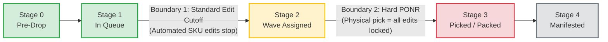
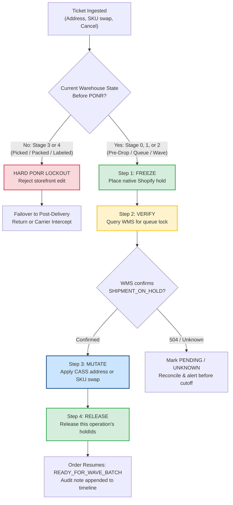
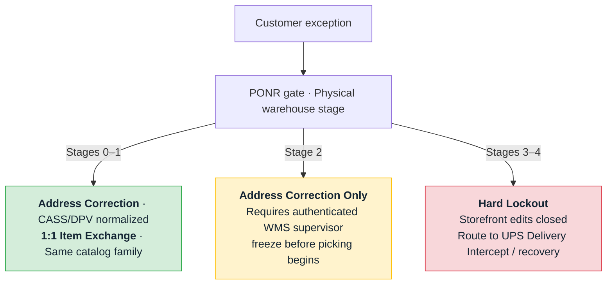

# One Label, Five Realities: Why Shopify's 'In Progress' Misled Operations

**A systems investigation into how Shopify's single status badge hides five physical warehouse stages, why expedited orders lose their edit cushion in 72 seconds, and how a lock-verified coordinator replaces operational guesswork.**

*Synapse Botanicals Systems Architecture | Order Lifecycle & State Synchronization | Technical Study — Domain 1*

---

## The Short Version

An order is 11 minutes old. Shopify Admin displays **`In Progress`**. Standard orders sit in a 15-minute buffer before shipping, so anyone looking at that screen — human or automated workflow — assumes there are four safe minutes to edit the address.

**Everything on that screen is lying by omission.** Behind one harmless `In Progress` label hide three conflicting physical realities (waiting in a queue, assigned to a picking batch, or already taped inside a carton). Expedited shipping skipped the 15-minute buffer completely. And even when you query the warehouse API directly, an `HTTP 200 OK` only means your message reached the gateway — never that a picker actually stopped.

This investigation unpacks those three observability blindspots, reconstructs the 133-second near-miss on Order **#18404**, and walks through the lock-verified coordinator that refuses to mutate a storefront record until the warehouse confirms the carton is physically frozen.

---

## Words You'll See

A handful of operations terms show up throughout this study. Skim them once and jump back whenever you need a refresher:

- **Shopify:** the online storefront where customers check out and where support sees order status.
- **3PL:** a third-party logistics provider that stores and ships inventory (here, ShipBob facilities in Allentown, PA and Reno, NV).
- **WMS:** the warehouse management system — the 3PL's floor software tracking queues, picking waves, and packing.
- **Wave:** a batch of 50 to 100 orders dropped to floor pickers at once.
- **Hold:** a "do not move this order" lock. Shopify has a storefront hold; the warehouse has a physical queue lock. They are not the same thing.
- **PONR (Point of No Return):** the moment physical picking starts, after which storefront edits can no longer change what goes on the truck.
- **CASS / DPV:** USPS address-standardization checks that validate a deliverable postal address and append ZIP+4 digits.
- **Idempotency key:** a unique request tag ensuring that retrying the exact same message never applies the change twice.
- **ATS (Available-to-Sell):** inventory free to reserve at a specific warehouse node.

Need a fast lookup instead of the full walkthrough? Jump straight to the [Quick Reference](#quick-reference) near the end.

---

## 1. The UI Lie on Order #18404 — And What Guessing Wrong Costs

*How Shopify Admin made an already-queued expedited order look completely safe to edit 11 minutes after checkout, and why tolerating that ambiguity leaks $50.70 per mis-shipped carton.*

### 1.1 The Screen Said Safe. Allentown Was 72 Seconds Ahead.

At `10:14:00 EST`, 11 minutes after checkout, Marcus Chen (`marcus.chen@example.com`) submits urgent ticket `#T-10492`: he accidentally checked out with his old apartment in Scranton, PA (`18503`), even though he just moved 49 miles across state lines to Binghamton, NY (`13901-3412`).

You open Order **#18404** (`gid://shopify/Order/5892114432104`, **$102.00**: `1× SYN-FSTK-MY` $42.00, `1× SYN-FSTK-BO` $42.00, plus **$18.00 expedited shipping**) in Shopify Admin. Everything you see looks reassuring: status is **`In Progress`**, and standard orders carry a 15-minute buffer before reaching the warehouse. If an agent fixes the address on screen, Shopify flashes *saved* in four seconds.

**Nothing on the warehouse floor in Allentown, PA knows you clicked save.**

A database write is a **statement of intent**. A carton heading down a conveyor belt is a **physical fact**. Unknown to anyone reading Shopify's screen, Order #18404 had skipped the 15-minute buffer at `10:04:12` — just **72 seconds** after checkout — and had already been sitting inside ShipBob's Allentown queue (`LOC-PA-01`) for **588 seconds**. Crossing from PA into NY also shifts freight zones, origin logic, and state tax flags.

The wrong label never printed — not because Shopify's UI told the truth, and not because a four-second edit saved the box. **Only locking the warehouse floor for 133 seconds (`10:14:00 → 10:16:13 EST`) and proving the physical hold before updating the record kept Scranton off the parcel:**

```text
10:04:12 EST  Order silently skips storefront buffer and enters Allentown queue
10:14:00 EST  Ticket #T-10492 arrives — screen still says "In Progress" (588s later)
10:14:18 EST  Coordinator forces & confirms warehouse queue lock        (18s)
10:16:13 EST  CASS check, order edit, and explicit hold release finish  (133s total)
10:16:15 EST  Order rejoins Allentown wave queue with Binghamton label  (135s)
```

### 1.2 Why Guessing Wrong Costs $50.70 Per Carton

Why build lock verification and timeout reconciliation just to stop one mis-addressed package? Because in dietary supplements, you cannot put a mis-shipped box back on the shelf.

Synapse Botanicals sells ingestible nootropics governed by **FDA 21 CFR Part 111, Subpart N**. Returned supplements must be identified and quarantined until quality control records a formal review and disposition. Sections `111.515–111.525` allow QC-approved salvage or reprocessing under strict controls, so visual inspection alone never authorizes release.

On top of that, **declared Synapse QA policy** treats returned supplements without verifiable thermal or handling history as scrap. Standard carrier tracking doesn't record warehouse-to-porch temperatures, so the product cost gets written off. (Federal law mandates the quarantine and review; Synapse's stricter policy selects destruction.)

To keep the unit math easy to see without mixing in Marcus's multi-pack basket, look at one **$42.00 Focus Stick Pack (`SYN-FSTK-MY`, $8.50 COGS)** that ships to the wrong address, triggers a full refund, and sends no replacement:

```text
┌──────────────────────────────────────────────────────────────────┐
│          ONE MIS-SHIPPED CARTON · Focus Stick Pack 30-Pack       │
├──────────────────────────────────────────────────────────────────┤
│  DIRECT CASH DRAIN                                               │
│    COGS written off (declared Synapse QA scrap policy) .. $ 8.50 │
│    Outbound freight (unrecoverable) ..................... $ 6.50 │
│    RTS reverse freight .................................. $ 7.20 │
│    3PL quarantine & scrap fee ........................... $ 1.50 │
│                                                          ─────── │
│                                               CASH:       $23.70 │
│                                                                  │
│  LOST NORMAL CONTRIBUTION ($42.00 − $8.50 − $6.50) ...... $27.00 │
│                                                          ─────── │
│  TOTAL CONTRIBUTION DETERIORATION ....................... $50.70 │
│                                                                  │
│  $50.70 ÷ $42.00 retail = 120.7% of retail value                 │
└──────────────────────────────────────────────────────────────────┘
```

In plain English: a single mis-delivery drains **$23.70 in cash**, wipes out **$27.00 in contribution** a good sale would have earned, and leaves the business **$50.70 worse off** (the **$42.00 refund** plus **$8.70** in return freight and disposal, excluding unlisted handling and payment fees).

Now scale that to normal DTC operations: **1,000 orders a day** (30,000 a month) at a **0.5% address error rate** creates **150 exception tickets a month**. If storefront edits miss the floor lock on those 150 tickets under that single-pack model:

- **Direct cash drain:** `$23.70 × 150` = **$3,555.00/month** (**$42,660.00/year**)
- **Contribution deterioration:** `$50.70 × 150` = **$7,605.00/month** (**$91,260.00/year**)

That is why tolerating ambiguity around Shopify's `In Progress` status isn't just a customer-experience annoyance — it's an annual **$91,260** margin leak waiting to happen.

---

## 2. Three Blindspots Behind One Status Label

*When support or middleware checks Shopify Admin and decides an order is safe to edit, three structural blindspots conspire to create false confidence.*

### 2.1 Blindspot 1: Five Warehouse Stages Compressed Into 'In Progress'

Shopify has one dial for active fulfillment. The warehouse has **five physical stages**. Even worse, they run on **different clocks**: Shopify commits database writes in milliseconds, while a 3PL warehouse like ShipBob runs on physical batches — periodic polling cycles (often ~15 minutes) and scheduled wave drops where 50 to 100 orders hit pickers together.

Here is what happens behind the scenes while Shopify mostly shows one phrase:

- **Stage 0 · Pre-Drop:** The order sits in Shopify's fraud/edit buffer; the warehouse doesn't know it exists. Shopify shows `Unfulfilled` *(hold active)*. Zero risk — edit or cancel anything.
- **Stage 1 · In Queue:** The order has dropped into ShipBob's queue, waiting for a wave. Shopify now flips to `In Progress`. Full edits still work, **but only if you lock the warehouse queue first**, because two systems now hold the order at once.
- **Stage 2 · Wave Batch:** The order is grouped into a wave, pick list printed, tote assigned. Shopify **still shows `In Progress`**. Line-item/SKU swaps have silently closed. Address fixes are still possible *only* via an authenticated WMS supervisor queue freeze before physical pick.
- **Stage 3 · Picked / Packed:** A human pulled the items from the bin, taped the box, and scanned the barcode. Shopify **still shows `In Progress`**. This is a **hard lockout**: storefront changes now describe a parcel that is already packed.
- **Stage 4 · Manifested:** Label affixed, carton staged on the carrier dock. Shopify finally switches to `Fulfilled` — accurate, and way too late. Only carrier recovery remains.



> [!WARNING]
> **The Critical Vulnerability**: Stages **1, 2, and 3 all display the identical `In Progress` label in Shopify Admin**. One UI string masks three incompatible realities: *safe to edit with a lock*, *address-only via supervisor freeze*, and *hard physical lockout*. Any automation that checks Shopify status alone is making decisions on noise.

Separating those stages cleanly requires two distinct operational lines instead of one vague "cutoff":

- **Boundary 1 (Standard Edit Cutoff — end of Stage 1):** Wave allocation closes automated line-item swaps permanently. Only supervisor-verified address corrections remain open.
- **Boundary 2 (Hard PONR — start of Stage 3):** Physical pick scan closes every storefront mutation permanently.

Stage 2 is the narrow corridor between them. In this design, `supervisor_override == true` means **authenticated warehouse evidence tied to this shipment and current operation** — never a flag set by a customer, helpdesk widget, or middleware to skip the floor check. To put it bluntly: **a supervisor can stop an unpicked carton; a Boolean can't stop a picker.**

*(See [Quick Reference](#quick-reference) for the complete 5-stage matrix.)*

### 2.2 Blindspot 2: Why Marcus's Expedited Order Had No Four-Minute Cushion

Imagine looking at Order #18404 arriving 11 minutes after checkout and thinking: *"Standard orders sit in a 15-minute hold buffer. We still have four minutes left."*

For Order #18404, that assumption was wrong by nearly ten minutes.

```text
STANDARD ORDER (15-minute fraud/edit buffer)
 00:00        checkout
 ├────────────────── 15:00 buffer: Stage 0, Zero Risk ──────────────────┤
 15:00                                                         WMS drop (Stage 1)
 ▲ ticket at T+11 lands INSIDE the buffer: a pure storefront edit.

EXPEDITED ORDER (#18404)
 00:00  checkout (~10:03:00)
 ├─ 1:10 ─┤ low-risk fraud pass (10:04:10)
          ├2s┤ WMS drop (10:04:12)  ◄── Stage 1 starts at T+1:12
              ├───────────────── 9:48 (588s) in queue ─────────────────┤
                                                              ticket at T+11:00 (10:14:00)
 ▲ ticket lands AFTER drop: the order has sat in Allentown for almost 10 minutes.
```

Here is the core rule: **Shipping SLAs override batching buffers.** Because Marcus paid **$18.00 for Expedited Shipping** to catch priority transit cutoffs (like UPS Next Day Air departing Allentown at 2:00 PM), Shopify Flow tagged the order `priority:expedited`, saw low fraud risk at `10:04:10 EST`, skipped the 15-minute cushion, and dropped it into ShipBob two seconds later at `10:04:12`.

By the time ticket `#T-10492` arrived at `10:14:00`, Order #18404 had already spent **588 seconds** inside Allentown's queue.

**An honest caveat on the 600-second rule:** Expedited fulfillment leaves a **600-second design budget** after WMS drop — not a guaranteed wave clock. Notice the timing math: Marcus's ticket landed at **588 seconds**, and the WMS queue lock cleared at **606 seconds**, six seconds *past* the budget. The 600-second estimate didn't save Order #18404; **checking and locking physical state first** did.

### 2.3 Blindspot 3: Warehouse Replies That Look Like Answers (`200` ≠ Stopped, `504` ≠ Failed)

Even after an integration stops trusting Shopify's UI and calls the warehouse API directly, standard HTTP responses mislead careless code:

- **`200 OK` (from Shopify or the WMS HTTP gateway) only means "I got your message."** Shopify flagged `ON_HOLD`, or ShipBob's gateway received your JSON. Neither proves a picker stopped. Keep holding and poll for the lock.
- **`SHIPMENT_ON_HOLD` (with a Queue ID) means "the floor actually stopped."** The WMS scheduler froze queue promotion. **This** is the green light to standardize and edit.
- **`504 Gateway Timeout` means "I don't know."** The connection dropped before the warehouse replied, so the hold might have landed *or* failed completely. **Mark the operation `PENDING` / `UNKNOWN`**, keep the same idempotency key, reconcile before wave cutoff — **never retry blindly.**
- **`422 PONR_EXCEEDED` (with `pick_status: "PICKED"`) means "too late."** Hard lockout — stop mutating and route to carrier recovery. *(Note: merely sitting in a wave does not prove pick; read `pick_status`, not just the HTTP status number.)*

```json
{
  "error": "PONR_EXCEEDED",
  "message": "Shipment has crossed the physical pick boundary; mutation refused.",
  "order_id": "gid://shopify/Order/5892114432104",
  "pick_status": "PICKED",
  "idempotency_key": "ponr-18404-addr-v1"
}
```

```text
┌─────────────────────────────────────────────────────────────────┐
│  200  =  "I GOT YOUR MESSAGE"   → the floor has NOT stopped     │
│  504  =  "I DON'T KNOW"         → PENDING/UNKNOWN · same key    │
│  422 + PICKED = HARD LOCKOUT    → carrier recovery              │
├─────────────────────────────────────────────────────────────────┤
│  Confirm the LOCK, not the 200.                                 │
└─────────────────────────────────────────────────────────────────┘
```

**Why the `504` is the scariest one.** Over the wire, a timeout *after* the warehouse succeeded looks identical to a timeout where *nothing happened*. Retrying with a fresh key risks double-applying competing operations. The only safe rule is to retain the original key and payload, query the authoritative operation-owned outcome (a stale or unowned `ON_HOLD` status cannot prove ownership), and retry only once you confirm the first effect never landed.

*(Full response cheat sheet in [Quick Reference](#quick-reference).)*

---

## 3. Reconstructing the Near-Miss: Inside Order #18404's 133 Seconds

*Tracing the staged incident second-by-second reveals why UI guesswork loses: 85.7% of total cycle time sat inside slow software checks, not the warehouse.*

### 3.1 Chronological Trace (`10:04:12` → `10:16:15`)

At `10:14:00 EST`, Marcus's Gorgias ticket (`#T-10492`) hit the webhook queue: *"URGENT: I entered my old apartment address in Scranton PA, but I just moved to Binghamton NY! Please update before shipping!"* His order (`FO 6710448123901`, `1× SYN-FSTK-MY` + `1× SYN-FSTK-BO` + `$18.00` expedited shipping, Allentown `LOC-PA-01`) was sitting in **Stage 1 · In Queue**.

Here is the step-by-step trace:

| Timestamp (EST) | Elapsed | System / Domain | What happened | Clock |
|---|---:|---|---|---|
| **10:04:12** | — | ShipBob WMS | Order drops to Allentown queue (Stage 1 starts) | Warehouse |
| **10:14:00** | T+0s | Gorgias | Ticket `#T-10492` ingested via webhook | Software |
| **10:14:02** | +2s | Shopify Flow | Idempotency key `MUT-18404-ADDR` assigned; operation opened | Software |
| **10:14:04** | +2s | Shopify Admin | `fulfillmentOrderHold` placed (`reason: INCORRECT_ADDRESS`) | Software |
| **10:14:18** | +14s | ShipBob WMS | Adapter confirms queue lock (`SHIPMENT_ON_HOLD`, Queue `#SB-948102`) | **Warehouse API** |
| **10:15:22** | +64s | USPS CASS | Normalization returns DPV-valid ZIP+4 (`13901-3412`) | Software |
| **10:15:30** | +8s | Shopify Admin | `orderUpdate` applies clean Binghamton address (`$0.00` ledger delta) | Software |
| **10:16:00** | +30s | Coordinator | Verification and immutable timeline audit log | Software |
| **10:16:08** | +8s | Shopify Admin | `fulfillmentOrderReleaseHold` sent with explicit `holdIds` | Software |
| **10:16:13** | +5s | ShipBob WMS | Adapter confirms transition back to `READY_FOR_WAVE_BATCH` | **Warehouse API** |
| **10:16:15** | +2s | ShipBob WMS | Order resumes wave eligibility with Binghamton label | Warehouse |

*Timestamp note: the 18s freeze/lock + 115s validation/mutation/release = 133s split is the fixed invariant. Measured to wave re-entry at 10:16:15, elapsed time is 135 seconds; this study measures the freeze to release confirmation (10:16:13) and treats the final 2 seconds as wave re-entry.*

### 3.2 Where the Time Actually Went: 114 Seconds Internal vs. 19 Seconds Warehouse

Surprise: **almost none of the 133 seconds was the warehouse.**

- **Warehouse API round trips: 19 seconds (14.3%).** Queue lock confirmation took **14 seconds** (10.5%); release confirmation took **5 seconds** (3.8%).
- **Internal software: 114 seconds (85.7%).** USPS CASS address check took **64 seconds** (48.1%), coordinator verification and logging took **30 seconds** (22.6%), Shopify GraphQL calls took **18 seconds** (13.5%), and webhook intake took **2 seconds** (1.5%).

**The real discovery:** the single slowest step in the entire pipeline — **64 seconds of USPS CASS validation** — happened **after** the warehouse lock landed at `10:14:18`. Had the system validated the address first and placed the warehouse hold afterward, Order #18404 would have stayed exposed to a live picking wave for more than an extra minute.

Freeze-First wins because it gets the slow, careful software work out of the physical race — assuming the warehouse honors the hold, preserves who owns it, and blocks stale or competing writes.

---

## 4. Fixing the Blindspot: Lock-Verified State Coordination

*Replaces storefront guesswork with a four-gate coordinator that proves physical queue locks before mutating records, isolates owned holds, and routes every stage deterministically.*

### 4.1 Why Software Gating Beat Agent Training (The Core Trade-Off)

Why not just train support agents to check order timestamps, spot expedited orders, and decide whether an order has probably entered picking?

**We deliberately rejected that path.** Asking humans to mentally resolve three invisible `In Progress` substages — while juggling live ticket pressure and `504` gateway uncertainty — pushes distributed-state resolution onto people who have no physical visibility into Allentown or Reno. As soon as an expedited ticket lands near a wave drop or a network call hangs, intuition breaks down.

The coordinator moves that entire decision into software (`evidence/latency/coordinator.js`) by enforcing three core properties:

1. **Atomic ownership & payload fingerprinting:** One active operation owns one shipment at a time; reusing a key with an altered payload rejects as a conflict.
2. **Conditional lock before write:** Storefront mutations are blocked until the WMS confirms an active hold on an unpicked shipment at the expected revision.
3. **Scoped hold release:** Gate 4 passes explicit `holdIds`, so clearing an address hold never wipes out an unrelated hold.

### 4.2 The Four Gates: Freeze → Verify → Mutate → Release



1. **Freeze (`fulfillmentOrderHold`):** Places a native Shopify hold (`reason: INCORRECT_ADDRESS`, stable `handle`) and saves `fulfillmentHold.id`. This pauses Shopify workers — it still proves nothing about the warehouse floor.
2. **Verify (`GET /shipments?order_id={id}`):** Unlocks Step 3 only when all three hold: `queue_lock == "SHIPMENT_ON_HOLD"`, `pick_status == "NOT_PICKED"`, and either `wave_id == null` or an authenticated WMS `supervisor_override` tied to this shipment and operation.
3. **Mutate (`orderUpdate` / `orderEditCommit`):** Runs USPS CASS/DPV-standardized address writes or `$0.00`-balanced line-item swaps only after Step 2 clears.
4. **Release (`fulfillmentOrderReleaseHold`):** Releases the exact `holdIds` saved in Step 1 and confirms transition back to `READY_FOR_WAVE_BATCH`. *(Wire payloads in [Appendix A](#appendix-a--integration-wire-contracts).)*

> [!IMPORTANT]
> **Hold Isolation Invariant**: Passing explicit `holdIds` is non-negotiable. In Shopify's Admin GraphQL API, omitting `holdIds` releases **every active hold on the fulfillment order**. If another system placed a fraud or tax review hold, an unscoped release silently wipes it out.

### 4.3 One Gate, Three Automated Paths

Every customer exception enters the same physical-state gate, which routes it deterministically — zero manual heuristics required:



- **Path 1 · Address Correction (Stages 0–1 Automated; Stage 2 Supervisor-Verified):** Freeze and confirm `SHIPMENT_ON_HOLD` (or authenticated supervisor freeze/deallocation at Stage 2) → standardize via USPS CASS/DPV to ZIP+4 (`142 Court Street, Apt 3B, Binghamton, NY 13901` → `142 COURT ST APT 3B, BINGHAMTON NY 13901-3412 (DPV: Valid)`) → recalculate shipping zone, node, and PA → NY cross-state tax/rate flags → execute `orderUpdate`, release owned `holdIds`, and write an immutable timeline entry (`[CASS-ADDR-UPDATE] ... Auth: Gorgias #T-10492. HoldId: 89104.`).
- **Path 2 · 1:1 Item Exchange (Stages 0–1 Only; Closed at Stage 2+):** Past Boundary 1 (`Stage 2+`), swaps automatically close in favor of post-delivery exchange. At Stages 0–1, the gate requires `ATS ≥ 5 units` at `LOC-PA-01` (protecting active waves), same-family price parity (`SYN-FSTK-MY` ↔ `SYN-FSTK-BO`, $42.00), and `$0.00` net financial delta across subtotals, discounts, taxes, and payment before running `orderEditCommit` and releasing explicit `holdIds`.
- **Path 3 · Hard Lockout & Carrier Failover (Stages 3–4):** On `422 PONR_EXCEEDED` or `PICKED` / `PACKED` / `MANIFESTED`, storefront edits lock out permanently (no retries). Failover triggers UPS Delivery Intercept v2 via Synapse's normalized adapter (`requestType: RS`, cancel reason `AM` in offline fixtures — normalized body never sent directly to UPS). Carrier statuses obey strict state rules: HTTP `200` + `success: false` is a business failure; `ACCEPTED` remains `pending` until physical depot diversion confirms recovery; timeouts remain `UNKNOWN` for lookup reconciliation. In offline carrier fixtures, a confirmed return costs **$17.50** vs. **$0.00** for failed/rejected attempts, and notifications state clearly that an intercept is a carrier request rather than a guarantee.

---

## 5. What Was Tested vs. What Was Staged

*Separating locally executed coordinator and carrier checks from staged scenario modeling.*

The 133-second Order #18404 trace is a staged scenario. By contrast, the coordinator's claim ownership, cutoff gates, timeout reconciliation, selective hold release, and crash recovery run locally inside reproducible test harnesses (all report and companion-study links sit in [Appendix B](#appendix-b--cross-references--evidence-links)).

### 5.1 Honest Sorting: From Executed Checks to Staged Inputs

- **Actually executed locally (Latency suite — 34/34 passed):**
  1. *Atomic claims:* eligible hold commits exactly one WMS-simulator effect; stale revisions cannot apply a hold.
  2. *Serialized duplicates:* concurrent same-order duplicates return *pending*, later replays return *confirmed*, competing IDs serialize on the same shipment, and reconciliation cannot steal an active operation.
  3. *Post-cutoff preservation:* rejected cutoff outcomes stay rejected on replay; wave release between initial read and conditional write blocks mutation.
  4. *Selective release:* releasing our hold leaves unrelated holds untouched.
  5. *Uncertainty handling:* timeout-after-success reconciles without a second effect; absent effect reconciles safely before same-key retry; revision shifts after uncertain effects are caught.
  6. *Payload integrity:* reusing a key for another order or modified address triggers conflict rejection.
  7. *Crash recovery:* a new worker process recovers an effect persisted before termination.
- **Actually executed locally (Carrier & Cost suites):** Carrier recovery (`34 passed, 2 skipped` — `ACCEPTED` ≠ recovered, duplicate events never repeat a fee, terminal states never overwritten); unit cost arithmetic (`11/11 passed` in whole integer cents).
- **Verified offline:** Pinned UPS Delivery Intercept v2 snapshot matches provenance hash and enforces selected wire constraints (not full OpenAPI validation or provider certification).
- **Staged or modeled:** The 133-second Order #18404 timeline, `21 CFR Part 111` scrap policy assumption, and carrier/quarantine fee lines (narrative/scenario inputs, not production measurements).
- **Not established:** Live Shopify/ShipBob vendor APIs, cross-region delivery, production wall-clock network latency, SQS delivery behavior, cluster-wide locking, physical trailer interception, or supplier purchase contracts.

### 5.2 Evidence Scope & Verification Matrix

| System Component / Claim | Evidentiary Status | Verification Source | Scope Boundary |
|---|---|---|---|
| **Atomic claim, payload conflict guard, cutoff preservation, timeout reconciliation, selective release, crash recovery** | **Executed locally** | Latency suite (34/34 passed) | Simulated WMS & local SQLite ledger; not live vendor APIs |
| **Pinned UPS Delivery Intercept v2 hash & selected wire rules** | **Verified offline** | Carrier suite (34 passed, **2 skipped**) | Not full OpenAPI validation or provider certification |
| **`ACCEPTED` ≠ recovered; idempotent fees; terminal state lock** | **Executed locally** | Carrier suite (34 passed) | Simulated carrier events; not physical trailer interception |
| **BOM, contribution, and replacement cents math** | **Executed locally** | Cost suite (11/11 passed) | Modeled rates; not live supplier contracts or net profit |
| **The 133-second trace, Order #18404** | **Staged scenario** | Narrative scenario inputs | Not production telemetry |
| **FDA 21 CFR Part 111 scrap policy & fee rates** | **Scenario policy** | Declared QA & cost inputs | Not legal determination or contract tariff |
| **Production latency, SQS delivery, third-party SLAs** | **Not established** | Architectural design | No live third-party SLA verified |

### 5.3 How to Read the SQLite Coordinator Benchmark

**Always cite the recorded run, not a remembered millisecond.** The Coordinator Latency Benchmark (linked in [Appendix B](#appendix-b--cross-references--evidence-links)) records the run ID, Node runtime, executed checks, and percentile table across Node's built-in SQLite ledger (`--full` expands smoke cases to 10,000 attempts).

- Timings use `performance.now()`; percentiles use nearest-rank (`ceil(p·N)−1`) with no interpolation.
- Every outcome stays in the dataset — including pending, rejected, and unknown results (**response latency is not confirmation latency**).
- The seed reproduces *injected delays*, not OS thread scheduling or real network wall-clock time.
- Two sanity checks prove the gates directly: **100 duplicate deliveries produced exactly 50 business effects** (idempotency), and **20 post-cutoff attempts produced exactly 0 effects** (hard gate).
- Local sub-millisecond SQLite timings are **not comparable** to the staged 19s/114s trace; the benchmark does not measure external CASS calls or human review.

---

## 6. Four Rules to Remember — And the Point of It All

*The four non-negotiable invariants enforced across the architecture.*

1. **Freeze first, mutate second.** Never write a storefront order edit against an unheld shipment. Editing first is a race condition by design.
2. **Confirm the lock, not the `200`.** HTTP `200` proves only message transport. Only a confirmed `SHIPMENT_ON_HOLD` lock clears mutation.
3. **Release only owned `holdIds`.** Explicit `holdIds` ensure fixing a shipping label never silently erases an unrelated fraud or tax hold.
4. **Fail closed past picked.** Once a physical pick scan lands, database edits describe a parcel that already moved. Shut off mutations immediately and shift to carrier recovery and cGMP quarantine rules.

Marcus Chen never learned his carton spent two minutes paused in Allentown. His package arrived in Binghamton, leaving nothing behind except a timeline audit entry and a 133-second lock record.

That is what an honest integration layer looks like: invisible when it succeeds, because it refuses to trust a flat status badge on a screen over physical proof from the warehouse floor.

> *"In a distributed system, database state is an aspiration; physical warehouse state is reality. The job of the integration layer is to ensure the aspiration never outruns the reality."*

---

<a id="quick-reference"></a>
## Quick Reference

Fast lookup tables for the five warehouse stages and API telemetry signals described in Section 2.

### Which Stage Can Mutate?

| Stage | Physical reality on floor | Shopify shows | Hazard | Eligible System Action |
|---|---|---|---|---|
| **0 · Pre-Drop** | Sits in fraud/edit buffer; WMS has no record | `Unfulfilled` *(hold active)* | Zero Risk | Full mutation or cancel |
| **1 · In Queue** | Imported to WMS queue; awaiting wave | `In Progress` | Low Hazard | Full mutation **after queue lock** |
| **2 · Wave Batch** | Assigned to wave, pick list printed, tote assigned | `In Progress` | Moderate Hazard | Address correction only via **supervisor queue freeze**; SKU swaps closed |
| **3 · Picked / Packed** | Items pulled, box taped, barcode scanned | `In Progress` | High Hazard | **Hard PONR lockout** — no storefront edits |
| **4 · Manifested** | Label affixed on carrier dock | `Fulfilled` | Irreversible | Carrier recovery only |

### What Does This Signal Mean?

| Telemetry Signal | Technical Meaning | Architectural Meaning | System Action |
|---|---|---|---|
| **Shopify Hold `200 OK`** | Database flagged `ON_HOLD` | Storefront intent saved; floor NOT stopped | Poll WMS lock; do **not** edit yet |
| **WMS HTTP `200 OK`** | Gateway accepted JSON payload | Transport confirmed; floor NOT stopped | Keep hold; poll for queue lock |
| **`SHIPMENT_ON_HOLD`** (Queue ID) | WMS scheduler froze queue promotion | **Floor stopped** | **Safe to edit** |
| **`504 Gateway Timeout`** | Connection closed before confirmation | **Outcome `UNKNOWN`** | Mark `PENDING / UNKNOWN`; keep key; reconcile before cutoff; **no blind retries** |
| **`422 PONR_EXCEEDED`** (`PICKED`) | Physical pick boundary crossed | **Hard PONR** *(wave alone doesn't prove this)* | Lock out edits; route to carrier recovery |

---

<a id="appendix-a--integration-wire-contracts"></a>
## Appendix A — Integration Wire Contracts

Reference GraphQL mutations and normalized 3PL adapter contract behind the four coordinator gates. Shopify calls follow Admin GraphQL schema shapes; the 3PL adapter is Synapse's internal normalized contract.

### A.1 Gate 1: Freeze (`fulfillmentOrderHold`)

```graphql
mutation FreezeFulfillmentOrder($id: ID!, $hold: FulfillmentOrderHoldInput!) {
  fulfillmentOrderHold(id: $id, fulfillmentHold: $hold) {
    fulfillmentHold {
      id
      reason
      reasonNotes
      handle
    }
    fulfillmentOrder {
      id
      status
    }
    userErrors {
      field
      message
    }
  }
}
```

```json
{
  "id": "gid://shopify/FulfillmentOrder/6710448123901",
  "hold": {
    "reason": "INCORRECT_ADDRESS",
    "reasonNotes": "Customer address correction ticket. Synapse PONR coordinator freeze.",
    "handle": "synapse-addr-18404"
  }
}
```

Expected result: `fulfillmentHold.id = gid://shopify/FulfillmentHold/89104`. **Persist this ID** for Gate 4.

### A.2 Gate 2: Verify the WMS Queue Lock (3PL Adapter)

```http
GET /shipments?order_id=gid://shopify/Order/5892114432104 HTTP/1.1
Host: 3pl-adapter.synapse.internal
Authorization: Bearer <token>
```

```json
{
  "queue_id": "SB-948102",
  "external_order_id": "5892114432104",
  "fulfillment_node": "LOC-PA-01",
  "shipment_state": "On Hold",
  "queue_lock": "SHIPMENT_ON_HOLD",
  "wave_id": null,
  "pick_status": "NOT_PICKED",
  "lock_timestamp": "2026-11-10T15:14:18Z"
}
```

**Proceed only if** `queue_lock == "SHIPMENT_ON_HOLD"` **and** (`wave_id == null` or `supervisor_override == true`) **and** `pick_status == "NOT_PICKED"`. The adapter sets `supervisor_override` solely from authenticated WMS confirmation of a completed supervisor freeze or wave deallocation for this shipment and operation — never from a client-supplied flag.

### A.3 Gate 3: Mutate (`orderUpdate` with CASS-Standardized Input)

```graphql
mutation CorrectShippingAddress($input: OrderInput!) {
  orderUpdate(input: $input) {
    order {
      id
      shippingAddress {
        address1
        address2
        city
        provinceCode
        zip
        countryCode
      }
    }
    userErrors {
      field
      message
    }
  }
}
```

```json
{
  "input": {
    "id": "gid://shopify/Order/5892114432104",
    "shippingAddress": {
      "firstName": "Marcus",
      "lastName": "Chen",
      "address1": "142 COURT ST",
      "address2": "APT 3B",
      "city": "BINGHAMTON",
      "provinceCode": "NY",
      "zip": "13901-3412",
      "countryCode": "US"
    }
  }
}
```

Always send the **CASS-standardized, ZIP+4** payload rather than raw customer text.

### A.4 Gate 4: Release (`fulfillmentOrderReleaseHold`, Explicit `holdIds`)

```graphql
mutation ReleaseOurHoldOnly($id: ID!, $holdIds: [ID!]) {
  fulfillmentOrderReleaseHold(id: $id, holdIds: $holdIds) {
    fulfillmentOrder {
      id
      status
    }
    userErrors {
      field
      message
    }
  }
}
```

```json
{
  "id": "gid://shopify/FulfillmentOrder/6710448123901",
  "holdIds": [
    "gid://shopify/FulfillmentHold/89104"
  ]
}
```

---

<a id="appendix-b--cross-references--evidence-links"></a>
## Appendix B — Cross-References & Evidence Links

Ground-truth evidence reports, companion case studies, and external regulatory references cited in this study:

### Evidence Suite & Local Harnesses
- [Coordinator Latency Benchmark](../evidence/latency/summary.md) — recorded SQLite harness run ID, Node runtime, percentile table, and coordinator engine (`evidence/latency/coordinator.js`).
- [Unit Cost & BOM Ledger](../evidence/costs/summary.md) — source unit costs for the `$8.50` Focus Stick COGS and modeled recovery economics.
- [Carrier Recovery Contracts](../evidence/carrier-recovery/summary.md) — pinned UPS Delivery Intercept v2 snapshot checks and state-transition fixtures (`requestType: RS`, `$17.50` confirmed vs. `$0.00` failed).
- [Reproducible Evidence Suite](../evidence/README.md) — index and execution instructions for all local verification suites.

### Companion Study Cross-References (Capstone — Order #35070)
- **Timeout & Cutoff Failure Chain:** [Capstone Sections 3–5](../capstone/TechnicalStudy-Capstone-AsynchronousOrderMutation.md) trace Order `#35070` after a swallowed `504` gateway timeout crossed Reno's `13:42` automated wave cutoff and `13:45` physical pick scan.
- **Kit Recovery & Replacement Economics:** [Capstone Section 7.1](../capstone/TechnicalStudy-Capstone-AsynchronousOrderMutation.md#71-baseline-vs-dual-fulfillment-recovery-ledger) applies the same `$8.50` Focus Stick cost inside a `$28.40` bundle (`$8.50` sticks + `$12.50` tincture + `$7.00` tumbler + `$0.40` kitting materials) under `SOP-QA-402`, where a `$98.60` replacement recovery cost turns a `$54.76` baseline contribution into `−$43.84`.

### Regulatory References
- [FDA 21 CFR Part 111, Subpart N (eCFR)](https://www.ecfr.gov/current/title-21/chapter-I/subchapter-B/part-111/subpart-N) — federal cGMP quarantine, material review, and quality-control disposition rules for returned dietary supplements (`Sections 111.515–111.525`).

---

*Compiled: 2026-11-10 | Synapse Botanicals Systems Architecture | Riovic Matthew*
