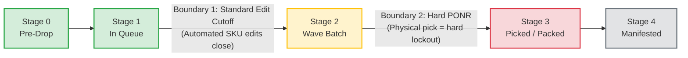
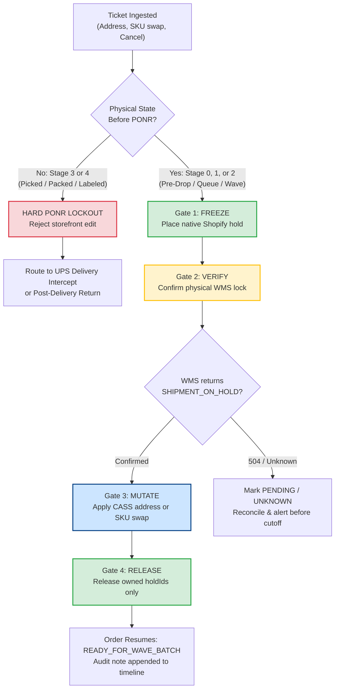
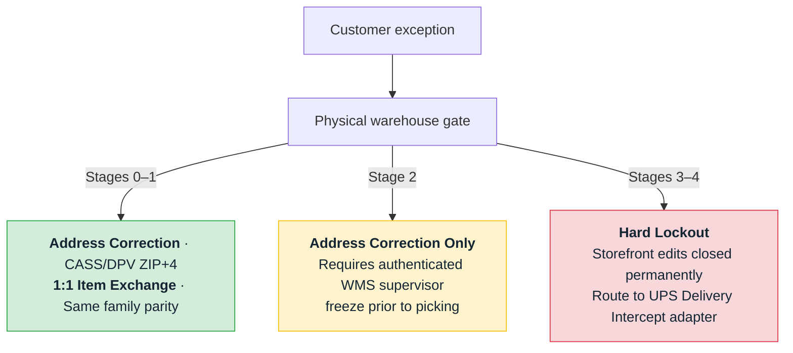

# The 'In Progress' Lie: Investigating Three Blindspots Between Checkout and the Warehouse Floor

**Why a calm status label in Shopify Admin fooled operations on an expedited supplement order, how three hidden system gaps create interstate mis-shipments, and how a physical-lock coordinator replaced dashboard guesswork.**

*Synapse Botanicals Systems Architecture | Order Lifecycle & Observability Investigation | Technical Study — Domain 1*

---

## The Short Version

An order is 11 minutes old. Open Shopify Admin and the screen shows **`In Progress`**. Standard orders wait 15 minutes before reaching the warehouse, so anyone staring at that dashboard assumes there are four comfortable minutes left to fix a shipping typo.

**That screen is lying by omission.** Behind one harmless `In Progress` badge hide three incompatible floor realities — waiting in a queue, dropped to a picking wave, or sealed inside a carton. Worse, paid expedited orders skip the 15-minute wait completely, and even direct warehouse API calls lie if you mistake an `HTTP 200 OK` receipt for a stopped conveyor belt.

This investigation traces those three blindspots on Order **#18404**, shows how timing the failure exposed an 85.7% software validation bottleneck, and details the lock-verified coordinator that refuses to trust any status screen until the warehouse confirms the carton has physically stopped.

---

## Words You'll See

- **Shopify:** the online storefront where customers buy and where operators read order status.
- **3PL:** a third-party logistics partner storing and shipping stock (here, ShipBob nodes in Allentown, PA and Reno, NV).
- **WMS:** the warehouse management system — floor software tracking queues, pick lists, and packing.
- **Wave:** a batch of 50 to 100 orders released to warehouse pickers at once.
- **Hold:** a stop signal. Shopify has a storefront hold; the WMS has a physical queue lock. Setting one does not guarantee the other.
- **PONR (Point of No Return):** the physical pick scan after which storefront edits can no longer intercept the box.
- **CASS / DPV:** USPS address verification that validates delivery points and appends ZIP+4 codes.
- **Idempotency key:** a unique token ensuring retried deliveries never execute the same mutation twice.
- **ATS (Available-to-Sell):** unreserved inventory available at a warehouse node.

Need a quick lookup table instead of the narrative? Jump to [Quick Reference](#quick-reference) near the end.

---

## 1. The Dashboard Said Safe. Allentown Already Had the Box.

*How an 11-minute-old ticket revealed a blindspot between digital status screens and physical warehouse floors — and why a single missed label destroys $50.70 in contribution.*

### 1.1 Anatomy of a False-Positive Screen

At `10:14:00 EST`, Gorgias ticket `#T-10492` lands in support from Marcus Chen (`marcus.chen@example.com`): *"URGENT: I entered my old apartment address in Scranton PA, but I just moved to Binghamton NY! Please update before shipping!"*

Open Order **#18404** (`gid://shopify/Order/5892114432104`) in Shopify Admin: two Focus Stick 30-packs (`1× SYN-FSTK-MY` at $42.00, `1× SYN-FSTK-BO` at $42.00) plus **$18.00 expedited shipping** = **$102.00**. Placed around `10:03:00 EST`. Allocated to Allentown, PA (`LOC-PA-01`). Destination Scranton, PA (`18503`) needs to become Binghamton, NY (`13901-3412`) — a **49-mile hop across state lines** that changes shipping zone, node routing, and state tax inputs.

Looking purely at the dashboard, nothing triggers an alarm:

1. **Order age:** 11 minutes. Common wisdom says orders sit in a 15-minute storefront cushion.
2. **Visible status:** `In Progress` — the exact same clean label displayed right after dispatch.
3. **Apparent action:** Edit the shipping address in Admin. Four seconds later, Shopify shows a green *Saved* checkmark.

**Here is the truth that dashboard hid:** Order #18404 had left Shopify's cushion **9 minutes and 48 seconds earlier** (`10:04:12 EST`) and had already spent **588 seconds** inside Allentown's warehouse queue.

A database write in Shopify is a **statement of intent**. A box rolling toward a pack station is a **physical fact**. Clicking *Save* in Admin never told Allentown anything. Stopping the Scranton label didn't happen when the storefront flashed green — it happened only because a lock-verified coordinator froze Allentown's floor queue for **133 seconds** (`10:14:00 → 10:16:13 EST`), confirmed the hold physically stuck before modifying a single field, and released only its own lock so the parcel rejoined the wave at `10:16:15 EST` with Binghamton ink ready.

```text
STOREFRONT VIEW (What Support Saw at 10:14:00)
  Status: "In Progress"  ·  Age: 11 min  ·  Assumed cushion left: ~4 min  ·  Edit saved: 4s ✅

WAREHOUSE REALITY (Allentown Floor at 10:14:00)
  Dropped to WMS: 10:04:12 (72s post-checkout)  ·  Time in floor queue: 588s  ·  Wrong label 1 wave away ❌
```

Why couldn't we simply accept rare mis-shipments when that screen is wrong? Because in ingestible supplements, you cannot restock a mis-delivered parcel.

### 1.2 Why One Mis-Read Badge Leaks $50.70 Per Carton

Unlike sneakers or mugs, Synapse Botanicals sells dietary supplements regulated under **FDA 21 CFR Part 111, Subpart N**. Any returned supplement must be segregated and quarantined until quality control records a formal material review and disposition. Under sections `111.515–111.525`, QC salvage or reprocessing is technically regulated, and visual inspection alone never clears a product for resale.

Synapse also enforces a stricter **declared QA scrap policy**: returned supplements without verifiable handling and temperature history cannot go back into stock and must be destroyed after QA sign-off. Standard courier scans prove location, not trailer temperature. *(Federal rules mandate quarantine and review; Synapse's stricter internal policy requires the write-off.)*

Isolate one **$42.00 Focus Stick Pack (`SYN-FSTK-MY`, $8.50 COGS)** that ships to an old address, receives a full refund, and sends no replacement:

```text
┌──────────────────────────────────────────────────────────────────┐
│          ONE MIS-SHIPPED CARTON · Focus Stick Pack 30-Pack       │
├──────────────────────────────────────────────────────────────────┤
│  DIRECT CASH DRAIN                                               │
│    COGS written off (declared Synapse QA scrap policy) .. $ 8.50 │
│    Outbound freight (unrecoverable) ..................... $ 6.50 │
│    RTS reverse freight .................................. $ 7.20 │
│    3PL quarantine & scrap fee ........................... $ 1.50 │
│                                                          ─────── │
│                                               CASH:       $23.70 │
│                                                                  │
│  LOST NORMAL CONTRIBUTION ($42.00 − $8.50 − $6.50) ...... $27.00 │
│                                                          ─────── │
│  TOTAL CONTRIBUTION DETERIORATION ....................... $50.70 │
│                                                                  │
│  $50.70 ÷ $42.00 retail = 120.7% of retail value                 │
└──────────────────────────────────────────────────────────────────┘
```

Excluding unlisted payment or handling charges, every wrong label wipes out **$23.70 in direct cash** and erases **$27.00 of earned contribution** — leaving the merchant **$50.70 worse off** (the **$42.00** refund plus **$8.70** in return logistics and quarantine fees).

At a typical DTC scale of **1,000 orders/day** (`30,000/month`) and a **0.5% address error rate** (`150` monthly exception tickets), missing the warehouse hold under this unit model leaks:

- **$3,555.00/month ($42,660.00/year)** in direct cash drain
- **$7,605.00/month ($91,260.00/year)** in total contribution deterioration

Once an investigation puts a **$91,260/year** price tag on an ambiguous UI badge, trusting screen intuition stops being acceptable.

---

## 2. Uncovering the Three Blindspots

*Investigating why Order #18404 looked harmless on screen exposed three distinct seams where storefront status, shipping queues, and HTTP replies decouple.*

### 2.1 Blindspot 1: Five Physical Truths Compressed Into 'In Progress'

Shopify operates on millisecond database commits. A 3PL warehouse like ShipBob (`LOC-PA-01` in Allentown, `LOC-NV-02` in Reno) runs on physical batches — periodic polling loops (typically ~15 minutes) and wave drops releasing 50 to 100 orders onto the floor simultaneously.

Those two clocks produce **five physical fulfillment stages**, yet Shopify's UI maps three contradictory floor states onto one reassuring phrase:

- **Stage 0 · Pre-Drop (`Unfulfilled`, hold active):** Sitting cleanly inside Shopify's edit buffer. WMS has zero record. Risk is zero — edit or swap freely.
- **Stage 1 · In Queue (`In Progress`):** Imported to ShipBob's digital queue, waiting for wave assignment. Two live systems now own the order, though UI Admin doesn't warn you. Edits still work, **only after locking the WMS queue**.
- **Stage 2 · Wave Batch (`In Progress`):** Assigned to a pick batch; pick sheets printed; totes allocated. **Line-item and SKU swaps have silently closed.** Only address changes remain viable — and only if a WMS supervisor freezes the queue or pulls the order before a picker pulls stock.
- **Stage 3 · Picked / Packed (`In Progress`):** Items pulled from bins, box taped, barcode scanned. Storefront writes now describe a world that no longer exists. Every UI mutation is unsafe (**Hard Lockout**).
- **Stage 4 · Manifested (`Fulfilled`):** Carrier label applied on the outbound dock. Storefront finally tells the truth — only when carrier intercept is the sole lever left.



> [!WARNING]
> **The Core UI Lie**: Stages **1, 2, and 3 render the exact same `In Progress` string in Shopify Admin**. One status label collapses *editable with a queue lock*, *address-only via supervisor freeze*, and *physically sealed in a box*. Gating automation on Shopify status alone is gating on noise.

Between those stages sit two real operational fences — **Boundary 1 (Standard Edit Cutoff)** at wave allocation, and **Boundary 2 (Hard PONR)** at physical pick scan. Stage 2 lives in the tight gap between them. There, `supervisor_override == true` is valid **only** when set from authenticated WMS confirmation tied to that specific shipment and operation — never a client flag supplied by support widgets or middleware. Put plainly: **a supervisor can stop an unpicked tote; a Boolean cannot stop a picker.**

*(Lookup matrix in [Quick Reference](#quick-reference).)*

### 2.2 Blindspot 2: The Vanished Cushion (Expedited SLA Bypass)

Why did a ticket arriving just 11 minutes after checkout miss the 15-minute storefront cushion completely?

Because **Shipping SLAs override batching buffers**. Order #18404 carried an **$18.00 Expedited Shipping** upgrade (`priority:expedited`). To protect strict carrier cutoff windows (such as UPS Next Day Air departing Allentown at 2:00 PM), Shopify Flow strips priority orders out of Stage 0 immediately after fraud clearance:

```text
STANDARD SHIPPING (15-minute buffer stays intact)
 00:00  checkout
 ├────────────── 15:00 Stage 0 cushion (safe storefront edits) ──────────────┤ 15:00 WMS drop
 ▲ Ticket at 11:00 hits empty floor risk — WMS hasn't seen it yet.

EXPEDITED SHIPPING — Order #18404 (buffer bypassed in 72 seconds)
 00:00  checkout (~10:03:00)
 ├─ 1:10 ─┤ fraud clears (10:04:10)
          ├2s┤ WMS drop (10:04:12)  ◄── Stage 1 starts immediately
              ├────────────────── 9:48 (588s) queued ──────────────────┤ 10:14:00 ticket
 ▲ Ticket at 11:00 lands 588 seconds deep inside Allentown.
```

Order #18404 cleared fraud checks at `10:04:10` and hit ShipBob at `10:04:12` — leaving support zero minutes of storefront buffer.

Even a fallback rule like *"expedited orders remain editable inside a **600-second design budget**"* fails under inspection: notice that ticket `#T-10492` landed at **588 seconds**, and Allentown confirmed the queue lock at **606 seconds** — six seconds *past* budget. Guessing from timestamps failed; querying the live warehouse stage before mutating did not.

### 2.3 Blindspot 3: API Telemetry That Misleads Code Too (`200` ≠ Stopped, `504` ≠ Failed)

Investigating deeper showed that abandoning Shopify's UI and calling the WMS API directly exposes a third blindspot: **wire status codes tell half-truths**.

- **`HTTP 200 OK` (from Shopify or the WMS gateway) means transport receipt only.** Shopify recorded `ON_HOLD`, or ShipBob's HTTP edge accepted your JSON packet. Neither proves pickers stopped. Keep polling until a queue lock returns.
- **`SHIPMENT_ON_HOLD` (plus a Queue ID like `SB-948102`) means physical freeze confirmed.** The scheduler froze wave promotion. Only this signal clears validation and writes.
- **`504 Gateway Timeout` means `PENDING / UNKNOWN` — never failed.** The gateway cut off before the upstream WMS answered. A timeout where the warehouse *executed* the hold looks wire-identical to one where *nothing* landed. Retrying with a new idempotency key forks competing intents; the only safe response is retaining the original key and payload, querying the authoritative operation-owned outcome (a stale or unowned `ON_HOLD` cannot confirm who owns it), and retrying only after proving the first effect never applied.
- **`422 PONR_EXCEEDED` + `pick_status: "PICKED"` means irreversible physical lockout.** Do not retry. Route directly to carrier intercept. *(Just sitting in a wave does not prove physical pick — check `pick_status`, never assume from a bare HTTP number.)*

```json
{
  "error": "PONR_EXCEEDED",
  "message": "Shipment has crossed the physical pick boundary; mutation refused.",
  "order_id": "gid://shopify/Order/5892114432104",
  "pick_status": "PICKED",
  "idempotency_key": "ponr-18404-addr-v1"
}
```

```text
┌─────────────────────────────────────────────────────────────────┐
│  200 OK         = "Message received"   → floor has NOT stopped  │
│  504 Timeout    = "Outcome unknown"    → PENDING/UNKNOWN · wait │
│  422 + PICKED   = "Hard physical stop" → close storefront edit  │
├─────────────────────────────────────────────────────────────────┤
│  Confirm the physical LOCK, never trust the 200 receipt.        │
└─────────────────────────────────────────────────────────────────┘
```

*(Full signal table sits in [Quick Reference](#quick-reference).)*

---

## 3. Reconstructing the Near-Miss: Where 133 Seconds Actually Went

*Before picking a fix, timing Order #18404 end-to-end uncovered why any workflow that validates addresses first and freezes second loses the race.*

### 3.1 Second-by-Second Reconstruction (`10:04:12` → `10:16:15`)

Order #18404 sat in **Stage 1 · In Queue** (`FO 6710448123901`, Allentown `LOC-PA-01`) when ticket `#T-10492` entered via Gorgias webhook at `10:14:00 EST`:

| Timestamp (EST) | Step | System / Domain | Action & Outcome | Clock |
|---|---:|---|---|---|
| **10:04:12** | — | ShipBob WMS | Order drops to Allentown queue (Stage 1 starts) | Warehouse |
| **10:14:00** | T+0s | Gorgias | Ticket `#T-10492` received via webhook | Software |
| **10:14:02** | +2s | Shopify Flow | Idempotency key `MUT-18404-ADDR` locked to operation | Software |
| **10:14:04** | +2s | Shopify Admin | Native `fulfillmentOrderHold` placed (`reason: INCORRECT_ADDRESS`) | Software |
| **10:14:18** | +14s | ShipBob WMS | Adapter confirms physical lock (`SHIPMENT_ON_HOLD`, `#SB-948102`) | **Warehouse API** |
| **10:15:22** | +64s | USPS CASS | Standardization validates Binghamton ZIP+4 (`13901-3412`) | Software |
| **10:15:30** | +8s | Shopify Admin | `orderUpdate` writes normalized destination (`$0.00` delta) | Software |
| **10:16:00** | +30s | Coordinator | Verification + immutable timeline audit log | Software |
| **10:16:08** | +8s | Shopify Admin | `fulfillmentOrderReleaseHold` passes explicit `holdIds` | Software |
| **10:16:13** | +5s | ShipBob WMS | Adapter confirms transition to `READY_FOR_WAVE_BATCH` | **Warehouse API** |
| **10:16:15** | +2s | ShipBob WMS | Order re-enters wave queue carrying Binghamton label | Warehouse |

*Timestamp accounting: 18s freeze & lock acquisition (`10:14:00 → 10:14:18`) + 115s internal checks, edit & release (`10:14:18 → 10:16:13`) = **133s total freeze**. Measured to queue re-entry at `10:16:15`, total elapsed time is 135s; the final 2 seconds count as wave re-entry.*

### 3.2 The 85.7% Bottleneck Discovery (`114s` Software vs. `19s` Warehouse)

Splitting those 133 seconds by clock domain revealed why intuitive sequencing fails:

- **Warehouse API round trips — 19 seconds (14.3%):** `14s` to confirm the queue lock + `5s` to confirm hold release.
- **Internal software work — 114 seconds (85.7%):** `64s` for USPS CASS validation (`48.1%`), `30s` coordinator audit logging (`22.6%`), `18s` Shopify GraphQL execution (`13.5%`), and `2s` webhook intake (`1.5%`).

Look at that single largest number: **64 seconds of USPS CASS validation (`48.1%`) executed safely *behind* a verified queue lock at `10:14:18`**. If the integration had trusted Shopify's `In Progress` label, validated the Binghamton address *before* holding the order, and tried locking afterward, Order #18404 would have remained exposed to wave allocation for over an extra minute. **Freeze-First** pulls slow validation completely out of the race against warehouse batching — provided the WMS respects the hold, records who owns it, and rejects stale or competing mutations.

---

## 4. Closing the Blindspots: Lock-Verified State Coordination

*Moves stage detection out of human screen reading into a four-gate coordinator that verifies floor state before touching orders, isolates owned holds, and routes exceptions automatically.*

### 4.1 The Trade-Off: Enforced State Coordinator vs. Operator Training

An obvious alternative was training support agents to distrust `In Progress` — teaching everyone to inspect payment timestamps, calculate expedited drop cutoffs manually, and judge whether an order could still be edited.

**We deliberately rejected operator judgment.** Expecting support staff to mentally reconstruct three hidden warehouse stages while under live queue load and `504` gateway uncertainty pushes distributed-systems reasoning onto people with zero physical floor visibility. One busy queue day or delayed webhook turns human heuristics into a **$50.70** write-off.

Encoding those guarantees in software (`evidence/latency/coordinator.js`) removes human state-guessing completely across three mechanics:

1. **Atomic ownership & payload fingerprinting:** One active operation owns one shipment at a time; reusing an idempotency key with altered inputs rejects immediately as a conflict.
2. **Conditional physical lock before write:** Storefront mutations stay blocked until WMS returns an active unpicked hold at the expected revision.
3. **Scoped hold release:** Releasing at the end specifies exact `holdIds`, so completing an address correction never drops another team's lock.

### 4.2 Four-Gate Execution Flow (`Freeze → Verify → Mutate → Release`)



1. **Gate 1 — Freeze (`fulfillmentOrderHold`):** Places a Shopify hold (`reason: INCORRECT_ADDRESS`, stable `handle`) and persists `fulfillmentHold.id`. Pauses Shopify dispatch — does not pause the warehouse.
2. **Gate 2 — Verify (`GET /shipments?order_id={id}`):** Unlocks Gate 3 strictly when `queue_lock == "SHIPMENT_ON_HOLD"`, `pick_status == "NOT_PICKED"`, and either `wave_id == null` or authenticated WMS `supervisor_override == true` tied to this shipment and operation.
3. **Gate 3 — Mutate (`orderUpdate` / `orderEditCommit`):** Applies USPS CASS-normalized addresses or `$0.00`-net SKU parity swaps only after Gate 2 clears.
4. **Gate 4 — Release (`fulfillmentOrderReleaseHold`):** Releases exclusively the `holdIds` captured in Gate 1 and verifies transition back to `READY_FOR_WAVE_BATCH`. *(Wire payloads in [Appendix A](#appendix-a--integration-wire-contracts).)*

> [!IMPORTANT]
> **Hold Isolation Invariant**: Passing explicit `holdIds` is mandatory. In Shopify's Admin GraphQL API, omitting `holdIds` releases **every active hold on the fulfillment order**. An unscoped release after updating a shipping street can silently wipe out an independent fraud or tax review hold placed by another service.

### 4.3 Deterministic Routing by Confirmed Physical Stage

Every exception passes through the same physical gate and branches without human guesswork:



- **Address Correction (Stages 0–1 Automated; Stage 2 Supervisor-Verified):** Freeze + physical `SHIPMENT_ON_HOLD` (or WMS supervisor freeze/deallocation at Stage 2) → normalize raw text via USPS CASS/DPV (`142 Court Street, Apt 3B, Binghamton, NY 13901` → `142 COURT ST APT 3B, BINGHAMTON NY 13901-3412 (DPV: Valid)`) → recalculate shipping zone, node, and PA → NY cross-state tax flags → execute `orderUpdate`, release owned `holdIds`, and append an immutable audit line (`[CASS-ADDR-UPDATE] ... Auth: Gorgias #T-10492. HoldId: 89104.`).
- **1:1 Item Exchange (Stages 0–1 Only):** Closed automatically at `Stage 2+` (defers to post-delivery exchange). Inside Stages 0–1, checks `ATS ≥ 5 units` at the allocated node (`LOC-PA-01`) so active waves never oversell, enforces same-family parity (`SYN-FSTK-MY` ↔ `SYN-FSTK-BO`, `$42.00`) and `$0.00` net financial delta, executes `orderEditCommit` under lock, and releases explicit `holdIds`.
- **Hard Lockout & Carrier Failover (Stages 3–4):** On `422 PONR_EXCEEDED` or `PICKED` / `PACKED` / `MANIFESTED`, all storefront edits lock out permanently without retries. Failover calls UPS Delivery Intercept v2 through Synapse's normalized adapter (`requestType: RS`, cancel reason `AM` in offline fixtures — normalized adapter JSON never sent directly to UPS). Carrier handling strictly distinguishes `HTTP 200` + `success: false` (business failure), electronic `ACCEPTED` (remains `pending` until physical depot diversion), and timeouts (`UNKNOWN`, lookup reconciliation only). Modeled fixtures price confirmed returns at **$17.50** vs. **$0.00** for failed/rejected intercepts, and outbound notices treat carrier intercepts as requests rather than guarantees.

---

## 5. Verification & Evidence Boundary: What Ran vs. What Was Modeled

*Separating reproducible local coordinator checks from staged investigative modeling.*

Order **#18404**'s 133-second timeline is a staged investigation trace. By contrast, the coordinator's claim ownership, cutoff barriers, `504` uncertainty reconciliation, selective `holdIds` release, and crash recovery all execute locally inside automated Node test harnesses *(links consolidated in [Appendix B](#appendix-b--cross-references--evidence-links))*.

### 5.1 Executed vs. Staged Breakdown

- **Executed locally — SQLite coordinator (`34/34 passed`):**
  1. *Atomic claims:* eligible hold triggers exactly one WMS-simulator effect; stale revisions rejected.
  2. *Serialized duplicates:* concurrent duplicates stay *pending*, later replays return *confirmed*, competing IDs serialize cleanly, and reconciliation cannot steal active pending locks.
  3. *Cutoff preservation:* rejected post-cutoff edits stay rejected on replay; wave release occurring mid-request blocks write commit.
  4. *Selective release:* releasing coordinator holds leaves unrelated holds active.
  5. *Uncertainty reconciliation:* timeout-after-success reconciles without duplicate writes; absent effect reconciles safely before same-key retry; post-effect revision changes trigger detection.
  6. *Payload integrity:* reusing an idempotency key for another order or changed address triggers conflict rejection.
  7. *Crash recovery:* fresh worker processes recover persisted effects written right before termination.
- **Executed locally — Carrier & Cost suites:** Carrier recovery (`34 passed, 2 skipped` — `ACCEPTED` never marks recovered, duplicate events never double-bill `$17.50`, terminal outcomes lock cleanly); BOM & contribution arithmetic (`11/11 passed` in whole integer cents).
- **Verified offline:** Pinned UPS Delivery Intercept v2 snapshot matches provenance hash and selected wire checks (not full OpenAPI validation or carrier certification).
- **Staged or modeled:** Order #18404's timeline (`10:04:12 → 10:16:15`), declared `21 CFR Part 111` scrap assumption, and modeled fee lines (`$1.50` quarantine, `$7.20` RTS, `$17.50` intercept).
- **Not established:** Live Shopify/ShipBob API behavior, SQS delivery guarantees, cluster-wide locking, production wall-clock timings, physical trailer diversion, or live supplier contracts.

### 5.2 Evidence Scope Matrix

| Component / Claim | Evidentiary Status | Verification Source | Scope Boundary |
|---|---|---|---|
| **Atomic hold claim, conflict rejection, cutoff lock, timeout reconciliation, selective release, crash recovery** | **Executed locally** | Latency suite (34/34 passed) | Simulated WMS & SQLite ledger; not live Shopify/ShipBob APIs |
| **Pinned UPS v2 snapshot hash & wire checks** | **Verified offline** | Carrier suite (34 passed, **2 skipped**) | Selected contract checks; not provider certification |
| **`ACCEPTED` ≠ recovered; idempotent fees; terminal state lock** | **Executed locally** | Carrier suite (34 passed) | Event simulator; not physical parcel diversion |
| **BOM, contribution, and loss arithmetic** | **Executed locally** | Cost suite (11/11 passed) | Modeled scenario inputs in whole integer cents |
| **Order #18404 trace & 133s breakdown** | **Staged scenario** | Investigation narrative inputs | Not production telemetry |
| **FDA Part 111 scrap assumption & fee tariffs** | **Scenario policy** | Declared QA & cost rules | Not regulatory counsel or contract invoices |
| **Live production latency, SQS delivery, vendor SLAs** | **Not established** | Architectural specification | No live external SLA measured |

### 5.3 Reading the SQLite Coordinator Benchmark

**Always cite the recorded report run in Appendix B rather than a remembered millisecond.** The harness exercises atomic claims and conditional shipment locks in Node's built-in SQLite (`--full` expands workloads to `10,000` attempts):

- Timings measure `performance.now()`; percentiles use nearest-rank (`ceil(p·N)−1`) with zero interpolation.
- Every outcome remains in metrics, including pending, rejected, and unknown states — **response latency never equals confirmation latency**.
- Two rows prove the core invariants directly: **100 duplicate deliveries produced exactly 50 business effects** (idempotency), and **20 post-cutoff attempts produced exactly 0 effects** (hard PONR barrier).
- Local sub-millisecond SQLite timings are **not comparable** to staged 19s/114s workflow estimates and do not measure external USPS CASS or human review steps.

---

## 6. Four Observability Rules — And the Takeaway

1. **Never gate on a flat status badge.** `In Progress` spans multiple physical stages; inspect actual queue and pick state at the WMS.
2. **Confirm the lock, not the `200`.** Gateway receipts confirm network delivery, not floor freeze. Only `SHIPMENT_ON_HOLD` clears mutation.
3. **Release only owned `holdIds`.** Explicit hold IDs keep address fixes from quietly erasing independent fraud or tax locks.
4. **Fail closed past physical pick.** Once stock leaves the bin, stop mutating storefront state and hand off to carrier recovery and cGMP quarantine rules.

Marcus Chen never heard about the two minutes his parcel waited in Allentown. His package landed cleanly in Binghamton leaving only a timeline note and a 133-second lock trace. An honest integration layer is quiet when it works — because it refuses to let a comforting dashboard badge outrun physical reality on a warehouse floor.

> *"In a distributed system, database state is an aspiration; physical warehouse state is reality. The job of the integration layer is to ensure the aspiration never outruns the reality."*

---

<a id="quick-reference"></a>
## Quick Reference

Compact lookup tables backing Section 2.

### Physical Stages vs. Storefront Screen

| Stage | Physical Floor Reality | Shopify Displays | Risk Tier | Eligible System Path |
|---|---|---|---|---|
| **0 · Pre-Drop** | Waiting in fraud/edit buffer; unseen by WMS | `Unfulfilled` *(hold active)* | Zero Risk | Full mutation or cancel |
| **1 · In Queue** | Imported to WMS queue; awaiting wave drop | `In Progress` | Low Hazard | Full mutation **after physical lock** |
| **2 · Wave Batch** | Assigned to wave, pick sheet printed, tote ready | `In Progress` | Moderate Hazard | Address correction only via **supervisor queue freeze**; SKU swaps closed |
| **3 · Picked / Packed** | Items pulled, box taped, barcode scanned | `In Progress` | High Hazard | **Hard PONR lockout** — edits refused |
| **4 · Manifested** | Labeled carton on carrier dock | `Fulfilled` | Irreversible | Carrier recovery only |

### Wire Signal Cheat Sheet

| Signal Received | Literal Meaning | Operational State | Coordinator Action |
|---|---|---|---|
| **Shopify Hold `200 OK`** | Shopify flagged `ON_HOLD` | Intent saved; floor NOT paused | Poll WMS lock; do **not** edit yet |
| **WMS HTTP `200 OK`** | WMS gateway received JSON | Transport ack; floor NOT paused | Hold active; poll queue lock |
| **`SHIPMENT_ON_HOLD`** (`Queue ID`) | WMS froze queue progression | **Physical floor paused** | Clear for CASS validation & edit |
| **`504 Gateway Timeout`** | Gateway dropped pre-reply | **Outcome `UNKNOWN`** | Mark `PENDING / UNKNOWN`; keep same key; reconcile before cutoff; **no blind retries** |
| **`422 PONR_EXCEEDED`** (`PICKED`) | Physical pick scan completed | **Hard PONR** *(wave alone doesn't prove pick)* | Close storefront edits; route to carrier recovery |

---

<a id="appendix-a--integration-wire-contracts"></a>
## Appendix A — Integration Wire Contracts

Reference GraphQL mutations and normalized 3PL adapter contract for the four coordinator gates. Shopify operations follow Admin GraphQL schema shapes; the 3PL endpoint is Synapse's normalized internal contract.

### A.1 Gate 1: Freeze (`fulfillmentOrderHold`)

```graphql
mutation FreezeFulfillmentOrder($id: ID!, $hold: FulfillmentOrderHoldInput!) {
  fulfillmentOrderHold(id: $id, fulfillmentHold: $hold) {
    fulfillmentHold {
      id
      reason
      reasonNotes
      handle
    }
    fulfillmentOrder {
      id
      status
    }
    userErrors {
      field
      message
    }
  }
}
```

```json
{
  "id": "gid://shopify/FulfillmentOrder/6710448123901",
  "hold": {
    "reason": "INCORRECT_ADDRESS",
    "reasonNotes": "Customer address correction ticket. Synapse PONR coordinator freeze.",
    "handle": "synapse-addr-18404"
  }
}
```

Expected result: `fulfillmentHold.id = gid://shopify/FulfillmentHold/89104`. **Persist this ID** for Gate 4.

### A.2 Gate 2: Verify the WMS Queue Lock (3PL Adapter)

```http
GET /shipments?order_id=gid://shopify/Order/5892114432104 HTTP/1.1
Host: 3pl-adapter.synapse.internal
Authorization: Bearer <token>
```

```json
{
  "queue_id": "SB-948102",
  "external_order_id": "5892114432104",
  "fulfillment_node": "LOC-PA-01",
  "shipment_state": "On Hold",
  "queue_lock": "SHIPMENT_ON_HOLD",
  "wave_id": null,
  "pick_status": "NOT_PICKED",
  "lock_timestamp": "2026-11-10T15:14:18Z"
}
```

**Proceed only if** `queue_lock == "SHIPMENT_ON_HOLD"` **and** (`wave_id == null` or `supervisor_override == true`) **and** `pick_status == "NOT_PICKED"`. The adapter sets `supervisor_override` strictly from authenticated WMS confirmation of a supervisor queue freeze or wave deallocation tied to this shipment and operation — never from a client-supplied flag.

### A.3 Gate 3: Mutate (`orderUpdate` with CASS-Standardized Input)

```graphql
mutation CorrectShippingAddress($input: OrderInput!) {
  orderUpdate(input: $input) {
    order {
      id
      shippingAddress {
        address1
        address2
        city
        provinceCode
        zip
        countryCode
      }
    }
    userErrors {
      field
      message
    }
  }
}
```

```json
{
  "input": {
    "id": "gid://shopify/Order/5892114432104",
    "shippingAddress": {
      "firstName": "Marcus",
      "lastName": "Chen",
      "address1": "142 COURT ST",
      "address2": "APT 3B",
      "city": "BINGHAMTON",
      "provinceCode": "NY",
      "zip": "13901-3412",
      "countryCode": "US"
    }
  }
}
```

Always supply the **CASS-standardized, ZIP+4** output rather than unvalidated customer text.

### A.4 Gate 4: Release (`fulfillmentOrderReleaseHold`, Explicit `holdIds`)

```graphql
mutation ReleaseOurHoldOnly($id: ID!, $holdIds: [ID!]) {
  fulfillmentOrderReleaseHold(id: $id, holdIds: $holdIds) {
    fulfillmentOrder {
      id
      status
    }
    userErrors {
      field
      message
    }
  }
}
```

```json
{
  "id": "gid://shopify/FulfillmentOrder/6710448123901",
  "holdIds": [
    "gid://shopify/FulfillmentHold/89104"
  ]
}
```

---

<a id="appendix-b--cross-references--evidence-links"></a>
## Appendix B — Cross-References & Evidence Links

Ground-truth evidence reports, companion studies, and regulatory references supporting this investigation:

### Evidence Suite & Local Harnesses
- [Coordinator Latency Benchmark](../evidence/latency/summary.md) — recorded SQLite run ID (`2026-11-20T14-04-24-973Z-74618b33`), Node v24.18.0 percentile metrics, and coordinator implementation (`evidence/latency/coordinator.js`).
- [Unit Cost & BOM Ledger](../evidence/costs/summary.md) — unit cost assumptions (`$8.50` Focus Stick COGS) and recovery sensitivity tables.
- [Carrier Recovery Contracts](../evidence/carrier-recovery/summary.md) — pinned UPS Delivery Intercept v2 fixture rules (`requestType: RS`, cancel reason `AM`, `$17.50` confirmed vs. `$0.00` failed).
- [Reproducible Evidence Suite](../evidence/README.md) — suite overview and local execution guide.

### Companion Study Cross-References (Capstone — Order #35070)
- **Timeout & Cutoff Failure Chain:** [Capstone Sections 3–5](../capstone/TechnicalStudy-Capstone-AsynchronousOrderMutation.md) trace Order `#35070` after a swallowed `504` gateway timeout crossed Reno's `13:42` automated wave cutoff and `13:45` physical pick scan.
- **Kit Recovery & Replacement Economics:** [Capstone Section 7.1](../capstone/TechnicalStudy-Capstone-AsynchronousOrderMutation.md#71-baseline-vs-dual-fulfillment-recovery-ledger) applies the same `$8.50` Focus Stick unit cost inside a `$28.40` combination bundle (`$8.50` sticks + `$12.50` tincture + `$7.00` tumbler + `$0.40` kitting materials) under `SOP-QA-402`, where a `$98.60` replacement recovery cost swings a `$54.76` baseline contribution to `−$43.84`.

### Regulatory References
- [FDA 21 CFR Part 111, Subpart N (eCFR)](https://www.ecfr.gov/current/title-21/chapter-I/subchapter-B/part-111/subpart-N) — cGMP requirements governing returned dietary supplement quarantine, material review, and QC disposition (`Sections 111.515–111.525`).

---

*Compiled: 2026-11-10 | Synapse Botanicals Systems Architecture | Riovic Matthew*
