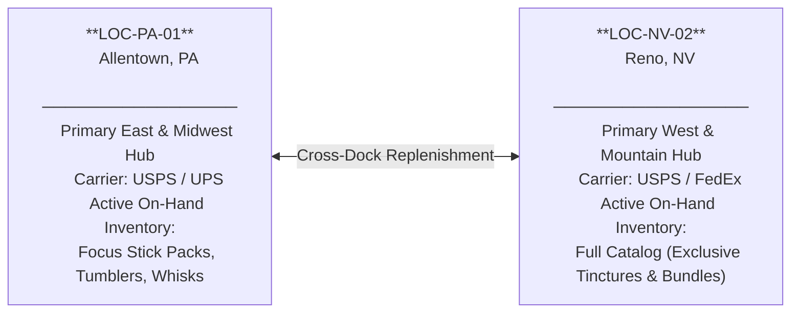
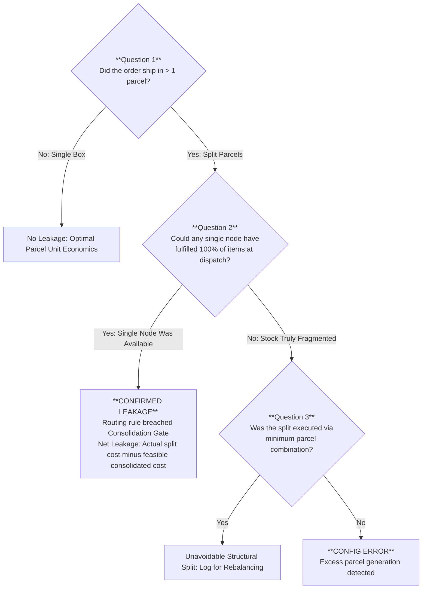
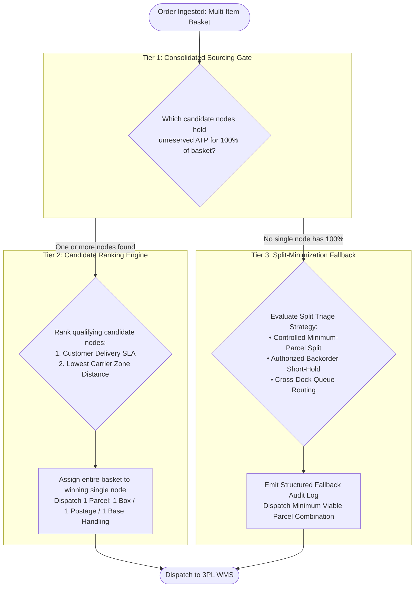

# Bi-Coastal Multi-Node Logistics & Freight Cost Optimization: The Denver Basket Autopsy and the Consolidation Bound

*Synapse Botanicals Systems Architecture | Logistics & Order Routing Engineering | Compiled 2026-11-10*

---

## 1. The Second Box Was the Expensive One

### 1.1 Every Item Was Routed on Its Own. The Invoice Said $21.50.

If you fulfill direct-to-consumer orders from more than one warehouse, the most intuitive routing policy in the world is to decide each item on its own: dispatch each line item from a warehouse that holds it and, where there is a choice. Tvaluate each line against its default stocked facility, without first checking whether one facility can fulfill the entire basket. Intuitively, this appears to minimize transit time and carrier zone charges. In practice, on multi-item shopping baskets, this unconstrained heuristic quietly hemorrhages operating margin.

Here is the empirical case in a single frame. A customer in Denver, CO orders a three-unit wellness basket: two *Focus Stick Packs (30-Pack)* and one *Adaptogen Tincture (60ml)*. The stick packs are dual-stocked at both network nodes: Allentown, PA (`LOC-PA-01`) and Reno, NV (`LOC-NV-02`). The tincture is batch-constrained and stocked exclusively in Reno. Geographically, Reno is the closer warehouse to Denver: modeled as Zone 4, against Zone 6 from Allentown.

A rule that evaluates each line item on its own, and defaults the stick packs to Allentown, sends the sticks from Allentown and the tincture from Reno: two boxes, two postage charges, two 3PL handling fees, totaling **$21.50**. Conversely, consolidating all three units into a single parcel dispatched from Reno costs **$10.50**. Consolidation saves **$11.00—a 51.16% reduction from the $21.50 split—while avoiding an unnecessary Allentown parcel**.

The loss has a name: **split-shipment surcharge leakage**. It does not generate software exceptions or operational alarms. Every parcel ships on time, warehouse scan guns confirm flawless pick sequences, and every shipping label is valid. The damage surfaces months later as an unexplained gross margin compression on multi-item baskets.

### 1.2 Executive Incident Matrix

| Parameter / Incident Dimension | Direct Impact / Incident Observation | Systemic & Financial Hazard |
|---|---|---|
| **Target Basket** | 2× Focus Stick Packs 30-Pack (`SYN-FSTK-MY`) + 1× Adaptogen Tincture 60ml (`SYN-TNCT-AM`), delivered to Denver, CO. Sticks are available at Allentown and Reno; tincture is available at Reno only. Reno is Zone 4, Allentown is Zone 6. | The tincture has exactly one feasible node, so the complete basket has a feasible single-node home. Any routing rule that evaluates line items individually cannot detect whole-basket feasibility. |
| **Naive Per-Line Routing** | Sticks default to Allentown (Zone 6), tincture ships from Reno (Zone 4). Incurs 2 parcels, 2 base postages, and 2 handling fees: **$21.50**. | The routing policy follows per-item default locations without first checking whole-basket availability. The second parcel adds a $2.90 handling penalty plus a second base carrier charge, while sending part of the order from the farther node. |
| **Consolidated Waterfall Routing** | Tier 1 Consolidation Gate identifies that only Reno holds unreserved ATP for 100% of the basket. Dispatches 1 parcel: **$10.50**. Net saving: **$11.00 (51.2% reduction)**. | Parcel count becomes the first-order cost driver. Geographic zone and SLA ranking are applied *only* among candidate nodes capable of fulfilling the entire basket. |
| **500-Order Cohort Exposure** | Model Alpha (157 splits / 31.4%) vs. Model Beta (41 splits / 8.2%); 657 vs. 541 parcels; $7,571.50 vs. $6,574.10 modeled fulfillment. **$997.40 net cohort saving** ($1.9948 per order). | Surcharge leakage is imperceptible per order but devastating in aggregate. At a 1,000-orders/day planning scale, this leakage represents **$728,102.00/year** in avoidable fulfillment expense. |

### 1.3 The Two Plans Side by Side

```text
OPTION A: NAIVE PER-LINE SPLIT (2 PARCELS) ────► $21.50
┌────────────────────────────────┐ ┌────────────────────────────────┐
│ Parcel 1: Reno (Zone 4)        │ │ Parcel 2: Allentown (Zone 6)   │
│ 1x Adaptogen Tincture          │ │ 2x Focus Stick Packs           │
│ Carrier Freight (Z4):    $6.40 │ │ Carrier Freight (Z6):    $8.10 │
│ 3PL Handling:            $3.30 │ │ 3PL Handling:            $3.70 │
│ Subtotal:                $9.70 │ │ Subtotal:               $11.80 │
└────────────────────────────────┘ └────────────────────────────────┘

OPTION B: CONSOLIDATED WATERFALL (1 PARCEL) ───► $10.50  (-$11.00 / -51.2%)
┌───────────────────────────────────────────────────────────────────┐
│ Single Consolidated Parcel: Reno (Zone 4)                         │
│ 1x Adaptogen Tincture + 2x Focus Stick Packs                      │
│ Carrier Freight (USPS Ground Advantage Zone 4):             $6.40 │
│ 3PL Handling ($2.90 base + 3 × $0.40 unit picks):           $4.10 │
│ Total Landed Cost:                                         $10.50 │
└───────────────────────────────────────────────────────────────────┘
```

> [!CAUTION]
> **Modeled Scenario Boundary**: The 3PL handling fees, carrier zone rates, postal assignments, and cohort models presented herein are declared scenario inputs calculated in integer cents. They represent standard commercial direct-to-consumer baseline models rather than live carrier API quotations or proprietary negotiated rate cards. Section 11 explicitly delineates what has been validated via offline test suites versus what represents architectural specifications.

So how can a rule that routes every item sensibly cost twice as much? To see it, you first need the network topology and the fee schedule it was pricing against.

---

## 2. Two Warehouses, One Basket

### 2.1 Terms Used in This Dossier

| Term | Operational Definition |
|---|---|
| **Node** | A physical fulfillment facility. `LOC-PA-01` is Allentown, PA; `LOC-NV-02` is Reno, NV |
| **3PL** | Third-party logistics provider (ShipBob) executing physical receiving, pick, pack, and carrier induction |
| **Basket** | The distinct set of SKUs and unit quantities comprising a single customer checkout |
| **Customer Profile (Denver)** | Sarah Jenkins (`sarah.jenkins@example.com`) in Denver, CO (`80202`) placing benchmark 3-unit basket |
| **Parcel** | One physical shipping carton with one carrier postage charge and one set of warehouse handling fees |
| **Split Shipment** | Fulfilling a single customer order across two or more separate parcels, usually originating from different nodes |
| **Consolidated Shipment** | Fulfilling 100% of an order's line items in a single package dispatched from one node |
| **ATP** | Available-to-Promise inventory: physical on-hand stock minus unfulfilled reservations and backorders |
| **USPS Zone** | Great-circle distance bands (Zones 1–8) determining carrier postage pricing from origin to destination ZIP |
| **Handling Fee** | Contractual warehouse fee charged per outbound shipment covering box, packing materials, and labor |
| **Cross-Dock Replenishment** | Scheduled inter-facility freight transfers rebalancing inventory to prevent node stockouts |
| **Waterfall** | A deterministic, prioritized execution sequence where rules evaluate hierarchically until satisfied |

### 2.2 Network Topology & Inventory Availability Profile

Both nodes are contractually authorized to distribute all 12 catalog variants. However, dynamic manufacturing replenishment schedules create temporary inventory skews. During the analyzed operating cycle, finished goods for *Adaptogen Tinctures* and *Starter Bundles* were staged exclusively at the Reno facility.



### 2.3 Scenario Handling Fee Structure

The economic model utilizes the following 3PL rate card. These figures represent commercial baseline inputs:

| Fee Component | Single Package Order (3 units) | Split Parcel 1 (1 unit) | Split Parcel 2 (2 units) | Total Split Cost |
|---|---|---|---|---|
| **Base Order Fulfillment** | $2.50 | $2.50 | $2.50 | $5.00 |
| **Packaging & Corrugate** | $0.80 | $0.80 | $0.80 | $1.60 |
| **Additional Pick Fee** | $0.80 (2 extra picks @ $0.40) | $0.00 (first pick included) | $0.40 (1 extra pick @ $0.40) | $0.40 |
| **Total 3PL Handling** | **$4.10** | **$3.30** | **$3.70** | **$7.00 (+$2.90 penalty)** |

#### Mathematical Handling Decomposition

The first pick in every parcel is bundled into the base fulfillment fee; only picks after the first carry the $0.40 charge. This fee structure collapses algebraically into an exact two-term equation:

$$\text{Fixed Parcel Overhead} = \$2.50 \text{ (base)} + \$0.80 \text{ (corrugate)} = \$3.30 \text{ (first pick included)}$$

$$\text{Variable Pick Labor} = \$0.40 \text{ for each unit picked after the first in each parcel}$$

$$\text{Handling}(P, U) = \$3.30 \times P + \$0.40 \times (U - P) = \$3.30P + \$0.40U - \$0.40P = \mathbf{\$2.90P + \$0.40U}$$

Where:
- $P$ is the total count of dispatched outbound parcels.
- $U$ is the total count of physical units picked across all parcels.
- The $\$2.90$ coefficient is not the sum of base and corrugate ($\$3.30$). It is $\$3.30$ less the $\$0.40$ credit that the per-unit term would otherwise assess for each parcel's first pick (which the schedule waives).

Checking the rate card against the formula:

| Parcel Configuration | Parcels ($P$) | Units ($U$) | $\text{Handling} = \$2.90P + \$0.40U$ |
|---|---:|---:|---:|
| 1 parcel, 1 unit | 1 | 1 | $\$2.90(1) + \$0.40(1) = \mathbf{\$3.30}$ |
| 1 parcel, 2 units | 1 | 2 | $\$2.90(1) + \$0.40(2) = \mathbf{\$3.70}$ |
| 1 parcel, 3 units | 1 | 3 | $\$2.90(1) + \$0.40(3) = \mathbf{\$4.10}$ |
| 2 parcels, 3 units (1 + 2) | 2 | 3 | $\$2.90(2) + \$0.40(3) = \mathbf{\$7.00}$ |

Now compare the same customer basket fulfilled as a split versus a consolidated shipment. Because the exact same physical units are picked in both scenarios, **the variable pick labor term cancels out completely**:

$$\Delta \text{Handling} = \text{Handling}_{\text{split}} - \text{Handling}_{\text{consolidated}} = \$2.90 \times (P_{\text{split}} - P_{\text{consolidated}}) + \$0.40 \times (U - U) = \mathbf{\$2.90 \times (P_{\text{split}} - P_{\text{consolidated}})}$$

$$\text{Check: } \$7.00 - \$4.10 = \mathbf{\$2.90}$$

The handling penalty for a split shipment is **exactly $2.90 per additional parcel**, completely invariant to how many units or SKUs the order contains.

### 2.4 Scenario Carrier Cost Inputs

The model utilizes the following standard domestic postage tariff schedules:

| Destination Zone | Great-Circle Distance | USPS Ground Advantage (Commercial) | Priority Mail Commercial |
|---|---|---|---|
| **Zones 1–2** | 0 – 150 miles | $5.40 | $7.80 |
| **Zone 3** | 151 – 300 miles | $5.85 | $8.40 |
| **Zone 4** | 301 – 600 miles | $6.40 | $9.10 |
| **Zone 5** | 601 – 1,000 miles | $7.20 | $10.40 |
| **Zone 6** | 1,001 – 1,400 miles | $8.10 | $11.80 |
| **Zone 7** | 1,401 – 1,800 miles | $9.20 | $13.50 |
| **Zone 8** | 1,801+ miles (Cross-Country) | $10.50 | $15.20 |

#### Cross-Reference: Capstone Order #35070

Order #35070 illustrates a different failure. Its Reno allocation retained the old Philadelphia destination after the customer requested San Francisco. The bundle was stocked in Reno (`LOC-NV-02`), so the incident was an address-state failure rather than an Allentown-versus-Reno allocation mistake.

The Capstone declares **$7.20 original ground freight** and **$14.80 replacement expedited freight.** These belong to different shipments and service levels; their difference is not a postal-zone penalty.

$$\$14.60 - \$6.50 = \$8.10 \quad \left(\frac{\$8.10}{\$6.50} = +124.6\%\right)$$

This illustrates the financial hazard of ignoring postal zones when consolidation is not in question. It forms the mirror image of the Denver basket: in Denver, ignoring parcel count cost $11.00; in Capstone #35070, ignoring postal zone cost $8.10.

> [!NOTE]
> The $6.50, $14.60, and +$8.10 figures represent Capstone-declared scenario inputs. The executed test suite in `evidence/freight/` asserts only that the Capstone fixture retains the Philadelphia destination and its separate $7.20 declared freight assumption (§11).

With the economic parameters established, we now trace the Denver order through two divergent routing policies to observe where margin is preserved or lost.

---

## 3. One Basket, Two Policies: Following the Denver Order

For Denver, CO, Reno is designated **Zone 4** and Allentown is designated **Zone 6**. The stock-discovery stage is the pivotal hinge where the two control policies diverge.

### 3.1 Routing Decision Trace

| Step | Evaluation Stage | Naive Per-Line Policy | Consolidated Waterfall Policy |
|---|---|---|---|
| **1** | **Order Ingestion** | Basket: 2× Focus Sticks, 1× Tincture. Destination: Denver, CO | Basket: 2× Focus Sticks, 1× Tincture. Destination: Denver, CO |
| **2** | **ATP Discovery** | Sticks: `LOC-PA-01` & `LOC-NV-02`. Tincture: `LOC-NV-02` only | Sticks: `LOC-PA-01` & `LOC-NV-02`. Tincture: `LOC-NV-02` only |
| **3** | **Decision Logic** | Evaluates Line 1 (Sticks): defaults to Allentown. Evaluates Line 2 (Tincture): routes to Reno | **Tier 1 Consolidation Gate**: Filters nodes holding unreserved stock for 100% of basket |
| **4** | **Candidate Evaluation** | Independent line placement forces multi-origin split | **Reno only.** Exactly one candidate qualifies; no ranking needed |
| **5** | **Execution Outcome** | **2 Parcels Dispatched** | **1 Parcel Dispatched** |

### 3.2 Full Cost Ledger Breakdown

```text
OPTION A: NAIVE SPLIT (Two Parcels)
  Parcel 1: Reno, NV to Denver, CO (USPS Zone 4, 1 Unit Tincture)
    Carrier Freight (USPS Ground Advantage Zone 4):      $6.40
    3PL Handling ($2.90 base + 1 × $0.40):               $3.30
    Parcel 1 Subtotal:                                   $9.70

  Parcel 2: Allentown, PA to Denver, CO (USPS Zone 6, 2 Units Sticks)
    Carrier Freight (USPS Ground Advantage Zone 6):      $8.10
    3PL Handling ($2.90 base + 2 × $0.40):               $3.70
    Parcel 2 Subtotal:                                  $11.80
  ────────────────────────────────────────────────────────────
  TOTAL SPLIT LANDED FULFILLMENT:                       $21.50

OPTION B: CONSOLIDATED (One Parcel from Reno)
  Single Parcel: Reno, NV to Denver, CO (USPS Zone 4, 3 Units Total)
    Carrier Freight (USPS Ground Advantage Zone 4):      $6.40
    3PL Handling ($2.90 base + 3 × $0.40):               $4.10
  ────────────────────────────────────────────────────────────
  TOTAL CONSOLIDATED LANDED FULFILLMENT:                $10.50

NET CONSOLIDATION ADVANTAGE:  $21.50 - $10.50 = $11.00 SAVED (51.2% Lower)
```

### 3.3 The Decision as an Auditable Record

To guarantee financial traceability, every routing decision must emit an auditable JSON event logging both the chosen routing vector and the counterfactual alternative rejected by the engine:

```json
{
  "order_id": "ORD-2026-8812",
  "order_basket": [
    {"sku": "SYN-FSTK-MY", "qty": 2},
    {"sku": "SYN-TNCT-AM", "qty": 1}
  ],
  "destination": {
    "city": "Denver",
    "state": "CO",
    "postal_code": "80202",
    "zone_from_reno": 4,
    "zone_from_allentown": 6
  },
  "waterfall_trace": {
    "tier_1_consolidation_candidates": ["LOC-NV-02"],
    "tier_2_sla_ranking": ["LOC-NV-02"],
    "tier_3_split_fallback_triggered": false
  },
  "decision": {
    "action": "ROUTE_ALL_TO_LOC-NV-02",
    "total_parcels": 1,
    "modeled_landed_cost_cents": 1050
  },
  "rejected_counterfactual": {
    "policy": "static_per_line_default",
    "forced_parcels": 2,
    "modeled_landed_cost_cents": 2150,
    "prevented_leakage_cents": 1100
  }
}
```

Logging the rejected alternative is deliberate: it provides operations and finance teams with an auditable ledger proving avoided fulfillment leakage.

One basket illustrates the mechanism. The next question is whether a universal mathematical principle governs multi-node consolidation.

---

## 4. The Consolidation Bound: When Is a Second Parcel Worth It?

Is consolidation always mathematically superior, or could extreme carrier long-zone rates eventually justify splitting an order to achieve closer shipping proximity? We answer this by deriving **The Consolidation Bound**.

We calculate the worst-case cross-country zone penalty and compare it directly against the minimum possible cost of injecting a second parcel into the logistics network:

| Variable / Parameter | USPS Ground Advantage | Priority Mail Commercial |
|---|---|---|
| **Maximum Long-Zone Penalty ($\Delta \text{Zone}_{\max}$)**<br>*(Zone 8 Cross-Country minus Zone 2 Local)* | $\$10.50 - \$5.40 = \mathbf{\$5.10}$ | $\$15.20 - \$7.80 = \mathbf{\$7.40}$ |
| **Minimum Second Parcel Cost ($\text{Parcel 2}_{\min}$)**<br>*($2.90 Handling + Cheapest Zone 1–2 Base Postage)* | $\$2.90 + \$5.40 = \mathbf{\$8.30}$ | $\$2.90 + \$7.80 = \mathbf{\$10.70}$ |
| **Consolidation Invariant Margin Advantage** | $\mathbf{\$3.20}$ net savings | $\mathbf{\$3.30}$ net savings |

Under declared commercial rate cards, **the second parcel always costs more than the worst possible postal zone differential by at least $3.20**. Consequently, whenever any single warehouse holds inventory for 100% of an order, the system must consolidate—even if that warehouse is located in the most distant carrier zone.

### Generous Boundary Verification: The Two-Zone-2 Theoretical Limit

To demonstrate the mathematical resilience of the bound, consider an extreme theoretical scenario deliberately constructed in favor of the split: assume both split packages could travel to local Zone 2, whereas the consolidated package must travel cross-country to Zone 8:

| Fulfillment Architecture | Parcels | Total Carrier Postage | Total 3PL Handling | Net Landed Cost |
|---|---|---|---|---|
| **Two Split Parcels (Both Zone 2)** | 2 | $\$5.40 + \$5.40 = \$10.80$ | $\$2.90 \times 2 + \$0.40 \times 3 = \$7.00$ | **$17.80** |
| **One Consolidated Parcel (Zone 8)** | 1 | $\$10.50$ | $\$2.90 \times 1 + \$0.40 \times 3 = \$4.10$ | **$14.60** |
| **Net Consolidation Advantage** | | | | **$3.20 Savings** |

> [!IMPORTANT]
> Because Allentown and Reno cannot both sit in the Zone 1–2 distance band for the same customer delivery address, the two-Zone-2 scenario is an impossible theoretical upper bound for split efficiency. If consolidation wins even under this impossible best case, consolidation mathematically dominates in every real-world network routing scenario.

The bound holds because the full incremental cost of a second parcel—$\$2.90$ fixed handling plus the cheapest base carrier rate ($\$5.40$)—totals $\$8.30$, which comfortably exceeds the $\$5.10$ maximum zone premium. Note that the $\$2.90$ handling fee alone is smaller than the $\$5.10$ zone differential; the bound holds because the second parcel must also bear its own independent carrier charge.

### Inventory State & Routing Response Matrix

| Network Inventory Condition | Operational Reality | Mandatory Routing Action | P&L Impact |
|---|---|---|---|
| **Single node holds 100% ATP** | Complete consolidation feasible | Route 100% of basket to candidate node | Zero split surcharge; minimum landed cost |
| **Multiple nodes hold 100% ATP** | Consolidation choice available | Rank candidates by closest carrier zone & SLA | Realizes authentic geographic zone savings |
| **No single node holds 100% ATP** | Inventory fragment constraint | Evaluate minimum-parcel split vs backorder queue | Controls damage; parcel count minimized |
| **ATP cache stale / in-flight race** | High phantom allocation risk | Re-query real-time unreserved balance at lock time | Prevents committing to an unfulfillable single box |

---

## 5. Spotting Leakage: Three Questions for Any Split Order

Fulfillment engineering teams do not need complex algorithms to identify whether their logistics network is bleeding margin. Auditing any order cohort requires asking three sequential questions:



### 5.1 Did the order ship in more than one box?
Calculate the macro **Parcel-to-Order Ratio**:

$$\text{Parcel Ratio} = \frac{\text{Total Dispatched Parcels}}{\text{Total Customer Orders}}$$

In an unconstrained naive environment, this ratio typically reaches **1.314** (657 parcels across 500 orders). Under consolidated routing governance, the ratio drops to **1.082** (541 parcels across 500 orders). Because the model counts each split order as two parcels, the ratio minus $1.000$ represents the exact split rate ($0.314$ and $0.082$). A rising ratio with stable basket sizes is the earliest warning indicator of routing policy misconfiguration.

### 5.2 Could one node have fulfilled it all?
For each split order, audit the unreserved ATP at each node at the exact moment of order assignment. Record three discrete facts:
1. The routing decision timestamp.
2. The ATP snapshot timestamp for each regional facility.
3. The unreserved quantity per SKU at each facility.

This telemetry uncovers two distinct failure modes:
- **Routing Policy Failure**: One node held the entire basket at assignment. The split was an unconstrained routing choice, not an inventory constraint (violating the §4 Consolidation Bound).
- **Data Freshness Failure**: The ATP snapshot exceeded the declared staleness threshold, or stock was claimed in an un-isolated race condition. The candidate set itself was corrupt (Failure Mode #4 in §7).

### 5.3 What would one parcel have cost?
Reprice the order retrospectively as a single shipment from the best consolidated candidate node. Log the variance per order:

$$\text{leak\_usd} = \text{actual\_modeled\_cost} - \text{counterfactual\_single\_parcel\_cost}$$

$$\text{Denver Autopsy: } \$21.50 - \$10.50 = \mathbf{\$11.00}$$

If the counterfactual is lower and one node held inventory, an authentic leak has been quantified. Aggregating `leak_usd` across monthly checkout volumes provides finance with an empirical recovery target.

---

## 6. When a Split Is Unavoidable: Controlled Exception Handling

When stock depletion across nodes makes single-package fulfillment physically impossible, the routing fallback must choose between three structured paths:

| Mitigation Architecture | Primary Trigger Criteria | Cost & Customer Trade-Off |
|---|---|---|
| **Controlled Minimum-Parcel Split** | Expedited customer SLA; stock physically segregated across facilities | Adds $2.90 fixed handling plus the extra parcel’s postage; the net difference also depends on any change in the retained parcel’s rate. |
| **Authorized Short-Hold Backorder** | Inbound replenishment container actively receiving at primary hub | Defers dispatch 24–48 hours; avoids second parcel expense; requires proactive customer messaging |
| **Automated Cross-Dock Transfer** | Chronic split SKU pairing identified in rolling 7-day velocity data | Incurs bulk freight transfer expense; eliminates recurring retail parcel split penalties permanently |

### Customer Communication Rules
1. **Upfront Disclosure at Checkout/Confirmation**: Split orders must be disclosed immediately. The customer must be informed that the order will arrive in multiple parcels, with distinct tracking references and carrier delivery windows for each.
2. **Backorder Choice**: Where a short hold (24–48 hours) enables a single node to fulfill the complete basket, provide the customer with an authorized backorder option as the preferred alternative to split packaging.
3. **Unified Order Tracking**: Never allow a customer to infer that an item was omitted. Ensure the storefront tracking portal links all outbound parcel tracking numbers to the single parent order record.

### Inventory Rebalancing Rules
1. **Velocity Pairing Telemetry**: Track chronic multi-origin SKU pairings. SKU combinations that repeatedly trigger Tier 3 splits indicate an inventory allocation defect rather than a software failure.
2. **Transfer Justification Math**: Authorize cross-dock warehouse replenishment when the bulk transfer freight cost is less than the cumulative net saving it creates, calculated as split fulfillment cost minus feasible consolidated fulfillment cost.
3. **Post-Transfer Verification**: Following a stock transfer, verify that the newly balanced node successfully passes Tier 1 for subsequent checkout cohorts.

---

## 7. Where Routing Leaks: Root-Cause Failure Mode Matrix

A comprehensive systems analysis of multi-node order routing identified four primary systemic vulnerability modes:

| # | Root-Cause Failure Mode | Architectural Mechanism | Preventable at Routing Time? | Remediation Control |
|---|---|---|:---:|---|
| **1** | **Independent Per-Line Evaluation** | Routing heuristics optimize individual SKU distance rather than aggregate basket parcel count | **Yes** | **Consolidation Gate**: Enforce Tier 1 whole-basket availability check before proximity ranking |
| **2** | **Omission of Warehouse Handling in Cost Logic** | Routing algorithms optimize purely for carrier postage, ignoring 3PL pick/pack/box fee structures | **Yes** | **Landed Cost Routing**: Incorporate $\$2.90P + \$0.40U$ into real-time decision functions |
| **3** | **Unbalanced Catalog Placement** | High-velocity companion SKUs segregated into disparate regional nodes during replenishment | **Partly** | **Affinity-Based Staging**: Warehouse replenishment bundling paired SKUs in identical facilities |
| **4** | **Stale Distributed ATP Data** | Inventory caches desynchronize during flash sales, causing phantom stock splits at wave creation | **Yes** | **Transactional Locking**: Validate unreserved real-time stock balances immediately prior to assignment |

The decisive flaw is **Failure Mode #1**. The other three amplify the damage, but #1 is a pure design choice. Prevention requires evaluating whole-basket consolidation *before* geographic proximity.

---

## 8. What 500 Orders Cost: The Empirical Cohort Simulation

To quantify the operational impact beyond individual basket autopsies, we examine an empirical benchmark cohort of 500 multi-item orders ($41,200 gross merchandise value, average order value $82.40).

### 8.1 Cohort Baseline Parameters

- **Cohort Size**: 500 multi-item customer checkouts.
- **Geographic Distribution**:
  - East Coast (USPS Zones 1–4 East): 42% (210 orders)
  - West Coast (USPS Zones 1–4 West): 34% (170 orders)
  - Central / Midwest (USPS Zones 5–6): 24% (120 orders)
- **Basket Complexity**:
  - 2-unit orders: 62% (310 orders $\times$ 2 units = 620 units)
  - 3-unit orders: 38% (190 orders $\times$ 3 units = 570 units)
  - **Total Units Picked**: **1,190 units** (identically matched between test models).

### 8.2 Benchmark Results: Model Alpha (Naive) vs. Model Beta (Consolidated)

```text
COHORT PARCEL & HANDLING ARITHMETIC:
  Model Alpha Parcels: 500 orders + 157 split orders = 657 parcels
  Model Beta Parcels:  500 orders +  41 split orders = 541 parcels
  Eliminated Parcels:  657 - 541 = 116 parcels (73.89% relative split reduction)

  Handling, Alpha: $2.90 × 657 + $0.40 × 1,190 = $1,905.30 + $476.00 = $2,381.30
  Handling, Beta:  $2.90 × 541 + $0.40 × 1,190 = $1,568.90 + $476.00 = $2,044.90
  Handling Saving: 116 parcels × $2.90 = $336.40

  Freight, Alpha:  $5,190.20
  Freight, Beta:   $4,529.20
  Freight Saving:  $5,190.20 - $4,529.20 = $661.00

  Total Fulfillment Saving: $336.40 handling + $661.00 freight = $997.40
  Per-Order Saving:         $997.40 / 500 = $1.9948 per order
  Relative Split Reduction: 116 / 157 = 73.89%
  Absolute Split Reduction: 31.4% - 8.2% = 23.2 percentage points
```

| Performance Metric | Model Alpha (Naive Per-Line) | Model Beta (Consolidated Waterfall) | Empirical Variance |
|---|---:|---:|---:|
| **Split Orders** | 157 (31.4%) | 41 (8.2%) | **-116 orders (-73.89% / -23.2 pp)** |
| **Total Dispatched Parcels** | 657 parcels | 541 parcels | **-116 parcels (-17.7%)** |
| **Parcel-to-Order Ratio** | 1.314 | 1.082 | -0.232 |
| **Total Units Picked** | 1,190 units | 1,190 units | Balanced Baskets |
| **3PL Handling Fee Expense** | $2,381.30 | $2,044.90 | **-$336.40 (-14.1%)** |
| **Carrier Freight Expense** | $5,190.20 | $4,529.20 | **-$661.00 (-12.7%)** |
| **Total Landed Fulfillment** | **$7,571.50** | **$6,574.10** | **-$997.40 (-13.2%)** |
| **Fulfillment Cost Per Order** | **$15.1430** | **$13.1482** | **-$1.9948 per order** |

The consolidated waterfall eliminates 116 split shipments, unlocking **$997.40 in direct fulfillment margin recovery** across the 500-order sample.

### 8.3 Planning Scale Sensitivity Projections

The per-order cohort average of **$1.9948** is exact ($997.40 / 500), so the projections below carry zero rounding distortion. Each tier illustrates a distinct operational planning scale applied to the modeled cohort average:

| Operational Planning Scale | Monthly Checkouts | Annual Dispatched Orders | Arithmetic Calculation | Modeled Annualized Savings |
|---|---:|---:|---|---:|
| **Modeled Benchmark Cohort** | — | 500 | $\$1.9948 \times 500$ | **$997.40** |
| **Mid-Market Brand (1.7k/mo)** | 1,700 | 20,400 | $\$1.9948 \times 1,700 \times 12$ | **$40,693.92 / year** |
| **Growth Stage (5k/mo)** | 5,000 | 60,000 | $\$1.9948 \times 5,000 \times 12$ | **$119,688.00 / year** |
| **High-Volume Scale (15k/mo)** | 15,000 | 180,000 | $\$1.9948 \times 15,000 \times 12$ | **$359,064.00 / year** |
| **Enterprise Fleet (1k/day)** | ≈30,417 average monthly checkouts | 365,000 | $\$1.9948 \times 365,000$ | **$728,102.00 / year** |

*Note: Projections represent conditional sensitivity calculations based on the declared cohort numerator. They illustrate systemic financial exposure rather than audited historical accounting ledgers.*

---

## 9. The Waterfall in Parts: Algorithmic Routing Engine Architecture

To eliminate split-shipment leakage systematically, the order routing engine is configured as an immutable, three-tier hierarchical waterfall.

### 9.1 Three-Tier Routing Waterfall Flowchart



### 9.2 Routing Parameters & Operational Rules

| Waterfall Stage / Parameter | Value / Operational Threshold | Operational Rationale |
|---|---|---|
| **Base Order Fulfillment** | $2.50 per parcel | Scenario input: fixed labor component of parcel handling |
| **Packaging & Corrugate** | $0.80 per parcel | Scenario input: physical box and void-fill materials |
| **Additional Pick Fee** | $0.40 per unit after the first | Scenario input: incremental per-unit warehouse pick fee |
| **Equivalent Handling Form** | $\text{Handling} = \$2.90P + \$0.40U$ | Algebraic formulation isolating the $2.90 cost of an additional box |
| **Carrier Tariff Schedules** | Table in §2.4 | Standard commercial domestic rate card inputs |
| **Tier 1 Pass Condition** | Unreserved $\text{ATP} \ge \text{Quantity}$ for all SKUs | Strict consolidation filter: partial availability fails Tier 1 |
| **ATP Freshness Check** | Real-time stock re-check at lock time | Prevents committing to an unfulfillable single-box wave |
| **Candidate Ranking (Tier 2)** | Delivery SLA, then closest carrier zone | Applied *exclusively* among candidate nodes capable of 100% fulfillment |
| **Bound Re-Validation Trigger** | Any change to carrier rates or handling | The §4 bound holds only while $\$2.90 + \text{BaseCarrier} > \Delta \text{Zone}_{\max}$ |
| **Tier 3 Audit Logging** | Reason code & counterfactual on every split | A split order must never be reached silently |

### 9.3 Production Implementation Context: Modern Shopify Plus Architecture

Implementing this logic in modern high-volume direct-to-consumer infrastructure requires moving beyond Shopify's legacy administrative location fulfillment priority lists:

#### Legacy Admin Rules vs. Shopify Functions
Location priority configured in the Shopify admin is a static rank order. It has no mechanism to evaluate per-parcel handling fees or execute a whole-basket ATP test. If Location A is ranked #1 and holds 1 out of 3 basket items, Shopify automatically fulfills that 1 item from Location A and splits the remaining 2 items to Location B. Static priority lists cannot enforce whole-basket consolidation.

To achieve programmatic consolidation, the architecture targets the **Shopify Functions Order Routing API**. Built as lightweight WebAssembly (Wasm) modules compiled from Rust, Shopify Functions execute within sub-10ms latency budgets during checkout and order creation.

#### API Surfaces and Availability

| API Surface | Target Function Hook | Operational Behavior | Relevance to the Waterfall |
|---|---|---|---|
| **Order Routing Location Rule API** | `cart.fulfillment-groups.location-rankings.generate.run` | Programmatically ranks locations associated with fulfillment groups; Shopify selects the top-ranked location | Carries Tiers 1 and 2 as an adaptive ranking |
| **Fulfillment Constraints API** | `cart.fulfillment-constraints.generate.run` | Restricts line items to specific locations or requires them to ship from the same location | Hard-enforces same-location sourcing, with the checkout risk detailed below |

#### How the Tiers Map to Shopify Functions

1. **Tier 1 as a Programmatic Location Filter**: The function computes which facilities hold unreserved ATP for 100% of the basket and ranks those qualifying locations into a higher-priority group than every other facility. Expressing Tier 1 as an adaptive ranking—rather than a hard same-location constraint—is a crucial engineering choice: Shopify documents that when items constrained by the Fulfillment Constraints API cannot be sourced together, the buyer sees *"No shipping options available"* at checkout. A hard constraint would inadvertently convert an inventory stockout (Tier 3) into an abandoned cart.
2. **Tier 2 as a Zone-SLA Sort**: Within the top-ranked group of fully stocked candidates, the function sorts surviving nodes by customer delivery SLA and lowest carrier zone distance. Tier 2 never executes against a facility that failed Tier 1.
3. **Tier 3 as Split Minimization**: When no single facility clears Tier 1, the function ranks locations by the percentage of basket items each can cover (highest first), ensuring that line items are packed into the minimum viable number of parcels. Backorder holds and inventory rebalancing transfers execute upstream in middleware.

*API Documentation References:* [Order Routing Location Rule API](https://shopify.dev/docs/api/functions/reference/order-routing-location-rule) · [Fulfillment Constraints API](https://shopify.dev/docs/api/functions/latest/fulfillment-constraints).

---

## 10. Four Principles for Multi-Node Fulfillment Governance

1. **Consolidate First, Distance Second**: Never query geographic proximity until you have verified that a node can fulfill 100% of the shopping basket. A distant single parcel is virtually always cheaper than two local parcels.
2. **Price the Parcel, Not the Mile**: Warehouse handling fees, corrugate expenses, and base carrier postage are fixed costs incurred with every box. Any routing algorithm that optimizes only for carrier mileage will reliably incinerate gross margin.
3. **Rank Only Across Capable Nodes**: Geographic zone ranking and SLA optimization are valid tools for choosing *between* capable consolidated nodes, never for fragmenting a basket across nodes.
4. **When Splits Are Unavoidable, Minimize and Rebalance**: If an order must split, select the minimum possible parcel count, emit structured audit logs for finance, and trigger automated cross-dock inventory transfers to rebalance stock.

---

## 11. What Is Proven, and What Is Only Designed: Evidence Scope & Verification Status

To preserve complete engineering credibility, this dossier strictly distinguishes between what has been verified through offline, reproducible test suites and what represents modeled scenarios or architectural specifications.

All offline verification tests are fully reproducible via the repository test suite summarized in [Freight Scenario Evidence](../evidence/freight/summary.md), and the overarching test harness is documented in the [Reproducible Evidence Suite](../evidence/README.md).

### 11.1 Evidence Scope & Verification Status Matrix

| Deliverable / Artifact | Location | Evidentiary Status | Verification Source |
|---|---|---|---|
| **Three-Tier Routing Waterfall** | §9 | Architectural Specification | Validated design; targets Shopify Functions API |
| **Network Topology & Inventory Profiles** | §2.2 | Declared Scenario Model | Defined network model (`LOC-PA-01`, `LOC-NV-02`) |
| **Denver Basket Autopsy ($21.50 vs $10.50)** | §3 | **Verified in Test Suite** | [Freight Scenario Evidence](../evidence/freight/summary.md) |
| **The Consolidation Bound ($3.20)** | §4 | **Verified in Test Suite** | [Freight Scenario Evidence](../evidence/freight/summary.md) |
| **500-Order Cohort Simulation ($997.40)** | §8 | **Verified in Test Suite** | [Freight Scenario Evidence](../evidence/freight/summary.md) |
| **Carrier Tariff Schedules** | §2.4 | Declared Model Inputs | Standard commercial rate cards; live API quote skipped |

### 11.2 Executed Test Suite Results Table

The test harness in [`evidence/freight/calculate_freight.js`](../evidence/freight/summary.md) executes programmatic assertions directly against integer-cent monetary representations, basket allocation matrices, and cohort models:

```text
Test Harness Run Metadata:
  Execution ID: 2026-11-11T07-58-46-329Z-14408
  Runtime: Node v24.18.0 (win32 x64)
  Result Summary: 13 Passed | 0 Failed | 1 Declared Skip
```

| Check / Programmatic Assertion | Status | Verification Detail |
|---|---|---|
| All monetary inputs are nonnegative safe integer cents | **PASSED** | Arithmetic zero-rounding and floating-point error protection |
| Three-pick parcel handling equals $4.10 under declared model | **PASSED** | Formula verification: $\$2.90 + (3 \times \$0.40) = \$4.10$ |
| Three units split across two parcels cost $7.00 handling | **PASSED** | Formula verification: $\$3.30 + \$3.70 = \$7.00$ (+$2.90 penalty) |
| Both priced plans reserve complete basket within capacity | **PASSED** | Validates inventory fixture bounds for Reno and Allentown |
| Unavailable tincture cannot be allocated to Allentown | **PASSED** | Confirms strict allocation rejection at unstocked nodes |
| Incomplete basket cannot be priced as successful fulfillment | **PASSED** | Rejects partial fulfillment routing without explicit exception |
| Reservations are aggregated across parcels at the same node | **PASSED** | Multi-line reservations roll up correctly into node ATP pools |
| Split $21.50 and consolidated $10.50 derive from parcel items | **PASSED** | Recomputes exact Denver autopsy ledgers from primitive inputs |
| Changing lane cost propagates without hidden surcharge | **PASSED** | Verifies zero unintended fees or hard-coded margin padding |
| 500-order fixture preserves paired units and parcel counts | **PASSED** | Verifies exactly 1,190 units across 657 and 541 parcels |
| Cohort savings match handling formula and freight inputs | **PASSED** | Validates exact $\$336.40 + \$661.00 = \$997.40$ cohort delta |
| Monthly and annual projections retain exact cohort numerator | **PASSED** | Validates $\$1.9948$/order scale factor across extended volumes |
| Capstone fixture retains Philadelphia and $7.20 freight | **PASSED** | Validates Order #35070 boundary parameters |
| Dated carrier tariff and ZIP-zone verification | **SKIPPED** | Declared model inputs; live API carrier quote verification omitted |

### 11.3 Boundary Statement

Read the carrier rate row honestly. The Denver autopsy forces a split against a feasible Reno consolidation to demonstrate the mathematical risk of an unconstrained per-line default. It does not establish that a closest-node policy would have chosen the split on a real order; in fact, for Denver, a closest-node policy would route every item from Reno and would not split. The split here arises from an unconstrained per-line default to Allentown, which is the exact behavior the waterfall eliminates.

The conclusion is also conditional: it survives changes in carrier rates only while a second parcel's full incremental cost ($\$2.90$ fixed handling plus base postage) remains larger than the maximum carrier zone premium ($\Delta \text{Zone}_{\max}$). Tariffs remain declared scenario inputs, and the rate table represents the baseline model upon which financial projections depend.

Furthermore, the Capstone Order #35070 figures cited in §2.4 ($6.50, $14.60, and +$8.10) are declared scenario inputs; the executed suite asserts only that its fixture retains Philadelphia and a separate $7.20 freight assumption. No live carrier invoices, negotiated commercial discounts, physical mis-shipments, or carrier claims are inferred from these calculations.

---

## 12. The Architectural Takeaway

> *"The Denver order cost $21.50 instead of $10.50 because the routing rule placed each item on its own and never counted boxes. Every parcel was labeled correctly and delivered on time, and the money was lost anyway... The principle is short enough to put on a wall: ask whether one box can do the job before you ask which box is closest."*

In distributed direct-to-consumer logistics, gross margin is rarely destroyed by catastrophic carrier failures. It leaks out cent by cent through well-intentioned heuristics that optimize for proximity while ignoring the brutal physics of parcel handling economics. True freight efficiency is achieved not by chasing the nearest warehouse, but by enforcing absolute basket consolidation before a single mile is measured.

---

*Compiled: 2026-11-10 | Synapse Botanicals Systems Architecture | Logistics & Order Routing Engineering*
