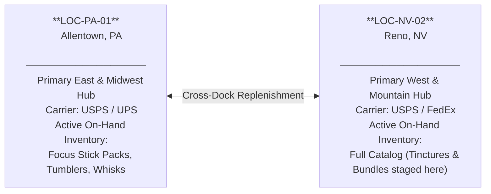
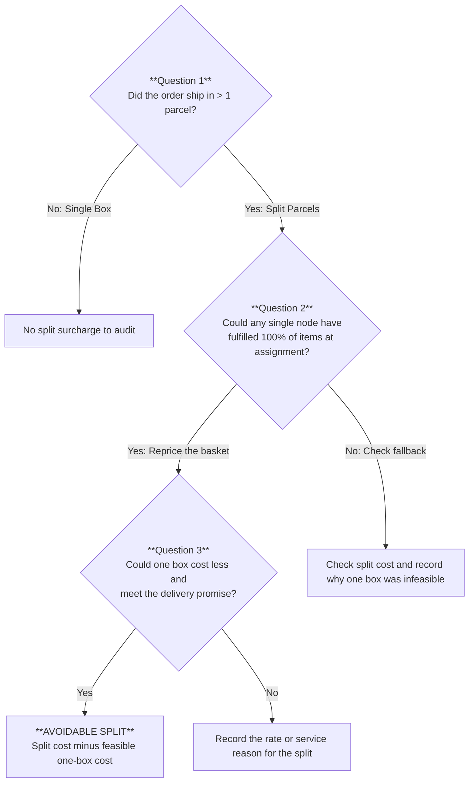
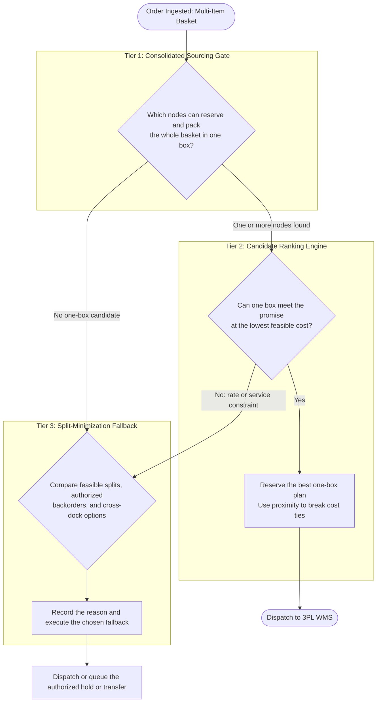

# The Warehouse 12 Miles Away Was the Expensive One

**Why the closest node quietly bleeds margin on multi-item baskets**

*Synapse Botanicals Systems Architecture | Logistics & Order Routing Engineering | Master Dossier — Domain 2*

---

## 1. Twelve Miles Away, $8.30 Lost: The Split-Shipment Surcharge Leak

### 1.1 The Proximity Illusion: How Getting Closer Doubled the Invoice

In multi-node e-commerce logistics, the most dangerous routing heuristic is the one that sounds like pure operational common sense: *ship every item from the nearest facility that has it in stock.*

When customer **Sarah Jenkins** (`sarah.jenkins@example.com`) placed an order for two *Focus Stick Packs (30-Pack)* and one *Adaptogen Tincture (60ml)* to her home in **Bethlehem, PA** (`18018`), the platform's order-routing engine executed its standard logic. Allentown (`LOC-PA-01`) sat just 12 miles away and held the stick packs in stock. Reno (`LOC-NV-02`) sat 2,400 miles away across the continent and held the tincture. Evaluating the customer's cart line-by-line, the proximity engine made the obvious geographic choice: route the sticks to Allentown (Zone 2) and the tincture to Reno (Zone 8).

Every line item cleared stock reservation. Both shipping labels were generated without incident. Both cartons rolled off their respective conveyor belts, were inducted into carrier networks on time, and arrived at the customer's doorstep within the promised delivery SLA.

And the business lost **$8.30 on an order that should have generated a healthy contribution margin.**

By evaluating each line item in isolation, the routing algorithm treated geographic distance as the primary cost driver while remaining completely blind to the commercial physics of the shipping carton. The cross-country parcel from Reno was *already mandatory* because Reno was the sole facility stocking the tincture. Putting the two stick packs into that same Reno carton added a trivial **$0.80** in incremental warehouse pick labor. In contrast, dispatching the stick packs from nearby Allentown required an entirely separate corrugated carton, an additional warehouse base fulfillment toll, and a second commercial carrier postage charge—incurring a **$9.10** penalty just to ship from 12 miles away.

In the final accounting, Allentown’s local parcel cost **$9.10** ($5.40 freight + $3.70 handling) and Reno’s cross-country parcel cost **$13.80** ($10.50 freight + $3.30 handling), producing a **$22.90** split fulfillment invoice. Consolidating all three units into a single Reno carton cost **$14.60** ($10.50 freight + $4.10 handling).

The nearest warehouse was right down the road. Using it was a **36.2% financial penalty**.

This failure mode is **split-shipment surcharge leakage**. The software did not crash, throw an exception, or drop an order. The failure materialized silently on the month-end carrier invoice as a physical package the business never needed to buy.

### 1.2 Executive Incident Matrix

| Parameter / Incident Dimension | Direct Impact / Incident Observation | Systemic & Financial Hazard |
|---|---|---|
| **Target Basket** | 2× Focus Stick Packs 30-Pack (`SYN-FSTK-MY`) + 1× Adaptogen Tincture 60ml (`SYN-TNCT-AM`), delivered to Sarah Jenkins in Bethlehem, PA (`18018`). Allentown has 2 sticks and 0 tinctures. Reno has 2 sticks and 1 tincture available. | Allentown is closer, but Reno alone has enough unreserved stock for the full basket. |
| **Closest-Stocked Per-Line Routing** | Allentown ships the sticks (modeled Zone 2), and Reno ships the tincture (modeled Zone 8). Two parcels cost **$22.90**. | The rule chooses the nearest eligible warehouse for each item. It never asks if the Reno parcel can carry the sticks too. |
| **Consolidated Waterfall Routing** | Reno passes the whole-basket stock check and meets the modeled delivery promise. One parcel costs **$14.60**. | The order avoids $5.40 in freight and $2.90 in handling. Net saving is **$8.30 (36.2%)**. |
| **500-Order Cohort Exposure** | A separate cohort compares Model Alpha (157 splits / 31.4%) with Model Beta (41 splits / 8.2%): 657 vs. 541 parcels and $7,571.50 vs. $6,574.10 in modeled costs. | The declared cohort inputs imply **$997.40** in savings ($1.9948 per order), or **$728,102.00/year** if that difference holds at 1,000 orders per day. |

### 1.3 The Two Plans Side by Side

```text
OPTION A: CLOSEST STOCK PER LINE (2 PARCELS) ─► $22.90
┌─────────────────────────────────┐ ┌─────────────────────────────────┐
│ Parcel 1: Allentown (Zone 2)    │ │ Parcel 2: Reno (Zone 8)         │
│ 2x Focus Stick Packs            │ │ 1x Adaptogen Tincture           │
│ Carrier Freight:          $5.40 │ │ Carrier Freight:         $10.50 │
│ 3PL Handling:             $3.70 │ │ 3PL Handling:             $3.30 │
│ Subtotal:                 $9.10 │ │ Subtotal:                $13.80 │
└─────────────────────────────────┘ └─────────────────────────────────┘

OPTION B: CONSOLIDATED WATERFALL (1 PARCEL) ───► $14.60  (-$8.30 / -36.2%)
┌───────────────────────────────────────────────────────────────────┐
│ Single Consolidated Parcel: Reno (Zone 8)                         │
│ 1x Adaptogen Tincture + 2x Focus Stick Packs                      │
│ Carrier Freight:                                           $10.50 │
│ 3PL Handling ($2.90 + 3 × $0.40):                           $4.10 │
│ Total Landed Cost:                                         $14.60 │
└───────────────────────────────────────────────────────────────────┘
```

> [!CAUTION]
> **Modeled Scenario Boundary**: The basket, available stock, rates, and zone buckets are declared inputs. The three units fit in one box, both plans meet the same delivery promise, and Reno’s modeled $10.50 freight applies to either box. Section 11 documents what the offline suite checks.

The routing engine didn't fail because of an unhandled exception or an inventory outage. It failed because it was blind to contractual physics: in modern 3PL rate schedules, injecting an extra corrugated carton into a distribution network costs far more than carrier mileage across state lines. To understand why proximity misled the algorithm, we must dissect the contractual rate cards governing warehouse labor and freight.

---

## 2. Why Cardboard Beats Mileage: The 3PL Rate Card and Carrier Tariffs

*The fee model behind every routing decision, reduced to one formula, and why a second parcel always adds a fixed $2.90 in handling.*

### 2.1 Systems Architecture & Scenario Glossary

| Concept / Identifier | Operational Definition in This Dossier |
|---|---|
| **Node** | A physical fulfillment facility. `LOC-PA-01` is Allentown, PA; `LOC-NV-02` is Reno, NV. |
| **Customer Profile** | Sarah Jenkins (`sarah.jenkins@example.com`) in Bethlehem, PA (`18018`), placing the 3-unit benchmark basket. |
| **Target Basket** | 2× Focus Stick Packs (`SYN-FSTK-MY`) + 1× Adaptogen Tincture (`SYN-TNCT-AM`). |
| **Available-to-Promise (ATP)** | Unreserved stock physically present and eligible for immediate picking wave allocation. |
| **Split vs. Consolidated** | Fulfilling an order across multiple parcels from different nodes vs. shipping 100% in a single carton from one node. |
| **Handling Formula** | The contractual 3PL fee model: $\text{Handling}(P, U) = \$2.90P + \$0.40U$, where an extra parcel costs an irreducible $\$2.90$. |
| **Surcharge Leakage** | Operating margin destroyed when independent per-line routing heuristics incur avoidable parcel surcharges. |

### 2.2 Network Topology & Inventory Availability Profile

Both nodes can distribute all 12 catalog variants. Replenishment determines what each one can ship today. The Bethlehem fixture gives Allentown the two stick packs but no tincture. Reno can reserve the entire order.

| Node | Proximity to Bethlehem | Stick packs available | Tinctures available | Can fill basket? |
|---|---|---:|---:|---|
| Allentown, PA (`LOC-PA-01`) | Closest, modeled Zone 2 | 2 | 0 | No |
| Reno, NV (`LOC-NV-02`) | Farther, modeled Zone 8 | 2 | 1 | Yes |



With inventory positioned across both nodes, the physical layout meets the commercial rate card. The economic viability of any routing decision hinges entirely on the contract governing warehouse pick and pack operations.

### 2.3 Scenario Handling Fee Structure

The economic model utilizes the following 3PL rate card. These figures represent commercial baseline inputs:

| Fee Component | Reno Consolidated Box (3 units) | Allentown Stick Box (2 units) | Reno Tincture Box (1 unit) | Total Split Cost |
|---|---:|---:|---:|---:|
| **Base Order Fulfillment** | $2.50 | $2.50 | $2.50 | $5.00 |
| **Packaging & Corrugate** | $0.80 | $0.80 | $0.80 | $1.60 |
| **Additional Pick Fee** | $0.80 (2 extra picks @ $0.40) | $0.40 (1 extra pick @ $0.40) | $0.00 (first pick included) | $0.40 |
| **Total 3PL Handling** | **$4.10** | **$3.70** | **$3.30** | **$7.00 (+$2.90 penalty)** |

#### Mathematical Handling Decomposition

The first pick in every parcel is bundled into the base fulfillment fee; only picks after the first carry the $0.40 charge. This fee structure collapses algebraically into an exact two-term equation:

$$\text{Fixed Parcel Overhead} = \$2.50 \text{ (base)} + \$0.80 \text{ (corrugate)} = \$3.30 \text{ (first pick included)}$$

$$\text{Variable Pick Labor} = \$0.40 \text{ for each unit picked after the first in each parcel}$$

$$\text{Handling}(P, U) = \$3.30 \times P + \$0.40 \times (U - P) = \$3.30P + \$0.40U - \$0.40P = \mathbf{\$2.90P + \$0.40U}$$

> This is the platform-wide 3PL handling model used in all dossiers. Base fulfillment ($2.50) + corrugate ($0.80) = $3.30 fixed parcel overhead; $0.40 per additional pick. The simplified coefficient $2.90P + $0.40U is the canonical form also referenced in Domain 5 Section 6 and the evidence/costs package.

Where:
- $P$ is the total count of dispatched outbound parcels.
- $U$ is the total count of physical units picked across all parcels.
- The $\$2.90$ coefficient is not the sum of base and corrugate ($\$3.30$). It is $\$3.30$ less the $\$0.40$ credit that the per-unit term would otherwise assess for each parcel's first pick (which the schedule waives).

This rate card gives $3.30 handling for a single parcel with one physical unit and $4.10 for a single parcel with three units. The separate two-item checkout in Domain 5 uses declared inputs of $4.10 handling and $6.50 freight for the basket. [Domain 5 Section 6](../domain-5-technical-diagnosis/MasterDossier-Domain5-MarginDefenseAndCartDiagnostics.md) applies those inputs to the checkout margin calculation.

Checking the rate card against the formula:

| Parcel Configuration | Parcels ($P$) | Units ($U$) | $\text{Handling} = \$2.90P + \$0.40U$ |
|---|---:|---:|---:|
| 1 parcel, 1 unit | 1 | 1 | $\$2.90(1) + \$0.40(1) = \mathbf{\$3.30}$ |
| 1 parcel, 2 units | 1 | 2 | $\$2.90(1) + \$0.40(2) = \mathbf{\$3.70}$ |
| 1 parcel, 3 units | 1 | 3 | $\$2.90(1) + \$0.40(3) = \mathbf{\$4.10}$ |
| 2 parcels, 3 units (1 + 2) | 2 | 3 | $\$2.90(2) + \$0.40(3) = \mathbf{\$7.00}$ |

Now compare the same customer basket fulfilled as a split versus a consolidated shipment. Because the exact same physical units are picked in both scenarios, **the variable pick labor term cancels out completely**:

$$\Delta \text{Handling} = \text{Handling}_{\text{split}} - \text{Handling}_{\text{consolidated}} = \$2.90 \times (P_{\text{split}} - P_{\text{consolidated}}) + \$0.40 \times (U - U) = \mathbf{\$2.90 \times (P_{\text{split}} - P_{\text{consolidated}})}$$

$$\text{Check: } \$7.00 - \$4.10 = \mathbf{\$2.90}$$

Under this fee schedule, splitting the same units adds **$2.90 in handling per additional parcel**. Carrier charges are accounted for separately.

### 2.4 Carrier Tariffs: The Myth of the Expensive Cross-Country Mile

The modeled rate card assigns $5.40 to Allentown’s local lane and $10.50 to Reno’s cross-country lane. The zone labels describe the fixture. The model holds freight per lane constant when the Reno parcel goes from one unit to three.

| Modeled Zone | Distance Band Used in Model | Ground Advantage Scenario Rate | Priority Mail Scenario Rate |
|---|---|---|---|
| **Zones 1–2** | 0 – 150 miles | $5.40 | $7.80 |
| **Zone 3** | 151 – 300 miles | $5.85 | $8.40 |
| **Zone 4** | 301 – 600 miles | $6.40 | $9.10 |
| **Zone 5** | 601 – 1,000 miles | $7.20 | $10.40 |
| **Zone 6** | 1,001 – 1,400 miles | $8.10 | $11.80 |
| **Zone 7** | 1,401 – 1,800 miles | $9.20 | $13.50 |
| **Zone 8** | 1,801+ miles (Cross-Country) | $10.50 | $15.20 |

#### Cross-Reference: Capstone Order #35070

Order #35070 illustrates a different failure. Its Reno allocation retained the old Philadelphia destination after the customer requested San Francisco. The bundle was stocked in Reno (`LOC-NV-02`), so the incident was an address-state failure rather than an Allentown-versus-Reno allocation mistake.

The Capstone models $7.20 in ground freight for the original shipment to Philadelphia and $14.80 in expedited freight for the replacement. Those two outbound legs total $22.00. The $7.60 difference compares shipments with different service levels. The return adds $8.40, bringing modeled freight across all three legs to $30.40 before handling, intercept, and other costs. [Capstone Section 6.1](../capstone/MasterDossier-Capstone-AsynchronousOrderMutation.md) shows the full recovery ledger.

With the contractual physics established—a guaranteed $2.90 handling penalty plus independent carrier postage for every extra box—we can now trace Sarah Jenkins's Bethlehem order through the two divergent routing engines.

---

## 3. Anatomy of an $8.30 Leak: The Bethlehem Collision Trace

*A side-by-side trace of the same order under two routing policies, with a full cost ledger and the audit record each decision should leave.*

From Bethlehem, PA, Allentown is the nearer warehouse (modeled Zone 2). Reno is the farther warehouse (modeled Zone 8). Both policies see the same inventory and delivery promise. They ask different questions of that inventory.

### 3.1 Routing Decision Trace

| Step | Evaluation Stage | Closest-Stocked Per-Line Policy | Consolidated Waterfall Policy |
|---|---|---|---|
| **1** | **Order Ingestion** | Bethlehem, PA. 2× Focus Stick Packs and 1× Tincture. | Same destination and basket. |
| **2** | **Stock Discovery** | Allentown has 2 sticks and 0 tinctures. Reno has 2 sticks and 1 tincture. | Same unreserved stock at both warehouses. |
| **3** | **Sticks** | Both locations qualify. Allentown is closer and gets the line. | Keep the sticks with the tincture while checking which node can cover all three units. |
| **4** | **Tincture and Full-Basket Check** | Reno is the only eligible location for the tincture and gets the line. | Reno alone can cover all three units and meet the modeled delivery promise. No proximity tie-break is needed. |
| **5** | **Execution Outcome** | **Two parcels.** One local, one cross-country. | **One parcel.** All three units ship from Reno. |

### 3.2 Full Cost Ledger Breakdown

```text
OPTION A: CLOSEST-STOCKED SPLIT (Two Parcels)
  Parcel 1: Allentown, PA to Bethlehem, PA (Modeled Zone 2, 2 Stick Packs)
    Carrier Freight:                                         $5.40
    3PL Handling ($3.30 incl. first pick + $0.40):            $3.70
    Parcel 1 Subtotal:                                        $9.10

  Parcel 2: Reno, NV to Bethlehem, PA (Modeled Zone 8, 1 Tincture)
    Carrier Freight:                                        $10.50
    3PL Handling ($3.30 incl. first pick):                    $3.30
    Parcel 2 Subtotal:                                       $13.80
  ────────────────────────────────────────────────────────────────
  TOTAL SPLIT LANDED FULFILLMENT:                            $22.90

OPTION B: CONSOLIDATED (One Parcel from Reno)
  Single Parcel: Reno, NV to Bethlehem, PA (Modeled Zone 8, 3 Units)
    Carrier Freight:                                        $10.50
    3PL Handling ($3.30 incl. first pick + 2 × $0.40):        $4.10
  ────────────────────────────────────────────────────────────────
  TOTAL CONSOLIDATED LANDED FULFILLMENT:                     $14.60

NET CONSOLIDATION ADVANTAGE: $22.90 − $14.60 = $8.30 SAVED (36.2% LOWER)
```

The Reno leg is already required. The two sticks add $0.80 in pick labor to that box and remove the entire $9.10 Allentown parcel. Across the order, that is $5.40 less postage and $2.90 less handling. If the bigger Reno box re-rates, compare the increase in postage with the $8.30 saving and verify the delivery promise before assigning the basket.

### 3.3 The Decision as an Auditable Record

To guarantee financial traceability, every routing decision must emit an auditable JSON event logging both the chosen routing vector and the counterfactual alternative rejected by the engine:

```json
{
  "order_id": "ORD-2026-8812",
  "order_basket": [
    {"sku": "SYN-FSTK-MY", "qty": 2},
    {"sku": "SYN-TNCT-AM", "qty": 1}
  ],
  "destination": {
    "city": "Bethlehem",
    "state": "PA",
    "postal_code": "18018",
    "modeled_zone_from_allentown": 2,
    "modeled_zone_from_reno": 8
  },
  "waterfall_trace": {
    "tier_1_consolidation_candidates": ["LOC-NV-02"],
    "tier_2_delivery_promise_met": true,
    "tier_2_one_box_cost_cents": 1460,
    "tier_2_split_cost_cents": 2290,
    "tier_3_split_fallback_triggered": false
  },
  "decision": {
    "action": "ROUTE_ALL_TO_LOC-NV-02",
    "total_parcels": 1,
    "modeled_landed_cost_cents": 1460
  },
  "rejected_counterfactual": {
    "policy": "closest_stocked_node_per_line",
    "stick_pack_node": "LOC-PA-01",
    "tincture_node": "LOC-NV-02",
    "total_parcels": 2,
    "modeled_landed_cost_cents": 2290,
    "modeled_savings_cents": 830
  }
}
```

Logging the alternative gives operations and finance a ledger they can audit. They can see why Allentown was a valid choice for the sticks and how much consolidating avoided under the recorded assumptions.

Saving $8.30 on a single basket in Bethlehem proves the concept for Zone 2 versus Zone 8. But an engineering organization cannot govern multi-node fulfillment on single-order anecdotes. What if the customer lived in Chicago (Zone 5)? What if both warehouses were closer? Can an unconstrained split shipment ever be cheaper than consolidation under commercial postal rate cards? The **Consolidation Bound** provides the mathematical answer.

---

## 4. Stacking the Deck for the Split, and It Still Loses: The Consolidation Bound

*A test of whether a cheap local lane can ever justify a second box, using worst-case zone premiums and a deliberately generous split scenario.*

Bethlehem gives the distance rule a fair shot. Allentown has a cheap local lane, and Reno has the most expensive lane in the schedule. Can that local rate ever make a two-box plan cheaper? The **Consolidation Bound** answers that question under the modeled rate card.

We calculate the worst-case cross-country zone penalty and compare it directly against the minimum possible cost of injecting a second parcel into the logistics network:

| Variable / Parameter | USPS Ground Advantage | Priority Mail Commercial |
|---|---|---|
| **Maximum long-zone premium** (Zone 8 minus local) | $10.50 − $5.40 = **$5.10** | $15.20 − $7.80 = **$7.40** |
| **Minimum added parcel cost** ($2.90 handling plus local freight) | $2.90 + $5.40 = **$8.30** | $2.90 + $7.80 = **$10.70** |
| **Minimum consolidation advantage in the model** | **$3.20** | **$3.30** |

Within each service, under fixed per-parcel rates and the same delivery promise, the minimum cost of a second parcel exceeds that service’s largest zone premium. The modeled advantage is at least **$3.20**. That gives the routing engine a reason to check for a single parcel even when the complete basket sits at the farthest warehouse.

### Generous Boundary Verification: The Two-Zone-2 Theoretical Limit

To demonstrate the mathematical resilience of the bound, consider an extreme theoretical scenario deliberately constructed in favor of the split: assume both split packages could travel to local Zone 2, whereas the consolidated package must travel cross-country to Zone 8:

| Fulfillment Architecture | Parcels | Total Carrier Postage | Total 3PL Handling | Net Landed Cost |
|---|---|---|---|---|
| **Two Split Parcels (Both Zone 2)** | 2 | $5.40 + $5.40 = $10.80 | $2.90 × 2 + $0.40 × 3 = $7.00 | **$17.80** |
| **One Consolidated Parcel (Zone 8)** | 1 | $10.50 | $2.90 × 1 + $0.40 × 3 = $4.10 | **$14.60** |
| **Net Consolidation Advantage** | | | | **$3.20 Savings** |

> [!IMPORTANT]
> Two local parcels give the split its best possible prices in this model. Bethlehem has one local leg and one cross-country leg, so its modeled saving is $8.30. Recalculate the bound when parcel weight, dimensions, surcharges, or service requirements change.

The bound holds because the full incremental cost of a second parcel—$\$2.90$ fixed handling plus the cheapest base carrier rate ($\$5.40$)—totals $\$8.30$, which comfortably exceeds the $\$5.10$ maximum zone premium. Note that the $\$2.90$ handling fee alone is smaller than the $\$5.10$ zone differential; the bound holds because the second parcel must also bear its own independent carrier charge.

### Inventory State & Routing Response Matrix

| Network Inventory Condition | Operational Reality | Mandatory Routing Action | P&L Impact |
|---|---|---|---|
| **One node can ship 100% in one box and meet the promise** | Complete consolidation feasible | Compare landed cost with the best feasible split, if available, then reserve the selected plan | Avoids the second parcel in the Bethlehem model |
| **Multiple nodes can ship the whole basket** | Consolidation choice available | Within eligible nodes, compare landed cost and use proximity to break ties | Proximity still matters when the basket can stay together |
| **No eligible node can ship the basket in one box** | Inventory, packaging, or service constraint | Evaluate the least-cost feasible split or authorized backorder | Keeps the delivery promise when a second box is needed |
| **ATP cache stale / in-flight race** | High phantom allocation risk | Re-query real-time unreserved balance at lock time | Prevents committing to an unfulfillable single box |

With mathematical proof that a single consolidated box holds an insurmountable $3.20 advantage across any domestic postal zone, the engineering challenge shifts from theoretical calculation to production telemetry: how do you audit an active fulfillment network to spot and quantify avoidable leakage in real time?

---

## 5. Three Questions That Expose a Leaking Network: The Split-Shipment Audit Protocol

*Three sequential questions that separate avoidable splits from justified ones, and how to price the leak on real orders.*

Fulfillment engineering teams do not need complex algorithms to identify whether their logistics network is bleeding margin. Auditing any order cohort requires asking three sequential questions:



### 5.1 Did the order ship in more than one box?
Calculate the macro **Parcel-to-Order Ratio**:

$$\text{Parcel Ratio} = \frac{\text{Total Dispatched Parcels}}{\text{Total Customer Orders}}$$

In the separate 500-order model, the ratio is **1.314** for Model Alpha (657 parcels) and **1.082** for Model Beta (541 parcels). The fixture counts each split as two parcels, so subtracting 1 from the ratio gives split rates of 31.4% and 8.2%. With stable basket sizes, a rising ratio is a reason to check for avoidable splits.

### 5.2 Could one node have fulfilled it all?
For each split order, audit the unreserved ATP at each node at the exact moment of order assignment. Record three discrete facts:
1. The routing decision timestamp.
2. The ATP snapshot timestamp for each regional facility.
3. The unreserved quantity per SKU at each facility.

This telemetry uncovers two distinct failure modes:
- **Missed Consolidation Candidate**: One node held the entire basket at assignment. Check its one-box rate and delivery promise before classifying the split as avoidable.
- **Data Freshness Failure**: The ATP snapshot exceeded the declared staleness threshold, or stock was claimed in an un-isolated race condition. The candidate set itself was corrupt (Failure Mode #4 in Section 7).

### 5.3 What would one parcel have cost?
Reprice the best eligible one-box plan for the same delivery promise. Subtract it from the split cost:

$$\text{leak\_usd} = \text{actual\_modeled\_cost} - \text{counterfactual\_single\_parcel\_cost}$$

$$\text{Bethlehem basket: } \$22.90 - \$14.60 = \mathbf{\$8.30}$$

In the Bethlehem fixture, Reno had the inventory and the one-box cost came in $8.30 lower. Applied to actual orders, the same audit uses reservation-time stock, rated parcel costs, and the original delivery promise to estimate recoverable spend.

The three-question audit protocol identifies orders where a single box was feasible but missed by software heuristics. But what happens when physical reality intervenes—when inventory is genuinely depleted, and no single warehouse holds the full basket?

---

## 6. When Splitting Is the Right Call: Controlled Exception Handling

*What to do when no single node can ship the whole basket: fallback options, customer communication rules, and when to rebalance inventory.*

When no one-box plan can meet the delivery promise at a competitive cost, the fallback compares three paths. For Bethlehem, the split remains available if Allentown can still reserve the sticks and Reno can still reserve and ship the tincture within the promise.

| Mitigation Architecture | Primary Trigger Criteria | Cost & Customer Trade-Off |
|---|---|---|
| **Controlled Split** | A single box fails the stock, rate, packaging, or delivery check | Price the feasible parcel combinations. An added box carries $2.90 more handling under the model, and any freight change also enters the comparison. |
| **Authorized Short-Hold Backorder** | Inbound replenishment container actively receiving at primary hub | Defers dispatch 24–48 hours; avoids second parcel expense; requires proactive customer messaging |
| **Automated Cross-Dock Transfer** | Chronic split SKU pairing identified in rolling 7-day velocity data | Pays bulk-transfer freight to reduce future splits when the newly stocked facility can fill the basket. |

### Customer Communication Rules
1. **Upfront Disclosure at Checkout/Confirmation**: Split orders must be disclosed immediately. The customer must be informed that the order will arrive in multiple parcels, with distinct tracking references and carrier delivery windows for each.
2. **Backorder Choice**: Where a short hold (24–48 hours) enables a single node to fulfill the complete basket, provide the customer with an authorized backorder option as the preferred alternative to split packaging.
3. **Unified Order Tracking**: Never allow a customer to infer that an item was omitted. Ensure the storefront tracking portal links all outbound parcel tracking numbers to the single parent order record.

### Inventory Rebalancing Rules
1. **Velocity Pairing Telemetry**: Track recurring multi-origin SKU pairings. Group stock-driven splits by SKU so replenishment can target baskets with repeated shortages.
2. **Transfer Justification Math**: Authorize cross-dock warehouse replenishment when the bulk transfer freight cost is less than the cumulative net saving it creates, calculated as split fulfillment cost minus feasible consolidated fulfillment cost.
3. **Post-Transfer Verification**: Following a stock transfer, verify that the newly balanced node successfully passes Tier 1 for subsequent checkout cohorts.

Mitigating unavoidable splits through backorders and replenishment handles physical inventory scarcity. But in automated fulfillment networks, the vast majority of split shipments are not caused by warehouse stockouts—they are caused by systemic flaws in software architecture.

---

## 7. Four Ways Routing Leaks Margin: Root-Cause Failure Mode Matrix

*Four root causes of split-shipment leakage, which are preventable at routing time, and which one is decisive.*

A comprehensive systems analysis of multi-node order routing identified four primary systemic vulnerability modes:

| # | Root-Cause Failure Mode | Architectural Mechanism | Preventable at Routing Time? | Remediation Control |
|---|---|---|:---:|---|
| **1** | **Independent Per-Line Evaluation** | Routing heuristics optimize individual SKU distance rather than aggregate basket parcel count | **Yes** | **Consolidation Gate**: Enforce Tier 1 whole-basket availability check before proximity ranking |
| **2** | **Omission of Warehouse Handling in Cost Logic** | Routing algorithms optimize purely for carrier postage, ignoring 3PL pick/pack/box fee structures | **Yes** | **Landed Cost Routing**: Incorporate $\$2.90P + \$0.40U$ into real-time decision functions |
| **3** | **Unbalanced Catalog Placement** | High-velocity companion SKUs segregated into disparate regional nodes during replenishment | **Partly** | **Affinity-Based Staging**: Warehouse replenishment bundling paired SKUs in identical facilities |
| **4** | **Stale Distributed ATP Data** | Inventory caches desynchronize during flash sales, causing phantom stock splits at wave creation | **Yes** | **Transactional Locking**: Validate unreserved real-time stock balances immediately prior to assignment |

The decisive flaw is **Failure Mode #1**. The other three amplify the damage, but #1 is a pure design choice. Prevention requires evaluating whole-basket consolidation *before* geographic proximity.

While an $8.30 leakage on Sarah Jenkins's basket in Bethlehem illustrates the mechanics of Failure Mode #1, enterprise executives evaluate architectural risk in aggregate P&L exposure. To understand why proximity routing is an existential margin threat, we scale the model across a verified 500-order cohort.

---

## 8. From $997 to a Modeled $728K: The 500-Order Paired-Cohort Simulation

*A paired comparison of a high-split and a low-split model across 500 orders, then projected to larger volumes as planning estimates, not audited figures.*

The Bethlehem order explains how a split happens. This separate 500-order simulation shows how parcel counts and freight inputs affect fulfillment spend at scale. The two models use the same 1,190 units and take their split counts and freight totals as inputs.

### 8.1 Cohort Baseline Parameters

- **Cohort Size**: 500 multi-item customer checkouts.
- **Basket Complexity**:
  - 2-unit orders: 62% (310 orders $\times$ 2 units = 620 units)
  - 3-unit orders: 38% (190 orders $\times$ 3 units = 570 units)
  - **Total Units Picked**: **1,190 units** (identically matched between test models).

### 8.2 Benchmark Results: Model Alpha vs. Model Beta

```text
COHORT PARCEL & HANDLING ARITHMETIC:
  Model Alpha Parcels: 500 orders + 157 split orders = 657 parcels
  Model Beta Parcels:  500 orders +  41 split orders = 541 parcels
  Eliminated Parcels:  657 - 541 = 116 parcels (73.89% relative split reduction)

  Handling, Alpha: $2.90 × 657 + $0.40 × 1,190 = $1,905.30 + $476.00 = $2,381.30
  Handling, Beta:  $2.90 × 541 + $0.40 × 1,190 = $1,568.90 + $476.00 = $2,044.90
  Handling Saving: 116 parcels × $2.90 = $336.40

  Freight, Alpha:  $5,190.20
  Freight, Beta:   $4,529.20
  Freight Saving:  $5,190.20 - $4,529.20 = $661.00

  Total Fulfillment Saving: $336.40 handling + $661.00 freight = $997.40
  Per-Order Saving:         $997.40 / 500 = $1.9948 per order
  Relative Split Reduction: 116 / 157 = 73.89%
  Absolute Split Reduction: 31.4% - 8.2% = 23.2 percentage points
```

| Performance Metric | Model Alpha (Higher Split Rate) | Model Beta (Lower Split Rate) | Modeled Change |
|---|---:|---:|---:|
| **Split Orders** | 157 (31.4%) | 41 (8.2%) | **-116 orders (-73.89% / -23.2 pp)** |
| **Total Dispatched Parcels** | 657 parcels | 541 parcels | **-116 parcels (-17.7%)** |
| **Parcel-to-Order Ratio** | 1.314 | 1.082 | -0.232 |
| **Total Units Picked** | 1,190 units | 1,190 units | Balanced Baskets |
| **3PL Handling Fee Expense** | $2,381.30 | $2,044.90 | **-$336.40 (-14.1%)** |
| **Carrier Freight Expense** | $5,190.20 | $4,529.20 | **-$661.00 (-12.7%)** |
| **Total Landed Fulfillment** | **$7,571.50** | **$6,574.10** | **-$997.40 (-13.2%)** |
| **Fulfillment Cost Per Order** | **$15.1430** | **$13.1482** | **-$1.9948 per order** |

Under the declared inputs, 116 fewer splits and $661.00 less freight produce **$997.40 in modeled savings** across the 500 orders.

### 8.3 Planning Scale Sensitivity Projections

The per-order cohort average of **$1.9948** is exact ($997.40 / 500), so the projections below carry zero rounding distortion. Each tier illustrates a distinct operational planning scale applied to the modeled cohort average:

| Operational Planning Scale | Monthly Checkouts | Annual Dispatched Orders | Arithmetic Calculation | Modeled Annualized Savings |
|---|---:|---:|---|---:|
| **Modeled Benchmark Cohort** | — | 500 | $\$1.9948 \times 500$ | **$997.40** |
| **Mid-Market Brand (1.7k/mo)** | 1,700 | 20,400 | $\$1.9948 \times 1,700 \times 12$ | **$40,693.92 / year** |
| **Growth Stage (5k/mo)** | 5,000 | 60,000 | $\$1.9948 \times 5,000 \times 12$ | **$119,688.00 / year** |
| **High-Volume Scale (15k/mo)** | 15,000 | 180,000 | $\$1.9948 \times 15,000 \times 12$ | **$359,064.00 / year** |
| **Enterprise Fleet (1k/day)** | ≈30,417 average monthly checkouts | 365,000 | $\$1.9948 \times 365,000$ | **$728,102.00 / year** |

*Note: Projections represent conditional sensitivity calculations based on the declared cohort numerator. They illustrate systemic financial exposure rather than audited historical accounting ledgers.*

Quantifying a $728,000 annual margin bleed across an enterprise fleet builds the executive mandate. Translating that mandate into production code requires moving beyond legacy administrative toggles and engineering a deterministic routing waterfall using modern platform extensions.

---

## 9. Basket First, Distance Second: The Three-Tier Shopify Functions Waterfall

*Routing rules, parameters, and a flowchart for choosing a one-box plan before proximity, plus how each tier maps onto Shopify's routing APIs.*

The first line can decide the fate of the whole order. Check the basket before committing that line, then compare plans that can meet the delivery promise. Reserve the stock for the winning one-box plan before dispatch. If the rate, packaging, or promise rules out that box, keep the best feasible split on the table.

### 9.1 Three-Tier Routing Waterfall Flowchart



### 9.2 Routing Parameters & Operational Rules

| Waterfall Stage / Parameter | Value / Operational Threshold | Operational Rationale |
|---|---|---|
| **Base Order Fulfillment** | $2.50 per parcel | Scenario input: fixed labor component of parcel handling |
| **Packaging & Corrugate** | $0.80 per parcel | Scenario input: physical box and void-fill materials |
| **Additional Pick Fee** | $0.40 per unit after the first | Scenario input: incremental per-unit warehouse pick fee |
| **Equivalent Handling Form** | $\text{Handling} = \$2.90P + \$0.40U$ | Algebraic formulation isolating the $2.90 cost of an additional box |
| **Carrier Scenario Rates** | Table in Section 2.4 | Fixed inputs for the fixture. Production decisions use the rated package and service. |
| **Tier 1 Pass Condition** | Enough unreserved stock for every SKU and a feasible package | Allentown fails on tincture. Reno can pack all three units. |
| **ATP Freshness Check** | Real-time stock re-check at lock time | Prevents committing to an unfulfillable single-box wave |
| **Candidate Ranking (Tier 2)** | Filter by delivery promise, compare landed cost, then use proximity as a tie-break | A $14.60 Reno parcel beats a $22.90 split under the same promise. |
| **Bound Re-Validation Trigger** | Any change to carrier rates, package rating, or handling | Recalculate whether the cost of an extra parcel exceeds the long-zone premium. |
| **Tier 3 Audit Logging** | Reason and evaluated alternative for every split | Distinguishes fragmented stock from a split justified by rates or service. |

### 9.3 Production Implementation Context: Modern Shopify Plus Architecture

Shopify’s default sequence prioritizes fewer split fulfillments, then the destination market, then proximity. Its closest-location-only configuration puts proximity first even when doing so splits an order. That is the behavior the Bethlehem baseline models. [Shopify order routing rules](https://help.shopify.com/en/manual/fulfillment/setup/order-routing/understanding-order-routing) · [Closest-location-only configuration](https://help.shopify.com/en/manual/fulfillment/setup/order-routing/setting-up-order-routing)

#### When Built-In Rules Are Enough
With both warehouses eligible for this market, prioritizing **Minimize split fulfillments** ahead of **Ship from closest location** expresses the Bethlehem decision using built-in rules. The proposed coordinator adds the landed-cost comparison, delivery-promise check, and reservation guard.

For custom location ranking, the proposed integration uses the **Order Routing Location Rule Function API** within eligible fulfillment groups. The coordinator owns external rating, reservation checks, and recovery actions.

#### API Surfaces and Availability

| API Surface | Target Function Hook | Operational Behavior | Relevance to the Waterfall |
|---|---|---|---|
| **Order Routing Location Rule API** | `cart.fulfillment-groups.location-rankings.generate.run` | Ranks locations within each fulfillment group | Can prioritize candidates based on the available inputs |
| **Fulfillment Constraints API** | `cart.fulfillment-constraints.generate.run` | Restricts line items to specific locations or requires them to ship from the same location | Hard-enforces same-location sourcing, with the checkout risk detailed below |

#### How the Tiers Map to Shopify Functions

1. **Tier 1 finds full-basket candidates.** Rank candidates within eligible fulfillment groups and recheck stock before committing a warehouse reservation. A hard same-location constraint can block checkout when no location can satisfy it, so use it where co-location is a business requirement. [Shopify order routing apps](https://shopify.dev/docs/apps/build/orders-fulfillment/order-routing-apps)
2. **Tier 2 compares eligible plans.** Under the fixture rates, Reno can cover every line and meet the promised delivery date in one box. If the larger box re-rates, compare its new landed cost with the split before booking it. Proximity still helps choose among equally priced eligible plans.
3. **Tier 3 evaluates the fallback.** When no one-box plan passes, compare feasible split assignments by service and landed cost. Middleware handles backorder and inventory-transfer decisions and records why the fallback was needed.

*API Documentation References:* [Order Routing Location Rule API](https://shopify.dev/docs/api/functions/latest/order-routing-location-rule) · [Fulfillment Constraints API](https://shopify.dev/docs/api/functions/latest/fulfillment-constraints).

The three-tier waterfall translates commercial rate card physics into deterministic code. From this architecture, four foundational governance principles emerge to guide all multi-node logistics operations.

---

## 10. Check, Price, Protect, Explain: Four Principles for Multi-Node Fulfillment Governance

*Four rules for multi-node fulfillment, each drawn from the failure modes and cost model shown earlier.*

1. **Check the whole basket first.** Never allow an independent line item to select a regional facility before verifying whether another eligible facility can ship 100% of the customer's cart in a single carton.
2. **Price every parcel.** Evaluate landed fulfillment cost dynamically across both carrier freight and 3PL handling. Never assume geographic proximity saves money without accounting for the irreducible $\$2.90$ fixed handling toll of a second carton.
3. **Protect the delivery promise.** Compare eligible candidates strictly within the committed customer delivery window. Proximity is a tie-breaker among plans with identical landed cost, not a primary sorting filter.
4. **Explain every split.** Never permit a split shipment to dispatch without emitting an auditable telemetry record documenting why consolidation was infeasible. Use recurring SKU-pair split patterns to drive data-backed replenishment.

Engineering principles are only as credible as the tests that prove them. To establish fiduciary confidence, every rate, formula, and boundary condition in this dossier is verified against an offline, reproducible test harness.

---

## 11. 15 Checks, 0 Failures, 1 Honest Skip: Evidence Scope and Verification Status

*Which results were verified by the offline freight suite, which inputs are declared scenario assumptions, and what the checks do not establish.*

To preserve complete engineering credibility, this dossier strictly distinguishes between what has been verified through offline, reproducible test suites and what represents modeled scenarios or architectural specifications.

All offline verification tests are fully reproducible via the repository test suite summarized in [Freight Scenario Evidence](../evidence/freight/summary.md), and the overarching test harness is documented in the [Reproducible Evidence Suite](../evidence/README.md).

### 11.1 Evidence Scope & Verification Status Matrix

| Deliverable / Artifact | Location | Evidentiary Status | Verification Source |
|---|---|---|---|
| **Three-Tier Routing Waterfall** | Section 9 | Architectural Specification | Validated design; targets Shopify Functions API |
| **Network Topology & Inventory Profiles** | Section 2.2 | Declared Scenario Model | Defined network model (`LOC-PA-01`, `LOC-NV-02`) |
| **Bethlehem Basket Autopsy ($22.90 vs $14.60)** | Section 3 | **Verified in Test Suite** | The nearest-stocked rule sends the sticks from Allentown for $9.10 and the tincture from Reno for $13.80. Reno can ship all three units for $14.60. [Freight Scenario Evidence](../evidence/freight/summary.md) |
| **The Consolidation Bound ($3.20)** | Section 4 | **Verified in Test Suite** | [Freight Scenario Evidence](../evidence/freight/summary.md) |
| **500-Order Cohort Simulation ($997.40)** | Section 8 | **Verified in Test Suite** | [Freight Scenario Evidence](../evidence/freight/summary.md) |
| **Carrier Scenario Rates** | Section 2.4 | Declared Model Inputs | Fixed rate and zone assumptions. Carrier rate and ZIP-zone verification skipped. |

### 11.2 Executed Freight Checks

Run `node evidence/freight/calculate_freight.js` from the repository root. The freight suite passed **15 checks**, with **0 failures** and **1 skip** for independent rate and ZIP-zone verification. [Executable freight checks](../evidence/freight/calculate_freight.js) · [Full results and run metadata](../evidence/freight/summary.md)

| Check | What it verifies |
|---|---|
| Nearest stocked node per line | Allentown gets the sticks and Reno gets the tincture. Reversing the distance ranking sends both lines from Reno. |
| Whole-basket stock | Only Reno can reserve all three units in the Bethlehem fixture. Allocating the tincture to Allentown is rejected. |
| Parcel arithmetic | The split costs $22.90. A single Reno box costs $14.60, leaving $8.30 in modeled savings. |
| Consolidation bound | Two hypothetical local parcels cost at least $3.20 more than one cross-country parcel under the fixed Ground Advantage scenario rates. |
| Paired cohort | Both models ship 1,190 units. The supplied split and freight inputs yield a $997.40 difference over 500 orders. |

### 11.3 Boundary Statement

The Bethlehem split follows directly from stock and proximity. Allentown is closer and can cover the sticks. Reno is the only source for the tincture and the only node that can reserve the full order. The offline checks derive the split from those inputs and price both plans.

The $8.30 saving assumes the same $10.50 Reno freight in both plans. One-box fit and the delivery promise are assumptions of the comparison. If adding the sticks raises the Reno rate by $8.30, the two plans tie. Above that, an otherwise feasible split costs less.

The freight suite checks that the Order #35070 fixture retains Philadelphia as the original destination and $7.20 as the declared original freight cost. The Capstone ledger separately records $14.80 as the modeled expedited replacement freight. No live carrier invoices, negotiated commercial discounts, physical mis-shipments, or carrier claims are inferred from these calculations.

---

## 12. Closest Is a Tie-Breaker, Not a Strategy: The Architectural Takeaway

> *“Allentown was the right warehouse for the sticks when the sticks were the only question. The tincture was already coming from Reno. Asking about the whole basket cut the modeled cost from $22.90 to $14.60.”*

The closest warehouse still has a place in the decision. Give the full basket a chance to stay together first, price the boxes, and make sure the chosen plan keeps the delivery promise.

---

*Compiled: 2026-11-10 | Synapse Botanicals Systems Architecture | Logistics & Order Routing Engineering*
