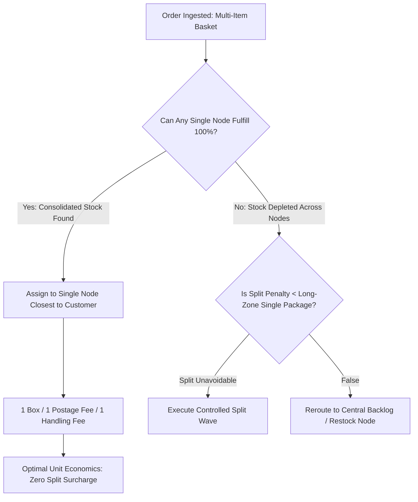
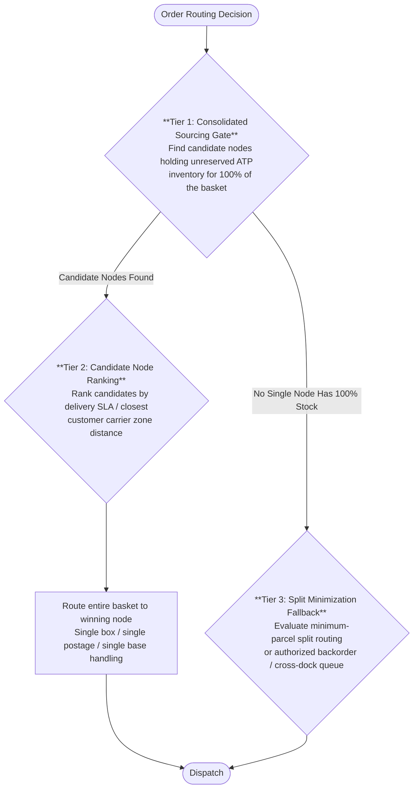
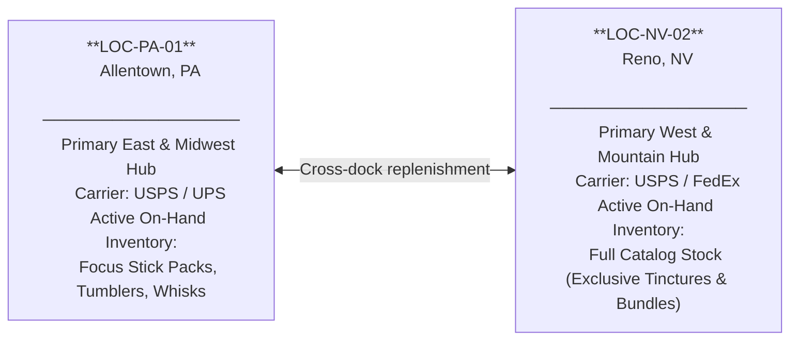

# Bi-Coastal Multi-Node Logistics & Freight Cost Optimization

---

## 1. Executive Summary & The Logistics Trade-Off

### 1.1 The Operational Challenge
In direct-to-consumer e-commerce scaling past $3M GMV, shipping costs represent the single largest variable operating expense outside of marketing. Brands distribute inventory across multi-node networks—such as East Coast (**Allentown, PA**) and West Coast (**Reno, NV**)—to reduce transit times and lower carrier zone rates.

However, direct-to-consumer catalogs with multi-item shopping baskets face a dangerous financial hazard: **Split-Shipment Surcharge Leakage**.

When a customer orders multiple items (e.g., *Focus Stick Packs* (30-Pack) + *Adaptogen Tincture* (60ml) + *Precision Tumbler*):
- If the routing algorithm blindly prioritizes **"Closest Location"**, it may fulfill Item 1 from Allentown (Zone 2) and Items 2 & 3 from Reno (Zone 2).
- **The Financial Trap**: The merchant now pays **two independent carrier base postage charges** and **two independent 3PL pick/pack/box handling fees**.
- The cost of the second package almost always wipes out any zone savings gained from physical proximity.



---

## 2. Fulfillment Economics & Carrier Rate Modeling

### 2.1 Scenario Handling Fee Structure
The model assigns the following handling fees to each parcel. These are scenario inputs, not a verified ShipBob quotation:

| Fee Component | Single Package Order | Split Shipment (Package 1) | Split Shipment (Package 2) | Total Split Cost |
|---|---|---|---|---|
| **Base Order Fulfillment** | $2.50 | $2.50 | $2.50 | $5.00 |
| **Additional Pick Fee** | $0.80 (2 extra picks) | $0.00 (single pick) | $0.40 (1 extra pick) | $0.40 |
| **Packaging & Corrugate** | $0.80 | $0.80 | $0.80 | $1.60 |
| **Total 3PL Handling** | **$4.10** | **$3.30** | **$3.70** | **$7.00 (+$2.90 penalty)** |

### 2.2 Scenario Carrier Cost Inputs

The values below are fixed model inputs, not verified current tariffs or actual Denver ZIP-pair quotes. A carrier quotation additionally requires service, origin/destination ZIPs, packed weight, dimensions, effective date and surcharge treatment.

| Destination Zone | Distance from Origin | Standard USPS Ground Advantage | Priority Mail Commercial |
|---|---|---|---|
| **Zones 1–2** | 0 – 150 miles | $5.40 | $7.80 |
| **Zone 3** | 151 – 300 miles | $5.85 | $8.40 |
| **Zone 4** | 301 – 600 miles | $6.40 | $9.10 |
| **Zone 5** | 601 – 1,000 miles | $7.20 | $10.40 |
| **Zone 6** | 1,001 – 1,400 miles | $8.10 | $11.80 |
| **Zone 7** | 1,401 – 1,800 miles | $9.20 | $13.50 |
| **Zone 8** | 1,801+ miles (Cross-Country) | $10.50 | $15.20 |

### 2.3 The Mathematical Breakeven: Consolidated vs. Split

```
Scenario: Customer in Denver, CO (Zone 4 from Reno, Zone 6 from Allentown)
Basket: 2 Units Focus Stick Packs (stocked at Allentown & Reno) + 1 Unit AM Focus Tincture (stocked only at Reno)
```

- **Option A: Naive Split Routing (Line items evaluated independently)**:
  If an unconstrained routing rule assigns Stick Packs to Allentown by default while routing Tincture to Reno due to lack of unreserved Allentown tincture stock:
  - Package 1 from Reno (Zone 4): $6.40 (Carrier) + $3.30 (3PL: $2.50 base + $0.80 packaging) = $9.70
  - Package 2 from Allentown (Zone 6): $8.10 (Carrier) + $3.70 (3PL: $2.50 base + $0.80 packaging + $0.40 extra pick) = $11.80
  - **Total Cost**: **$21.50**

- **Option B: Consolidated Routing (Reno fulfills all 3 units)**:
  - Single Package from Reno (Zone 4): $6.40 (Carrier) + $4.10 (3PL: $2.50 base + $0.80 packaging + 2×$0.40 extra picks) = **$10.50**
  - **Net Financial Advantage**: **$11.00 SAVED** ($21.50 split vs. $10.50 consolidated) by shipping from Reno in a single box!

> **Core Axiom**: Under the printed scenario inputs, a single consolidated package across higher model buckets (e.g. Zone 8 consolidated at $14.60) remains cheaper than two split packages in lower zones (e.g. two Zone 2 shipments totaling $17.80, saving $3.20).

---

## 3. Algorithmic Routing Waterfall Architecture

The cost comparison makes parcel count a routing concern alongside proximity. The waterfall below first checks whether one node can fulfill the entire basket, then ranks eligible nodes or evaluates a split or backorder.

To systematically contain freight leakage, the Shopify Plus routing engine was configured with a strict, hierarchical 3-tier rule stack:



### 3.1 Network Topology & Inventory Availability Profile

Both nodes are authorized for distributed fulfillment across all 12 catalog variants. However, active Available-to-Promise (ATP) inventory fluctuates dynamically based on production batch cycles; during the evaluated scenario, on-hand Tincture and Starter Bundle inventory was allocated exclusively to Reno (`LOC-NV-02`).



---

## 4. Empirical A/B Simulation: 500-Order Cohort

To quantify the cost of fewer splits, the following cohort comparison holds the baskets constant and varies parcel counts and aggregate freight inputs. It then distinguishes the cohort result from projections at other operating volumes.

> [!NOTE] **Scenario Inputs & Modeling Context:**  
> The 500-order cohort ($41,200 GMV, average order value $82.40) uses fixed freight inputs and a declared parcel-handling model. Published tariff and actual ZIP-zone verification are outside this execution. Results reflect conditional model calculations comparing naive independent-line proximity against consolidated multi-node waterfall rules.

### 4.1 Cohort Parameters & Geography
- **Cohort Size**: 500 multi-item orders
- **Geographic Mix**:
  - East Coast (USPS Zones 1–4 East): 42% (210 orders)
  - West Coast (USPS Zones 1–4 West): 34% (170 orders)
  - Central / Midwest (USPS Zones 5–6): 24% (120 orders)
- **Basket Complexity**:
  - 2-item orders: 62% (310 orders)
  - 3+ item orders: 38% (190 orders)

### 4.2 Benchmark Results: Model Alpha (Naive) vs. Model Beta (Optimized)

The reproducible paired-basket model assigns exactly three units to each of the 190 three-plus orders. Together with 310 two-unit orders, this yields 1,190 picked units in both alternatives. Split counts and aggregate freight totals are scenario inputs; no per-order routing engine result or historical ledger is inferred.

| Metric | Model Alpha | Model Beta | Difference |
|---|---:|---:|---:|
| Split orders | 157 (31.4%) | 41 (8.2%) | 116 fewer; 23.2 percentage points |
| Parcels | 657 | 541 | 116 fewer |
| Picked units | 1,190 | 1,190 | Same baskets |
| Handling: $2.90P + $0.40U | $2,381.30 | $2,044.90 | $336.40 |
| Aggregate freight input | $5,190.20 | $4,529.20 | $661.00 |
| Total modeled fulfillment | $7,571.50 | $6,574.10 | **$997.40** |
| Cost/order | $15.1430 | $13.1482 | **$1.9948** |

Relative split reduction is 116/157 = 73.89%. The same-basket handling difference is 116 × $2.90 = $336.40. No unitemized packaging surcharge is included.

### 4.3 Annualized Business Impact

At a separate planning scale of 1,000 orders/day for 365 days, $1.9948 × 365,000 = **$728,102/year**. At 1,700 orders/month, the same unrounded cohort average gives **$3,391.16/month**, or **$40,693.92** over twelve identical months. These are separate scale scenarios, not realized savings.

### 4.4 Reproducible Routing-Cost Evidence

The [freight suite](../evidence/freight/summary.md) asserts feasible fixture reservations, complete baskets, parcel-level handling, the $21.50 versus $10.50 controlled comparison, and the cohort/scale calculations. The three-unit comparison forces a split against feasible Reno consolidation; it does not establish that a closest-node policy would choose the split.

The tariff file identifies public reference candidates, but lacks a verified dated tariff snapshot or ZIP-zone quote. Its monetary values remain scenario inputs. Source verification is reported as skipped, rather than passed. No carrier invoice, negotiated discount or physical misrouting outcome is established.

---
