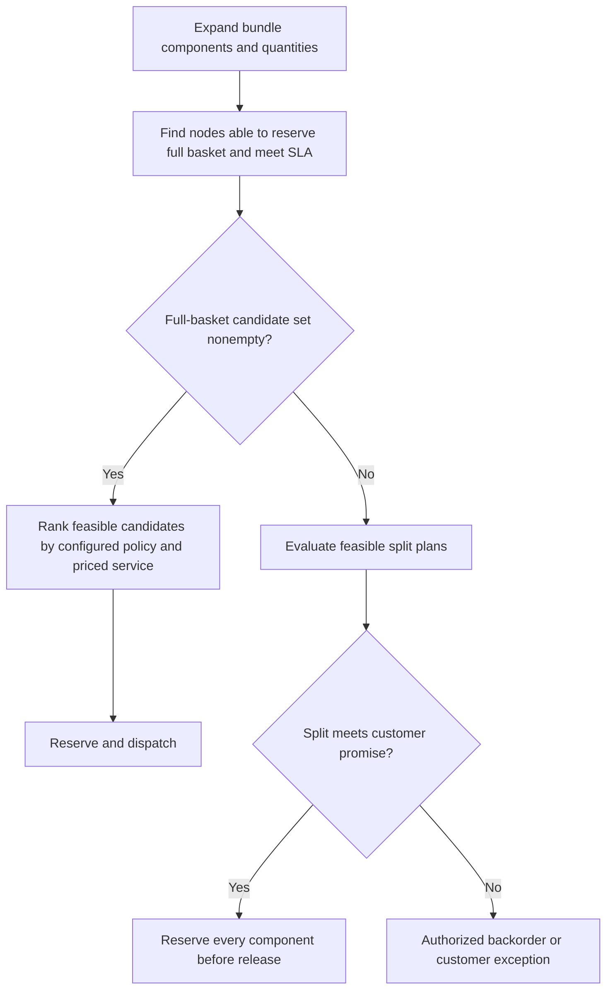

# Multi-Node Routing & Freight Economics

> **Empirical staging simulation.** Synapse Botanicals is a technical operations sandbox used to stress-test e-commerce failure modes with synthetic customer and order fixtures. Commercial charges and financial outcomes are scenario inputs and calculations. The verification section distinguishes supplied trace excerpts, reproducible model results, and acceptance criteria for the designed controls. No production customer data or live fulfillment is represented.

## 1. Executive Context & Failure Mode

Closest-node routing can produce two parcels where one farther node could fulfill the complete basket. The decision balances reservation feasibility, service promise and total fulfillment cost. Minimizing splits is a useful policy, but is not proof of minimum landed cost for every order.

Nodes are Allentown (`LOC-PA-01`) and Reno (`LOC-NV-02`). Neither has unconditional catalog-wide availability. The examples use synthetic inventory conditions, not permanent node exclusivity or verified postal ZIP-pair quotes.

## 2. Governance & Architecture Protocol

### 2.1 Cost inputs

All rates are fixed simulation inputs in USD, not current USPS tariffs or ShipBob contract quotations. Lane qualification in an integration records origin/destination ZIPs, carrier/service, packed weight and dimensions, applicable weight tier and included/excluded surcharges. The following modeled rate buckets isolate the routing effect; they are not a claim that one price applies to every parcel below one pound.

| Modeled zone bucket | Ground scenario postage | Priority scenario postage |
|---|---:|---:|
| 1–2 | $5.40 | $7.80 |
| 3 | $5.85 | $8.40 |
| 4 | $6.40 | $9.10 |
| 5 | $7.20 | $10.40 |
| 6 | $8.10 | $11.80 |
| 7 | $9.20 | $13.50 |
| 8 | $10.50 | $15.20 |

Standard handling includes $2.50 per parcel, first pick included, $0.80 corrugate and $0.40 per additional pick. For P parcels and U picked units: `H = 2.90P + 0.40U`. Protective packing used in other experiments adds $0.40 per parcel and is excluded from this routing experiment.

| Three-unit basket | One parcel | Two parcels: two units + one unit |
|---|---:|---:|
| Base fees | $2.50 | $5.00 |
| Additional picks | $0.80 | $0.40 |
| Corrugate | $0.80 | $1.60 |
| Handling total | **$4.10** | **$7.00** |

A second parcel adds $2.90 handling for the same total units, plus its incremental postage.

### 2.2 Reservation and routing sequence



Native Shopify location rules and a custom total-cost optimizer are different implementations. The model uses minimize-splits priority, then service feasibility and location ranking. A deployed optimizer must identify the app/Function/adapter and its cost inputs. Recheck reservations before release; no routing diagram makes a stock read atomic.

## 3. Decision Matrix & Reproducible Economics

### 3.1 Three-unit lane comparison

The modeled basket contains two NeuroFocus units and one Ashwagandha unit (`SYN-AT-001`). Inventory input: Allentown can reserve all three; Reno can reserve the two NeuroFocus units but not the tincture. This stock condition does not apply automatically to another order or to `SYN-TNCT-AM`.

| Plan | Freight | Handling | Total |
|---|---:|---:|---:|
| Reno: two units, modeled zone 4 | $6.40 | $3.70 | $10.10 |
| Allentown: one unit, modeled zone 6 | $8.10 | $3.30 | $11.40 |
| **Split combined** | **$14.50** | **$7.00** | **$21.50** |
| **Allentown: all three** | **$8.10** | **$4.10** | **$12.20** |

Savings: $21.50−$12.20=**$9.30**. No specific Denver zone assignment is inferred. With the same table, one zone-8 parcel is $10.50+$4.10=$14.60, versus two zone-2 parcels at $10.80+$7.00=$17.80: a separate **$3.20** difference. Lane economics, rather than a universal consolidation claim, determine the choice.

### 3.2 Five-hundred-order model

The synthetic cohort has 310 two-unit orders and 190 three-unit orders: **1,190 picked units** across 500 orders. This explicit three-unit assumption defines the reproducible model. Alpha has 157 two-parcel orders; Beta has 41. All other orders use one parcel. Aggregate freight charges are supplied scenario inputs, not reconstructed carrier invoices.

| Metric | Alpha | Beta | Difference |
|---|---:|---:|---:|
| Orders | 500 | 500 | Same baskets |
| Split orders | 157 (31.4%) | 41 (8.2%) | 116 fewer |
| Parcels | 657 | 541 | 116 fewer |
| Picked units | 1,190 | 1,190 | 0 |
| Handling: 2.90P+0.40U | $2,381.30 | $2,044.90 | $336.40 |
| Freight input | $5,190.20 | $4,529.20 | $661.00 |
| Total fulfillment | **$7,571.50** | **$6,574.10** | **$997.40** |
| Cost/order | $15.1430 | $13.1482 | **$1.9948** |

Relative split reduction is 116/157=**73.89%**; absolute reduction is **23.2 percentage points**. Cohort GMV is $41,200, so AOV=$82.40. This is separate from the store's $85–$120 planning range.

```python
from decimal import Decimal as D
orders, units = 500, 310 * 2 + 190 * 3
alpha = D('2.90') * 657 + D('0.40') * units + D('5190.20')
beta = D('2.90') * 541 + D('0.40') * units + D('4529.20')
saving = alpha - beta
assert saving == D('997.40')
assert saving / orders == D('1.9948')
assert saving / orders * 365000 == D('728102.0000')
```

At 1,000 orders/day for 365 days, constant basket mix, costs and routing effect imply **$728,102/year**. This is an annualized model, not realized merchant savings. A delivery-promise violation, different weight tiers or added fulfillment charges changes the result.

## 4. Empirical Verification & Run Sheet

The supplied staging study compares proximity-first and consolidation-first routing. The table and code above define an independently reproducible cost model; the aggregate freight inputs do not independently establish provider pricing or per-order routing success.

| Test | Acceptance evidence |
|---|---|
| One feasible full-basket node | Reservation and selected shipment plan |
| Several feasible nodes | Candidate ranking, service and cost comparison |
| No full-basket node | Feasible split or explicit backorder decision |
| Inventory changes during routing | Failed reservation triggers re-evaluation |
| Bundle | Component reservations, not parent-SKU count alone |
| Freight reconciliation | Parcel weights/services and fee lines match input ledger |
| Cohort parity | Same basket units and promise constraints in both models |

Operational verification records each order's SKU quantities, candidate availability, reservations, parcel plan, lane quote and resulting cost. The embedded model establishes the arithmetic; authenticated routing and carrier-rate verification require their actual recorded responses.

## 5. Technical References

- [Shopify order-routing documentation](https://help.shopify.com/en/manual/fulfillment/setup/order-routing) — deployed rule availability and behavior must match the selected configuration.
- [USPS Postal Explorer](https://pe.usps.com/) — service, zone and price qualification; this dossier uses scenario rates.
