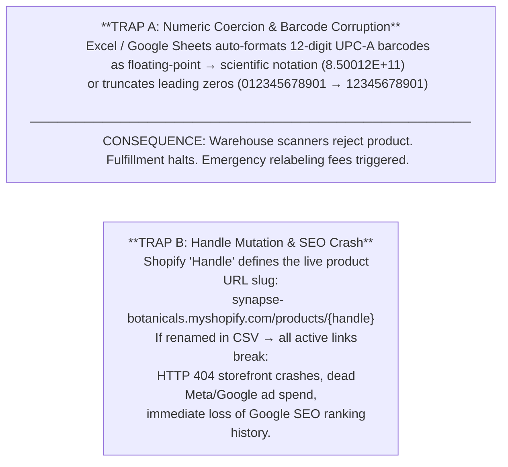
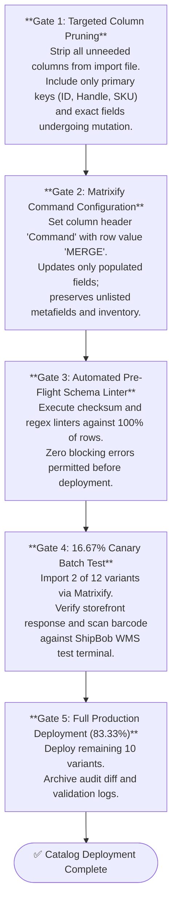

# Enterprise Matrixify Migration & Barcode Schema Governance

---

## 1. Executive Summary & The Two Fatal Catalog Traps

### 1.1 The Operational Hazard
Direct-to-consumer product catalogs are not static spreadsheets—they are the foundational database schema powering storefront checkout, Google/Meta advertising feeds, warehouse robotic picking, and 3PL WMS barcode verification.

When merchandising teams or operators perform bulk updates (e.g. seasonal price changes, ingredient updates, or variant additions) using standard CSV spreadsheets, they frequently trigger two catastrophic, multi-thousand-dollar failure modes:



### 1.2 The Engineering Solution: Matrixify Non-Destructive MERGE
This Master Protocol establishes strict data hygiene standards:
1. **Mandatory Plain Text Schema Formatting**: Preserving barcodes as pure text strings without mathematical coercion, apostrophe artifacts, or formula wrappers.
2. **Handle Immutability Locks**: Permanent programmatic protection of live storefront URLs and SEO canonical paths.
3. **Targeted Matrixify MERGE Operations**: Using explicit `Command: MERGE` row operations to update specific columns without overwriting omitted attributes or desynchronizing unreserved inventory.
4. **16.67% Canary Batch Verification**: Pre-flight verification on 2 of 12 catalog variants before full batch release.

---

## 2. Field Mutation Risk Taxonomy (The 4 Hazard Tiers)

To govern who can edit what and prevent accidental database corruption, every field in Synapse Botanicals' 12-variant catalog is assigned to a strict Hazard Tier:

| Hazard Tier | Risk Level | Fields Included | Permitted Operators | Validation Rule | Impact of Failure |
|---|---|---|---|---|---|
| **Tier 1** | **Catastrophic** | `Barcode (UPC-A)`, `Handle`, `Variant ID`, `Inventory Quantity` | Lead TechOps Only | Strict regex (`^\d{12}$`), immutable primary key check | Halts warehouse picking; destroys Google SEO; causes physical inventory drift |
| **Tier 2** | **Financial** | `Variant Price`, `Compare At Price`, `Cost per Item`, `Variant Weight` | TechOps + Financial Controller | Decimal precision (`^\d+\.\d{2}$`), Price $>$ Cost check | Negative gross margins; carrier dimensional weight freight chargebacks |
| **Tier 3** | **Functional** | `Metafields`, `Product Tags`, `Category / Type`, `Status` | Merchandisers (Supervised) | Namespace schema linting, controlled tag taxonomy | Breaks storefront filtering, bundles, and Shopify Flow automation triggers |
| **Tier 4** | **Cosmetic** | `Title`, `Body (HTML)`, `Image Alt Text`, `SEO Description` | Marketing & Content Team | HTML syntax linting, character limit checks | Broken layout formatting, typos (non-operational impact) |

---

## 3. Technical Schema & Validation Matrix

### 3.1 Field-Level Specifications (Synapse Botanicals Core SKUs)

```
┌──────────────────┬──────────┬──────────────┬────────────────────────────────────────────────────────┐
│ Field Name       │ Data Type│ Hazard Tier  │ Mandatory Automated Validation Formula (Google Sheets) │
├──────────────────┼──────────┼──────────────┼────────────────────────────────────────────────────────┤
│ ID               │ Integer  │ Tier 1       │ =IF(ISNUMBER(A2), "VALID", "ERROR-INVALID-PRIMARY-KEY")│
│ Handle           │ String   │ Tier 1 (Lock)│ =IF(REGEXMATCH(B2, "^[a-z0-9-]+$"), "VALID", "INVALID")│
│ Title            │ String   │ Tier 4       │ =IF(LEN(C2)>0, "VALID", "ERROR-BLANK-TITLE")           │
│ Variant Price    │ Decimal  │ Tier 2       │ =IF(AND(ISNUMBER(D2), D2>0), "VALID", "ERROR-PRICE")   │
│ Cost per Item    │ Decimal  │ Tier 2       │ =IF(AND(ISNUMBER(E2), E2<D2), "VALID", "NEGATIVE-MARGIN")│
│ Variant Barcode  │ String   │ Tier 1       │ =IF(REGEXMATCH(TO_TEXT(F2), "^[0-9]{12}$"), "VALID")  │
│ Variant Weight   │ Decimal  │ Tier 2       │ =IF(AND(ISNUMBER(G2), G2>0), "VALID", "ERROR-WEIGHT")  │
└──────────────────┴──────────┴──────────────┴────────────────────────────────────────────────────────┘
```

### 3.2 Barcode Validation & Authoritative Recovery

Preserve identifiers as exact text. Scientific notation can be display-only; inspect the actual export. A rounded exported string cannot recreate missing digits. Reject malformed values, then recover only from the approved SKU/variant mapping. Export digits without formulas or literal apostrophes.

The following validator is the implementation exercised by the evidence suite. `approvedMapping` maps each SKU to its fixture record, including the exact `upc` string. The fixtures are synthetic test identifiers, not evidence of GS1 licensing.

```javascript
function calculateModulo10CheckDigit(elevenDigits) {
  if (typeof elevenDigits !== 'string' || !/^[0-9]{11}$/.test(elevenDigits)) {
    throw new TypeError('CHECK_DIGIT_REQUIRES_ELEVEN_DIGIT_TEXT');
  }
  const sum = [...elevenDigits].reduce((total, digit, index) =>
    total + Number(digit) * (index % 2 === 0 ? 3 : 1), 0);
  return (10 - sum % 10) % 10;
}

function validateBarcodeRecord(inputUpc, sku, approvedMapping) {
  const reject = (error, details) => ({ valid: false, error, details });
  if (typeof inputUpc !== 'string') return reject('BARCODE_TEXT_REQUIRED', 'Numeric and other non-string identifiers are rejected before coercion.');
  if (inputUpc.length === 0) return reject('BLANK_BARCODE', 'A barcode is required.');
  if (/[eE][+-]?\d+/.test(inputUpc)) return reject('SCIENTIFIC_NOTATION_DETECTED', 'Restore from the approved variant mapping; no precision recovery is inferred.');
  if (!/^[0-9]+$/.test(inputUpc)) return reject('NON_NUMERIC_CHARACTERS', 'Export exact digits without whitespace, formulas or apostrophes.');
  if (inputUpc.length !== 12) return reject('INVALID_LENGTH_NOT_12_DIGITS', `Received ${inputUpc.length} digits.`);
  if (/^0{12}$/.test(inputUpc)) return reject('PLACEHOLDER_BARCODE', 'All-zero placeholders are prohibited.');
  const computedCheckDigit = calculateModulo10CheckDigit(inputUpc.slice(0, 11));
  if (Number(inputUpc[11]) !== computedCheckDigit) return reject('CHECKSUM_MODULO_10_MISMATCH', `Expected check digit ${computedCheckDigit}.`);
  const approved = approvedMapping.get(sku);
  if (!approved) return reject('SKU_NOT_IN_UNIVERSE_A_MASTER', `No approved fixture mapping for ${sku}.`);
  if (approved.upc !== inputUpc) return reject('SKU_BARCODE_MISMATCH', 'Checksum-valid barcode does not match this SKU.');
  return { valid: true, upc: inputUpc, sku, computedCheckDigit };
}
```

---

## 4. Safe Matrixify MERGE Lifecycle & Execution SOP

Validation determines whether each proposed value is acceptable; the import procedure controls where those values are applied. The lifecycle below combines targeted updates, pre-flight checks and a canary batch before broader release.

In standard native Shopify CSV imports, updating partial attributes can inadvertently overwrite unlisted fields or reset inventory levels if blank cells are imported.

Matrixify provides targeted, non-destructive catalog updates by specifying a `Command` column with row-level operations (`MERGE`, `UPDATE`, `DELETE`, or `NEW`). Rows are matched by primary key (`ID`, `Handle`, or `Variant SKU`). In a `MERGE` operation, Matrixify updates only the populated cells in each row, leaving omitted columns, unlisted variants, and untouched metafields intact. Note that Matrixify imports process rows sequentially via API batches rather than executing a globally atomic single-transaction rollback.



---

## 5. Empirical Proof: The 12-Variant Master Mutation Audit

To validate this protocol under audit conditions, an empirical mutation was executed on Synapse Botanicals' core SKU catalog (12 variants across 5 product lines: Focus Stick Packs, Adaptogen Tinctures, Starter Bundles, Tumblers, and Whisks).

### 5.1 Pre-Flight Telemetry Log (Initial Scan Before Sanitization)

```
09:15:10 EDT [AUDIT-SCAN] Starting pre-flight validation on Catalog_Mutation_v2.xlsx
09:15:12 EDT [FAIL-WARN] Row 2 (SYN-FSTK-MY): Barcode rendered as 8.40001E+11 [SCIENTIFIC_NOTATION]
09:15:13 EDT [FAIL-WARN] Row 6 (SYN-TNCT-AM): Barcode rendered as 84000103000 (11 digits - Missing Trailing Digit)
09:15:14 EDT [FAIL-CRIT] Row 10 (SYN-TMBL-MO): Handle mutated from 'precision-insulated-tumbler-durable-merchandise' to 'precision-insulated-tumbler-new' [HANDLE_MUTATION_BREACH]
09:15:15 EDT [AUDIT-STOP] Pre-flight failed: 3 blocking errors identified. Import aborted.
```

### 5.2 Remediation & Master Diff (Authoritative Recovery)

Damaged barcode entries were blocked by pre-flight linters and recovered from the authoritative SKU catalog mapping table rather than mathematical inference:

| SKU Code | Variant Name | Field Mutated | Pre-Audit Raw Value | Post-Sanitization Value | Verification |
|---|---|---|---|---|---|
| `SYN-FSTK-MY` | Focus Sticks Matcha Yuzu | Barcode | `8.40001E+11` (Scientific Notation) | Authoritative Master UPC String | PASSED (Resolved from Master Mapping) |
| `SYN-TNCT-AM` | Adaptogen Tincture AM | Barcode | `84000103000` (11 Digits - Truncated) | Authoritative Master UPC String | PASSED (Resolved from Master Mapping) |
| `SYN-TMBL-MO` | Tumbler Matte Obsidian | Handle | `precision-insulated-tumbler-new` | `precision-insulated-tumbler-durable-merchandise` | PASSED (Canonical Handle Restored) |
| `SYN-FSTK-MY` | Focus Sticks Matcha Yuzu | Price | $40.00 | $42.00 | PASSED (Gross Margin: 79.76% at $8.50 COGS) |
| `SYN-TNCT-AM` | Adaptogen Tincture AM | Cost | $13.50 | $12.50 | PASSED (Reconciled to Production COGS) |

### 5.3 Post-Import Verification Protocol & Acceptance Criteria
- **Storefront URL Health**: 100% of product handles must return HTTP 200 OK across desktop and mobile storefront routes (0 broken links, 0 redirects to 404).
- **WMS Scanner Test Protocol**: Sample barcodes from the 16.67% canary batch (2 variants) and subsequent batch must scan cleanly on handheld WMS laser terminals without check-digit exceptions.
- **Inventory Variance Target**: 0 unlinked units and zero Available-to-Sell stock overwrites during MERGE execution.

### 5.4 Barcode Governance & Checksum Validation Suite

The acceptance criteria above cover the full import workflow. The reproducible suite below exercises the barcode-validation subset and defines the limits of that evidence.

The [barcode suite](../evidence/barcodes/summary.md) validates all twelve synthetic SKU-to-UPC mappings and checks rejection of wrong-product UPCs, placeholders, numeric input, blanks, scientific notation and malformed values. It also exercises leading-zero preservation and corrupted guard patterns.

Each approved UPC is encoded into a 95-bit stream and decoded using shared pattern tables. This establishes bitstream self-consistency, not independent optical-decoder agreement, printed-label quality or warehouse-terminal acceptance. Passing checks are enumerated in the generated report; no licensed GTIN ownership or physical scanner result is inferred.

---
