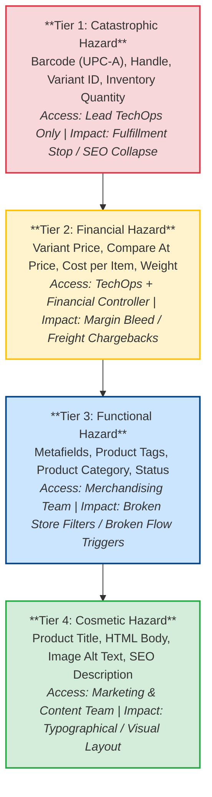
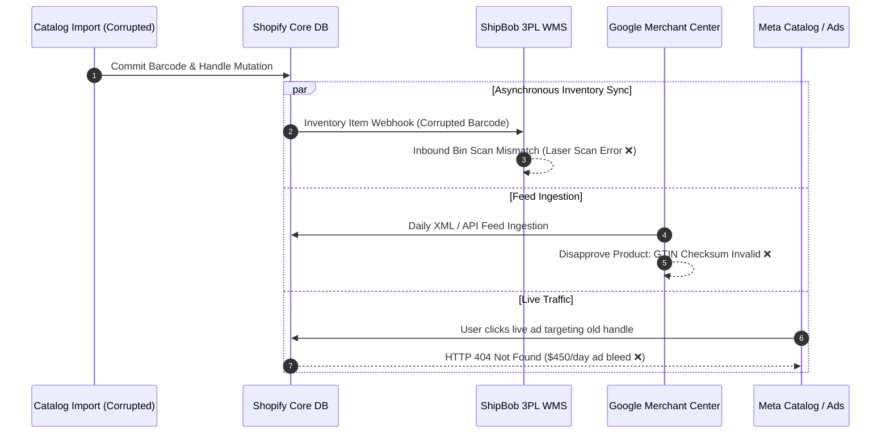
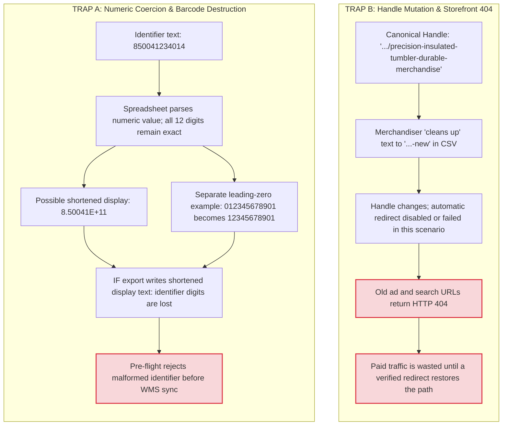
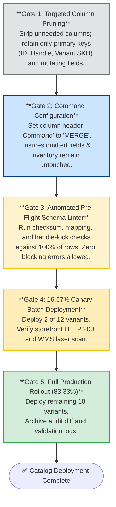

# The File Looked Perfect. Three Cells Were Already Wrong.

**How a five-second pre-flight check kept a corrupted bulk update out of the store, with zero rows committed**

*Synapse Botanicals Systems Architecture | Riovic Matthew | Technical Case Study — Domain 3*

---

## 1. Tidy on Screen, Wrong in the File: The Silent Spreadsheet Rewrite

*How malformed barcode fixtures and an unauthorized handle change expose a catalog release, and how a reconstructed five-second stop illustrates the gate that must block it.*

A spreadsheet is built to present data to a human, not to protect the integrity of a relational record. That design choice is harmless when the data is a budget, but dangerous when the data is an e-commerce product catalog.

A catalog connects storefront checkout, advertising feeds, warehouse scanners, and canonical product URLs. A UPC-A contains twelve digits, but those digits identify a product; they do not describe a quantity. IEEE 754 binary64 can represent every twelve-digit integer exactly. The operational danger comes when a spreadsheet drops a leading zero or an export writes a shortened scientific-notation display back into the file. The screen can look tidy while the identifier crossing into the WMS has changed.

This case study uses Synapse Botanicals' 12-variant catalog and synthetic malformed identifiers to test that boundary. The `8.40001E+11` and `84000103000` fixtures are deliberately bad inputs, not recorded transformations of the approved `850041...` identifiers. The five-second workbook timeline is a reconstructed scenario; the executable evidence proves barcode validation and mapping behavior, not a live Excel export or Matrixify deployment.

```
       09:15:10 EDT                                             09:15:15 EDT
    Audit Scan Begins                                      Circuit Breaker Trips
───────────●──────────────────────────────────────────────────────────●─────────────►
           │                                                          │
           ├── 09:15:12: Row 2 (SYN-FSTK-MY) Barcode -> 8.40001E+11   │
           ├── 09:15:13: Row 6 (SYN-TNCT-AM) Barcode -> 11 Digits     │
           └── 09:15:14: Row 10 (SYN-TMBL-MO) Handle Renamed          │
           │                                                          │
           └──────────────── 5 Seconds to Total Abortion ─────────────┘
                                [ZERO BYTES COMMITTED]
```

### 1.1 The Five-Second Stop

In the reconstructed October 24, 2026 trace, the pre-flight gate begins at 09:15:10 EDT and inspects a proposed 12-variant update across five product lines. Three injected defects block the release:
* **Row 2 (`SYN-FSTK-MY`):** The barcode field contains the malformed scientific-notation fixture `8.40001E+11`.
* **Row 6 (`SYN-TNCT-AM`):** The barcode field contains the eleven-digit fixture `84000103000`. No checksum repair can prove which product it identifies.
* **Row 10 (`SYN-TMBL-MO`):** The canonical handle has changed from `precision-insulated-tumbler-durable-merchandise` to `precision-insulated-tumbler-new`.

The scenario stops the release at 09:15:15 EDT. No live Shopify or Matrixify import was executed. The control is fail-closed: a blocked file never reaches the production import boundary.

If released, the malformed identifiers could break the WMS product match. The handle-change branch separately assumes that automatic redirect creation was disabled or failed, leaving the old product URL at HTTP 404 for 48 hours. Under those declared conditions, Section 3 prices **$3,900.00 in modeled incident exposure**, including **$900.00 in wasted paid media**.

> [!CAUTION]
> **Scenario and evidence scope.** The barcode suite executes locally against synthetic GTIN fixtures; the financial model calculates declared costs. The workbook timeline is reconstructed. No live spreadsheet coercion, Matrixify import, production store, GS1 ownership, or physical warehouse scanner result is claimed. Section 12 separates executed checks from deployment specifications.

| Incident Parameter | Baseline Parameter Value | Architectural Significance |
|---|---|---|
| **Operator Profile** | Dr. Aris Thorne (`aris.thorne@example.com`) | Lead Catalog & ERP Systems Architect managing bulk Matrixify schema transformations. The Field Mutation Risk Taxonomy in Section 2.1 defines permissions by field. It reserves Tier 1 edits for Lead TechOps and lists TechOps and the Financial Controller as permitted operators for Tier 2. |
| **Catalog Scope** | `Catalog_Mutation_v2.xlsx`: 12 variants across 5 product lines (Focus Sticks, Adaptogen Tinctures, Bundles, Tumblers, Whisks) | Foundational catalog master powering checkout, 3PL WMS, and ad channels. |
| **Injected Catalog Defects** | Two malformed barcode fixtures (scientific notation and eleven-digit text) plus one unauthorized handle change | Three blocking defects; the gate checks stored values rather than trusting spreadsheet display. |
| **The Potential Blast Radius** | $3,900.00 modeled out-of-pocket toll per release; $7,800/year at 8 bulk updates and a 25% error rate (Section 3) | Relabeling fees, wasted paid media clicks, and emergency TechOps intervention. |
| **The 5-Second Circuit Breaker** | 09:15:10 to 09:15:15 EDT; import aborted with zero database commits | Automated linter terminated execution before Shopify Admin was contacted. |

---

## 2. Every Column Is a Lever: Four Hazard Tiers and Role-Based Access

*How catalog fields are ranked by the damage a wrong value causes, and why the import file itself acts as the permission boundary.*

Every column in a catalog file is a lever on the live store, and the levers are not equally heavy.

The `Variant ID` and the `Handle` are the primary keys other systems use to locate a product. The `Barcode` is the physical label the warehouse uses to pick and pack it. The `SKU` joins them. Change a product `Title` and a page reads awkwardly. Change a barcode and a pack bench can no longer verify the carton. Synapse Botanicals therefore assigns every field in the 12-variant catalog to one of four hazard tiers, ranked by the operational damage a wrong value causes, and restricts each tier to the smallest role with a legitimate reason to edit it.



### 2.1 Field Mutation Risk Taxonomy

| Hazard Tier | Risk Level | Fields Included | Permitted Operators | Validation Rule | Impact of Failure |
|---|---|---|---|---|---|
| **Tier 1** | **Catastrophic** | `Barcode (UPC-A)`, `Handle`, `Variant ID`, `Inventory Quantity` | **Lead TechOps only** | Strict regex (`^\d{12}$` for barcodes), immutable primary-key check | Halts warehouse picking; destroys search ranking; causes physical inventory drift. |
| **Tier 2** | **Financial** | `Variant Price`, `Compare At Price`, `Cost per Item`, `Variant Weight` | **TechOps + Financial Controller** | Decimal precision (`^\d+\.\d{2}$`); price must exceed cost | Negative gross margins; carrier dimensional-weight freight chargebacks. |
| **Tier 3** | **Functional** | `Metafields`, `Product Tags`, `Category / Type`, `Status` | **Merchandisers (supervised)** | Namespace schema linting; controlled tag taxonomy | Breaks storefront filtering, bundle logic, and automated Shopify Flow triggers. |
| **Tier 4** | **Cosmetic** | `Title`, `Body (HTML)`, `Image Alt Text`, `SEO Description` | **Marketing & Content Team** | HTML syntax linting; character-limit checks | Broken layout formatting, typos (zero operational or physical fulfillment impact). |

### 2.2 Least Privilege: In Bulk Imports, the File Is the Permission

The tiers apply the principle of least privilege directly to catalog administration: each role receives the minimum write access its work requires and nothing more.

The principle is usually discussed in terms of user accounts and IAM permissions, but in a bulk-import workflow **the file itself is the permission**. Matrixify, the Shopify bulk-import application Synapse uses, accepts a `Command` column on every row. Under `MERGE`, updates are scoped strictly to the columns present in the file. Crucially, **omitting an unmutated column entirely (Targeted Column Pruning)** is the primary architectural safety control: if an unmutated column is left in the spreadsheet with empty cells, those blank cells can inadvertently overwrite or wipe live values. Physically stripping unmutated columns guarantees the import is physically incapable of altering unlisted fields. A marketing import file containing only `ID`, `Title`, `Body (HTML)`, `Image Alt Text`, and `SEO Description` cannot alter a barcode, a price, or a URL handle because those columns do not exist in the file.

The same logic protects against spreadsheet coercion: silent mathematical conversion can only damage columns that actually exist in the file. Tier 1 columns appear in an import file only as match keys, and the linter verifies every match key against the canonical registry before execution proceeds. When the linter reports defects in more than one tier, the lowest-numbered tier is resolved first, because it carries the largest blast radius.

Understanding the tier hierarchy raises the natural question: what does failure actually cost? Section 3 models that figure to the dollar.

---

## 3. One Bad Release, $3,900 Out of Pocket: The Modeled Blast Radius

*A deterministic cost model for one unmitigated release, annualized by update frequency and error rate, plus the costs the ledger deliberately leaves out.*

An engineering control is only worth building if the failure it prevents carries a real financial cost. The model below prices an unmitigated release of the corrupted file that the gate intercepted. The model is deterministic: every input is a stated operational assumption, and every output is reproducible arithmetic.

### 3.1 Model Inputs

| Input | Value | Operational Domain |
|---|---|---|
| Units in inventory exposed to corrupted barcode values | 1,000 across Reno and Allentown fulfillment nodes | Trap A: barcode corruption |
| 3PL manual thermal over-labeling fee | $2.20 per unit | Trap A: barcode corruption |
| Daily paid-media spend (Meta & Google Shopping) | $450.00 per day | Trap B: handle mutation |
| Duration of HTTP 404 on the product URL | 48 hours (2 days), with automatic handle redirect creation disabled or failed | Trap B: handle mutation |
| Emergency TechOps and SEO recovery | $800.00 fixed allocation | Trap B: handle mutation |
| Bulk catalog updates per year | 8 (2 per quarter, seasonal updates) | Annualization |
| Human error rate per bulk update | 25% | Annualization |

### 3.2 Incident Ledger: One Unmitigated Release

When an unmitigated release commits to the primary store, the damage does not stay contained in Shopify. It propagates asynchronously across warehouse inventory systems, product feeds, and live paid-media campaigns:



| # | Cost Line | Operational Driver | Calculation | Cost | Share |
|:---:|---|---|---|:---:|:---:|
| **1** | **Warehouse emergency relabeling** | Manual thermal over-labeling by 3PL on units in bins at Reno and Allentown | 1,000 units × $2.20 | **$2,200.00** | 56.4% |
| **2** | **Wasted paid media (404 ad traffic)** | Meta and Google Shopping campaigns sending clicks to old handle returning HTTP 404 | 2 days × $450.00/day | **$900.00** | 23.1% |
| **3** | **Emergency TechOps and SEO recovery** | Forensic manual 301 redirect mapping, XML sitemap re-indexing, and cache re-submission | Fixed allocation | **$800.00** | 20.5% |
| | **TOTAL OUT-OF-POCKET INCIDENT TOLL** | | $2,200 + $900 + $800 | **$3,900.00** | **100.0%** |

Line 1 is the price of the barcode trap. Lines 2 and 3—totaling $1,700.00—are the price of the handle trap.

Notice an essential operational difference: **the ad-spend line is the only one that grows with detection time**. Every additional day the 404 persists adds $450.00 ($18.75 per hour). The relabeling and technical recovery lines are fixed once the bad file commits. That asymmetry is why the control sits *in front* of the import and not behind it.

### 3.3 Annualized Exposure

```text
Bulk updates per year        = 2 per quarter x 4 quarters      = 8
Expected corrupted releases  = 8 x 25% human error rate        = 2
Annual unmitigated exposure  = 2 x $3,900.00                   = $7,800.00 per year
```

| Human Error Rate | Corrupted Releases per Year | Annual Exposure |
|---|:---:|:---:|
| 12.5% | 1 | $3,900.00 |
| **25.0% (Model Baseline)** | **2** | **$7,800.00** |
| 50.0% | 4 | $15,600.00 |

### 3.4 What the Ledger Does Not Count

The $3,900.00 total prices three declared response costs; it is not a measured loss or an unconditional minimum. It excludes foregone sales contribution, carrier chargebacks, customer-support load, and any recovery lag after redirects deploy. At $42.00 retail and $8.50 COGS, a Focus Sticks Matcha Yuzu sale carries **$33.50 in product gross margin before fulfillment and processing**. Keep that separate from order contribution.

To understand why these failures occur so reliably in unprotected workflows, we must examine the physical and software mechanics of the spreadsheet traps that produce them.

---

## 4. The Tool Did Exactly What It Was Built For: Numeric Coercion and Handle Mutation

*How leading-zero loss or a shortened export can corrupt identifiers, and how a handle change without a working redirect breaks the path from an ad click to checkout.*

The diagram distinguishes plausible failure mechanisms from the synthetic malformed values used by the validator. Numeric storage does not itself round a twelve-digit UPC. The damage occurs when identifier text or its exported representation changes.



### 4.1 Trap A: Numeric Coercion and Optical Scanner Physics

A UPC is an identifier that happens to contain digits. **Binary64 represents every twelve-digit integer exactly**; storing `850041234014` numerically does not itself destroy its trailing digits. The release gate protects against three different hazards:

1. **Display versus storage:** A shortened display such as `8.50041E+11` is not proof that the stored integer changed. Inspect the exported bytes and cell type.
2. **Shortened export text:** If an export or later transformation writes `8.50041E+11` as the identifier, only six significant digits survive in that text. Restore the approved value from the SKU registry; do not infer the missing digits. This is a conditional failure mechanism, not a measured export result in this repository.
3. **Leading-zero loss:** Numeric conversion changes identifier text such as `012345678901` to `12345678901`. Arithmetic preserves the quantity and loses the label. Preserve the barcode as text from ingestion through export.

**The physical consequence:** A UPC-A symbol carries twelve digits in a 95-module pattern, excluding quiet zones. A malformed catalog string can fail label generation or fail the WMS match when a correct physical label is scanned. The offline suite checks text, checksum, product mapping, and a shared-table software round trip. A scanner at the pack bench remains a separate acceptance test.

### 4.2 Trap B: Handle Mutation and SEO Destruction

A Shopify handle is the unique URL slug of a product page, served at `/products/{handle}`. For `SYN-TMBL-MO`, the canonical handle is `precision-insulated-tumbler-durable-merchandise`. Everything outside the store knows the product by that address: search engines, Meta ad campaigns, Google Shopping, influencer affiliate links, and customer bookmarks.

A handle change does not automatically kill the old URL. Matrixify normally creates an old-to-new redirect when it updates a handle. **This incident model assumes that redirect creation was disabled or failed.** With no working redirect, the old URL returns HTTP 404 and the paid click still bills. Two days at $450.00 per day produce the ledger's **$900.00 wasted-media line**.

The gate must verify the complete path: the old URL redirects to the approved new URL, the destination returns HTTP 200, and campaign and analytics references remain attributable. A new slug alone proves neither lost search equity nor erased conversion history. [Matrixify product-handle behavior](https://matrixify.app/documentation/products/)

Unless a redirect is created deliberately, a handle change delivered through a bulk file carries none. That is why a handle rename is an approved redirect project, never a catalog edit (Law 2, Section 10).

### 4.3 Client-Side Guardrails: In-Sheet Validation Formulas

Before a file reaches the automated linter, in-sheet formulas provide immediate visual feedback to catalog operators. Rather than checking every cosmetic field, the template focuses on the three critical hazards where mathematical coercion and margin destruction occur:

| Target Field | Hazard Tier | Validation Formula (Google Sheets) | Enforced Invariant |
|---|---|---|---|
| **Variant Barcode** | Tier 1 | `=IF(AND(ISTEXT(F2), REGEXMATCH(F2, "^[0-9]{12}$")), "VALID", "ERROR-BARCODE-COERCION")` | Must be a pure 12-digit string; fails if coerced to float or stripped of leading zero. |
| **Handle** | Tier 1 (Lock) | `=IF(REGEXMATCH(B2, "^[a-z0-9-]+$"), "VALID", "ERROR-INVALID-HANDLE")` | Must remain an immutable URL slug; flags whitespace, uppercase, or special characters. |
| **Cost per Item** | Tier 2 | `=IF(AND(ISNUMBER(E2), E2<D2), "VALID", "ERROR-NEGATIVE-MARGIN")` | Cost must not exceed selling price (Tier 2 margin defense). |

The barcode formula explicitly tests `ISTEXT` before evaluating the regex. Converting with `TO_TEXT` first would hide the coercion, because a coerced number converted back to text looks identical to text that was never coerced.

> [!NOTE]
> **Why Client-Side Formulas Are Insufficient**: In-sheet formulas provide immediate operator feedback, but they cannot act as an architectural boundary. An operator can paste values over formulas, ignore error flags, or export to CSV where formula cells are stripped. Client-side formulas are visual aids; the authoritative security boundary is the external, immutable pre-flight linter in Section 5.

### 4.4 Schema by Omission

`Inventory Quantity` is Tier 1 and has no formula because no spreadsheet formula can make it safe to import. It is protected by being absent. A field that is not being updated must not exist in the import file, ensuring there is nothing to coerce, overwrite, or desynchronize from the warehouse. Gate 1 in Section 9 enforces this rule on every release.

Knowing what can go wrong is only half the protocol. The validator that enforces the other half uses two deterministic proofs: a Modulo-10 checksum and a relational identity check against the master mapping.

---

## 5. Prove the Math, Then Prove the Product: The Checksum and Mapping Validator

*A worked Modulo-10 check, the validator code, and the approved SKU-to-UPC mapping that decide whether a barcode is both consistent and correct.*

The validator performs two functions: it proves a barcode is internally mathematically consistent, and it proves it belongs to the product it is attached to. The first uses the Modulo-10 algorithm. The second uses the approved SKU-to-UPC master mapping.

### 5.1 The Approved Master Mapping

These twelve fixtures represent the canonical Universe A mapping. Each UPC-A passed the Modulo-10 engine and a 95-bit software round-trip decode ([`evidence/barcodes/summary.md`](../evidence/barcodes/summary.md)):

| SKU Code | Product / Variant Name | Canonical UPC-A | Check Digit |
|---|---|---|:---:|
| `SYN-FSTK-MY` | Focus Stick Packs 30-Pack (Matcha Yuzu) | `850041234014` | **4** |
| `SYN-FSTK-BO` | Focus Stick Packs 30-Pack (Blood Orange) | `850041234021` | **1** |
| `SYN-FSTK-WB` | Focus Stick Packs 30-Pack (Wild Blueberry) | `850041234038` | **8** |
| `SYN-FSTK-GA` | Focus Stick Packs 30-Pack (Crisp Green Apple) | `850041234045` | **5** |
| `SYN-TNCT-AM` | Adaptogen Tincture 60ml (AM Focus / Lion's Mane) | `850041234052` | **2** |
| `SYN-TNCT-PM` | Adaptogen Tincture 60ml (PM Restore / Reishi) | `850041234069` | **9** |
| `SYN-BNDL-MAO` | Starter Bundle (Matcha / AM / Obsidian) | `850041234076` | **6** |
| `SYN-BNDL-BAB` | Starter Bundle (Orange / AM / Bone White) | `850041234083` | **3** |
| `SYN-TMBL-MO` | Precision Insulated Tumbler 500ml (Matte Obsidian) | `850041234090` | **0** |
| `SYN-TMBL-BW` | Precision Insulated Tumbler 500ml (Bone White) | `850041234106` | **6** |
| `SYN-TMBL-SG` | Precision Insulated Tumbler 500ml (Sage Green) | `850041234113` | **3** |
| `SYN-ACC-WHSK` | Micro-Foam Electric Whisk | `850041234120` | **0** |

### 5.2 The JavaScript Implementation

```javascript
/**
 * Computes the GS1 Modulo-10 Check Digit for an 11-digit UPC-A string.
 */
function calculateModulo10CheckDigit(elevenDigits) {
  if (typeof elevenDigits !== 'string' || !/^[0-9]{11}$/.test(elevenDigits)) {
    throw new TypeError('CHECK_DIGIT_REQUIRES_ELEVEN_DIGIT_TEXT');
  }
  const sum = [...elevenDigits].reduce((total, digit, index) =>
    total + Number(digit) * (index % 2 === 0 ? 3 : 1), 0);
  return (10 - (sum % 10)) % 10;
}

/**
 * Validates a barcode string against GS1 math and authoritative SKU mappings.
 */
function validateBarcodeRecord(inputUpc, sku, approvedMapping) {
  const reject = (error, details) => ({ valid: false, error, details });
  if (typeof inputUpc !== 'string') return reject('BARCODE_TEXT_REQUIRED', 'Numeric primitives rejected before coercion.');
  if (inputUpc.length === 0) return reject('BLANK_BARCODE', 'Barcode is required.');
  if (/[eE][+-]?\d+/.test(inputUpc)) return reject('SCIENTIFIC_NOTATION_DETECTED', 'Floating-point notation detected.');
  if (!/^[0-9]+$/.test(inputUpc)) return reject('NON_NUMERIC_CHARACTERS', 'Contains non-numeric artifacts or whitespace.');
  if (inputUpc.length !== 12) return reject('INVALID_LENGTH_NOT_12_DIGITS', `Received ${inputUpc.length} digits.`);
  if (/^0{12}$/.test(inputUpc)) return reject('PLACEHOLDER_BARCODE', 'All-zero placeholders are prohibited.');

  const computedCheckDigit = calculateModulo10CheckDigit(inputUpc.slice(0, 11));
  if (Number(inputUpc[11]) !== computedCheckDigit) {
    return reject('CHECKSUM_MODULO_10_MISMATCH', `Expected check digit ${computedCheckDigit}.`);
  }

  const approved = approvedMapping.get(sku);
  if (!approved) return reject('SKU_NOT_IN_UNIVERSE_A_MASTER', `No approved fixture mapping for ${sku}.`);
  if (approved.upc !== inputUpc) return reject('SKU_BARCODE_MISMATCH', 'Checksum-valid barcode does not match this SKU.');

  return { valid: true, upc: inputUpc, sku, computedCheckDigit };
}

// Example invocations:
// validateBarcodeRecord('850041234014', 'SYN-FSTK-MY', approvedMapping);
// => { valid: true, upc: '850041234014', sku: 'SYN-FSTK-MY', computedCheckDigit: 4 }
// validateBarcodeRecord('8.40001E+11', 'SYN-FSTK-MY', approvedMapping);
// => { valid: false, error: 'SCIENTIFIC_NOTATION_DETECTED', details: 'Floating-point notation detected.' }
```

### 5.3 A Worked Check

For `SYN-FSTK-MY` (`850041234014`):
```text
First 11 digits :   8   5   0   0   4   1   2   3   4   0   1
GS1 Weights     :   3   1   3   1   3   1   3   1   3   1   3
Products        :  24   5   0   0  12   1   6   3  12   0   3  -->  Sum = 66

Check Digit = (10 - (66 mod 10)) mod 10 = (10 - 6) mod 10 = 4   [Matches 12th digit]
```

For `SYN-TNCT-AM` (`850041234052`), the weighted sum is 78 $\rightarrow$ check digit is 2. For `SYN-TMBL-MO` (`850041234090`), the weighted sum is 90 $\rightarrow$ check digit is 0.

### 5.4 Why Barcodes Are Strings, Never Numbers

The first assertion in `validateBarcodeRecord` is a strict `typeof` check. A barcode that arrives as a JavaScript number is rejected with `BARCODE_TEXT_REQUIRED` even if its digits happen to be correct, because arriving as a number proves it was parsed through a numeric type—and numeric types cannot preserve leading zeros (`012345678905` becomes `12345678905`). `Number()` appears in the validator in only one place: converting single validated characters to compute the weighted sum.

The validator passes on seven specific conditions. It rejects on nine. Section 6 catalogs every failure type, including two traps that pass the arithmetic and would still corrupt the catalog.

---

## 6. Nine Ways a Barcode Fails: The Rejection Matrix for Malformed Identifiers

*The nine failure types the validator enforces, including two traps that pass the Modulo-10 arithmetic but would still silently corrupt the catalog.*

The validation engine rejects nine distinct barcode failure types. Two of them — the all-zero placeholder and the valid-UPC-on-wrong-SKU mismatch — are especially dangerous: both pass the Modulo-10 checksum, would be accepted by a naive validator, and would create silent catalog corruption that only surfaces on the warehouse floor. The offline run exercised 16 negative fixtures across all nine types. All 16 produced their expected rejection. The [barcode evidence](../evidence/barcodes/summary.md) lists the individual fixtures and outcomes.

| # | Error Code | Failure Mode | Ground-Truth Fixture Input | Architectural Meaning | Required Remediation Action |
|:---:|---|---|---|---|---|
| **1** | `BARCODE_TEXT_REQUIRED` | Numeric type coercion | `850041234014` *(numeric primitive)* | Coercion already occurred upstream. | Format column as Text (`@`) and re-export. |
| **2** | `BLANK_BARCODE` | Missing identifier | `""` *(empty string)* | Required primary identifier is missing. | Restore from master mapping. |
| **3** | `SCIENTIFIC_NOTATION_DETECTED` | Exported display rounding | `8.50041E+11` (`ERR-SCINOT-01`) | Shortened exported identifier text cannot recover the approved digits. | Restore from master mapping; never infer digits. |
| **4** | `NON_NUMERIC_CHARACTERS` | Text artifact or typo | `85004123401A` (`ERR-NON-NUMERIC`) | Formula wrapper, apostrophe, or character leaked in. | Export exact 12 digits without wrappers. |
| **5** | `INVALID_LENGTH_NOT_12_DIGITS` | Truncation / dropped zero | `50041234014` (`ERR-TRUNC-01`) | String is not a valid UPC-A. | Restore exact 12-digit string from mapping. |
| **6** | `PLACEHOLDER_BARCODE` | All-zero stand-in | `000000000000` *(dummy string)* | Arithmetically valid dummy value. | Prohibit release until live GS1 UPC assigned. |
| **7** | `CHECKSUM_MODULO_10_MISMATCH` | Damaged digit / typo | `850041234017` (`ERR-CHKSUM-01`) | Check digit disagrees with first 11 digits. | Re-calculate check digit; restore from mapping. |
| **8** | `SKU_NOT_IN_UNIVERSE_A_MASTER` | Unknown catalog SKU | `850041234014` on unapproved SKU | SKU does not exist in master catalog. | Abort import; register SKU in master catalog. |
| **9** | `SKU_BARCODE_MISMATCH` | Valid UPC on wrong SKU | `850041234021` on `SYN-FSTK-MY` | Checksum is valid, but barcode belongs to another product! | Re-align product SKU with dedicated UPC. |

### 6.1 Two Critical Architectural Traps

* **The 12-Zero Trap (Rule 6)**: `000000000000` mathematically passes the Modulo-10 checksum: eleven zeros produce a weighted sum of 0, and $(10 - 0) \pmod{10} = 0$. A naive validator that checks only the check digit will happily approve twelve zeros. That is why `PLACEHOLDER_BARCODE` executes before the checksum.
* **The SKU Mismatch Trap (Rule 9)**: `850041234021` is a valid UPC-A (check digit 1) belonging to Blood Orange stick packs (`SYN-FSTK-BO`). If assigned to Matcha Yuzu (`SYN-FSTK-MY`), every arithmetic check passes, the scanner reads it cleanly, and the WMS finds a real product—just the wrong one. Rule 9 enforces that only relational mapping proves product identity.

When these failure modes meet a live production file, the circuit breaker leaves no room for ambiguity. Section 7 presents the five-second trace of the audit that caught them.

---

## 7. Five Seconds to Abort: The Audit of `Catalog_Mutation_v2.xlsx`

*A reconstructed scenario log showing which rule blocks each defect and where the release stops.*

The timestamps below illustrate a five-second abort across a proposed 12-variant workbook. They are scenario inputs, not captured workbook-parser telemetry. The executable barcode suite separately verifies rejection of malformed text, invalid checksums, and wrong-product identifiers.

```text
09:15:10.042 EDT [AUDIT-INIT] Ingesting Catalog_Mutation_v2.xlsx (12 variants, 7 attributes)
09:15:10.890 EDT [AUDIT-SCAN] Executing Gate 1-3 Schema & Linter Validations across 100% of rows
09:15:12.114 EDT [FAIL-WARN] Row 2 (SYN-FSTK-MY): Injected malformed text '8.40001E+11' [SCIENTIFIC_NOTATION_DETECTED]
09:15:13.402 EDT [FAIL-WARN] Row 6 (SYN-TNCT-AM): Injected eleven-digit text '84000103000' [INVALID_LENGTH_NOT_12_DIGITS]
09:15:14.650 EDT [FAIL-CRIT] Row 10 (SYN-TMBL-MO): Handle mutated to 'precision-insulated-tumbler-new' [HANDLE_MUTATION_BREACH]
09:15:15.012 EDT [CIRCUIT-TRIP] Pre-flight failed: 3 blocking errors trapped.
09:15:15.015 EDT [AUDIT-STOP] Catalog deployment ABORTED. Zero bytes committed to Shopify Admin.
```

The scenario ends at the import boundary: the gate blocks dispatch before Shopify Admin receives a write. The $3,900.00 ledger prices the modeled release that the control is designed to prevent; it does not record avoided losses from a live deployment.

An abort prevents the commit. What comes next is not a rewrite — it is a restore. And the distinction matters architecturally.

---

## 8. Restore, Never Reconstruct: Remediation and the Master Diff

*How a tripped circuit breaker transitions into a verified restore workflow, and why canonical registries replace arithmetic guessing.*

A malformed value does not carry the proof needed to repair itself. `8.40001E+11` is not the approved UPC for `SYN-FSTK-MY`; expanding it or guessing trailing digits cannot establish product identity. Restore the exact text from the authoritative SKU mapping, then rerun checksum and mapping validation.

### 8.1 The Dual-Payload Problem and the Remediation Protocol

Production catalog updates rarely contain *only* corrupted rows. In practice, bulk spreadsheets are **dual-payload files**: they bundle routine commercial adjustments (price adjustments and BOM reconciliations) alongside catastrophic schema defects (coerced barcodes and mutated handles). The governance engine must be surgical — it must isolate and arrest the Tier 1 operational hazards without discarding the legitimate Tier 2 commercial data.

When the Gate 3 circuit breaker aborted `Catalog_Mutation_v2.xlsx`, remediation followed a four-step recovery protocol rather than a manual spreadsheet re-edit:

1. **Quarantine & Extraction:** The corrupted file was locked, and the linter emitted error coordinates for Rows 2, 6, and 10 into an incident log:
   ```json
   [
     {"row": 2, "sku": "SYN-FSTK-MY", "field": "Barcode", "error": "SCIENTIFIC_NOTATION_DETECTED"},
     {"row": 6, "sku": "SYN-TNCT-AM", "field": "Barcode", "error": "INVALID_LENGTH_NOT_12_DIGITS"},
     {"row": 10, "sku": "SYN-TMBL-MO", "field": "Handle", "error": "HANDLE_MUTATION_BREACH"}
   ]
   ```
2. **Relational Registry Lookup:** Using the immutable `Variant SKU` as the query key, the pipeline looked up canonical values directly from the Master Mapping (Section 5.1) — no arithmetic, no inference:
   * **Row 2 (`SYN-FSTK-MY`):** Discard `8.40001E+11` → query by SKU → canonical string `"850041234014"`.
   * **Row 6 (`SYN-TNCT-AM`):** Discard `84000103000` → query by SKU → canonical string `"850041234052"`.
   * **Row 10 (`SYN-TMBL-MO`):** Discard `precision-insulated-tumbler-new` → query handle registry by SKU → canonical handle `"precision-insulated-tumbler-durable-merchandise"`.
3. **Format-Safe Patching:** Barcode columns were enforced as strict text strings (formatted as `@` in-sheet) to prevent spreadsheet software from silently re-coercing values into floating-point notation on save. Legitimate commercial edits in Rows 4 and 5 were preserved untouched.
4. **Re-Lint & Diff Generation:** In the remediation scenario, the corrected rows return to the linter and the master diff below records the intended field changes. The executable suites verify the canonical mappings and financial arithmetic. This table does not establish a cryptographically signed workbook diff, an executed Matrixify promotion, or a physical canary result.

| SKU Code | Variant Name | Field Mutated | Pre-Audit Value | Post-Sanitization Value | Audit Classification & Verification |
|---|---|---|---|---|---|
| **Tier 1: Operational Schema Hazards (Arrested & Restored)** | | | | | |
| `SYN-FSTK-MY` | Focus Sticks Matcha Yuzu | `Barcode` (Row 2) | `8.40001E+11` *(Scientific Notation)* | `850041234014` | **RESTORED**: Overwritten from master mapping; check digit 4 valid |
| `SYN-TNCT-AM` | Adaptogen Tincture AM | `Barcode` (Row 6) | `84000103000` *(11 Digits, Truncated)* | `850041234052` | **RESTORED**: Overwritten from master mapping; check digit 2 valid |
| `SYN-TMBL-MO` | Tumbler Matte Obsidian | `Handle` (Row 10) | `precision-insulated-tumbler-new` | `precision-insulated-tumbler-durable-merchandise` | **RESTORED**: Canonical handle reinstated from registry |
| **Tier 2: Legitimate Commercial Updates (Validated & Approved)** | | | | | |
| `SYN-FSTK-MY` | Focus Sticks Matcha Yuzu | `Variant Price` | $40.00 | $42.00 | **APPROVED**: Margin protected (79.76% gross margin at $8.50 COGS) |
| `SYN-TNCT-AM` | Adaptogen Tincture AM | `Cost per Item` | $13.50 | $12.50 | **APPROVED**: Cost corrected to match manufacturing BOM |

#### Downstream Financial & Ledger Continuity

Rows 4 and 5 illustrate why surgical governance matters: catalog data does not exist in a vacuum — it is the single source of truth for all financial ledgers in the enterprise. The Focus Sticks price increase to **$42.00** defends a **79.76% gross margin** against its **$8.50** production cost. Correcting the tincture cost from an erroneous $13.50 back to the canonical **$12.50** prevents silent margin distortion across accounting and analytics systems.

These two canonical costs directly power downstream order modeling across the portfolio:
* In **[Domain 5 Section 6.1](../domain-5-technical-diagnosis/MasterDossier-Domain5-MarginDefenseAndCartDiagnostics.md)**, Order #29863 combines one stick pack ($8.50) and one tincture ($12.50) for a base COGS of **$21.00** before handling, freight, and processing.
* In the **[Capstone Section 7.1](../capstone/MasterDossier-Capstone-AsynchronousOrderMutation.md#71-baseline-vs-dual-fulfillment-recovery-ledger)**, Order #35070 bundles these with a $7.00 tumbler and $0.40 kitting charge to establish the Starter Bundle at **$28.40 COGS**.


### 8.2 Why Nothing Was Reconstructed

`8.40001E+11` expands to $840,001,000,000$, not $850,041,234,014$. `84000103000` is not a prefix, suffix, or truncation of `850041234052`. No padding, rounding, or checksum arithmetic applied to either value leads back to the master.

Reconstruction is especially dangerous when it looks plausible: an 11-digit string can have a valid check digit computed for it, and a rounded string can be padded with zeros. Both results pass Modulo-10 checks, but assign a synthetic barcode that matches no physical packaging, creating silent warehouse inventory exceptions.

> **Non-Negotiable Law: Never reconstruct a damaged barcode through arithmetic. Restore it only from the authoritative SKU master mapping.**

Restoring canonical data repairs a corrupted export. Preventing corruption from reaching the store in the future requires standardizing the entire import lifecycle. Section 9 details the five-gate deployment pipeline.

---

## 9. Prune, Command, Lint, Canary, Roll Out: The Five-Gate Safe MERGE Lifecycle

*How non-destructive MERGE leaves unlisted fields untouched, and what each gate must pass before the remaining 10 of 12 variants deploy.*

The gate that stopped the corrupted file is only the third of five. In native Shopify CSV imports and unpruned spreadsheets, partial updates are hazardous: present columns with blank cells can inadvertently erase existing product metafields, overwrite secondary images, or clear inventory. Before Gate 3 ever fires, Gate 1 (*Targeted Column Pruning*) removes unmutated columns completely, while Gate 2 (*`MERGE` Command Configuration*) instructs Matrixify to update only the fields explicitly provided in the file.

To prevent destructive writes, Synapse Botanicals standardizes on **Matrixify's Non-Destructive `MERGE` Architecture**:



### 9.1 Targeted Column Pruning (The Pruned File Example)

Under Matrixify's `MERGE` command, safe partial updates require strict column omission. While `MERGE` updates populated cells, keeping unnecessary columns in the file creates severe risk: empty cells in a retained column can be interpreted as instructions to clear existing field values. Therefore, Gate 1 enforces **physical column pruning**: every attribute not undergoing active mutation is stripped from the file entirely.

An import file updating the price of Focus Sticks Matcha Yuzu contains only three columns:

| Variant SKU | Command | Variant Price |
|:---|:---:|:---:|
| `SYN-FSTK-MY` | `MERGE` | `42.00` |

Every omitted column (`Barcode`, `Handle`, `Inventory Quantity`, `Title`, `Metafields`) is absent from the sheet structure, making it physically impossible to clear, overwrite, or desynchronize unmanaged data.

### 9.2 The Five-Gate Enforcement Matrix

| Gate | Engineering Control | Pass Condition | Action on Failure |
|---|---|---|---|
| **Gate 1: Targeted Column Pruning** | Remove every column not undergoing active mutation | File contains only primary keys and target mutation fields | Prune and resubmit. Never import an unpruned sheet. |
| **Gate 2: Command Configuration** | Set `Command = MERGE` on every row | Every row carries an explicit command; match keys resolve | Correct command column. Never fall back to native CSV. |
| **Gate 3: Pre-Flight Schema Linter** | Checksum, mapping, handle-lock, and Tier 2 rules on 100% of rows | Zero blocking errors trapped | Abort. Restore damaged values from master mapping and re-lint. |
| **Gate 4: 16.67% Canary Batch** | Deploy 2 of 12 variants across two product lines | Storefront returns HTTP 200; WMS laser terminal scans barcode cleanly | Halt. 10 of 12 variants remain completely untouched. |
| **Gate 5: Full Production Rollout** | Deploy remaining 10 variants (83.33%) | Post-import acceptance criteria met; audit diff archived | Halt and invoke rollback from authoritative mapping. |

### 9.3 Automated CI/CD Pre-Flight Pipeline

In enterprise operations, catalog validation cannot depend on manual operator discipline. The pre-flight linter executes as an automated CI/CD gate prior to file ingestion:

```bash
# Production pre-commit linting gate
npx catalog-lint --file ./imports/Catalog_Mutation_v2.xlsx --strict --format json
```

In automated workflows, any workbook uploaded to an S3 staging bucket triggers an event-driven AWS Lambda worker that runs the validator against the canonical SKU mapping registry. Files that fail any Gate 1–3 rule are quarantined immediately, generating an automated Slack alert to TechOps with the exact row and field failure codes. Only files that pass with zero blocking errors receive an authenticated upload signature for Matrixify execution.

### 9.4 Automated Canary & WMS Optical Acceptance

Gate 4 deploys a 16.67% canary batch (2 of 12 variants) across two distinct product families (`SYN-FSTK-MY` and `SYN-TNCT-AM`). The deployment coordinator asserts two independent system boundaries before Gate 5 triggers full rollout:

```bash
# 1. Assert Storefront HTTP 200 on mutated handle
curl -s -o /dev/null -w "%{http_code}" https://synapsebotanicals.com/products/focus-sticks-matcha-yuzu
# Pass criteria: HTTP 200 (not 404 or redirect loop)

# 2. Assert WMS API reflects exact canonical barcode string
curl -s -H "Authorization: Bearer $WMS_SECRET" \
  https://api.shipbob.com/1.0/inventory?sku=SYN-FSTK-MY | jq -r '.[0].upc'
# Pass criteria: exact text match "850041234014" (12 digits, no scientific notation)
```

The proposed pack-bench acceptance test uses a physical handheld scanner to compare the printed label with the synced inventory record. Only after the software and physical checks pass may Gate 5 release the remaining 10 variants (83.33%). The repository has not executed that scanner test. A two-variant canary limits exposure; it does not reduce deployment risk to zero.

---

## 10. A Barcode Is Text, a Handle Is an Address: Four Laws of Catalog Governance

*The protocol distilled into four non-negotiable laws, each tied to the earlier section whose gap it closes.*

Four non-negotiable laws govern catalog data across enterprise commerce:

1. **The Law of Pure Text Identifiers**: A barcode is a label, not a mathematical number. It must be stored, exported, and validated strictly as a string primitive. Any identifier that has ever passed through a numeric type must be rejected. *(Closes the gap in Section 4: numeric coercion).*
2. **The Law of Immutable Canonical Handles**: A product handle is a live URL address, not a marketing title. Renaming a handle requires a formal redirect project and marketing approval, never a casual bulk spreadsheet edit. *(Closes the gap in Section 3: the 404 ad-spend bleed).*
3. **The Law of Minimal Column Scope (Schema by Omission)**: If an attribute is not actively being modified, it must not exist in the import file. Blank cells must never be permitted near production databases. *(Closes the gap in Section 9: accidental data destruction).*
4. **The Law of Authoritative Recovery**: Damaged barcodes must never be reconstructed through arithmetic guessing or truncation padding. They must be restored strictly from the authoritative master SKU catalog mapping. *(Closes the gap in Section 8: unrecoverable precision loss).*

These four laws are only the operational expression of a deeper architectural boundary. Section 11 draws out the core principle that separates enterprise catalog governance from casual data entry.

---

## 11. An Identifier, Not a Number: The Architectural Takeaway

*Why spreadsheet typing assumptions destroy enterprise catalogs, and how pre-flight validation protects warehouse and storefront integrity.*

Three edits in one file looked completely routine to casual inspection: a barcode that displayed as a number, a barcode one digit short, and a URL handle that had been "tidied."

Those edits can break product identity at the WMS boundary and strand paid traffic when no working redirect exists. The reconstructed five-second stop illustrates the release rule: inspect stored identifiers, validate the approved mapping, and verify URL continuity before import. The offline checks prove selected validation behavior; they do not certify a physical scan or a production deployment.

The ultimate law of catalog data is simple: **A barcode is an identifier, not a number; a product handle is a permanent address, not a title. Build the pre-flight gate that enforces that boundary before anyone clicks import.**

Software verification proves that the rules hold; the operational incident proves why they matter. Section 12 concludes with the transparent evidentiary scope separating local staging tests from physical warehouse deployment criteria.

---

## 12. Verified in Staging, Not on the Scanner: Evidence Scope and Verification Status

*Which results were verified in staging, which are documented specifications or scenario audits, and why physical scanner performance is not inferred.*

Senior engineering architecture requires rigorous intellectual honesty. We clearly delineate what has been proven through empirical staging test suites versus what represents an operational deployment specification.

```
┌────────────────────────────────────────────────────────────────────────┐
│                        EVIDENCE STATUS SUMMARY                         │
├──────────────────────────────┬─────────────────────────────────────────┤
│ [✔] Verified in Staging      │ Modulo-10 checksum, 95-bit decode suite │
│ [!] Documented Specification │ Matrixify MERGE SOP, Google Sheets rules│
│ [○] Scenario Audit           │ Catalog_Mutation_v2.xlsx 5-second trace │
└──────────────────────────────┴─────────────────────────────────────────┘
```

### 12.1 Evidence Scope and Verification Status Matrix

| Deliverable | Section | Status | Ground-Truth Evidence Source |
|---|---|---|---|
| **Modulo-10 Checksum Validity** (All 12 SKUs) | Section 5 | **Verified in Staging** | 12 of 12 pass: [`evidence/barcodes/summary.md`](../evidence/barcodes/summary.md). |
| **95-Bit UPC-A Encode & Decode** | Sections 4 and 5 | **Verified in Staging** | 12 of 12 bit-exact software round-trip: [`evidence/barcodes/summary.md`](../evidence/barcodes/summary.md). |
| **Negative Anomaly Rejection Suite** (16 inputs) | Section 6 | **Executed offline** | All 16 fixtures returned their expected rejection, including checksum-valid identifiers assigned to the wrong SKU. [Barcode fixture results](../evidence/barcodes/summary.md) |
| **Tier 2 Price & Margin Verification** (79.76% at $8.50 COGS) | Section 8 | **Verified in Staging** | [`evidence/costs/summary.md`](../evidence/costs/summary.md) (SYN-FSTK-MY: $42.00 retail, $8.50 COGS = 79.76% gross margin; arithmetic also validates $12.50 tincture correction in Section 8.1). |
| **Pre-Flight Audit Telemetry** (`Catalog_Mutation_v2.xlsx`) | Section 7 | Scenario Audit | Reconstructed 5-second circuit breaker trace across 12 variants. |
| **Field Hazard Taxonomy & RBAC** | Section 2 | Documented Specification | Role-based catalog governance schema mapping access tiers. |
| **Unmitigated Cost Model** ($3,900.00 release / $7,800/yr) | Section 3 | Documented Specification | Deterministic model incorporating 3PL relabeling fees and paid ad spend. |
| **Spreadsheet Validation Formulas** | Section 4 | Specified | Template formulas in this case study; not executed against live sheet. |
| **Matrixify Safe MERGE SOP & Canary Lifecycle** | Section 9 | Documented Specification | Standard operating procedure for non-destructive partial imports. |
| **WMS Optical Scanner Acceptance Test** | Section 9.4 | Specified | Operational acceptance criteria; physical hardware test. |

### 12.2 Evidence Links

- The [barcode summary](../evidence/barcodes/summary.md) records 12 of 12 approved SKU mappings and 95-bit software round trips, plus 16 of 16 expected rejections. The encoder and decoder share pattern tables. Physical scanning is outside the test scope.
- [`evidence/costs/summary.md`](../evidence/costs/summary.md): Tier 2 price, cost, and gross margin sensitivity verification.
- [`evidence/README.md`](../evidence/README.md): Master evidence index.

### 12.3 The Evidentiary Boundary

Local software agreement is verified. The encoder and decoder agree on all twelve barcodes, every checksum passes, and every defect mode in the negative suite is trapped before commit. Physical warehouse performance on handheld laser terminals (Zebra TC52, Honeywell CT60) under low-light and damaged-label conditions represents an operational acceptance criterion. No licensed GTIN ownership or physical scanner hardware result is inferred from local software tests.

---

*Synapse Botanicals Systems Architecture | Riovic Matthew | Technical Case Study — Domain 3*
