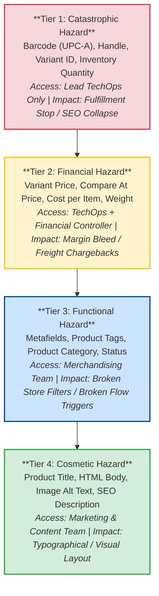
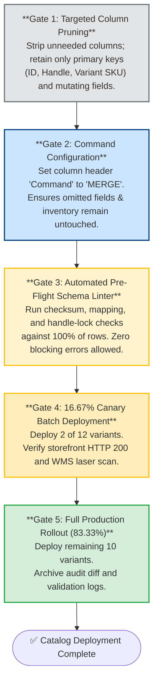

# The Barcode That Became a Number: How a Spreadsheet Rewrote a Catalog Before Anyone Pressed Import

*Synapse Botanicals Systems Architecture | Riovic Matthew | Master Dossier — Domain 3*

---

## 1. The Hook: The Spreadsheet That Rewrote Production

A spreadsheet is built to present data to a human, not to protect the integrity of a relational record. That design choice is harmless when the data is a budget, but dangerous when the data is an e-commerce product catalog. 

A catalog is the relational schema behind storefront checkout, advertising feeds, warehouse optical scanners, and canonical product URLs. The moment an operator opens a catalog export in Excel or Google Sheets, the application quietly begins making typing decisions on their behalf. A UPC-A barcode—the 12-digit retail code whose last digit is a check digit computed from the first eleven—looks like a number, so the spreadsheet treats it as one: an IEEE 754 floating-point value it is free to convert to scientific notation, round, or strip of leading zeros. No warning dialog appears. The file opens normally, looks visually tidy, and passes casual human review.

This dossier documents a bulk update to Synapse Botanicals' 12-variant catalog, where each variant is identified by a stock-keeping unit (SKU) such as `SYN-FSTK-MY` (Focus Sticks Matcha Yuzu). The update file had been silently rewritten by exactly that spreadsheet coercion mechanism. It also documents the pre-flight gate that intercepted the file in five seconds, before a single row was committed to production.

```
       09:15:10 EDT                                             09:15:15 EDT
    Audit Scan Begins                                      Circuit Breaker Trips
───────────●──────────────────────────────────────────────────────────●─────────────►
           │                                                          │
           ├── 09:15:12: Row 2 (SYN-FSTK-MY) Barcode -> 8.40001E+11   │
           ├── 09:15:13: Row 6 (SYN-TNCT-AM) Barcode -> 11 Digits     │
           └── 09:15:14: Row 10 (SYN-TMBL-MO) Handle Renamed          │
           │                                                          │
           └──────────────── 5 Seconds to Total Abortion ─────────────┘
                                [ZERO BYTES COMMITTED]
```

### The Five-Second Stop

At 09:15:10 EDT on October 24, 2026, an automated pre-flight linter began scanning `Catalog_Mutation_v2.xlsx`, a 12-variant update spanning 5 core product lines. Within four seconds it identified three blocking defects:
* **Row 2 (`SYN-FSTK-MY`):** The barcode had been coerced to scientific notation: `8.40001E+11`.
* **Row 6 (`SYN-TNCT-AM`):** The barcode had lost its check digit and was truncated to 11 digits: `84000103000`.
* **Row 10 (`SYN-TMBL-MO`):** The canonical product handle had been renamed from `precision-insulated-tumbler-durable-merchandise` to `precision-insulated-tumbler-new`.

At 09:15:15 EDT, the circuit breaker tripped and aborted the import. Zero rows reached the Shopify database.

Had the file gone through, two products would have carried barcodes that the warehouse management system (WMS) could not match to physical inventory, and a core product page would have returned HTTP 404 to every ad click, search result, and customer bookmark pointing to the old address. Section 3 models that failure at a **$3,900.00 cash blast radius** for a single unmitigated release.

> [!CAUTION]
> **Staging Sandbox Disclosure**: Every result in this dossier was produced in a staging environment: an in-memory/SQLite-backed test suite, synthetic GTIN fixtures (test identifiers, not GS1-licensed codes), and deterministic pricing and cost models. No production store, live Matrixify import, or physical warehouse scanner was exercised. Section 11 separates what was verified in staging from what is only specified.

| Incident Parameter | Baseline Parameter Value | Architectural Significance |
|---|---|---|
| **Operator Profile** | Dr. Aris Thorne (`aris.thorne@example.com`) | Lead Catalog & ERP Systems Architect managing bulk Matrixify schema transformations. The Field Mutation Risk Taxonomy in Section 2.1 defines permissions by field. It reserves Tier 1 edits for Lead TechOps and lists TechOps and the Financial Controller as permitted operators for Tier 2. |
| **Catalog Scope** | `Catalog_Mutation_v2.xlsx`: 12 variants across 5 product lines (Focus Sticks, Adaptogen Tinctures, Bundles, Tumblers, Whisks) | Foundational catalog master powering checkout, 3PL WMS, and ad channels. |
| **The Silent Coercion Defects** | Two barcodes destroyed by numeric coercion (scientific notation, 11-digit truncation) and one handle rename | Three blocking errors, none visible to a human viewing the spreadsheet. |
| **The Potential Blast Radius** | $3,900.00 modeled out-of-pocket toll per release; $7,800/year at 8 bulk updates and a 25% error rate (Section 3) | Relabeling fees, wasted paid media clicks, and emergency TechOps intervention. |
| **The 5-Second Circuit Breaker** | 09:15:10 to 09:15:15 EDT; import aborted with zero database commits | Automated linter terminated execution before Shopify Admin was contacted. |

---

## 2. The Four Hazard Tiers: Role-Based Catalog Governance

Every column in a catalog file is a lever on the live store, and the levers are not equally heavy. 

The `Variant ID` and the `Handle` are the primary keys other systems use to locate a product. The `Barcode` is the physical label the warehouse uses to pick and pack it. The `SKU` joins them. Change a product `Title` and a page reads awkwardly. Change a barcode and a pack bench can no longer verify the carton. Synapse Botanicals therefore assigns every field in the 12-variant catalog to one of four hazard tiers, ranked by the operational damage a wrong value causes, and restricts each tier to the smallest role with a legitimate reason to edit it.



### 2.1 Field Mutation Risk Taxonomy

| Hazard Tier | Risk Level | Fields Included | Permitted Operators | Validation Rule | Impact of Failure |
|---|---|---|---|---|---|
| **Tier 1** | **Catastrophic** | `Barcode (UPC-A)`, `Handle`, `Variant ID`, `Inventory Quantity` | **Lead TechOps only** | Strict regex (`^\d{12}$` for barcodes), immutable primary-key check | Halts warehouse picking; destroys search ranking; causes physical inventory drift. |
| **Tier 2** | **Financial** | `Variant Price`, `Compare At Price`, `Cost per Item`, `Variant Weight` | **TechOps + Financial Controller** | Decimal precision (`^\d+\.\d{2}$`); price must exceed cost | Negative gross margins; carrier dimensional-weight freight chargebacks. |
| **Tier 3** | **Functional** | `Metafields`, `Product Tags`, `Category / Type`, `Status` | **Merchandisers (supervised)** | Namespace schema linting; controlled tag taxonomy | Breaks storefront filtering, bundle logic, and automated Shopify Flow triggers. |
| **Tier 4** | **Cosmetic** | `Title`, `Body (HTML)`, `Image Alt Text`, `SEO Description` | **Marketing & Content Team** | HTML syntax linting; character-limit checks | Broken layout formatting, typos (zero operational or physical fulfillment impact). |

### 2.2 Least Privilege: In Bulk Imports, the File Is the Permission

The tiers apply the principle of least privilege directly to catalog administration: each role receives the minimum write access its work requires and nothing more. 

The principle is usually discussed in terms of user accounts and IAM permissions, but in a bulk-import workflow **the file itself is the permission**. Matrixify, the Shopify bulk-import application Synapse uses, accepts a `Command` column on every row. Under `MERGE`, it updates only the cells that row populates and leaves every other column untouched. A marketing import file containing only `ID`, `Title`, `Body (HTML)`, `Image Alt Text`, and `SEO Description` is therefore physically incapable of altering a barcode, a price, or a URL handle.

The same logic protects against spreadsheet coercion: silent mathematical conversion can only damage columns that actually exist in the file. Tier 1 columns appear in an import file only as match keys, and the linter verifies every match key against the canonical registry before execution proceeds. When the linter reports defects in more than one tier, the lowest-numbered tier is resolved first, because it carries the largest blast radius.

---

## 3. What a Corrupted Catalog Costs: The $3,900 Blast Radius

An engineering control is only worth building if the failure it prevents carries a real financial cost. The model below prices an unmitigated release of the corrupted file that the gate intercepted. The model is deterministic: every input is a stated operational assumption, and every output is reproducible arithmetic.

### 3.1 Model Inputs

| Input | Value | Operational Domain |
|---|---|---|
| Units in inventory exposed to corrupted barcode values | 1,000 across Reno and Allentown fulfillment nodes | Trap A: barcode corruption |
| 3PL manual thermal over-labeling fee | $2.20 per unit | Trap A: barcode corruption |
| Daily paid-media spend (Meta & Google Shopping) | $450.00 per day | Trap B: handle mutation |
| Duration of HTTP 404 on the product URL | 48 hours (2 days) | Trap B: handle mutation |
| Emergency TechOps and SEO recovery | $800.00 fixed allocation | Trap B: handle mutation |
| Bulk catalog updates per year | 8 (2 per quarter, seasonal updates) | Annualization |
| Human error rate per bulk update | 25% | Annualization |

### 3.2 Incident Ledger: One Unmitigated Release

| # | Cost Line | Operational Driver | Calculation | Cost | Share |
|:---:|---|---|---|:---:|:---:|
| **1** | **Warehouse emergency relabeling** | Manual thermal over-labeling by 3PL on units in bins at Reno and Allentown | 1,000 units × $2.20 | **$2,200.00** | 56.4% |
| **2** | **Wasted paid media (404 ad traffic)** | Meta and Google Shopping campaigns sending clicks to old handle returning HTTP 404 | 2 days × $450.00/day | **$900.00** | 23.1% |
| **3** | **Emergency TechOps and SEO recovery** | Forensic manual 301 redirect mapping, XML sitemap re-indexing, and cache re-submission | Fixed allocation | **$800.00** | 20.5% |
| | **TOTAL OUT-OF-POCKET INCIDENT TOLL** | | $2,200 + $900 + $800 | **$3,900.00** | **100.0%** |

Line 1 is the price of the barcode trap. Lines 2 and 3—totaling $1,700.00—are the price of the handle trap. 

Notice an essential operational difference: **the ad-spend line is the only one that grows with detection time**. Every additional day the 404 persists adds $450.00 ($18.75 per hour). The relabeling and technical recovery lines are fixed once the bad file commits. That asymmetry is why the control sits *in front* of the import and not behind it.

### 3.3 Annualized Exposure

```text
Bulk updates per year        = 2 per quarter x 4 quarters      = 8
Expected corrupted releases  = 8 x 25% human error rate        = 2
Annual unmitigated exposure  = 2 x $3,900.00                   = $7,800.00 per year
```

| Human Error Rate | Corrupted Releases per Year | Annual Exposure |
|---|:---:|:---:|
| 12.5% | 1 | $3,900.00 |
| **25.0% (Model Baseline)** | **2** | **$7,800.00** |
| 50.0% | 4 | $15,600.00 |

### 3.4 What the Ledger Does Not Count

The $3,900.00 figure is a conservative financial floor. It prices only the three cost lines that arrive as direct invoices and payroll. It excludes lost sales contribution: every Focus Sticks Matcha Yuzu order lost to a scan failure or a dead landing page forfeits **$33.50 of gross margin** at the $42.00 retail price and $8.50 COGS (Section 8). It also excludes carrier chargebacks, customer support ticket volume, and the search ranking lag that persists after 301 redirects are deployed.

---

## 4. The Anatomy of Two Spreadsheet Traps

Both failures in this file begin with a software tool doing precisely what it was designed to do.

```mermaid
flowchart TD
    subgraph TRAP_A["TRAP A: Numeric Coercion & Barcode Destruction"]
        A1["Raw Text Entered: '850041234014'"] --> A2["Spreadsheet treats cell as numeric"]
        A2 --> A3["Auto-formats to IEEE 754 float: '8.50041E+11'"]
        A2 --> A4["Or strips leading zero: '012345678901' -> '12345678901'"]
        A3 --> A5["EXPORT: Corrupted text string saved to CSV"]
        A4 --> A5
        A5 --> A6["3PL Laser Scanner rejects 11-digit / float string ❌"]
    end

    subgraph TRAP_B["TRAP B: Handle Mutation & Storefront 404"]
        B1["Canonical Handle: '.../precision-insulated-tumbler-durable-merchandise'"]
        B1 --> B2["Merchandiser 'cleans up' text to '...-new' in CSV"]
        B2 --> B3["Shopify creates NEW URL path; original URL vanishes"]
        B3 --> B4["Active Meta/Google Ads return HTTP 404 ❌"]
        B4 --> B5["Organic Google Search Ranking History Destroyed ❌"]
    end

    style A6 fill:#f8d7da,stroke:#dc3545,stroke-width:2px;
    style B4 fill:#f8d7da,stroke:#dc3545,stroke-width:2px;
    style B5 fill:#f8d7da,stroke:#dc3545,stroke-width:2px;
```



### 4.1 Trap A: Numeric Coercion and Optical Scanner Physics

A UPC is an identifier that happens to be made of digits, and a spreadsheet cannot tell the difference. When Excel or Google Sheets parses a bare `850041234014`, it stores a binary floating-point value (IEEE 754 double precision), because that is how both applications represent every number. Three consequences follow:

1. **Display Rounding**: In a General-format column, a 12-digit number is rendered as `8.50041E+11`, a six-significant-digit summary. Whether the full digits survive underneath depends on the application, which is why the exported CSV file, not the on-screen sheet, is the artifact to inspect.
2. **Export of the Display Form**: A CSV export frequently writes the rendered text instead of the underlying value. At that moment display rounding becomes permanent data loss: `8.50041E+11` in the file carries only six significant digits, and the remaining digits are gone. A rounded string cannot recreate them.
3. **Leading-Zero Stripping**: A number has no leading zero in arithmetic. `012345678901` is stored as `12345678901`, eleven digits, and no later formatting step can know what was removed.

**The Physical Warehouse Consequence**: A UPC-A symbol is an exact **95-module optical pattern**: a 3-module start guard (`101`), six left-hand digits at 7 modules each (42), a 5-module center guard (`01010`), six right-hand digits (42), and a 3-module end guard (`101`). The pattern has no slot for an eleventh or thirteenth digit. A warehouse laser scanner (Zebra TC52) decodes exactly twelve digits, verifies the Modulo-10 check digit, and looks up the string in the WMS database. An 11-digit catalog value cannot be printed as a valid UPC-A symbol, triggering hard scanner read errors at the pack bench.

### 4.2 Trap B: Handle Mutation and SEO Destruction

A Shopify handle is the unique URL slug of a product page, served at `/products/{handle}`. For `SYN-TMBL-MO`, the canonical handle is `precision-insulated-tumbler-durable-merchandise`. Everything outside the store knows the product by that address: search engines, Meta ad campaigns, Google Shopping, influencer affiliate links, and customer bookmarks.

Rename the handle in a bulk file, and the old address stops resolving. Three losses follow immediately:
* **Traffic**: Live links to the old URL dead-end into HTTP 404, while paid clicks continue billing.
* **Search Equity**: Accumulated PageRank authority stops accruing to a URL that no longer exists until a 301 redirect is configured and re-crawled.
* **Conversion History**: Analytics platforms attribute performance by landing page slug, so the new slug resets historical conversion tracking.

Unless a redirect is created deliberately, a handle change delivered through a bulk file carries none. That is why a handle rename is an approved redirect project, never a catalog edit (Law 2, Section 10).

### 4.3 Field-Level Validation Formulas

The first line of defense is a column of Google Sheets formulas that flag bad values on screen:

| Field Name | Data Type | Hazard Tier | Validation Formula (Google Sheets) |
|---|---|---|---|
| **ID** | Integer | Tier 1 | `=IF(ISNUMBER(A2), "VALID", "ERROR-INVALID-PRIMARY-KEY")` |
| **Handle** | String | Tier 1 (Lock) | `=IF(REGEXMATCH(B2, "^[a-z0-9-]+$"), "VALID", "ERROR-INVALID-HANDLE")` |
| **Title** | String | Tier 4 | `=IF(LEN(C2)>0, "VALID", "ERROR-BLANK-TITLE")` |
| **Variant Price** | Decimal | Tier 2 | `=IF(AND(ISNUMBER(D2), D2>0), "VALID", "ERROR-PRICE")` |
| **Cost per Item** | Decimal | Tier 2 | `=IF(AND(ISNUMBER(E2), E2<D2), "VALID", "ERROR-NEGATIVE-MARGIN")` |
| **Variant Barcode** | String | Tier 1 | `=IF(AND(ISTEXT(F2), REGEXMATCH(F2, "^[0-9]{12}$")), "VALID", "ERROR-BARCODE")` |
| **Variant Weight** | Decimal | Tier 2 | `=IF(AND(ISNUMBER(G2), G2>0), "VALID", "ERROR-WEIGHT")` |
| **Inventory Quantity**| Integer | Tier 1 | *None. Omitted from import file by design (Schema by Omission)* |

The barcode formula explicitly tests `ISTEXT` before evaluating the regex. Converting with `TO_TEXT` first would hide the coercion, because a coerced number converted back to text looks identical to text that was never coerced.

### 4.4 Schema by Omission

`Inventory Quantity` is Tier 1 and has no formula because no spreadsheet formula can make it safe to import. It is protected by being absent. A field that is not being updated must not exist in the import file, ensuring there is nothing to coerce, overwrite, or desynchronize from the warehouse. Gate 1 in Section 9 enforces this rule on every release.

---

## 5. The Pre-Flight Validator: Checksum and Mapping Engine

The validator performs two functions: it proves a barcode is internally mathematically consistent, and it proves it belongs to the product it is attached to. The first uses the Modulo-10 algorithm. The second uses the approved SKU-to-UPC master mapping.

### 5.1 The Approved Master Mapping

These twelve fixtures represent the canonical Universe A mapping. Each UPC-A passed the Modulo-10 engine and a 95-bit software round-trip decode ([`evidence/barcodes/summary.md`](../evidence/barcodes/summary.md)):

| SKU Code | Product / Variant Name | Canonical UPC-A | Check Digit |
|---|---|---|:---:|
| `SYN-FSTK-MY` | Focus Stick Packs 30-Pack (Matcha Yuzu) | `850041234014` | **4** |
| `SYN-FSTK-BO` | Focus Stick Packs 30-Pack (Blood Orange) | `850041234021` | **1** |
| `SYN-FSTK-WB` | Focus Stick Packs 30-Pack (Wild Blueberry) | `850041234038` | **8** |
| `SYN-FSTK-GA` | Focus Stick Packs 30-Pack (Crisp Green Apple) | `850041234045` | **5** |
| `SYN-TNCT-AM` | Adaptogen Tincture 60ml (AM Focus / Lion's Mane) | `850041234052` | **2** |
| `SYN-TNCT-PM` | Adaptogen Tincture 60ml (PM Restore / Reishi) | `850041234069` | **9** |
| `SYN-BNDL-MAO` | Starter Bundle (Matcha / AM / Obsidian) | `850041234076` | **6** |
| `SYN-BNDL-BAB` | Starter Bundle (Orange / AM / Bone White) | `850041234083` | **3** |
| `SYN-TMBL-MO` | Precision Insulated Tumbler 500ml (Matte Obsidian) | `850041234090` | **0** |
| `SYN-TMBL-BW` | Precision Insulated Tumbler 500ml (Bone White) | `850041234106` | **6** |
| `SYN-TMBL-SG` | Precision Insulated Tumbler 500ml (Sage Green) | `850041234113` | **3** |
| `SYN-ACC-WHSK` | Micro-Foam Electric Whisk | `850041234120` | **0** |

### 5.2 The JavaScript Implementation

```javascript
/**
 * Computes the GS1 Modulo-10 Check Digit for an 11-digit UPC-A string.
 */
function calculateModulo10CheckDigit(elevenDigits) {
  if (typeof elevenDigits !== 'string' || !/^[0-9]{11}$/.test(elevenDigits)) {
    throw new TypeError('CHECK_DIGIT_REQUIRES_ELEVEN_DIGIT_TEXT');
  }
  const sum = [...elevenDigits].reduce((total, digit, index) =>
    total + Number(digit) * (index % 2 === 0 ? 3 : 1), 0);
  return (10 - (sum % 10)) % 10;
}

/**
 * Validates a barcode string against GS1 math and authoritative SKU mappings.
 */
function validateBarcodeRecord(inputUpc, sku, approvedMapping) {
  const reject = (error, details) => ({ valid: false, error, details });
  if (typeof inputUpc !== 'string') return reject('BARCODE_TEXT_REQUIRED', 'Numeric primitives rejected before coercion.');
  if (inputUpc.length === 0) return reject('BLANK_BARCODE', 'Barcode is required.');
  if (/[eE][+-]?\d+/.test(inputUpc)) return reject('SCIENTIFIC_NOTATION_DETECTED', 'Floating-point notation detected.');
  if (!/^[0-9]+$/.test(inputUpc)) return reject('NON_NUMERIC_CHARACTERS', 'Contains non-numeric artifacts or whitespace.');
  if (inputUpc.length !== 12) return reject('INVALID_LENGTH_NOT_12_DIGITS', `Received ${inputUpc.length} digits.`);
  if (/^0{12}$/.test(inputUpc)) return reject('PLACEHOLDER_BARCODE', 'All-zero placeholders are prohibited.');
  
  const computedCheckDigit = calculateModulo10CheckDigit(inputUpc.slice(0, 11));
  if (Number(inputUpc[11]) !== computedCheckDigit) {
    return reject('CHECKSUM_MODULO_10_MISMATCH', `Expected check digit ${computedCheckDigit}.`);
  }
  
  const approved = approvedMapping.get(sku);
  if (!approved) return reject('SKU_NOT_IN_UNIVERSE_A_MASTER', `No approved fixture mapping for ${sku}.`);
  if (approved.upc !== inputUpc) return reject('SKU_BARCODE_MISMATCH', 'Checksum-valid barcode does not match this SKU.');
  
  return { valid: true, upc: inputUpc, sku, computedCheckDigit };
}
```

### 5.3 A Worked Check

For `SYN-FSTK-MY` (`850041234014`):
```text
First 11 digits :   8   5   0   0   4   1   2   3   4   0   1
GS1 Weights     :   3   1   3   1   3   1   3   1   3   1   3
Products        :  24   5   0   0  12   1   6   3  12   0   3  -->  Sum = 66

Check Digit = (10 - (66 mod 10)) mod 10 = (10 - 6) mod 10 = 4   [Matches 12th digit]
```

For `SYN-TNCT-AM` (`850041234052`), the weighted sum is 78 $\rightarrow$ check digit is 2. For `SYN-TMBL-MO` (`850041234090`), the weighted sum is 90 $\rightarrow$ check digit is 0.

### 5.4 Calling the Validator

```javascript
const approvedMapping = new Map([
  ['SYN-FSTK-MY',  { upc: '850041234014' }],
  ['SYN-FSTK-BO',  { upc: '850041234021' }],
  ['SYN-TNCT-AM',  { upc: '850041234052' }],
  ['SYN-TMBL-MO',  { upc: '850041234090' }],
]);

// Valid Record
validateBarcodeRecord('850041234014', 'SYN-FSTK-MY', approvedMapping);
// Output: { valid: true, upc: '850041234014', sku: 'SYN-FSTK-MY', computedCheckDigit: 4 }

// Corrupted Scientific Notation
validateBarcodeRecord('8.40001E+11', 'SYN-FSTK-MY', approvedMapping);
// Output: { valid: false, error: 'SCIENTIFIC_NOTATION_DETECTED', details: 'Floating-point notation detected.' }

// Checksum Mismatch
validateBarcodeRecord('850041234017', 'SYN-FSTK-MY', approvedMapping);
// Output: { valid: false, error: 'CHECKSUM_MODULO_10_MISMATCH', details: 'Expected check digit 4.' }
```

### 5.5 Why Barcodes Are Strings, Never Numbers

The first assertion in `validateBarcodeRecord` is a strict `typeof` check. A barcode that arrives as a JavaScript number is rejected with `BARCODE_TEXT_REQUIRED` even if its digits happen to be correct, because arriving as a number proves it was parsed through a numeric type—and numeric types cannot preserve leading zeros (`012345678905` becomes `12345678905`). `Number()` appears in the validator in only one place: converting single validated characters to compute the weighted sum.

---

## 6. The 9-Point Rejection Matrix: Trapping Malformed Identifiers

The validation engine groups rejected mutations into nine failure types. For example, a checksum-valid `850041234021` is rejected on `SYN-FSTK-MY` because that SKU requires the exact text `850041234014`. The offline run exercised 16 negative inputs across these failure types. All 16 produced their expected rejection. The [barcode evidence](../evidence/barcodes/summary.md) lists the individual fixtures and outcomes.

| # | Error Code | Failure Mode | Ground-Truth Fixture Input | Architectural Meaning | Required Remediation Action |
|:---:|---|---|---|---|---|
| **1** | `BARCODE_TEXT_REQUIRED` | Numeric type coercion | `850041234014` *(numeric primitive)* | Coercion already occurred upstream. | Format column as Text (`@`) and re-export. |
| **2** | `BLANK_BARCODE` | Missing identifier | `""` *(empty string)* | Required primary identifier is missing. | Restore from master mapping. |
| **3** | `SCIENTIFIC_NOTATION_DETECTED` | Exported display rounding | `8.50041E+11` (`ERR-SCINOT-01`) | Digits permanently lost in floating-point conversion. | Restore from master mapping; never infer digits. |
| **4** | `NON_NUMERIC_CHARACTERS` | Text artifact or typo | `85004123401A` (`ERR-NON-NUMERIC`) | Formula wrapper, apostrophe, or character leaked in. | Export exact 12 digits without wrappers. |
| **5** | `INVALID_LENGTH_NOT_12_DIGITS` | Truncation / dropped zero | `50041234014` (`ERR-TRUNC-01`) | String is not a valid UPC-A. | Restore exact 12-digit string from mapping. |
| **6** | `PLACEHOLDER_BARCODE` | All-zero stand-in | `000000000000` *(dummy string)* | Arithmetically valid dummy value. | Prohibit release until live GS1 UPC assigned. |
| **7** | `CHECKSUM_MODULO_10_MISMATCH` | Damaged digit / typo | `850041234017` (`ERR-CHKSUM-01`) | Check digit disagrees with first 11 digits. | Re-calculate check digit; restore from mapping. |
| **8** | `SKU_NOT_IN_UNIVERSE_A_MASTER` | Unknown catalog SKU | `850041234014` on unapproved SKU | SKU does not exist in master catalog. | Abort import; register SKU in master catalog. |
| **9** | `SKU_BARCODE_MISMATCH` | Valid UPC on wrong SKU | `850041234021` on `SYN-FSTK-MY` | Checksum is valid, but barcode belongs to another product! | Re-align product SKU with dedicated UPC. |

### Two Critical Architectural Traps

* **The 12-Zero Trap (Rule 6)**: `000000000000` mathematically passes the Modulo-10 checksum: eleven zeros produce a weighted sum of 0, and $(10 - 0) \pmod{10} = 0$. A naive validator that checks only the check digit will happily approve twelve zeros. That is why `PLACEHOLDER_BARCODE` executes before the checksum.
* **The SKU Mismatch Trap (Rule 9)**: `850041234021` is a valid UPC-A (check digit 1) belonging to Blood Orange stick packs (`SYN-FSTK-BO`). If assigned to Matcha Yuzu (`SYN-FSTK-MY`), every arithmetic check passes, the scanner reads it cleanly, and the WMS finds a real product—just the wrong one. Rule 9 enforces that only relational mapping proves product identity.

---

## 7. Five Seconds to Abort: The Audit of `Catalog_Mutation_v2.xlsx`

The audit evaluated all 12 variants of `Catalog_Mutation_v2.xlsx`, a seasonal bulk update touching barcodes, handles, prices, and costs.

### 7.1 Telemetry Log

```text
09:15:10.042 EDT [AUDIT-INIT] Ingesting Catalog_Mutation_v2.xlsx (12 variants, 7 attributes)
09:15:10.890 EDT [AUDIT-SCAN] Executing Gate 1-3 Schema & Linter Validations across 100% of rows
09:15:12.114 EDT [FAIL-WARN] Row 2 (SYN-FSTK-MY): Barcode coerced to '8.40001E+11' [SCIENTIFIC_NOTATION_DETECTED]
09:15:13.402 EDT [FAIL-WARN] Row 6 (SYN-TNCT-AM): Barcode truncated to '84000103000' (11 digits) [INVALID_LENGTH_NOT_12_DIGITS]
09:15:14.650 EDT [FAIL-CRIT] Row 10 (SYN-TMBL-MO): Handle mutated to 'precision-insulated-tumbler-new' [HANDLE_MUTATION_BREACH]
09:15:15.012 EDT [CIRCUIT-TRIP] Pre-flight failed: 3 blocking errors trapped.
09:15:15.015 EDT [AUDIT-STOP] Catalog deployment ABORTED. Zero bytes committed to Shopify Admin.
```

### 7.2 Incident Chronology

| Time (EDT) | Elapsed | Event Description | Rule That Fired |
|---|:---:|---|---|
| **09:15:10** | +0s | Pre-flight validation initiated; 12 rows queued | Gate 3 Linter |
| **09:15:12** | +2s | Row 2 (`SYN-FSTK-MY`): Barcode coerced to `8.40001E+11` | `SCIENTIFIC_NOTATION_DETECTED` |
| **09:15:13** | +3s | Row 6 (`SYN-TNCT-AM`): Barcode truncated to 11 digits (`84000103000`) | `INVALID_LENGTH_NOT_12_DIGITS` |
| **09:15:14** | +4s | Row 10 (`SYN-TMBL-MO`): Handle mutated to `...-new` | `HANDLE_MUTATION_BREACH` (Handle Lock) |
| **09:15:15** | +5s | **3 blocking errors trapped. Import aborted. Zero database commits.** | Circuit Breaker |

---

## 8. Remediation and Master Diff: Exact-String Canonical Recovery

A damaged barcode cannot be repaired by arithmetic. Once an application converts a barcode into `8.40001E+11`, the original trailing digits are gone. Any algorithm that attempts to "guess" the missing numbers will create duplicate, invalid barcodes.

### 8.1 Master Diff: Pre-Audit vs. Post-Sanitization

| SKU Code | Variant Name | Field Mutated | Pre-Audit Value | Post-Sanitization Value | Verification Status |
|---|---|---|---|---|---|
| `SYN-FSTK-MY` | Focus Sticks Matcha Yuzu | `Barcode` (Row 2) | `8.40001E+11` *(Scientific Notation)* | `850041234014` | **PASSED**: Resolved from master mapping; check digit 4 |
| `SYN-TNCT-AM` | Adaptogen Tincture AM | `Barcode` (Row 6) | `84000103000` *(11 Digits, Truncated)* | `850041234052` | **PASSED**: Resolved from master mapping; check digit 2 |
| `SYN-TMBL-MO` | Tumbler Matte Obsidian | `Handle` (Row 10) | `precision-insulated-tumbler-new` | `precision-insulated-tumbler-durable-merchandise` | **RESTORED**: Canonical handle reinstated from registry |
| `SYN-FSTK-MY` | Focus Sticks Matcha Yuzu | `Variant Price` | $40.00 | $42.00 | **PASSED**: Tier 2 Valid (Gross margin: 79.76% at $8.50 COGS)¹ |
| `SYN-TNCT-AM` | Adaptogen Tincture AM | `Cost per Item` | $13.50 | $12.50 | **PASSED**: Tier 2 Valid (Reconciled to manufacturing BOM)² |

¹ Gross margin = ($42.00 − $8.50) / $42.00 = $33.50 / $42.00 = 79.76%. COGS sourced from platform BOM: [evidence/costs/summary.md](../evidence/costs/summary.md) (Focus Stick Packs 30-Pack unit cost = $8.50).

² Scenario cost corrected from erroneous $13.50 to canonical $12.50. Platform BOM: [evidence/costs/summary.md](../evidence/costs/summary.md) (AM Adaptogen Tincture 60ml unit cost = $12.50).

Notice rows 4 and 5: the file also carried legitimate, intentional Tier 2 price and cost changes. The linter cleanly validated the legitimate financial adjustments while arresting the catastrophic Tier 1 schema defects.

Those two unit costs carry into separate order models. One pack and one tincture give Order #29863 $8.50 + $12.50 = **$21.00 in COGS** before handling, freight, and processing. The Capstone’s Order #35070 adds a $7.00 tumbler and $0.40 of kitting materials, bringing the Starter Bundle to **$28.40 in COGS**. [Domain 5 Section 6.1](../domain-5-technical-diagnosis/MasterDossier-Domain5-MarginDefenseAndCartDiagnostics.md) and [Capstone Section 6.1](../capstone/MasterDossier-Capstone-AsynchronousOrderMutation.md) show how those costs enter the respective ledgers.

### 8.2 Why Nothing Was Reconstructed

`8.40001E+11` expands to $840,001,000,000$, not $850,041,234,014$. `84000103000` is not a prefix, suffix, or truncation of `850041234052`. No padding, rounding, or checksum arithmetic applied to either value leads back to the master. 

Reconstruction is especially dangerous when it looks plausible: an 11-digit string can have a valid check digit computed for it, and a rounded string can be padded with zeros. Both results pass Modulo-10 checks, but assign a synthetic barcode that matches no physical packaging, creating silent warehouse inventory exceptions.

> **Non-Negotiable Law: Never reconstruct a damaged barcode through arithmetic. Restore it only from the authoritative SKU master mapping.**

---

## 9. The Safe MERGE Lifecycle: 5 Gates and a 16.67% Canary

In standard native Shopify CSV imports, partial updates are destructive: blank cells in an imported spreadsheet can inadvertently erase existing product metafields, overwrite secondary images, or reset inventory quantities to zero. 

To prevent destructive writes, Synapse Botanicals standardizes on **Matrixify's Non-Destructive `MERGE` Architecture**:



### 9.1 Targeted Column Pruning (The Pruned File Example)

Under Matrixify's `MERGE` command, only populated cells are updated. An import file updating the price of Focus Sticks Matcha Yuzu contains only three columns:

| Variant SKU | Command | Variant Price |
|:---|:---:|:---:|
| `SYN-FSTK-MY` | `MERGE` | `42.00` |

Every omitted column (`Barcode`, `Handle`, `Inventory Quantity`, `Title`, `Metafields`) is absent, making it physically impossible to overwrite or desynchronize.

### 9.2 The Five-Gate Enforcement Matrix

| Gate | Engineering Control | Pass Condition | Action on Failure |
|---|---|---|---|
| **Gate 1: Targeted Column Pruning** | Remove every column not undergoing active mutation | File contains only primary keys and target mutation fields | Prune and resubmit. Never import an unpruned sheet. |
| **Gate 2: Command Configuration** | Set `Command = MERGE` on every row | Every row carries an explicit command; match keys resolve | Correct command column. Never fall back to native CSV. |
| **Gate 3: Pre-Flight Schema Linter** | Checksum, mapping, handle-lock, and Tier 2 rules on 100% of rows | Zero blocking errors trapped | Abort. Restore damaged values from master mapping and re-lint. |
| **Gate 4: 16.67% Canary Batch** | Deploy 2 of 12 variants across two product lines | Storefront returns HTTP 200; WMS laser terminal scans barcode cleanly | Halt. 10 of 12 variants remain completely untouched. |
| **Gate 5: Full Production Rollout** | Deploy remaining 10 variants (83.33%) | Post-import acceptance criteria met; audit diff archived | Halt and invoke rollback from authoritative mapping. |

---

## 10. The Four Operational Laws of Catalog Governance

Four non-negotiable laws govern catalog data across enterprise commerce:

1. **The Law of Pure Text Identifiers**: A barcode is a label, not a mathematical number. It must be stored, exported, and validated strictly as a string primitive. Any identifier that has ever passed through a numeric type must be rejected. *(Closes the gap in Section 4: numeric coercion).*
2. **The Law of Immutable Canonical Handles**: A product handle is a live URL address, not a marketing title. Renaming a handle requires a formal redirect project and marketing approval, never a casual bulk spreadsheet edit. *(Closes the gap in Section 3: the 404 ad-spend bleed).*
3. **The Law of Minimal Column Scope (Schema by Omission)**: If an attribute is not actively being modified, it must not exist in the import file. Blank cells must never be permitted near production databases. *(Closes the gap in Section 9: accidental data destruction).*
4. **The Law of Authoritative Recovery**: Damaged barcodes must never be reconstructed through arithmetic guessing or truncation padding. They must be restored strictly from the authoritative master SKU catalog mapping. *(Closes the gap in Section 8: unrecoverable precision loss).*

---

## 11. What Is Proven, and What Is Only Designed

Senior engineering architecture requires rigorous intellectual honesty. We clearly delineate what has been proven through empirical staging test suites versus what represents an operational deployment specification.

```
┌────────────────────────────────────────────────────────────────────────┐
│                        EVIDENCE STATUS SUMMARY                         │
├──────────────────────────────┬─────────────────────────────────────────┤
│ [✔] Verified in Staging      │ Modulo-10 checksum, 95-bit decode suite │
│ [!] Documented Specification │ Matrixify MERGE SOP, Google Sheets rules│
│ [○] Scenario Audit           │ Catalog_Mutation_v2.xlsx 5-second trace │
└──────────────────────────────┴─────────────────────────────────────────┘
```

### 11.1 Evidence Scope and Verification Status Matrix

| Deliverable | Section | Status | Ground-Truth Evidence Source |
|---|---|---|---|
| **Modulo-10 Checksum Validity** (All 12 SKUs) | Section 5 | **Verified in Staging** | 12 of 12 pass: [`evidence/barcodes/summary.md`](../evidence/barcodes/summary.md). |
| **95-Bit UPC-A Encode & Decode** | Sections 4 and 5 | **Verified in Staging** | 12 of 12 bit-exact software round-trip: [`evidence/barcodes/summary.md`](../evidence/barcodes/summary.md). |
| **Negative Anomaly Rejection Suite** (16 inputs) | Section 6 | **Executed offline** | All 16 fixtures returned their expected rejection, including checksum-valid identifiers assigned to the wrong SKU. [Barcode fixture results](../evidence/barcodes/summary.md) |
| **Tier 2 Price & Margin Verification** (79.76% at $8.50 COGS) | Section 8 | **Verified in Staging** | [`evidence/costs/summary.md`](../evidence/costs/summary.md) (SYN-FSTK-MY: $42.00 retail, $8.50 COGS = 79.76% gross margin; arithmetic also validates $12.50 tincture correction in Section 8.1). |
| **Pre-Flight Audit Telemetry** (`Catalog_Mutation_v2.xlsx`) | Section 7 | Scenario Audit | Reconstructed 5-second circuit breaker trace across 12 variants. |
| **Field Hazard Taxonomy & RBAC** | Section 2 | Documented Specification | Role-based catalog governance schema mapping access tiers. |
| **Unmitigated Cost Model** ($3,900.00 release / $7,800/yr) | Section 3 | Documented Specification | Deterministic model incorporating 3PL relabeling fees and paid ad spend. |
| **Spreadsheet Validation Formulas** | Section 4 | Specified | Template formulas in this dossier; not executed against live sheet. |
| **Matrixify Safe MERGE SOP & Canary Lifecycle** | Section 9 | Documented Specification | Standard operating procedure for non-destructive partial imports. |
| **WMS Optical Scanner Acceptance Test** | Section 9.4 | Specified | Operational acceptance criteria; physical hardware test. |

### 11.2 Evidence Links

- The [barcode summary](../evidence/barcodes/summary.md) records 12 of 12 approved SKU mappings and 95-bit software round trips, plus 16 of 16 expected rejections. The encoder and decoder share pattern tables. Physical scanning is outside the test scope.
- [`evidence/costs/summary.md`](../evidence/costs/summary.md): Tier 2 price, cost, and gross margin sensitivity verification.
- [`evidence/README.md`](../evidence/README.md): Master evidence index.

### 11.3 The Evidentiary Boundary

Local software agreement is verified. The encoder and decoder agree on all twelve barcodes, every checksum passes, and every defect mode in the negative suite is trapped before commit. Physical warehouse performance on handheld laser terminals (Zebra TC52, Honeywell CT60) under low-light and damaged-label conditions represents an operational acceptance criterion. No licensed GTIN ownership or physical scanner hardware result is inferred from local software tests.

---

## 12. The Architectural Takeaway

Three edits in one file looked completely routine to casual inspection: a barcode that displayed as a number, a barcode one digit short, and a URL handle that had been "tidied." 

Each was a silent trigger for catastrophic operational failure: physical barcode read errors on warehouse pack benches, immediate HTTP 404 crashes on live advertising traffic, and thousands of dollars in emergency relabeling fees. The audit intercepted the file in five seconds because it refused to trust what a spreadsheet displayed and verified what the file had actually stored.

The ultimate law of catalog data is simple: **A barcode is an identifier, not a number; a product handle is a permanent address, not a title. Build the pre-flight gate that enforces that boundary before anyone clicks import.**

---

*Synapse Botanicals Systems Architecture | Riovic Matthew | Master Dossier — Domain 3*
