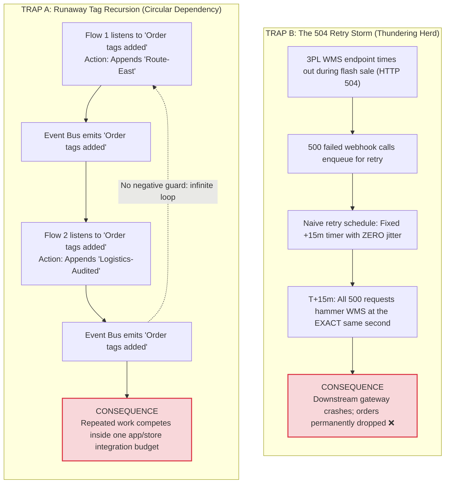
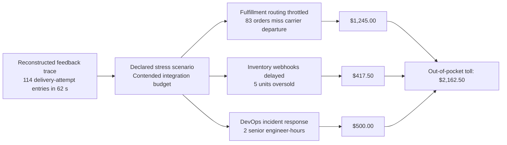
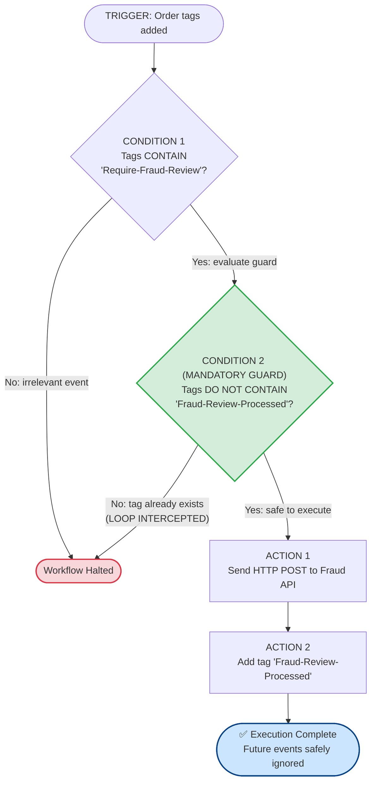
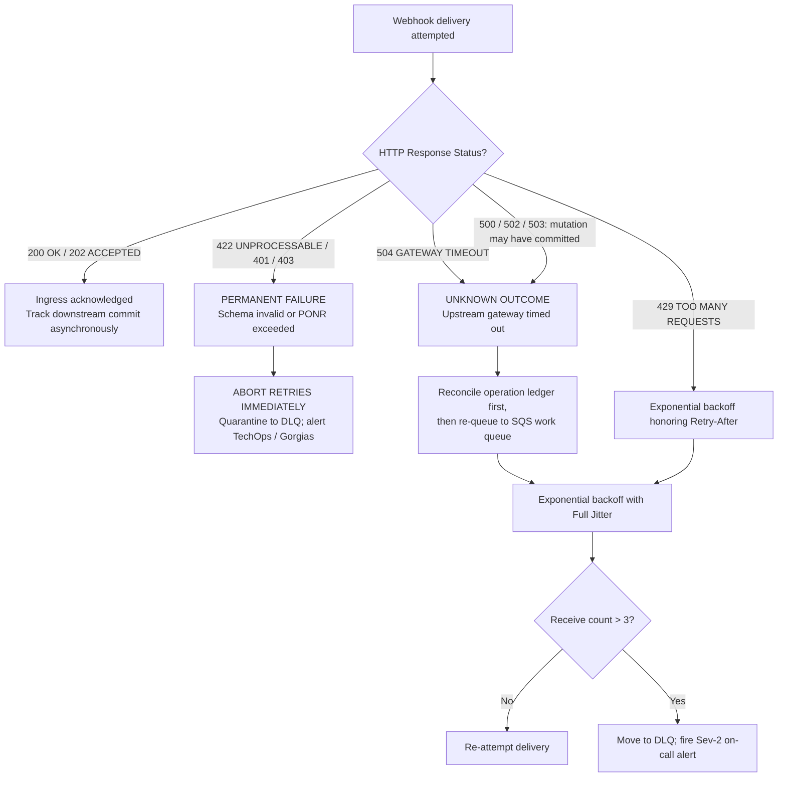
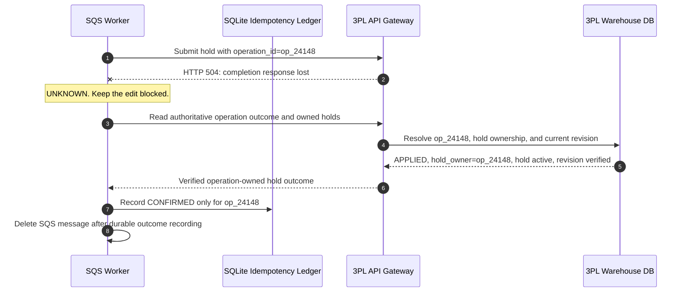
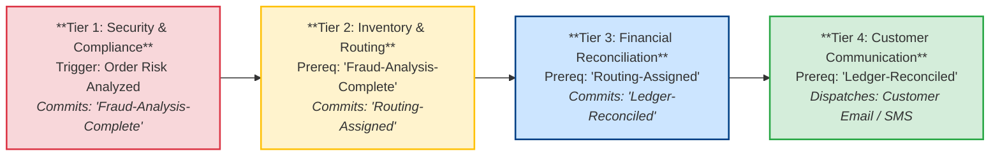

# Neither Automation Had a Bug. Together They Created 114 Events in 62 Seconds.

**How a tag loop and a synchronized retry storm each turn automation into an outage, and the guards that stop both**

*Synapse Botanicals Systems Architecture | Riovic Matthew | Technical Study — Domain 4*

---

## 1. A Routine Update, a Closed Ring: The Runaway Loop on Order #24148

*How a reconstructed tag-feedback chain amplifies demand inside one app/store budget, and the guards that keep repeated work from blocking legitimate warehouse operations.*

### 1.1 The Incident Anatomy: How the Closed Ring Ignited

Event-driven business automation feels like free labor. A customer updates a shipping address in an online portal, a tag appears on the order, a workflow reacts in the background, a warehouse management system (WMS) receives an updated routing instruction, and not a single human operator touches a keyboard.

An event-driven system can turn its own output into its next input. A one-for-one feedback chain grows linearly; fan-out above one can grow faster. Either can run without a stopping condition. The warehouse pays for that missing condition when legitimate holds cannot reach the queue.

**November 2, 2026, at 11:02:01 EST.** Order **#24148** (Chloe Bennett, `chloe.bennett@example.com`) receives `Address-Verified`. The model routes order-update deliveries through an unsafe adapter into two custom Flow listeners: one attempts `Route-East`, the other `Logistics-Audited`. The adapter fails to distinguish a new tag from repeated work. The trace supplies **114 event/delivery-attempt entries in 62 seconds**; it does not claim 114 successful tag writes or a native Shopify `Order tags added` trigger. Section 2.1 defines the production connector contract that closes that gap.

The declared amplification model prices each recursive event at **three REST requests**: an order fetch, a metadata query, and a tag mutation. At 114 / 62 events per second, that is **342 attempted requests / 62 seconds = 5.52 requests/sec**, before background traffic under the same app/store credentials. Against the Standard bucket's 2 requests/sec leak, demand exceeds replenishment by approximately **3.52 requests/sec**. An initially empty 40-request bucket would fill in about **11.4 seconds under a uniform fluid approximation**, sooner with background load. Exact throttle timing depends on bursts, failed calls, and retry scheduling.

The trace's **39/40 REST utilization**, **950/1,000 modeled GraphQL cost points consumed**, and **140ms to 4,850ms middleware latency** are separate illustrative stress snapshots. The repository does not derive those snapshots from the 114 entries or claim observed Shopify performance.

**11:03:03 EST.** On-call triage contained the loop by deploying an emergency hotfix to Flow 1, inserting the missing negative guard condition (`tags do not contain 'Route-East'`) that terminated recursion on the next cycle.

### 1.2 Timeline, API Exhaustion, and Blast Radius

```text
11:02:01 EST                                      11:03:03 EST
Order tag received                               Guard deployed
     +-------------------------------------------------------------+
     | 11:02:02: FLOW-01 attempts Route-East                       |
     | 11:02:03: FLOW-02 attempts Logistics-Audited                |
     | 11:02:04: Repeated work re-enters the adapter               |
     | 11:02:58: Later illustrative 429 / 39-of-40 snapshot        |
     +-------------------------------------------------------------+
             62 seconds / 114 reconstructed trace entries
```

Under the declared amplification model, the looping workload competes with fulfillment pushes, inventory sync, and customer updates that use the **same integration app against the same store**. Separate apps do not share that REST bucket. The operational risk is still concrete: an urgent warehouse hold can wait behind the integration's own repeated work while the picking wave advances.

The second failure mode is quieter and just as expensive: when a warehouse endpoint returns `HTTP 504 Gateway Timeout` during a flash sale and every failed call retries on the same fixed schedule, hundreds of retries land in the same instant on a system that is already struggling. Section 2 contrasts both traps.

> [!CAUTION]
> **Scenario and evidence scope.** Order #24148 is a reconstructed failure scenario. Its 114 event/delivery-attempt entries, timestamps, resource snapshots, and three-REST-calls-per-event model are declared inputs, not observed platform telemetry. Shopify REST Admin limits are **Standard: 40 requests / 2 req/sec; Advanced: 80 / 4; Plus: 400 / 20**, scoped per app and store. Custom app credentials do not turn a Plus store into a Standard-tier store. The [local coordinator suite](../evidence/latency/summary.md) separately verifies operation identity, duplicate handling, conditional hold acquisition, and reconciliation against simulators. It does not execute the custom Flow connector or reproduce this incident. [Shopify REST rate limits](https://shopify.dev/docs/api/admin-rest/usage/rate-limits)

| Incident Dimension | Incident Parameter Value | Architectural Significance |
|---|---|---|
| **Customer Profile** | Chloe Bennett (`chloe.bennett@example.com`) | Customer initiating an address modification via storefront self-service portal. |
| **Incident Scope** | Order #24148 reconstructed feedback scenario | Demonstrates contention inside one app/store integration budget; other apps retain their own buckets. |
| **Trigger Mechanism** | Address update appends `Address-Verified` tag | Unconstrained `Order tags added` listeners create circular dependencies. |
| **Circular Flow Pair** | `FLOW-01` (`Route-East`) $\leftrightarrow$ `FLOW-02` (`Logistics-Audited`) | Two independent flows listening broadly without negative exit criteria. |
| **Containment Action** | Emergency negative guard deployed to `FLOW-01` at $T+62.1\text{s}$ | Halts sequential recursion immediately; terminates the 114-event storm. |
| **Financial Exposure Floor** | $2,162.50 out-of-pocket baseline | Direct exposure across 3PL SLA credits, inventory overselling, and DevOps triage. |

---

## 2. No Memory of Its Own Work: Tag Recursion and the 504 Retry Storm

*How a platform-side tag loop and a warehouse-side retry storm start, what each exhausts, and how they share one root cause.*

In distributed e-commerce systems, un-governed event-driven automations typically fail in one of two distinct patterns. They appear unrelated because one lives entirely inside the storefront platform while the other operates across the boundary to external warehouse endpoints. Yet they share a single root cause: **a system reacting to events with zero memory of its own earlier work**.



### 2.1 Trap A: Runaway Tag Recursion

Shopify Flow has no native **Order tags added** trigger. The proposed connector subscribes to `orders/updated`, verifies the webhook signature, durably records event identity, and compares order-tag state against an authoritative prior snapshot. Duplicate delivery is not a new business event; a repeated tag write with no tag delta must not wake the chain.

When a genuine addition exists, the app invokes a registered custom Flow trigger through Admin GraphQL **`flowTriggerReceive(handle: "order-tags-added", payload: ...)`**. The registered payload schema carries the order ID, event identity, and added tags. This case study's `Order tags added` label names that custom connector event. A webhook subscription alone does not register a Flow trigger. Persist identity and serialize state comparison per order before dispatching it. [Shopify custom-trigger API](https://shopify.dev/docs/api/admin-graphql/latest/mutations/flowTriggerReceive)

The reconstructed failure model deliberately omits those guards and assigns three REST calls to each recursive delivery attempt: order fetch, metadata query, and tag mutation. Its 5.52 attempted calls/sec exceeds the Standard bucket's 2/sec leak before background traffic. Native Flow actions and `flowTriggerReceive` use GraphQL and carry a separate cost budget; do not count them as REST calls. A production adapter must record actual calls, costs, and outcomes before attributing a throttle to this model.

### 2.2 Trap B: The 504 Retry Storm (The Thundering Herd)

When a third-party logistics (3PL) warehouse management system experiences high concurrency during a major commercial event (such as Black Friday / Cyber Monday), upstream reverse proxies and API gateways frequently terminate long-running database requests with `HTTP 504 Gateway Timeout`.

A fixed relative retry delay preserves a traffic surge's shape. If 500 calls fail between 12:00:00 and 12:01:00 and each retries exactly 15 minutes later, their retry surge lands between 12:15:00 and 12:16:00. Only callers that failed together or were assigned the same retry slot return at the same instant. Full Jitter spreads those correlated attempts; an admission limit still protects the recovering warehouse from aggregate demand.

### 2.3 Side-by-Side Trap Comparison

| Dimension | Trap A: Tag Recursion | Trap B: 504 Retry Storm |
|---|---|---|
| **Where it originates** | Inside the platform: workflows listening to each other | At the boundary: a struggling downstream warehouse endpoint |
| **What amplifies it** | Each reaction is itself an event | Synchronized retries from hundreds of concurrent callers |
| **What it exhausts** | Shopify Admin API budget (REST leaky bucket and GraphQL points) | 3PL endpoint capacity and middleware worker thread pools |
| **How it shows up** | One order's timeline grows faster than total store traffic | Hundreds of orders fail simultaneously at recurring intervals |
| **What stops it** | Negative guards (Section 5) and state-gated ordering (Section 8) | Classified retries (Section 7), asynchronous queue, DLQ, and Full Jitter (Section 9) |
| **Shared remedy** | Durable operation identity (Section 6) | Durable operation identity (Section 6) |

Understanding how unconstrained event loops ignite is only the operational symptom; evaluating the financial damage reveals the stakes. Section 3 models the out-of-pocket commercial toll of that 62-second saturation.

---

## 3. A $2,162.50 Floor: The Modeled Blast Radius of a Runaway Loop

*A unit-economic model that prices the incident across SLA credits, overselling, and engineering time, then scales it to a peak-season surge.*

Engineers often evaluate API rate-limiting as a temporary capacity inconvenience. To an executive, API starvation is an immediate operational and cash liability.

The three-call amplification model shows how one integration can consume its own available capacity. The 39/40 REST and 950/1,000 GraphQL snapshots illustrate stress; they do not establish a measured store outage or prove that unrelated apps stopped. The financial model below separately assumes delayed fulfillment, overselling, and response labor. Its dollars follow those declared operational inputs, not a universal conversion from webhook count to loss.



### 3.1 The Unit-Economic Model

| # | Cost Line | Cost Driver | Unit Cost | Quantity | Subtotal |
|---|---|---|---|---|---|
| 1 | **3PL Fulfillment SLA Breaches** | Orders missing same-day carrier departure cutoff | $15.00 customer courtesy credit | 83 orders | $1,245.00 |
| 2 | **Overselling from Throttled Inventory** | Units sold after physical stock was depleted | $50.00 courtesy credit + $33.50 assumed foregone contribution per cancellation | 5 units | $417.50 |
| 3 | **Emergency DevOps Triage** | Senior engineering incident response & queue re-sync | $250.00 loaded hourly rate | 2 hours | $500.00 |
| | **Total Out-of-Pocket Incident Toll** | | | | **$2,162.50** |

```text
incident_toll = (delayed_orders × $15.00) + (oversold_units × $83.50) + (engineer_hours × $250.00)
              = (83 × $15.00) + (5 × $83.50) + (2 × $250.00)
              = $1,245.00 + $417.50 + $500.00
              = $2,162.50
```

1. **Fulfillment SLA breach penalties ($1,245.00)**: The order-routing automations and the middleware that dispatches fulfillment orders to ShipBob draw from the same Admin API bucket that the loop consumed. With the bucket full, those calls queued behind `HTTP 429` backoff retries. In this scenario, 83 orders missed the 14:00 EST carrier truck departure, requiring customer service to issue a $15.00 courtesy shipping credit per customer: $83 \times \$15.00 = \$1,245.00$.
2. **Overselling losses from throttled inventory sync ($417.50)**: Real-time inventory sync webhooks were backed up in the starved queue. During that latency window, 5 units of The Daily Protocol Starter Bundle were purchased after physical inventory was exhausted. The model assumes a $50.00 courtesy credit and $33.50 in foregone contribution for each cancellation. At $83.50 per cancellation, the modeled loss across five cancellations is $417.50.
3. **Emergency DevOps triage ($500.00)**: Two hours of senior systems engineering time dedicated to isolating the runaway workflow, purging orphaned webhook queues, and verifying database ledger parity at a loaded cost of $250.00/hr.

### 3.2 Scaled Exposure: Black Friday / Cyber Monday (BFCM)

The cost formula is strictly linear in its drivers, and high-velocity commercial events aggressively inflate delayed orders and oversold units. At our model's unit economics, every additional 100 orders delayed past a carrier cutoff adds $1,500.00 in direct appeasement credits.

If the 500 warehouse fulfillment calls in the Trap B scenario represent orders missing their carrier departure window, the credit line alone reaches:

$$500 \times \$15.00 = \$7,500.00$$

That single cost line is more than 3.4× the entire Order #24148 incident toll, before calculating a single oversold inventory bundle or incident response hour.

Furthermore, an unmitigated 30-minute API blackout during peak traffic carries catastrophic unpriced costs: abandoned checkout conversions while payment automations stall, unrecoverable payment gateway transaction fees on refunded orders, chargeback dispute fees, and customer lifetime value (LTV) destruction. Consequently, **$2,162.50 represents the absolute floor** of financial exposure for a single un-intercepted recursion event.

Pricing the unit economics demonstrates why immediate intervention is mandatory, but analyzing the forensic trace reveals why detection took 58 seconds to contain. Section 4 dissects the 62-second autopsy of Order #24148.

---

## 4. Detection Was Not Containment: The 62-Second Autopsy of Order #24148

*A timestamped timeline, phase-by-phase resource breakdown, and three lessons on how the loop grew and why it ran so long.*

### 4.1 Chronological Forensic Timeline

| Timestamp | Elapsed | Component | Event Description & Execution State | System Impact |
|---|:---:|---|---|---|
| **11:02:01.100** | +0.0s | Storefront | Customer updates shipping address; appends tag `Address-Verified`. | Initial Trigger |
| **11:02:02.140** | +1.0s | `FLOW-01` | Flow 1 evaluates trigger; executes Action: appends tag `Route-East`. | Execution #1 |
| **11:02:03.220** | +2.1s | `FLOW-02` | Flow 2 detects tag addition; executes Action: appends `Logistics-Audited`. | Execution #1 |
| **11:02:04.305** | +3.2s | `FLOW-01` | Flow 1 detects new tag; re-evaluates order; appends `Route-East`. | **Recursion Cycle 1** |
| **11:02:05.410** | +4.3s | `FLOW-02` | Flow 2 detects new tag; re-evaluates order; appends `Logistics-Audited`. | **Recursion Cycle 2** |
| *[ ... ]* | *[ ... ]* | *[ ... ]* | *[ 94 recurring iterations executed across 52 seconds ]* | *API Saturated* |
| **11:02:58.820** | +57.7s | Shopify API model | Later illustrative throttle snapshot: HTTP 429; REST utilization shown as 39/40. This is not the first exhaustion time predicted by the three-call model. | **Sustained Contention** |
| **11:03:00.110** | +59.0s | Middleware | Ingestion latency degrades to 4,850ms; thread pool exhaustion imminent. | High Contention |
| **11:03:03.250** | +62.1s | **On-Call Triage** | **Emergency negative check deployed to Flow 1. Recursion halted.** | **LOOP TERMINATED** |

### 4.2 Phase Breakdown & Resource Impact

| Phase | Window | Duration | What Happened |
|---|---|---|---|
| **Ignition** | 11:02:01 to 11:02:04 | 3.0s | Initial address trigger, two valid executions, followed immediately by first recursive re-evaluation. |
| **Sustained Feedback** | 11:02:04 to 11:02:58 | 54.0s | Reconstructed event/delivery attempts continue. The three-call amplification model predicts contention earlier than the later snapshot; successful write counts are not inferred. |
| **Later Observation & Containment** | 11:02:58 to 11:03:03 | 5.1s | The scenario shows a later throttle snapshot, then inserts the negative guard and ends the modeled feedback chain. |

| Resource Metric | Baseline Value | Peak Incident Saturation | Systemic Impact |
|---|---|---|---|
| **Trace Entries** | Routine traffic not measured | **114 event/delivery-attempt entries** in 62 seconds | 1.84 entries/sec; not a count of successful tag mutations. |
| **Admin REST API Model** | Standard bucket: 40; leak: 2/sec | **39/40 illustrative snapshot** | Three declared REST calls/event imply 5.52 attempted calls/sec before same-app/store background traffic. |
| **GraphQL Cost Snapshot** | Restore rate and query costs not modeled | **950/1,000 modeled points consumed** | Independent illustrative snapshot; not derived from REST traffic. |
| **Middleware Latency Snapshot** | 140ms illustrative baseline | **4,850ms illustrative stress value** | 34.6x ratio under supplied scenario inputs; not a measured vendor benchmark. |

### 4.3 Reading the Loop

1. **The missing exit condition is the defect.** The reconstructed chain is linear, with one modeled successor per entry. Three REST calls per event amplify demand to approximately 5.52 calls/sec. A 40-request Standard bucket leaking at 2/sec cannot sustain that load; the fluid approximation reaches capacity in about 11.4 seconds before background traffic. The later +57.7s snapshot is not evidence of first throttle onset.
2. **Detection needs an owner.** The trace places a detection marker at +3.2s and containment at +62.1s, leaving 58.9 seconds of modeled response delay. Those timestamps illustrate the operating gap; they are not captured on-call telemetry.
3. **Stop repeated work before it spends the budget.** At the next modeled evaluation, `Route-East` already present must terminate Flow 1. The corrected path needs two logical tag additions; actual API request counts depend on the connector, reads, and retries.

Halting sequential recursion requires an explicit programmatic rule that terminates the circular dependency before it can spawn. Section 5 details the single mandatory guard that neutralizes tag loops.

---

## 5. One Condition Ends the Loop: The Negative Check Rule for Shopify Flow

*The mandatory guard condition for any workflow that adds a tag, how it reduces 114 events to two additions, and the gap it leaves open.*

The fundamental architectural principle for eliminating sequential tag recursion is simple, mandatory, and non-negotiable: **The Negative Check Rule**.

```text
THE NEGATIVE CHECK INVARIANT:
Every workflow that executes an "Add Order Tags" action MUST include an upstream
condition verifying that the target tag is NOT already present on the order.
```

### 5.1 Production Shopify Flow Blueprint



Even if the `"Order tags added"` trigger fires 50 times in sequence, Action 1 and Action 2 run only on the first pass, provided that pass commits the guard tag. From the second pass onward, **Condition 2 evaluates to False**, so neither action runs again.

### 5.2 The Rule Applied to Order #24148

| Workflow | Before (Unconstrained Loop) | After (Guarded Blueprint) |
|---|---|---|
| **Flow 1** | Listens to any `Order tags added` $\to$ appends `Route-East`. | Condition 1: tags contain `Address-Verified`.<br/>Condition 2: tags **do not contain** `Route-East`.<br/>Action: appends `Route-East`. |
| **Flow 2** | Listens to any `Order tags added` $\to$ appends `Logistics-Audited`. | Condition 1: tags contain `Route-East`.<br/>Condition 2: tags **do not contain** `Logistics-Audited`.<br/>Action: appends `Logistics-Audited`. |

Under the corrected sequential contract, Flow 1 adds `Route-East`, Flow 2 adds `Logistics-Audited`, and the next evaluation finds its completion guard already present. **Two logical tag additions replace the reconstructed chain's repeated attempts.** That is the desired state transition, not a claim that two API calls reproduce the complete production workflow.

> [!WARNING]
> **The Concurrency Gap**: The blueprint exposes a critical boundary. The tag is added in **Action 2**, *after* the external HTTP request in Action 1. Any concurrent webhook event arriving while Action 1 is in-flight will evaluate Condition 2, find the tag absent, and execute a duplicate side effect. Closing that window requires an atomic coordination boundary (Section 6).

---

## 6. A Tag Check Is Not a Lock: The Concurrency Boundary and the Idempotency Triad

*Why a tag check is not an atomic lock, the three primitives that close the race, and how each ledger state maps to a helpdesk action.*

While the Negative Check Rule completely eliminates **sequential** recursion loops, senior systems architects must recognize its boundary: **A tag check is an application-level guard, not an atomic database lock.**

### 6.1 The Concurrent Race Vulnerability

When an event bus delivers two copies of an `"Order tags added"` webhook simultaneously across parallel worker threads:

```mermaid
sequenceDiagram
    autonumber
    participant D1 as Delivery Thread 1
    participant D2 as Delivery Thread 2
    participant O as "Order Tags"
    participant F as 3PL / External API

    D1->>O: T+0ms: Read tags (Finds NO 'Fraud-Review-Processed')
    D2->>O: T+5ms: Read tags (Finds NO 'Fraud-Review-Processed')

    rect rgb(30, 41, 59)
    Note over D1,F: CRITICAL 115ms RACE WINDOW -- Condition passed, tag uncommitted
    D1->>F: T+25ms: HTTP POST Request (Side Effect 1 Dispatched)
    D2->>F: T+30ms: HTTP POST Request (Side Effect 2 Dispatched -- DUPLICATE)
    F-->>D1: T+110ms: HTTP 200 OK (Hold #1 Created)
    F-->>D2: T+115ms: HTTP 200 OK (Hold #2 Created)
    end

    D1->>O: T+120ms: Append tag 'Fraud-Review-Processed'
    D2->>O: T+125ms: Append tag 'Fraud-Review-Processed' (Too late)
```



1. **T+0ms to T+5ms (Simultaneous Read):** Thread 1 and Thread 2 read the order record 5ms apart. Both evaluate Condition 2 (`tags_do_not_contain: 'Fraud-Review-Processed'`) to **True**, because neither thread has committed Action 2 yet.
2. **T+25ms to T+30ms (The Blind Mutation Gap):** While Action 1 is making its slow network hop to the external warehouse API, Thread 2 dispatches an identical HTTP POST. Both requests are accepted by the warehouse, creating **two duplicate fulfillment holds**.
3. **T+120ms (Too Late):** Thread 1 finally writes the tag back to Shopify, but the duplicate side effect is already live.

### 6.2 The Distributed Idempotency Triad

Under at-least-once delivery, the **Idempotency Triad** binds a replay to its original intent. Enforce these controls before dispatch, then verify the operation-owned warehouse outcome. The ledger controls participating workers; it does not turn an independent vendor or a direct Admin edit into the same transaction:

| Idempotency Primitive | Technical Mechanism | What It Prevents | Local Verification Evidence ([`../evidence/latency/summary.md`](../evidence/latency/summary.md)) |
|---|---|---|---|
| **1. Durable `operation_id`** | Client-generated UUID persisted in an ACID ledger | Duplicate processing of re-delivered webhooks | Concurrent same-order duplicate returns `PENDING`; later replay returns `CONFIRMED`. |
| **2. SHA-256 Payload Hash** | Cryptographic hash of normalized JSON payload | Payload tampering or conflicting mutations under same key | Reusing key for different order or modified address rejects conflicting payload. |
| **3. Optimistic Version Lock** | Monotonically increasing `expected_order_version` | Stale workflows overwriting newer order states | Stale revision cannot apply hold; reconciliation detects revision delta. |

### 6.3 Canonical Middleware Idempotency Contract

The payload is normalized (sorted keys, stripped whitespace) and hashed via SHA-256 before ledger lookup:

```json
{"action":"fulfillment_hold","order":"#24148","reason":"address-verification"}
```

```json
{
  "operation_id": "op_24148_fulfillment_hold_0001",
  "idempotency_key": "idem_24148_tag_event_202611021102",
  "order": "#24148",
  "payload_hash": "sha256:a93e99ee8fe5ee2b03f7215c377ad5192ae4241f8a1f37ab1bfde2d7dd2ce0be",
  "expected_order_version": 7,
  "state": "PENDING",
  "attempts": 1,
  "created_at": "2026-11-02T16:02:01Z",
  "locked_until": "2026-11-02T16:02:31Z"
}
```

### 6.4 What the Coordinator Ledger Answers

| Incoming Delivery State | What the Ledger Finds | Coordinator Response |
|---|---|---|
| **Same ID, same hash, worker active** | State == `PENDING` | Return `PENDING`. No duplicate side effect is dispatched. |
| **Same ID, same hash, outcome recorded** | State == `CONFIRMED` or `REJECTED` | Return stored historical outcome. Never re-execute mutation. |
| **Same ID, different payload hash** | Existing record has differing hash | **Reject as conflicting payload** (HTTP 409/422). Do not store or mutate. |
| **Different ID, same shipment, active** | Prior operation is `PENDING` | Serialize execution behind the active operation lock. |
| **Stale order version** | `expected_order_version` < current version | **Reject as stale version conflict**. Zero side effects permitted. |
| **Prior attempt ended UNKNOWN** | State == `UNKNOWN` | **Reconcile physical WMS state first**. Never replay blind. |

For the address hold in Order #24148, the operation ID and normalized payload hash identify the request across deliveries. The coordinator states translate into these ticket decisions:

| Coordinator state | Helpdesk ticket tag | What the agent can do |
|---|---|---|
| `PENDING` | `CS-ADDR-HOLD-PENDING` | Wait for warehouse confirmation. Address validation can start while the edit stays blocked. |
| `CONFIRMED` | `CS-ADDR-HOLD-APPLIED` | A verified pre-wave warehouse lock permits the address edit. Release only the hold created for the request. |
| `REJECTED` | `CS-ADDR-HOLD-REJECTED` | A cutoff rejection blocks the edit. Escalate for carrier recovery when eligible. |
| `UNKNOWN` | `CS-ADDR-HOLD-UNKNOWN` | Ask TechOps to verify the warehouse outcome before deciding whether to replay. |

The local duplicate fixture dispatches one warehouse simulator effect. A concurrent copy receives `PENDING`, and a later replay receives the stored `CONFIRMED` result. The [coordinator test suite](../evidence/latency/summary.md) verifies the executed assertions and state transitions across all four tags.

An ACID idempotency ledger prevents duplicate mutations internally, but external network requests still fail across warehouse boundaries. Section 7 establishes the HTTP status code triage protocol that separates transient retries from permanent stops.

---

## 7. "I Don't Know" vs. "Stop": Status-Code Triage for Retries

*How to classify HTTP responses, the three-step reconciliation protocol for 504 timeouts, and the diagnostic triage sequence for on-call engineers.*

Retry policy is a classification problem before it is a timing problem. A critical failure in automation design is treating all HTTP error codes identically. Retrying a client-side validation error (`422`) wastes resources; failing to reconcile an ambiguous timeout (`504`) creates silent shipping desynchronization.



### 7.1 Status Code Triage Dictionary

| HTTP Status Code | Semantic Classification | Upstream Root Cause | Required Automated Action | Operator Requirement |
|---|---|---|---|---|
| **200 OK / 202 ACCEPTED** | Ingress Acknowledged | Message durably enqueued by downstream gateway. | Acknowledge delivery; track downstream asynchronous completion. | None (Normal operation). |
| **429 TOO MANY REQUESTS** | Rate Limited | Leaky bucket or GraphQL cost point limit exceeded. | **Exponential backoff honoring `Retry-After` header**. | Monitor concurrent flow volume if persistent. |
| **401 / 403 FORBIDDEN** | Auth or Scope Failure | Expired API token, bad HMAC, or missing OAuth scope. | **ABORT RETRIES IMMEDIATELY.** Quarantine message to DLQ. | **Sev-2 Alert:** Re-authenticate credentials or update scopes. |
| **422 UNPROCESSABLE** | Business Rejection | Schema invalid, or warehouse Point of No Return crossed. | **ABORT RETRIES IMMEDIATELY.** Do not retry. Quarantine to DLQ. | Inspect payload; verify if order already packed in warehouse. |
| **500 / 502 / 503 ERROR** | Server Fault; Mutation Outcome May Be Unknown | Gateway or server failed before a trustworthy completion response. | Reconcile any possibly committed mutation; retry only under the same operation identity and safe replay contract, with Full Jitter (budget: 3). | Alert TechOps when the outcome or retry budget remains unresolved. |
| **504 GATEWAY TIMEOUT** | **Unknown State** | Edge gateway closed connection before upstream WMS answered. | **DO NOT RETRY BLINDLY.** Reconcile operation ledger before replay. | Check physical WMS queue state before dispatching duplicate. |

```
                 ┌──────────────────────────────────────────────────────────┐
  HTTP 422       │ "Your request is invalid / PONR crossed." (NEVER retry)  │
  HTTP 429       │ "You are too fast." (Back off and honor Retry-After)     │
  HTTP 504       │ "I don't know what happened." (Reconcile before replay)  │
                 └──────────────────────────────────────────────────────────┘
```

> [!IMPORTANT]
> **The 504 Semantic Rule**: An HTTP 504 Gateway Timeout is not a rejection ("No"). It means **"I don't know what happened."** The upstream gateway closed the HTTP socket waiting for the warehouse database, but the mutation may have landed successfully on the warehouse floor! Retrying a 504 blindly without checking the order ledger can apply mutations twice, duplicate shipping labels, or release holds prematurely.

### 7.2 The 504 Reconciliation Protocol: How Middleware Verifies Unknown State

When an outbound mutation (such as placing a fulfillment hold) returns `HTTP 504 Gateway Timeout`, the SQS worker follows the operation-specific reconciliation protocol below before permitting a retry:



The lookup above is a required **adapter contract**, not a claim that every WMS exposes this vendor endpoint. The adapter must preserve a stable remote operation reference and authoritative hold ownership. If the vendor cannot distinguish a pending write from one that never applied, uncertainty stays visible and the address edit stays blocked.

1. **Applied:** Confirm only when the authoritative outcome belongs to the original `operation_id`, the active hold satisfies `hold_owner == operation_id`, and the revision checks still permit this workflow. Another agent's `ON_HOLD` state is not our receipt. Persist the verified outcome before deleting the SQS message.
2. **Not applied:** An `OPEN` snapshot does not prove the first request vanished; the write may still be running or the read may lag. Retry only after authoritative resolution establishes that the original attempt cannot still commit and the same-operation replay contract prevents duplicates. Keep the original operation ID and recheck the cutoff at the remote mutation boundary.
3. **Unresolved:** If lookup fails, ownership differs, revision changed, or an earlier attempt can still commit, retain `UNKNOWN`, keep the edit blocked, and alert TechOps before the wave deadline. Use `ChangeMessageVisibility` for delayed redelivery. SQS increments receive count on receipt; the worker records its own durable attempt count.
4. **Budget exhausted:** After three unsuccessful receives, the configured redrive policy transfers the message to the DLQ. The incident ticket owns further reconciliation. Re-enqueuing a new message must not reset the operation's durable attempt budget or authorize a blind replay.

### 7.3 The Three Diagnostic Questions for Automation Triage

When an on-call engineer receives an alert from the automation bus, they answer three questions in order:
1. **Is a single order's timeline accelerating faster than baseline traffic?** $\rightarrow$ If yes, an un-guarded tag loop is active (Trap A). Check recent workflow deployments.
2. **Did the response establish an authoritative outcome?** $\rightarrow$ If 422 or 401/403, stop and inspect the rejection. A 500, 502, 503, or 504 may hide a committed write; reconcile before replay unless the same-operation vendor contract makes replay safe. A status code does not undo a warehouse mutation.
3. **Does the payload match an existing `operation_id`?** $\rightarrow$ If yes, query the ledger; do not re-execute side effects.

Triaging status codes governs the network boundary, but managing concurrent automations inside the store requires architectural hierarchy. Section 8 introduces the four-tier state-gated ladder that replaces diagram order with deterministic execution.

---

## 8. Workflows Don't Run in Diagram Order: The Four-Tier Execution Ladder

*Why workflows on the same trigger run in parallel, and how four tiers chained by committed tags enforce a deterministic order.*

A common mistake in Shopify Flow design is assuming that workflows execute in the visual order they are arranged in an architectural diagram.

In Shopify's cloud infrastructure, **all workflows subscribing to the same trigger execute concurrently in parallel worker threads**. If Workflow A (Fraud Check) and Workflow B (Warehouse Routing) both listen for `Order created`, they race against each other. Furthermore, fraud analysis arrives asynchronously via a dedicated `Order risk analyzed` webhook, meaning a workflow inspecting fraud risk at `Order created` reads an unpopulated score.

To enforce deterministic execution, workflows must be arranged into a **Four-Tier State-Gated Execution Ladder**:



### 8.1 The Execution Ladder Specifications

| Priority Tier | Domain Responsibility | Mandatory Prerequisite Guard | Trigger Event & Actions | Committed State |
|---|---|---|---|---|
| **Tier 1** | **Security, Fraud & Compliance** | *None (First Responder)* | **Trigger**: `Order risk analyzed` / `Order created`. Evaluates Shopify risk level (High/Med/Low). High risk $\to$ places native fulfillment hold. Runs CASS address validation. | `Fraud-Analysis-Complete` |
| **Tier 2** | **Inventory & Fulfillment Routing** | `tags_contain: 'Fraud-Analysis-Complete'` | **Trigger**: `Order tags added`. Verifies PONR state (pre-wave queue). Allocates bi-coastal nodes (`LOC-PA-01` vs `LOC-NV-02`). Dispatches fulfillment order. | `Routing-Assigned` |
| **Tier 3** | **Financial & Ledger Parity** | `tags_contain: 'Routing-Assigned'` | **Trigger**: `Order tags added`. Audits tax jurisdiction calculations, currency conversion, and discount codes. Zero-delta verification on order adjustments. | `Ledger-Reconciled` |
| **Tier 4** | **Customer Communications** | `tags_contain: 'Ledger-Reconciled'` | **Trigger**: `Order tags added`. Dispatches customer order confirmation email (Klaviyo), SMS alerts, and marketing loyalty tier updates. | *None (End of Chain)* |

Because the state gates are committed as order tags, each tier's workflow must also enforce the Negative Check Rule (Section 5): Tier 2 requires `Fraud-Analysis-Complete` present and `Routing-Assigned` absent.

### 8.2 Event Trigger vs. Action Conflict Matrix

| Inbound Webhook Event | Proposed Workflow Action | Potential Conflict / Hazard | Mandatory Engineering Guard |
|---|---|---|---|
| `Order Created` | Place 3PL Fulfillment Hold | Races against automated wave allocation. | Assert warehouse state is `Pre-Wave Queue` before dispatching. |
| `Order Tags Added` | Append tag `Logistics-Verified` | **Infinite recursion loop** with other tag listeners. | Negative Check: `tags_do_not_contain: 'Logistics-Verified'`. |
| `Fulfillment Order Hold` | Webhook to 3PL Gateway | Race with physical warehouse wave pickers. | Keep the ticket pending after HTTP 200/202 ingress acknowledgment. Permit the edit only after the operation-owned WMS hold is authoritatively confirmed before cutoff; notify completion only after both addresses and selective release are verified. |
| `Order Cancelled` | Issue Gateway Refund | Double-refund hazard if capture transaction pending. | Verify payment gateway status == `CAPTURED` before dispatching refund. |

State prerequisites express workflow order. Atomic claims, operation ownership, and revision checks must still close concurrent execution paths. Section 9 adds the queue, deadline budget, and admission controls that keep retries from overwhelming the warehouse gateway.

---

## 9. Spread the Retries, Bound the Traffic: The SQS, DLQ, and Full Jitter Design

*The queue topology, retry parameters, and backoff math that spread a synchronized 500-request spike over time, as a design not yet load-tested.*

To defuse the Thundering Herd problem (Trap B), Synapse Botanicals decouples synchronous webhooks from external 3PL APIs using an asynchronous message queue topology:

```text
┌────────────────────────────────────────────────────────┐
│  SHOPIFY FLOW: Outbound Webhook Dispatched             │
└───────────────────────────┬────────────────────────────┘
                            │
                            ▼
┌────────────────────────────────────────────────────────┐
│  MIDDLEWARE FAST-INGESTION ADAPTER                     │
│  • Validates HMAC signature & assigns operation_id     │
│  • Enqueues message to SQS; returns HTTP 202 in < 50ms │
└───────────────────────────┬────────────────────────────┘
                            │
                            ▼
┌────────────────────────────────────────────────────────┐
│  AMAZON SQS STANDARD WORK QUEUE                        │
│  • Visibility Timeout: 30 seconds                      │
│  • Redrive Policy: maxReceiveCount = 3                 │
└─────────────┬────────────────────────────┬─────────────┘
              │ Receive Message            │
              ▼                            ▼ (Attempts > 3 or HTTP 422)
┌───────────────────────────┐ ┌──────────────────────────┐
│ SQS WORKER CONSUMER       │ │ DEAD-LETTER QUEUE (DLQ)  │
│ • Full Jitter Backoff     │ │ • Retention: 14 days     │
│ • Reconciles 504 outcomes │ │ • Fires Sev-2 Ops Alert  │
│ * Deletes after durable   │ │ * Requires manual triage │
│   verified outcome        │ │                          │
└───────────────────────────┘ └──────────────────────────┘
```

### 9.1 The Full Jitter Algorithm

Standard exponential backoff ($T = B \times 2^{\text{attempt}}$) delays retries, but because every failed request uses the same mathematical curve, requests remain clustered together.

To break synchronization, our SQS consumers implement the **Full Jitter Algorithm** (AWS Architecture Standard):

$$T_{\text{sleep}} = \text{random}(0, \, \min(M, \, B \times 2^{\text{attempt}}))$$

| Parameter | Meaning | Production Value |
|---|---|---|
| $T_{\text{sleep}}$ | Seconds message remains invisible before redelivery | Uniformly drawn from $[0, \, \text{ceiling}]$ |
| $B$ | Base retry interval | 30 seconds |
| $M$ | Maximum retry ceiling | 300 seconds (5 minutes) |
| $\text{attempt}$ | Failed delivery count | 1, then 2 |

| Failed Receive | Ceiling = $\min(M, \, B \times 2^{\text{attempt}})$ | Mean Sleep | 500 Callers Failing Simultaneously |
|---|---|---|---|
| **Receive 1** | $\min(300, \, 30 \times 2) = 60\text{s}$ | 30 seconds | 500 / 60 = **8.33 calls/sec** on average |
| **Receive 2** | $\min(300, \, 30 \times 4) = 120\text{s}$ | 60 seconds | An isolated 500-call cohort spread over this window averages **4.17 calls/sec**; this is not a rate cap. |
| **Receive 3** | Exhausted (maxReceiveCount = 3) | N/A | Message moved to DLQ; Sev-2 alert fires |

### 9.2 Mathematical Proof of Thundering Herd Smoothing

Suppose 500 warehouse fulfillment calls fail simultaneously during a flash sale. Under a fixed 15-minute schedule, all 500 return at the exact same second. Exponential backoff without jitter does not solve this: callers failing together compute the exact same delay, hitting the database together at $T+60\text{s}$ and again at $T+120\text{s}$.

With Full Jitter, each caller draws its sleep duration uniformly from $[0, W]$ where $W = 60\text{s}$. For $N = 500$ independent callers, the number of arrivals in any 1-second interval ($\Delta = 1$) follows a binomial distribution with expected value:

$$\mathbb{E}[X] = \frac{N \Delta}{W} = \frac{500 \times 1}{60} = 8.33\text{ requests/sec}$$

The standard deviation around this arrival rate is:

$$\sigma = \sqrt{N p (1 - p)} = \sqrt{500 \times \frac{1}{60} \times \left(1 - \frac{1}{60}\right)} \approx 2.86\text{ requests/sec}$$

For the isolated first-retry cohort, the expected count in a one-second bin is **8.33**, with standard deviation **2.86**. That is a distribution, not a guaranteed ceiling or a promise that the gateway recovers. Retry generations, reconciliation reads, and new orders can overlap. Bound worker concurrency and outbound request rate, honor `Retry-After`, and stop dispatch at the operation's warehouse deadline. Jitter spreads demand; admission control limits it.

### 9.3 SQS Queue Configuration Parameters

| Parameter Name | Production Value | Architectural Rationale |
|---|---|---|
| **Work Queue Type** | SQS Standard | High throughput at-least-once delivery; duplicates absorbed by ledger (Section 6). |
| **Visibility Timeout** | 30-second initial visibility | Extend visibility while an owned attempt remains active; apply Full Jitter through `ChangeMessageVisibility`. Visibility expiry does not prove the previous worker stopped. |
| **Max Receive Count** | 3 receives | Initial receive plus two redeliveries. Keep the operation's durable attempt budget across replacement messages and manual redrive. |
| **Dead-Letter Retention** | 14 days (SQS max) | For Standard queues, expiry retains the original enqueue timestamp. Source-queue time consumes this period: one day in the source leaves at most thirteen days in the DLQ. Set source retention lower, alert immediately, and assign an incident owner; fourteen days is not a post-DLQ rescue window. |
| **DLQ Alert Trigger** | Immediate on depth $\ge$ 1 | Any dead-lettered message represents an order at risk of fulfillment failure. |
| **Backoff Policy** | Full Jitter ($B=30\text{s}, M=300\text{s}$) | Mathematically desynchronizes concurrent retries (Section 9.2). |
| **422 / 401 / 403 Routing** | Direct to DLQ | Schema and auth rejections cannot resolve through retries. |
| **Gateway Deadline** | 5,000ms in this design | A declared adapter timeout, not a universal HTTP 504 threshold. A lost mutation response requires operation-specific reconciliation before replay. |

Decoupling webhook ingestion from warehouse delivery completes the defensive infrastructure. Section 10 distills the entire operational framework into four non-negotiable laws.

---

## 10. See Your Own Earlier Work Before You Act: Four Laws of Business Automation

*The protocol distilled into four non-negotiable laws, each tied to the earlier section whose gap it closes.*

Across distributed commerce architectures, four non-negotiable laws govern event-driven workflows:

1. **The Law of Negative Guards**: No workflow shall execute an `"Add Tags"` action without an upstream condition verifying that the target tag is not already present. *(Closes the gap in Section 4: runaway tag recursion).*
2. **The Law of State-Gated Ordering**: Workflows must be chained by explicit committed state conditions, never by drawn diagram hierarchies. *(Closes the gap in Section 8: concurrent webhook race conditions).*
3. **The Law of Classified Retries**: Client rejections (`422`) must abort; rate limits (`429`) must back off; timeouts (`504`) must reconcile state before replay. Never retry blind. *(Closes the gap in Section 7: retry storms and duplicate mutations).*
4. **The Law of Idempotent Identity**: Every automated side effect must carry a durable `operation_id` and payload hash to ensure duplicate events cannot corrupt production state. *(Closes the gap in Section 6: concurrent execution).*

These four laws provide the operational safeguards, but their necessity stems from a foundational realization about distributed automation. Section 11 concludes with the architectural takeaway on memory and visibility.

---

## 11. Two Failures of Memory: The Architectural Takeaway

*Why distributed automations collapse when they cannot see their own earlier work, and the mental model that prevents systemic outages.*

Order #24148 collapsed because two reasonable automations each trusted the other to know when to stop. The retry storm shares the identical failure mode: a cautious-looking fixed schedule, executed simultaneously by hundreds of callers against a system that had just signaled for room.

Both are **failures of memory**. In the loop, the system could not see its own earlier work. In the storm, the system could not determine whether an earlier attempt had already succeeded.

The guards close different boundaries. Negative checks stop sequential repeated work; operation identity, ownership, and revision checks arbitrate concurrent work. Full Jitter spreads a retry cohort but does not cap outbound traffic. State prerequisites express workflow order; they do not create a distributed lock. The coordinator must reconcile uncertain effects and give unresolved orders an owner before the warehouse clock expires.

> **Every automated action is an event, and every event can become a loop. Build the system that sees its own earlier work before it acts.**

The architectural philosophy explains why event loops occur; transparent verification proves that our defenses hold. Section 12 establishes the formal evidentiary scope separating local coordinator tests from operational cloud deployment criteria.

---

## 12. 34 Local Checks Passed, Cloud Untested: Evidence Scope and Verification Status

*What was executed locally, what remains a specification or scenario, and the cloud acceptance criteria still open before deployment.*

In accordance with rigorous systems engineering standards, this case study strictly separates locally executed test suites from operational deployment specifications.

```
┌────────────────────────────────────────────────────────────────────────┐
│                        EVIDENCE STATUS SUMMARY                         │
├──────────────────────────────┬─────────────────────────────────────────┤
│ [✔] Verified in Staging      │ SQLite coordinator, deduplication tests │
│ [!] Documented Specification │ Shopify Flow blueprint, SQS DLQ topology│
│ [○] Scenario Audit           │ Order #24148 62-second recursive trace   │
└──────────────────────────────┴─────────────────────────────────────────┘
```

### 12.1 Evidence Scope & Verification Status Matrix

| Architectural Deliverable | Case Study Section | Evidence Status | Ground-Truth Evidence Source |
|---|---|---|---|
| **Order #24148 Feedback Scenario** | Sections 1 and 4 | Reconstructed Scenario | 114 event/delivery-attempt entries in 62 seconds. The three-REST-calls/event amplification model and resource snapshots are declared illustrations, not captured Shopify telemetry. |
| **Financial Blast Radius Model** | Section 3 | Modeled Scenario | Unit-economic cost model incorporating 3PL SLA credits and inventory overselling. |
| **Negative Tag Check Blueprint** | Section 5 | Documented Specification | Production-ready Shopify Flow visual guard pattern. |
| **Idempotency Triad & Ledger Contract** | Section 6 | **Executed locally** | A duplicate with the same ID and payload hash returns the active or stored result. The original request produces one simulator effect. [Coordinator checks](../evidence/latency/summary.md) |
| **Status Code Triage & Cutoff Rejection** | Section 7 | **Cutoff checked locally** | The post-cutoff workload produces zero warehouse simulator effects, and replay preserves the rejection. [Coordinator checks](../evidence/latency/summary.md) |
| **Four-Tier Execution Ladder** | Section 8 | Documented Specification | State-gated priority specifications and trigger-action conflict matrix. |
| **SQS Work Queue & Full Jitter Model** | Section 9 | Documented Specification | The isolated 500-call first-retry cohort has an expected 8.33 arrivals per one-second bin. Cloud delivery, admission limits, and recovery behavior remain acceptance tests. |

### 12.2 Executed Results: 34 of 34 Checks Passed

The [current coordinator report](../evidence/latency/summary.md) records the run ID, Node version, executed checks, attempt counts, business effects, and measured local percentiles. Use that report when quoting results; do not copy an earlier machine's timing into a current deployment claim.

The local fixtures verify duplicate outcomes, conditional hold acquisition, operation ownership, revision conflicts, uncertain-effect reconciliation, selective release, and restart recovery. They contact no Shopify API, WMS vendor, or SQS service. The response distribution includes pending, rejected, and unknown outcomes; it is not warehouse-confirmation latency. A fast duplicate lookup cannot stop a conveyor. The production acceptance test must still prove that the correct order is physically held before the wave releases.

### 12.3 Safety Claims vs. Executed Checks

| Safety Property Claimed | Executed Test Suite Assertion ([`../evidence/latency/summary.md`](../evidence/latency/summary.md)) |
|---|---|
| **One effect per eligible request** | Eligible hold commits exactly one WMS-simulator effect. |
| **Duplicate delivery safety** | Concurrent duplicate returns `PENDING`; subsequent replay returns `CONFIRMED`. |
| **Payload tampering detection** | Reusing a key with a modified shipping address rejects the conflicting payload. |
| **Concurrent operation serialization** | Competing operation IDs serialize the same shipment while pending. |
| **Cutoff race integrity** | A warehouse wave release between initial read and hold rejects the mutation. |
| **Unknown outcome reconciliation** | Timeout after remote success reconciles without a second effect. |
| **Stale revision protection** | Stale order revision cannot apply a hold; detects revision change. |
| **Selective release precision** | Selective hold release preserves unrelated order holds. |
| **Crash recovery durability** | Process restart recovers effect persisted prior to worker termination. |

### 12.4 The Scope Boundary

The local coordinator suite validates ledger persistence, conditional update logic, and deduplication timing against simulated endpoints. It does not establish cloud-managed distributed locking, live Amazon SQS FIFO guarantees, physical warehouse floor holds, or Shopify Plus multi-tenant leaky-bucket behavior.

Integration acceptance criteria for cloud deployment remain:
1. Production Shopify Flow configuration verified with negative guards active in staging.
2. Amazon SQS work queue and DLQ deployed with CloudWatch alarm on `ApproximateNumberOfMessagesVisible >= 1`.
3. Full Jitter backoff load test executed against a throttled gateway endpoint.

Full test suite documentation is maintained in the evidence directory ([`../evidence/README.md`](../evidence/README.md)).

---

---

*Synapse Botanicals Systems Architecture | Riovic Matthew | Technical Study — Domain 4*
