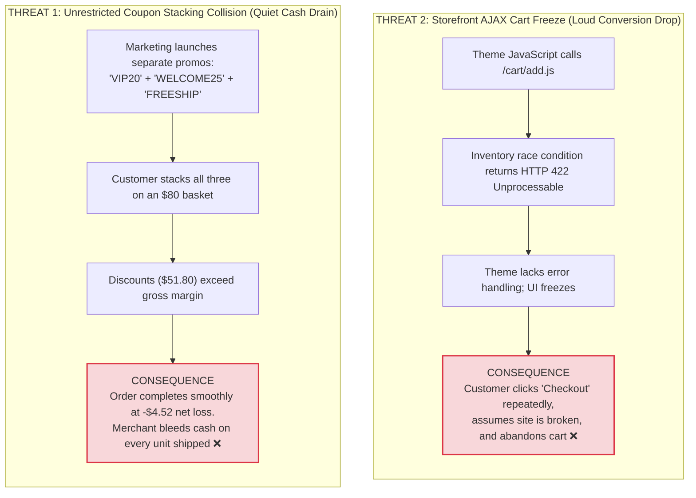
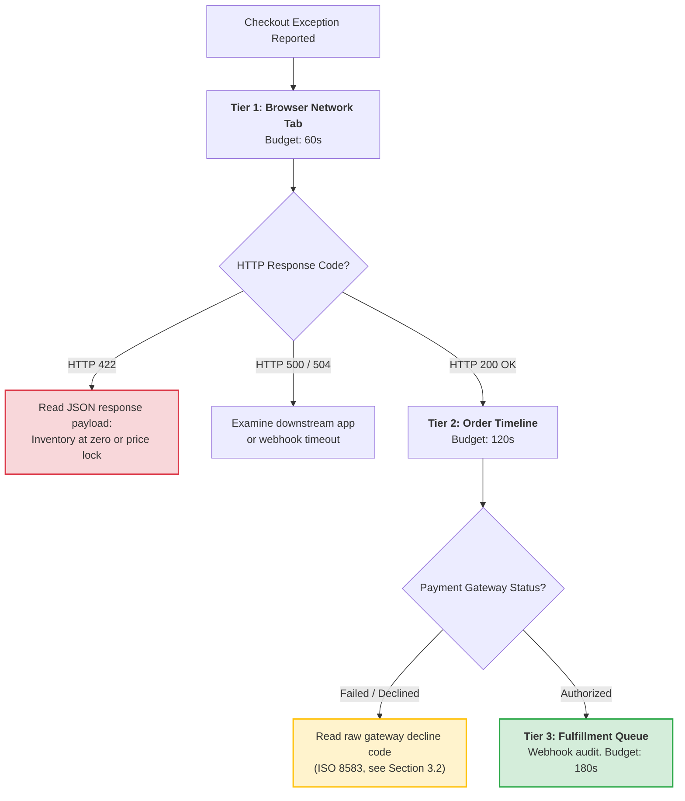
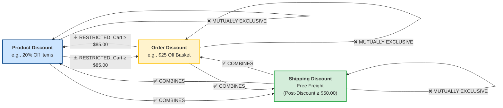
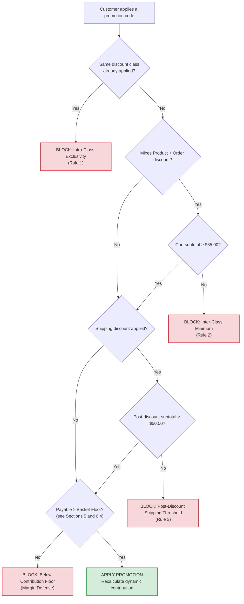
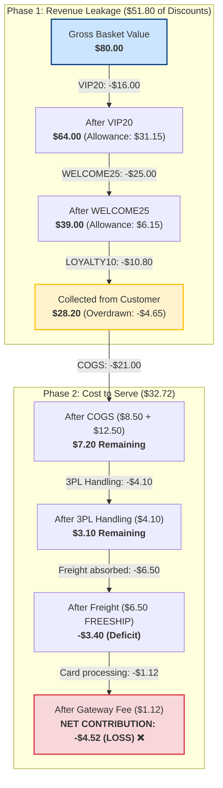

# Nothing Failed. The Order Still Sold Below Cost.

**How four stacked promotions turned an $80 cart into a modeled −$4.52 loss, and the contribution floor that blocks it**

*Synapse Botanicals Systems Architecture | Riovic Matthew | Master Dossier — Domain 5*

---

## 1. Item Sold. Ledger Said −$4.52: The $80 Cart That Drained in Silence

*How four promotions stacked without exclusivity on an $80 basket to produce an order that cost money to ship, and the contribution floor that prevents it.*

### 1.1 The Incident Paradox: Selling Below Direct Cost

The checkout returned no errors. The order confirmation fired. The warehouse picked, packed, and dispatched the parcel. By every signal the platform exposes — conversion event, fulfillment status, payment captured — Order **#29863** was a success.

The ledger disagreed.

Customer **David Miller** (`david.miller@example.com`) placed an $80.00 basket containing one Focus Stick Packs 30-Pack at $42.00 and one Adaptogen Tincture 60ml at $38.00. He applied four promotional codes in a single session: `VIP20` (20% off products), `WELCOME25` ($25.00 off the order), `LOYALTY10` (an unearned, merchant-funded $10.80 order discount), and `FREESHIP` (free ground shipping). This scenario assigns no prior customer funding or stored-credit liability to `LOYALTY10`. It reduces revenue. None of the codes blocked each other. The checkout accepted them all.

The customer paid **$28.20**. Manufacturing those goods cost $21.00. Picking, packing, and boxing them cost $4.10. Shipping them cost $6.50. Processing the payment cost $1.12. Total out-of-pocket: **$32.72** — against $28.20 collected.

**Modeled net contribution: −$4.52.** The platform raised no alarm, logged no failure, and shipped the parcel anyway. With combinatorial rules enforced, that exact same basket yields **+$30.24**.

This case study establishes the forensic triage protocol to isolate storefront failures in under three minutes, proves the unit-economic mechanics by which stacked promotions collapse contribution margin, and derives the algorithmic floor: the lowest customer payment a basket can accept before the order costs the merchant money.

### 1.2 Timeline and Contribution Collapse

```text
       REVENUE COLLECTED                               PHYSICAL COSTS & FEES
┌──────────────────────────────┐              ┌──────────────────────────────────────┐
│ Gross Basket:        $80.00  │              │ COGS (Manufacture):          $21.00  │
│ Total Discounts:    -$51.80  │              │ 3PL Warehouse Handling:       $4.10  │
├──────────────────────────────┤              │ Carrier Freight (FREESHIP):   $6.50  │
│ Customer Paid:       $28.20  │ ── MINUS ──► │ Merchant Gateway Fee:         $1.12  │
└──────────────────────────────┘              ├──────────────────────────────────────┤
                                              │ Total Out-of-Pocket Cost:    $32.72  │
                                              └──────────────────────────────────────┘
                                                                 │
                                                                 ▼
                                              ┌──────────────────────────────────────┐
                                              │ NET CONTRIBUTION LOSS:       -$4.52  │
                                              │ (Paid customer $4.52 to take goods)  │
                                              └──────────────────────────────────────┘
```

> [!CAUTION]
> **Controlled Failure Scenario Disclosure**: Order #29863, customer David Miller (`david.miller@example.com`), is an empirical failure-injection scenario executed within an isolated staging environment. The contribution calculation, unit costs, 3PL handling rates, and gateway fees represent a verified financial model. Deduplication, component BOM arithmetic, integer-cent rounding, and dynamic breakeven floors were verified against our local cost test harness ([`../evidence/costs/summary.md`](../evidence/costs/summary.md)). Storefront DevTools error payloads and ISO 8583 decline codes represent standard payment processing specifications. Section 12 provides the complete verification matrix distinguishing locally proven test suites from operational deployment specifications.

| Diagnostic Vector | Observed Value |
|---|---|
| **Incident Scope** | Order #29863 — $80.00 gross basket, 2 SKUs |
| **Promotional Collision** | `VIP20` + `WELCOME25` + `LOYALTY10` + `FREESHIP` — four codes, zero class exclusivity |
| **Settlement Delta** | $28.20 collected vs. $32.85 dynamic breakeven — $4.65 below the cash floor |
| **Financial Reversal** | **−$4.52** unprotected → **+$30.24** protected — a **+$34.76** swing on a single basket |
| **Remediation Guard** | 3×3 Combinatorial Matrix + sub-5ms WASM Margin Floor |

Understanding how one order drains margin is the first step; defending the entire storefront requires recognizing that checkout funnels fail in two opposite directions. Section 2 establishes the dual-threat landscape.

---

## 2. Fail Loudly or Succeed Too Well: The Two Storefront Threats

*The two opposite checkout failures (a stacked order that loses cash and a frozen cart that loses conversions), and their contrasting diagnostic signatures.*

### 2.1 The Two Storefront Threats

In direct-to-consumer e-commerce, the checkout funnel is vulnerable to two distinct yet equally damaging technical failure modes:



### 2.2 Asymmetric Failure Profiles: Margin vs. Conversion

While both failure modes occur within the checkout funnel, they exhibit opposite operational and diagnostic signatures:

| Diagnostic Dimension | Threat 1: Silent Margin Leak (Coupon Collision) | Threat 2: Loud Cart Freeze (AJAX State Error) |
|---|---|---|
| **Primary Symptom** | Zero errors reported; checkout completes smoothly | Buttons become unresponsive; checkout blocked |
| **Telemetry Signal** | Clean `HTTP 200 OK` across all requests | Browser DevTools logs `HTTP 422` or unhandled JS exception |
| **Discovery Channel** | Post-settlement ledger audit or monthly P&L review | Immediate customer complaint or drop in top-of-funnel conversion |
| **Financial Impact** | Cumulative out-of-pocket cash loss on every unit shipped | Immediate top-line revenue loss from abandoned carts |
| **Remediation Layer** | Server-side discount exclusivity & dynamic margin floor | Client-side error handling & real-time inventory validation |
| **Resolution Urgency** | Architectural redesign (Permanent prevention) | Rapid operational triage (<3 minute MTTI) |

The two threats require opposite technical disciplines and separate remediation tracks:

- **Threat 2 (Loud Cart Freeze)**: The checkout is broken and customers cannot complete purchases. The operational priority is speed: an on-call engineer must isolate the failing layer in under three minutes.
- **Threat 1 (Silent Margin Leak)**: The checkout completes smoothly while silently hemorrhaging cash on every shipped unit. The operational priority is mathematical precision: contribution floors, discount class rules, and combinatorial exclusivity.

We address the loud failure first: an active storefront freeze is an operational emergency hemorrhaging conversions and customer trust in real time. Section 3 introduces the three-tier forensic triage protocol to diagnose and resolve this failure in under three minutes, before Section 4 turns to the architectural defense of the order ledger.

---

## 3. When Checkout Fails Loudly: The Three-Minute Triage (<60s MTTI)

*A three-tier forensic checklist with 60, 120, and 180-second budgets: Tier 1 (browser network tab), Tier 2 (order timeline and gateway decline codes), and Tier 3 (the fulfillment queue).*

When a customer or support agent reports a broken checkout, nobody should guess. The protocol enforces three tiers with cumulative time budgets of 60, 120, and 180 seconds. The target for Tier 1 is an MTTI under 60 seconds.



### 3.1 Tier 1: Browser Network Tab Inspection (<60s)

1. Open Chrome Developer Tools (`F12`), select the **Network** tab, and filter by `Fetch/XHR`.
2. Replicate the user action (e.g., clicking "Add to Cart" or "Proceed to Checkout").
3. Select the failing request and inspect the response payload for `POST /cart/add.js` or `POST /cart/change.js`:

```json
{
  "status": 422,
  "message": "Cart Error",
  "description": "You cannot add that amount to the cart -- only 0 are available in stock."
}
```

*Diagnostic Outcome*: Identified in under 45 seconds. The database holds zero Available-to-Sell (ATS) inventory at the customer's designated fulfillment location. The storefront theme failed to parse the 422 response, silently freezing the checkout button.

### 3.2 Tier 2: Order Timeline & Gateway Decline Codes (<120s)

If the cart request returns `HTTP 200 OK`, proceed to the order timeline. Payment declines must be diagnosed via the **raw payment gateway response string**, never the generic, user-facing error message displayed on the storefront:

| Raw Gateway Decline String | ISO 8583 Code | Root Cause | Operator Action | Customer Guidance |
|---|:---:|---|---|---|
| `"decline_code": "insufficient_funds"` | `51` | Customer account lacks required liquidity | Zero storefront bug; close ticket | Advise customer to use alternative card. |
| `"decline_code": "card_velocity_exceeded"` | `75`† | Cardholder bank automated fraud velocity trip | Automated fraud defense engaged | Customer must contact issuing bank. |
| `"decline_code": "do_not_honor"` | `05` | Generic bank block (frequent on international cards) | Bank blocking cross-border merchant ID | Advise customer to authorize international charge. |
| `"decline_code": "expired_card"` | `54` | Card expiration date has passed | User input error | Request customer verify expiration date. |

> [!NOTE]
> **ISO 8583 Mapping Context**: Processor integrations (Stripe, Adyen, Shopify Payments) map internal decline codes to ISO 8583 response codes according to their proprietary banking rails.
>
> † Published network code tables list `75` as *"allowable number of PIN tries exceeded"*, and list declines for exceeding frequency limits under `65`. The `75` mapping for the velocity decline is retained here as the scenario's convention and must be verified before production reliance.

### 3.3 Tier 3: Fulfillment Queue Webhook Audit (<180s)

If payment shows `Authorized` and the order remains unfulfilled, the failure occurred downstream in the fulfillment export pipeline. The analyst uses the Order ID to inspect the middleware event log, correlating the outbound dispatch attempt against the 3PL's response status:

| HTTP Status | Semantic State | Immediate Operator Triage Protocol |
|:---:|---|---|
| **422 Unprocessable** | Business Rejection | **Do not replay blindly.** Inspect payload: if `PONR_EXCEEDED`, the order crossed the warehouse Point of No Return. If a schema lint error, patch before re-submitting. |
| **504 Gateway Timeout** | **Unknown State** | **Never retry without verification.** The socket closed, but the warehouse database may have committed the mutation. Probe 3PL state via `GET` before re-dispatching. |
| **429 Too Many Requests** | Rate Limited | **Pause and back off.** Do not re-trigger manual sync; ensure middleware honors `Retry-After` headers to avoid exhausting API burst quotas. |
| **500 / 502 / 503 Error** | Downstream Server Fault | **Transient 3PL outage.** Check warehouse API status page. Verify message is enqueued with jittered exponential backoff rather than dropped. |
| **401 / 403 Forbidden** | Auth / Scope Failure | **Fatal integration fault.** Halt exports immediately; alert on-call engineer to refresh expired OAuth tokens or rotated HMAC secret keys. |

*(For the complete architectural implementation of dead-letter queues, exponential backoff with full jitter, and two-phase 504 ledger reconciliation, see [Domain 4 Section 7.1](../domain-4-business-automation/MasterDossier-Domain4-WebhookAutomationAndFlowTriage.md).)*

Rapid forensic triage restores conversion when checkout breaks, but unblocking the transaction pipeline is only half the battle. Once orders flow freely, the storefront must defend against checkouts that succeed at the direct expense of profitability. Section 4 introduces the 3×3 combinatorial matrix that prevents uncontrolled promotional stacking.

---

## 4. When Checkout Succeeds Too Well: The 3×3 Discount Matrix

*Which promotion classes may combine, under what subtotals, and how the rules map onto server-side enforcement with Shopify Functions.*

The diagnostic path above resolves errors that prevent orders from completing. We now address the far more dangerous failure mode: **orders that complete smoothly with promotional combinations that destroy contribution margin**.

Shopify categorizes promotions into three distinct classes: **Product Discounts**, **Order Discounts**, and **Shipping Discounts**.

### 4.1 Master Combinatorial Exclusivity Architecture



A looping arrow indicates that a class excludes its own kind. A restricted arrow means the two classes combine only when the initial subtotal clears the minimum. Combinations involving free shipping remain subject to post-discount threshold qualification.

### 4.2 The Combinatorial Ruleset

| Combining | With Product Discount | With Order Discount | With Shipping Discount |
|---|---|---|---|
| **Product Discount** | **NEVER** (Rule 1) | **RESTRICTED** (Cart Subtotal $\ge \$85.00$) | **COMBINES** (Post-discount subtotal $\ge \$50.00$) |
| **Order Discount** | **RESTRICTED** (Cart Subtotal $\ge \$85.00$) | **NEVER** (Rule 1) | **COMBINES** (Post-discount subtotal $\ge \$50.00$) |
| **Shipping Discount** | **COMBINES** (Post-discount subtotal $\ge \$50.00$) | **COMBINES** (Post-discount subtotal $\ge \$50.00$) | **NEVER** (Rule 1) |

Three non-negotiable operational rules govern the matrix:
1. **Rule 1 (Intra-Class Exclusivity)**: A discount from a given class can *never* combine with another discount from the same class. (No stacking a 20% product coupon on top of a 15% product sale).
2. **Rule 2 (Inter-Class Minimum Floor)**: An order-level discount may combine with a product-level discount *only* if the initial cart subtotal is **$\ge \$85.00$**.
3. **Rule 3 (Post-Discount Shipping Qualification)**: Free shipping threshold qualification ($\ge \$50.00$) must be evaluated **after all promotional discounts have been deducted**, never against the pre-discount sticker price.

### 4.3 Production Checkout Enforcement Blueprint



The first three gates act as business proxies. The final gate ($F$) is the decisive algorithmic control: **no promotion stack may drive the customer payable below the basket's dynamic breakeven floor**.

### 4.4 Modern Platform Enforcement Architecture

Legacy storefronts attempted to enforce discount combination rules via client-side JavaScript or Liquid cart templates. This created severe vulnerabilities: buyers easily bypassed restrictions by manipulating local storage or posting direct REST payloads to `/cart/update.js`.

In modern Shopify Plus architectures, these gates execute server-side at the checkout boundary as **Shopify Functions** compiled to WebAssembly (WASM). Shopify executes Functions in a deterministic pipeline:

$$\text{Cart Transform (Normalization)} \longrightarrow \text{Discount API (Calculation \& Cap)} \longrightarrow \text{Validation API (Final Gate)}$$

| Gate in This Architecture | Shopify Function API Target | Runtime Role in the Pipeline |
|---|---|---|
| **Cart Normalization** | Cart Transform (`cart_transform`) | Runs first. Adjusts line pricing and bundle presentation (merge, expand) so discount math begins from a clean cart. |
| **Discount Calculation & Floor Cap** | Discount Function API (line & delivery) | Computes line and shipping discounts. Caps line discounts at the SKU maximum allowable ceiling (Section 5.2) and evaluates free shipping post-discount. |
| **Final Validation Gate** | Cart and Checkout Validation (`cart.validations.generate.run`) | Checks the final discounted cart. Activate its Validation resource through Admin GraphQL `validationCreate` with `enable: true` and `blockOnFailure: true`, then read those flags back. Return blocking checkout errors for an invalid combination, missing cost inputs, or a below-floor payable. The Discount Function owns calculation and capping; Validation does not remove discounts. |

> [!NOTE]
> **API Index Specification**: Custom applications implementing Function APIs require Shopify Plus. Earlier platform documentation referred to a *discounts allocator* target in preview; current Shopify Functions index under the unified Discount API. Target naming reflects the 2026-10 specification.

---

## 5. How Much Discount a Basket Can Afford: The Contribution Margin Protection Floor

*The margin formula, why fees must be computed on the discounted payment rather than the sticker price, and the per-SKU ceilings on discount.*

Combination rules govern which promotions coexist. The **Contribution Margin Protection Floor** answers the next question: does the final payment cover this basket's declared product, fulfillment, freight, and processing costs? The gate blocks a negative modeled unit contribution. A zero floor does not fund overhead, acquisition, or unmodeled recovery costs.

$CM = (\text{Retail Price} - \text{Total Discount}) - (\text{COGS} + \text{3PL Handling} + \text{Carrier Freight} + \text{Processing Fee})$

$\text{Processing Fee} = \text{round}(0.029 \times \text{Customer Payment} + \$0.30) \quad \text{\small (rounded half-up to the nearest cent)}$

### 5.1 Naive vs. Dynamic Gateway Breakeven

A critical mathematical flaw in naive retail modeling is calculating payment gateway fees against the full retail sticker price:

$P_{\text{static}} = \text{COGS} + \text{3PL Handling} + \text{Carrier Freight} + \text{round}(0.029 \times \text{Retail Price} + \$0.30)$

Because credit card processors charge strictly on the cash actually captured ($2.9\% + \$0.30$), evaluating fees on full retail overstates costs on discounted orders:

```text
  STATIC MODEL (Naive):   $42.00 Retail × 2.9% + $0.30 = $1.52 Fee  ──► Breakeven: $19.57
  DYNAMIC MODEL (Exact):  $18.90 Floor  × 2.9% + $0.30 = $0.85 Fee  ──► Breakeven: $18.90
  ────────────────────────────────────────────────────────────────────────────────────────
  RESULT: Naive static pricing overstates costs, needlessly withholding $0.67 in discount headroom.
```

The true dynamic breakeven solves for the customer payment $P'$ where net contribution equals exactly zero:

$P' - (\text{COGS} + \text{3PL Handling} + \text{Carrier Freight}) - (0.029\,P' + \$0.30) = 0$

$P' \times (1 - 0.029) = \text{COGS} + \text{3PL Handling} + \text{Carrier Freight} + \$0.30$

$P' = \frac{\text{COGS} + \text{3PL Handling} + \text{Carrier Freight} + \$0.30}{1 - 0.029}$

**Whole-Cent Integer Resolution**: Because merchant banking rails cannot capture fractional pennies, continuous solutions (e.g., Focus Sticks $P' = \$18.896$) cannot be applied directly as raw floats. The operational dynamic floor is the smallest whole-cent payment whose contribution remains non-negative when credit card fees are rounded half-up, and whose immediately preceding cent leaves a negative balance.

### 5.2 Catalog Unit Economics & Discount Ceilings

Applying the dynamic formula across the catalog establishes the maximum allowable discount each product can withstand:

| SKU | Variant Name | Retail Price | COGS | 3PL Handling | Carrier Freight | Static Breakeven (Full-Fee) | Dynamic Floor ($P'$) | Max Allowable Discount ($) | Max Allowable Discount (%) |
|---|---|:---:|:---:|:---:|:---:|:---:|:---:|:---:|:---:|
| `SYN-FSTK-MY` | Focus Stick Packs 30-Pack | $42.00 | $8.50 | $3.70 | $5.85 | $19.57 | **$18.90** | **$23.10** | **55.0%** |
| `SYN-TNCT-AM` | Adaptogen Tincture 60ml | $38.00 | $12.50 | $3.70 | $5.85 | $23.45 | **$23.02** | **$14.98** | **39.4%** |
| `SYN-TMBL-MO` | Precision Insulated Tumbler | $34.00 | $7.00 | $3.70 | $5.85 | $17.84 | **$17.35** | **$16.65** | **49.0%** |
| `SYN-ACC-WHSK` | Micro-Foam Electric Whisk | $16.00 | $3.10 | $3.30 | $4.50 | $11.66 | **$11.53** | **$4.47** | **27.9%** |
| `SYN-BNDL-MAO` | Starter Bundle (`catalog_bundle_82`)* | $82.00 | $28.40 | $4.50 | $7.20 | $42.78 | **$41.61** | **$40.39** | **49.3%** |

> [!NOTE]
> **Logistics Schedule & Bundle BOM Baseline**:
> * **Declared Fulfillment Inputs**: The Focus Sticks, tincture, and tumbler standalone rows each declare $3.70 handling and $5.85 freight. The whisk declares $3.30 handling and $4.50 freight. Order #29863 declares $4.10 handling and $6.50 freight for its two-unit carton. These inputs are recorded under `declared_fulfillment_inputs` in the [input ledger](../evidence/costs/bom_inputs.json). Each amount belongs to its declared configuration. The current cost runner executes bundle `scenarios`; these standalone and basket records remain declared dossier inputs.
> * **Three Bundle Fixtures, Three Named Inputs**: The $98.00 `capstone` order uses $4.50 handling and $7.20 freight. The $82.00 `catalog_bundle_82` table row holds those fulfillment inputs fixed. The separate $82.00 `alternative_promo` benchmark uses $4.90 handling and $6.50 baseline freight. Price and fulfillment assumptions travel with the scenario ID.
> * **Bundle BOM**: The Starter Bundle reflects $28.40 kitted COGS ($28.00 raw components + $0.40 packaging/kitting material).

### 5.3 Merchandising Impact: Unlocked Headroom vs. Low-Margin Hazards

Evaluating dynamic floors reveals two critical commercial insights for growth and finance teams:

1. **Unlocking Legitimate Promotional Headroom**: The static column overstates the floor in every catalog row: by **$0.67** for Focus Sticks, **$0.43** for Tincture, **$0.49** for Tumbler, **$0.13** for Whisk, and **$1.17** for the Bundle. Calculating fees statically penalizes marketing by withholding valid promotional headroom that remains fully profitable.
2. **Exposing the Low-Margin Hazard**: While high-margin consumables tolerate aggressive discounting (Focus Sticks withstand 55.0%), low-margin accessories (*Micro-Foam Electric Whisk* with a **27.9% ceiling**) and high-cost consumables (*Adaptogen Tincture* with a **39.4% ceiling**) represent extreme operational vulnerabilities.

> [!IMPORTANT]
> **The Low-Margin Hazard in Practice**: Stacking a standard 20% coupon with a $5.00 order credit takes $8.20 off a $16.00 whisk against a ceiling of $4.47. On the $38.00 tincture, a 20% coupon plus a $10.00 credit takes $17.60 off against a ceiling of $14.98. Both combinations breach the unit floor, causing the merchant to pay the customer to take inventory.

Deriving mathematical breakeven floors establishes the theoretical defense, but testing those limits against an unconstrained checkout reveals how quickly combinations fail. Section 6 simulates the four-code collision on Order #29863.

---

## 6. Four Codes, One $80 Cart: The Collision Simulation of Order #29863

*Establishing the basket's discount capacity, tracing the four-code collision through a burn-down ledger, demonstrating layered rule protection, and proving the discrete whole-cent floor.*

### 6.1 Baseline Order Configuration & Allowable Discount Capacity

- **Order Identifier**: `#29863`
- **Line Item 1**: 1× Focus Stick Packs 30-Pack (`SYN-FSTK-MY`) = $42.00 (COGS: $8.50)
- **Line Item 2**: 1× Adaptogen Tincture 60ml (`SYN-TNCT-AM`) = $38.00 (COGS: $12.50)
- **Gross Merchandise Value (GMV)**: **$80.00**
- **Direct Operational Costs**: Packaged into a single consolidated parcel with declared handling of $4.10 and freight of $6.50. Combined with $21.00 in product COGS, the basket carries **$31.60 in physical costs** before transaction processing.
- **Dynamic Breakeven Floor**: Using the dynamic formula derived in Section 5.1, the minimum payment required to achieve non-negative contribution is **$32.85** (verified discretely in Section 6.4).
- **Maximum Allowable Discount Capacity**:
  $$\text{Basket Discount Allowance} = \text{GMV } (\$80.00) - \text{Floor } (\$32.85) = \mathbf{\$47.15} \quad (58.94\% \text{ ceiling})$$

Before checkout accepts a code, the basket carries **$47.15** in discount capacity. In this scenario, `LOYALTY10` is an unearned promotional order discount, so it spends that capacity alongside the other merchant-funded deductions. The $32.85 floor already includes the declared $6.50 freight cost. Deduct shipping expense once; do not spend the same freight dollar again as an additional merchandise discount.

### 6.2 The Unrestricted Collision Event

During checkout, four separate promotions collided without exclusivity rules, rapidly exhausting the $47.15 discount allowance:

| Step | Promotion Code | Class & Offer | Incremental Deduction | Customer Payable | Remaining Discount Headroom | Operational Status |
|:---:|---|---|:---:|:---:|:---:|:---:|
| **0** | Initial Cart | Baseline $80.00 basket | — | $80.00 | **+$47.15** | Full Headroom Available |
| **1** | `VIP20` | Product (20% off items) | −$16.00 | $64.00 | **+$31.15** | Within Safe Threshold |
| **2** | `WELCOME25` | Order ($25.00 off cart) | −$25.00 | $39.00 | **+$6.15** | Critical Buffer Remaining |
| **3** | `LOYALTY10` | Order (unearned promotional reward) | -$10.80 | **$28.20** | **-$4.65** | **CRITICAL OVERDRAW (Breach)** |
| **4** | `FREESHIP` | Shipping ($6.50 freight absorbed) | $6.50 absorbed | **$28.20** | **−$4.65** | Deficit Shipped Out-of-Pocket ❌ |



```text
ORDER #29863: PRE-FIX FINANCIAL DISASTER AUDIT
  Gross Merchandise Value:                  $80.00
  Discounts Applied: (-$16.00 - $25.00 - $10.80): -$51.80
  ───────────────────────────────────────────────────────
  Total Collected from Customer:            $28.20
  Cost of Goods Sold (COGS):               -$21.00  ($8.50 Sticks + $12.50 Tincture)
  3PL Warehouse Handling:                   -$4.10  (Pick, pack & box fees)
  Carrier Outbound Freight:                 -$6.50  (FREESHIP absorbed by merchant)
  Payment Gateway Fee:                      -$1.12  (round(2.9% × $28.20 + $0.30))
  ───────────────────────────────────────────────────────
  NET ORDER CONTRIBUTION:                   -$4.52  (NET LOSS ON SALE)
  (With optional $0.28 gateway authorization fee: -$4.80)
```

**Reconciling the $4.65 Overdraw with the −$4.52 Net Loss**: The customer received $51.80 in total discounts, overdrawing the $47.15 allowance by exactly **$4.65**. The final net contribution loss was −$4.52 rather than −$4.65 because the lower collected payment ($28.20 vs. $32.85) reduced credit card fees from $1.25 down to $1.12 ($2.9% × $28.20 + $0.30). This dynamic fee reduction provided **$0.13 in processing fee relief** ($4.65 − $0.13 = $4.52).

**The Shipping Decoy**: `FREESHIP` left customer payment at $28.20 while the merchant absorbed the declared $6.50 freight cost. Charging the customer that $6.50 would raise collected revenue to $34.70. The fee rounds to $1.31, leaving **+$1.79 in contribution**: $34.70 - $21.00 COGS - $4.10 handling - $6.50 freight - $1.31 processing. Freight enters the cost ledger once; collected shipping revenue helps fund it.

### 6.3 Post-Remediation Execution (Layered Protection Applied)

With the 3×3 Combinatorial Matrix and checkout validation enforced:
1. The customer applies `VIP20` $\to$ Applied (−$16.00). Subtotal is **$64.00**. Remaining discount allowance is **$31.15**.
2. The customer attempts `WELCOME25` $\to$ **Blocked by Rule 2**:
   > *"Discount code WELCOME25 cannot be combined with VIP20 on carts under $85.00."*
   Notice that Rule 2 intercepts the combination at the storefront boundary *before* the basket approaches its $32.85 floor.
3. Treat `LOYALTY10` as an unearned promotional **order discount**. Apply the same class-exclusivity and basket-floor gates. Customer-funded payment tenders require their own settlement accounting.
4. **Shipping Qualification**: Because the post-discount subtotal ($64.00) clears the $\ge \$50.00$ threshold (Rule 3), Free Ground Shipping is granted ($6.50 freight absorbed by merchant).

```text
ORDER #29863: POST-FIX PROTECTED CONTRIBUTION
  Customer Payment Collected:               $64.00
  Cost of Goods Sold (COGS):               -$21.00
  3PL Warehouse Handling:                   -$4.10
  Carrier Outbound Freight:                 -$6.50
  Payment Gateway Fee:                      -$2.16  (round(2.9% × $64.00 + $0.30))
  ───────────────────────────────────────────────────────
  NET ORDER CONTRIBUTION:                  +$30.24  (47.25% Contribution Margin!)
```

> [!NOTE]
> **Shipping Qualification Sensitivity**: Free ground shipping was granted because the post-discount subtotal ($64.00) cleared Rule 3's $\ge \$50.00$ threshold. Under an alternative policy where the customer pays the $6.50 freight charge, collected revenue rises to $70.50, gateway fee becomes $2.34, and net contribution reaches **+$36.56** — an additional $6.32 of margin headroom available to operators who set a tighter free-shipping floor.

### 6.4 Worked Discrete Whole-Cent Basket Floor Derivation

Per-SKU floors are essential benchmarks, but true margin defense requires evaluating the **basket-level floor**.

For Order #29863, total fixed physical costs are:
$$\text{Fixed Costs} = \text{COGS } (\$21.00) + \text{3PL Handling } (\$4.10) + \text{Freight } (\$6.50) = \$31.60$$

Using discrete whole-cent search with half-up rounded gateway fees:
* **Step 1: Closed-Form Continuous Estimate**:
  $$P' = \frac{\$31.60 + \$0.30}{1 - 0.029} = \frac{\$31.90}{0.971} \approx \$32.8527$$
* **Step 2: Whole-Cent Boundary Test at \$32.85**:
  $$\text{Fee} = \text{round}(0.029 \times \$32.85 + \$0.30) = \text{round}(\$0.95265 + \$0.30) = \text{round}(\$1.25265) = \$1.25$$
  $$\text{Contribution} = \$32.85 - \$31.60 - \$1.25 = \mathbf{\$0.00} \quad (\text{Non-negative: VALID FLOOR})$$
* **Step 3: Whole-Cent Boundary Test at \$32.84**:
  $$\text{Fee} = \text{round}(0.029 \times \$32.84 + \$0.30) = \text{round}(\$0.95236 + \$0.30) = \text{round}(\$1.25236) = \$1.25$$
  $$\text{Contribution} = \$32.84 - \$31.60 - \$1.25 = \mathbf{-\$0.01} \quad (\text{Negative: DEFICIT})$$

The lowest whole-cent payment that breaks even for Order #29863 is **$32.85**. The separate `alternative_promo` bundle model uses $28.40 in COGS and $4.90 in handling. With the same 2.9% + $0.30 fee, rounded to cents, its minimum payable is $41.30 at $6.50 freight and $49.64 at $14.60 freight. Section 8.2 shows both calculations and the full range. The [freight sensitivity report](../evidence/costs/summary.md) records the offline results.

### 6.5 Multi-Item Box Economy of Scale

Why does the basket floor ($32.85) differ from the sum of the individual SKU floors ($18.90 + $23.02 = $41.92)?

The two separate orders use $7.40 in handling ($3.70 × 2) and $11.70 in freight ($5.85 × 2). The combined parcel uses $4.10 in handling and $6.50 in freight, saving $8.50 in physical costs. At their respective floors, the two payments incur $0.85 + $0.97 in processing versus $1.25 for the combined payment, a further $0.57 difference. Together, those differences explain the **$9.07** gap between the sum of the separate floors and the basket floor:

| Cost & Fee Component | Two Separate Shipments (Sum of SKU Floors) | One Consolidated Shipment (Order #29863) | Net Consolidation Savings |
|---|:---:|:---:|:---:|
| **Product COGS** | $21.00 ($8.50 + $12.50) | $21.00 ($8.50 + $12.50) | $0.00 (Unchanged) |
| **3PL Warehouse Handling** | $7.40 ($3.70 × 2) | $4.10 (Single box pick/pack) | **+$3.30** |
| **Carrier Outbound Freight** | $11.70 ($5.85 × 2) | $6.50 (Single box ground) | **+$5.20** |
| **Subtotal Physical Direct Costs** | **$40.10** | **$31.60** | **+$8.50** |
| **Payment Gateway Processing Fees** | $1.82 ($0.85 + $0.97) | $1.25 (On $32.85 collected) | **+$0.57** |
| **Dynamic Breakeven Floor ($P'$)** | **$41.92** ($18.90 + $23.02) | **$32.85** | **+$9.07 Lower Floor** |

Consolidating items into a single parcel preserves **$8.50 in direct physical overhead** ($3.30 handling + $5.20 freight). Because the lower physical cost reduces the breakeven revenue threshold, the card processing fee drops from $1.82 to $1.25, contributing an additional **$0.57 in fee relief** for a total **$9.07 economy of scale**.

Tracing the physical savings of consolidated shipping explains the basket mechanics, but preventing recurrence requires isolating which controls failed. Section 7 presents the root-cause failure mode matrix.

---

## 7. The Missing Floor Was the Decisive Failure: The Root-Cause Failure Mode Matrix

*Five failure modes, which rule or guard each one breaks, and the crucial distinction between operational proxy rules and mathematical floors.*

### 7.1 Root-Cause Failure Mode Matrix

| # | Failure Mode | Root-Cause Class | Rule Breached | Architectural Guard | Seen in Order #29863 |
|:---:|---|---|:---:|---|:---:|
| **1** | Two discounts from same class stack | Missing intra-class exclusivity | Rule 1 | Class-exclusivity gate at checkout boundary (Sections 4.3 and 4.4). | **YES**: `WELCOME25` + promotional order reward `LOYALTY10`. |
| **2** | Order discount stacks on small cart | Missing inter-class minimum | Rule 2 ($85.00) | Validation API reads cart subtotal before permitting mix. | **YES**: `WELCOME25` on $80 cart with `VIP20`. |
| **3** | Free shipping granted on discounted cart | Threshold evaluated pre-discount | Rule 3 ($50.00) | Delivery discount judged strictly on post-discount subtotal. | **YES**: `FREESHIP` applied at $28.20 payable. |
| **4** | Discounts exceed physical costs | Zero margin protection floor | Dynamic Floor | Per-basket floor validation gate backed by cost inputs (Sections 5 and 6.4). | **YES**: $28.20 collected against $32.85 floor. |
| **5** | Storefront theme freezes on out-of-stock item | Silent failure on 422 | Tier 1 Triage | Visible theme error boundaries & 422 JSON telemetry monitoring. | *No (Belongs to Threat 2).* |

### 7.2 The Decisive Root Cause: Proxy Rules vs. Mathematical Floors

Examining the five failure modes reveals a fundamental hierarchy between operational heuristics and mathematical guarantees:

1. **Heuristic Policy Proxies (Defects #1, #2, #3)**: Rules such as class-exclusivity boundaries, subtotal minimums ($85.00), and post-discount shipping thresholds ($50.00) serve as operational friction. They are easily configured in storefront admin interfaces and immediately intelligible to marketing operators. However, proxy rules are inherently fragile: launching a new high-percentage coupon (e.g., a 40% VIP flash sale) or shifting catalog product costs can satisfy all proxy rules while still breaching profitability.
2. **The Decisive Defect (Defect #4 — Zero Margin Protection Floor)**: The catastrophic vulnerability in Order #29863 was not merely that codes combined, but that the checkout engine possessed no server-side awareness of direct fulfillment costs. A dynamic margin protection floor acts as an absolute mathematical invariant: regardless of what promotional codes are presented, the transaction is rejected or pruned if customer payment falls below $P'_{\text{dynamic}}$. Had Defect #4 been mitigated, the checkout would have automatically rejected the final promotional deduction at $32.85, preserving contribution even in the total absence of Rules 1 through 3.

Resilient checkout needs both layers. Policy gates control promotion combinations; the basket floor blocks a negative contribution under the published cost inputs. Neither substitutes for current costs or a positive commercial margin target. Section 8 defines the inputs and deployment contract that make the gate useful.

---

## 8. Every Threshold in One Place: The Protection's Configuration Parameters

*Operational configuration parameters, why dynamic floors must account for geographic shipping zones, and the sub-5ms runtime pipeline that enforces them.*

### 8.1 Operational Configuration Parameters

| Parameter | Production Value | Architectural Rationale | Cross-Reference |
|---|---|---|:---:|
| **Inter-Class Combination Minimum (Rule 2)** | Cart Subtotal $\ge \$85.00$ | Proxy keeping small baskets from combining product and order discounts. | Section 4.2 |
| **Post-Discount Shipping Threshold (Rule 3)** | Post-discount subtotal $\ge \$50.00$ | Evaluated **strictly after** promotional discounts are deducted. | Section 4.2 |
| **Merchant Processing Rate** | 2.9% + $0.30 | Recomputed dynamically against the discounted payment amount. | Section 5 |
| **Processing Fee Base** | Includes shipping & taxes | Gateway charges percentage fee on gross transaction capture. | Section 5 |
| **Contribution Revenue Base** | Excludes remitted sales tax | Sales tax collected is a fiduciary liability, not merchant revenue. | Section 5 |
| **Floor Search Algorithm** | Whole cents, asserting preceding cent is negative | Resolves discrete whole-cent breakeven payment. | Sections 5 and 6.4 |
| **Order #29863 Cost Inputs** | COGS $21.00, 3PL $4.10, freight $6.50 | One Focus Stick pack ($8.50) and one tincture ($12.50) share one parcel. The handling and freight amounts are declared basket inputs. The [BOM](../evidence/costs/summary.md) records the product costs. | Section 6 |

### 8.2 Geographic Volatility: Why Dynamic Floors Require Zone-Aware Freight

A major blindspot in naive margin defense is treating fulfillment freight as a single, static national constant (e.g., standardizing on $6.50). In reality, carrier shipping costs fluctuate dramatically across geographic zones. If a merchant sets a static nationwide breakeven floor, orders shipped locally may remain profitable, while identical orders shipped cross-country bleed cash.

The same kit can carry a different financial fixture. Here the **Promotional Campaign Scenario** (`alternative_promo`) declares an $82.00 price, $28.40 kitted COGS, $4.90 handling, and $6.50 baseline freight in [the input ledger](../evidence/costs/bom_inputs.json). Hold price, COGS, and handling fixed; vary only the freight input below. The declared $4.90 handling amount stays fixed throughout this freight sweep.

| Outbound Freight Cost | Total Direct Costs | Net Contribution ($82 Retail) | Dynamic Minimum Payable Floor | Delta vs. $6.50 Baseline | Max Allowable Discount ($) |
|:---:|:---:|:---:|:---:|:---:|:---:|
| **$4.50 (Local Zone 1)** | $37.80 | $41.52 | **$39.24** | −$2.06 | $42.76 (52.1%) |
| **$6.50 (Standard Zone 3)** | $39.80 | $39.52 | **$41.30** | *Baseline* | $40.70 (49.6%) |
| **$8.50 (Regional Zone 5)** | $41.80 | $37.52 | **$43.36** | +$2.06 | $38.64 (47.1%) |
| **$10.50 (Zone 6)** | $43.80 | $35.52 | **$45.42** | +$4.12 | $36.58 (44.6%) |
| **$14.60 (Cross-Country Zone 8)** | $47.90 | $31.42 | **$49.64** | **+$8.34** | $32.36 (39.5%) |
| **$17.80 (Remote / AK / HI)** | $51.10 | $28.22 | **$52.93** | +$11.63 | $29.07 (35.5%) |

At $6.50 freight (Zone 3), fixed costs are $39.80 and the dynamic floor is **$41.30**. But when that same package is shipped cross-country to Zone 8 ($14.60 freight), fixed costs rise to $47.90, driving the required floor up to **$49.64**—an **+$8.34 swing** in required customer payment. In remote destinations (Alaska/Hawaii), the floor spikes to **$52.93** (+11.63).

**The Architectural Implication**: A promotional discount of $40.00 on this $82.00 bundle leaves a $42.00 customer payment. That payment is fully profitable in Zone 1 (clearing the $39.24 floor), but generates an immediate operational loss in Zone 8 (failing the $49.64 floor). Therefore, checkout validation cannot rely on static catalog averages; it must dynamically resolve the floor against the customer's actual destination postal zone.

*(Note: In contrast to this $82.00 promotional benchmark, the Capstone models Elena Vance's Order #35070 at its full standard MSRP of $98.00 ($28.40 COGS, $4.50 handling, $7.20 freight, $3.14 processing = $54.76 baseline contribution). Both scenario variants are checked integer-cent inputs in `evidence/costs/bom_inputs.json`. [Capstone Section 7.1](../capstone/MasterDossier-Capstone-AsynchronousOrderMutation.md#71-baseline-vs-dual-fulfillment-recovery-ledger) itemizes Elena's baseline and replacement ledgers.)*

### 8.3 Three-Tier Production Enforcement: Block the Loss Before the Box Moves

A Discount Function calculates and caps the promotion it produces. The Cart and Checkout Validation Function guards the final payable. Keep those jobs separate: the calculator sets the discount; the gate stops a below-floor checkout before the warehouse receives an order it costs money to ship.

```mermaid
flowchart TD
    subgraph TIER1["1. Checkout Boundary: Proposed Shopify Functions Deployment"]
        D1["Discount Function<br/>Calculate and cap its discount output"] --> V1["Validation Function<br/>Read final discounted cart and cost inputs"]
        V1 --> V2{"Inputs valid and current;<br/>contribution floor satisfied?"}
        V2 -- "Yes" --> PASS["Allow Checkout Progression"]
        V2 -- "No" --> BLOCK["Block Checkout<br/>Return an actionable customer message"]
    end
    subgraph TIER2["2. Promotion Configuration"]
        A1["Native combinesWith Settings<br/>Approved discount combinations"] --> A2["Function Policy Checks<br/>$85 combination / $50 shipping thresholds"]
    end
    subgraph TIER3["3. Asynchronous Cost Publication"]
        E1["ERP / WMS Declared Cost Inputs"] --> E2["Versioned Metafields<br/>Currency, effective time, and freshness limit"]
    end
    TIER2 -.->|"Policy Inputs"| TIER1
    TIER3 -.->|"Cost Inputs"| TIER1
    style PASS fill:#d4edda,stroke:#28a745,stroke-width:2px;
    style BLOCK fill:#f8d7da,stroke:#dc3545,stroke-width:2px;
```



**Activate the gate through Admin GraphQL.** Deploy the Function first. With the required validation scopes, call `validationCreate(validation: $input)` using the app-owned Function handle. `blockOnFailure` belongs to the Validation resource; a TOML label cannot switch it on:

```graphql
mutation ActivateSynapseMarginFloor($input: ValidationCreateInput!) {
  validationCreate(validation: $input) {
    validation { id enabled blockOnFailure }
    userErrors { field message }
  }
}
```

```json
{
  "input": {
    "functionHandle": "synapse-margin-floor",
    "title": "Synapse contribution floor",
    "enable": true,
    "blockOnFailure": true
  }
}
```

Use the handle of the deployed extension. Require no top-level GraphQL errors, an empty `userErrors` array, and a returned Validation ID. Persist that ID, then read the resource back:

```graphql
query VerifySynapseMarginFloor($id: ID!) {
  node(id: $id) {
    ... on Validation { id enabled blockOnFailure }
  }
}
```

Proceed only when the persisted resource returns `enabled: true` and `blockOnFailure: true`. Update an existing resource through `validationUpdate` rather than creating another gate on every retry. These are deployment acceptance checks, not executed calls in this repository. [Validation activation](https://shopify.dev/docs/api/admin-graphql/2026-10/mutations/validationCreate) · [Validation resource](https://shopify.dev/docs/api/admin-graphql/2026-10/objects/Validation)

* **Runtime failure and missing cost data are different failures.** `blockOnFailure: true` closes the runtime-exception path. The Function must separately return a blocking validation error when required costs are missing, malformed, stale, in the wrong currency, or unsuitable for the destination/service. Never substitute zero costs or single-code exclusivity. Evaluate the final discounted cart; include tax in the processing base and exclude remitted tax from contribution revenue. [Validation failure behavior](https://shopify.dev/docs/api/functions/2026-10/cart-and-checkout-validation)
* **Measure the target; respect the platform limit.** This design targets sub-5ms evaluation using published cost metafields instead of live ERP calls. The repository has not measured that target. Shopify documents an 11-million-instruction allowance for carts with up to 200 lines, scaling for larger carts. Profile the deployed Function against its instruction budget; do not describe 5ms as the host's enforced CPU cutoff. [Function instruction limits](https://shopify.dev/docs/apps/build/functions/optimize-instruction-counts)
* **One coupon can cross the floor.** The Micro-Foam Electric Whisk (`SYN-ACC-WHSK`) retails at $16.00 and has an $11.53 floor under its declared fulfillment inputs. A 40% promotion leaves $9.60: the gate blocks the checkout even when no other code is present. The number of coupons does not change the cost of putting that whisk in a box.

The checkout mechanism remains a deployment specification. Section 9 measures the declared campaign's contribution swing; it does not turn this proposed gate into a live-platform result.

---

## 9. $34.76 on One Order, $34,760 on a Campaign: Modeled Financial Exposure

*The financial swing on Order #29863 and how preventing uncontrolled coupon stacking scales across a 1,000-order marketing campaign.*

### 9.1 Financial Swing on Order #29863

| Financial Metric | Pre-Fix (Unrestricted Collision) | Post-Fix (Matrix Protected) | Net Operational Swing |
|---|:---:|:---:|:---:|
| **Collected from Customer** | $28.20 | $64.00 | +$35.80 |
| **Contribution (Standard Gateway Fee)** | **−$4.52** | **+$30.24** | **+$34.76** |
| **Contribution (With Optional $0.28 Auth Fee on Each Order)** | -$4.80 | +$29.96 | +$34.76 |
| **Contribution Margin (%)** | **-16.03%** | **+47.25%** | **+63.28 percentage points** |

Enforcing combinatorial rules swings this single order by **+$34.76**.

### 9.2 Scaled Campaign Exposure Model

One -$4.52 order looks small beside a campaign dashboard. Repeat the same fixture 1,000 times and the warehouse ships **-$4,520.00 in modeled contribution**. Hold paid-order volume and cost inputs fixed, then compare the protected checkout:

| Campaign Exposure Metric | Calculation | Financial Result |
|---|---|---:|
| **Protected Contribution (Rules Enforced)** | 1,000 orders * +$30.24 | **+$30,240.00** |
| **Unprotected Modeled Contribution (4 Stacked Codes)** | 1,000 orders * (-$4.52) | **-$4,520.00** |
| **Preserved Contribution** | $30,240.00 - (-$4,520.00) | **+$34,760.00** |

```text
1,000-ORDER CAMPAIGN: DECLARED COSTS AND FIXED PAID-ORDER VOLUME
  Uncontrolled stacking:          -$4,520.00 contribution
  Protected checkout:           +$30,240.00 contribution
  ------------------------------------------------------
  PRESERVED CONTRIBUTION:       +$34,760.00 per campaign
```

The control changes what each paid order contributes before overhead and acquisition costs. Across 1,000 identical modeled orders, the protected branch preserves **$34,760.00 in contribution**. This is a scenario comparison; realized campaign results also depend on conversion, demand, and actual fulfillment invoices.

The financial case puts a price on the missing floor. Section 10 turns that diagnosis into enforceable operating rules.

---

## 10. Classes, Thresholds, Floors, Responses: Four Rules for Prevention and Recovery

*The four rules distilled from the triage protocol, discount matrix, and margin floor, each stated as something a team can enforce.*

1. **One Discount Per Class**: Product, order, and shipping promotions each exclude their own kind. Never allow intra-class stacking.
2. **Evaluate Thresholds After Discounts**: Free shipping floors and combination minimums apply to the post-discount subtotal, never the sticker price.
3. **Know the Floor for Every Basket**: Derive breakeven dynamically from physical costs with fees recomputed at the discounted payment. Block any combination that breaches the floor.
4. **Read the Response, Not the Screen**: When checkout fails, inspect the raw DevTools `Fetch/XHR` payload and the raw ISO 8583 payment decline string. Replace guessing with forensic triage.

These four rules provide the operational safeguards, but their urgency comes from recognizing the fundamental difference between an outage and a margin leak. Section 11 concludes with the architectural takeaway on silent failures.

---

## 11. Margin Leaks Don't Alarm: The Architectural Takeaway

*Why unconstrained discount stacking is quieter and more dangerous than a site crash, and how automated floors protect unit economics.*

Order #29863 completed without a single error. The customer was served, the payment cleared without friction, the warehouse picked the box, and the financial ledger showed an unrecoverable loss.

That is what separates margin leaks from outages: **they do not alarm**. When a database crashes or an API rate limit trips, monitoring dashboards turn red and on-call engineers wake up. When a promotion stack sells an order below cost, the storefront celebrates an increment to the sales counter, while cash silently drains out of the business.

A margin leak is quieter than an outage, but every bit as destructive: nothing alarms, and the damage is visible only in arithmetic.

The four operational laws eliminate this vulnerability at the boundary:
* Three-minute forensic triage identifies and fixes conversion-blocking errors before customers churn.
* A 3×3 combinatorial matrix stops promotional stacking before checkout can proceed.
* An activated contribution gate blocks orders below the floor calculated from valid, current inputs; the production audit must reconcile those inputs to actual cost.

> **A sale is not a success until the contribution margin is positive. Protect the floor before you publish the code.**

The architectural philosophy explains why margin leaks persist undetected; transparent verification proves that our financial models hold. Section 12 establishes the formal evidentiary scope separating locally executed cost tests from live platform specifications.

---

## 12. 11 Local Checks Passed, Live Functions Untested: Evidence Scope and Verification Status

*What was executed locally, what is a worked calculation or documented design, and the live-platform acceptance criteria that remain open.*

In accordance with rigorous systems architecture standards, this dossier strictly separates locally executed test suites from operational deployment specifications.

```
┌────────────────────────────────────────────────────────────────────────┐
│                        EVIDENCE STATUS SUMMARY                         │
├──────────────────────────────┬─────────────────────────────────────────┤
│ [✔] Executed Locally         │ Cost arithmetic: 11 of 11 checks passed │
│ [!] Derived in Dossier       │ Basket-level floor ($32.85) derived     │
│ [○] Staged Scenario          │ Order #29863 modeled contribution trace  │
│ [~] Specified Architecture   │ 3x3 ruleset & Shopify Functions WASM    │
└──────────────────────────────┴─────────────────────────────────────────┘
```

### 12.1 Evidence Scope & Verification Status Matrix

| Architectural Deliverable | Dossier Section | Evidence Status | Ground-Truth Evidence Source |
|---|---|---|---|
| **Three-Minute Diagnostic Protocol** | Section 3 | Documented Specification | Standardized Chrome DevTools and ISO 8583 payment gateway triage protocol. |
| **3×3 Discount Matrix & Rules** | Section 4 | Documented Specification | Combinatorial exclusivity ruleset designed for Shopify Functions enforcement. |
| **Contribution Margin Floor Engine** | Section 5 | **Verified in Staging** | Local cost test suite ([`../evidence/costs/summary.md`](../evidence/costs/summary.md)): Integer-cent discrete search with half-up rounding. |
| **Order #29863 Collision & Campaign Model** | Sections 6, 9.1, and 9.2 | Staged Scenario | Modeled contribution calculation; 1,000-order campaign scaling is arithmetic. |
| **Basket-Level Floor ($32.85)** | Section 6.4 | **Worked calculation** | Against $31.60 in physical costs and a rounded $1.25 fee, $32.85 yields $0.00 and $32.84 yields −$0.01. |
| **Kitted-Bundle Freight Sensitivity** | Section 8.2 | **Verified in Staging** | Cost model runner ([`../evidence/costs/summary.md`](../evidence/costs/summary.md)): Evaluated across $4.50 to $17.80 freight ranges. |

### 12.2 Executed Results: 11 of 11 Checks Passed

The [current cost report](../evidence/costs/summary.md) records its run ID, runtime, and executed checks; the [whole-suite manifest](../evidence/latest_run.json) binds those results to source and report hashes. Use that recorded execution for presentation figures. The suite handles money in integer cents with rational half-up processing fees. A declared input is not an executed check until the report identifies the calculation it exercises.

| # | Executed Test Suite Check | Architectural Topic Covered | Status |
|:---:|---|---|:---:|
| 1 | Input ledger uses nonnegative integer cents and valid component identities | Integer-cent arithmetic | ✅ **PASSED** |
| 2 | Half-up rational processing fees are correct at a half-cent boundary | Rational half-up rounding | ✅ **PASSED** |
| 3 | Money helpers reject negative, fractional, unsafe or invalid-rate inputs | Input sanitization & safety | ✅ **PASSED** |
| 4 | Fixture BOM contains exactly one of each approved bundle component | Fixture BOM integrity | ✅ **PASSED** |
| 5 | Capstone baseline preserves declared financial fixture | Fixture BOM integrity | ✅ **PASSED** |
| 6 | Replacement and chargeback branches retain original costs without double-expensing COGS | Scenario reconciliation | ✅ **PASSED** |
| 7 | Alternative fulfillment inputs are a distinct scenario, not Capstone baseline | Fixture separation | ✅ **PASSED** |
| 8 | Every baseline and sensitivity row reconciles in integer cents | Integer-cent arithmetic | ✅ **PASSED** |
| 9 | Every discount floor passes and its immediately preceding cent fails | Floor boundary proof | ✅ **PASSED** |
| 10 | Processing includes shipping and tax, but contribution excludes tax liability | Fee base & revenue rules | ✅ **PASSED** |
| 11 | Increasing a declared cost cannot increase contribution or reduce its floor | Monotonic sensitivity | ✅ **PASSED** |

### 12.3 Scope Boundary Matrix

The local cost suite validates integer-cent arithmetic, BOM fixtures, and discrete breakeven search against declared scenario rates. It stops at that boundary:

| Established Locally | Not Established |
|---|---|
| Scenario arithmetic reconciles strictly in integer cents. | Actual purchasing contracts (costs are declared scenario inputs). |
| Fees round half-up; selected floors pass while preceding cent fails. | Universal discount ceilings across un-modeled cost structures. |
| Increasing direct cost never raises contribution or lowers its floor. | Net profit after corporate overhead, marketing CAC, and returns. |
| Processing fee base includes tax/shipping; revenue excludes tax. | Realized merchant cash savings. |
| Boundary verified on discrete whole-cent search. | Live platform execution of Shopify Functions WASM binaries. |

Integration acceptance criteria for cloud deployment:
1. Deploy the Discount and Cart and Checkout Validation Functions on a supported store; activate the Validation resource and read back `enabled: true` and `blockOnFailure: true`.
2. Exercise the final-cart floor through standard and accelerated checkout. Test a single oversized coupon, stacked discounts, shipping/tax handling, and missing, stale, malformed, or wrong-currency costs. Require the intended customer-facing block.
3. Inject a Function runtime failure and verify that the activated gate blocks checkout. Measure instruction consumption and latency separately; the local ledger does not establish Function runtime performance.
4. Reconcile captured payments, remitted tax, promotional deductions, and actual 3PL/carrier charges in the financial audit.

Full test suite documentation is maintained in the evidence directory ([`../evidence/README.md`](../evidence/README.md)).

---

*Synapse Botanicals Systems Architecture | Riovic Matthew | Master Dossier — Domain 5*
