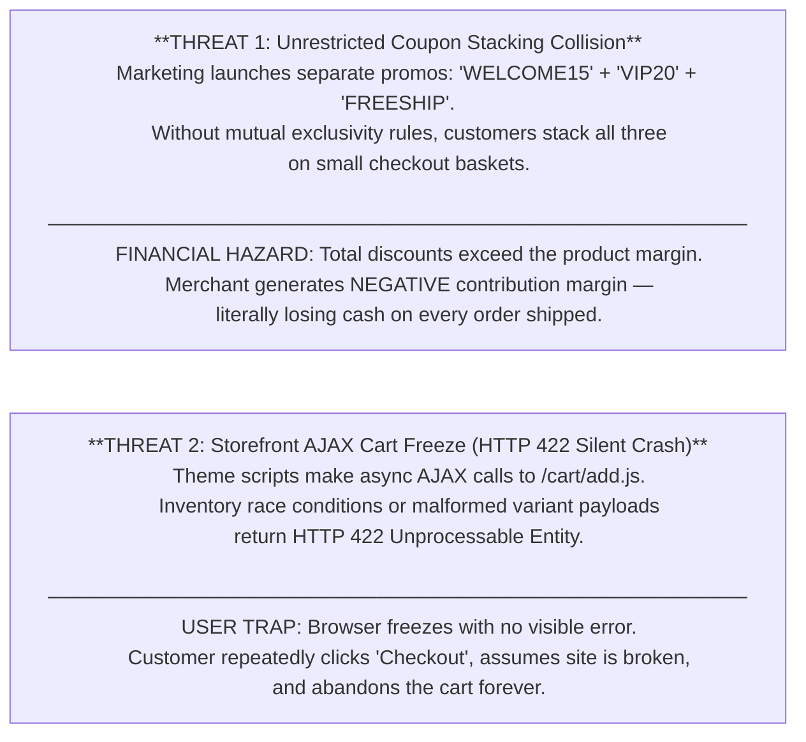
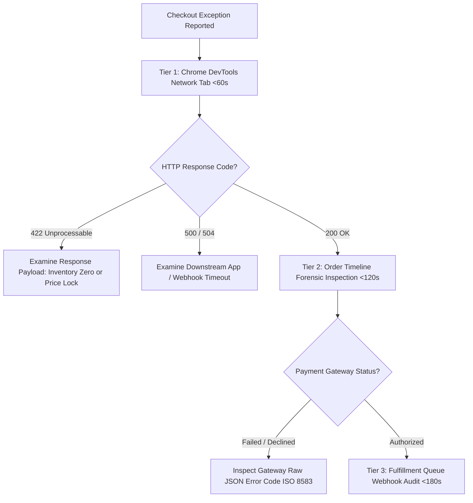
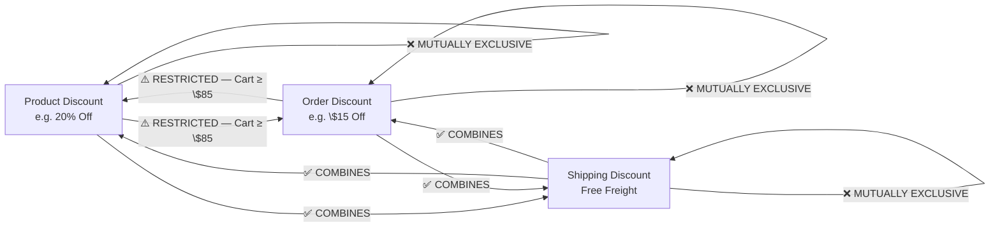

# Algorithmic Margin Defense & Storefront Cart Diagnostics

---

## 1. Executive Summary & The Dual Storefront Threats

### 1.1 The Operational Challenge
In scaling direct-to-consumer e-commerce, the checkout funnel is vulnerable to two distinct yet equally devastating technical threats:



### 1.2 The Engineering Solution: The Margin Protection Floor & 3-Minute Triage
This Master Protocol establishes:
1. **The 3x3 Discount Class Permutation Matrix**: Programmatically preventing invalid promo combinations.
2. **The Contribution Margin Protection Floor**: Hard math preventing net negative sales.
3. **The 3-Minute Forensic Diagnostic Framework**: Chrome DevTools network payload triage under 60 seconds MTTI.

---

## 2. The 3-Minute Diagnostic Framework (<60s MTTI)

When a customer or customer support reports a broken checkout or failed payment, operators must never guess. They follow a strict 3-tier forensic protocol:



### 2.1 Layer 1: Storefront Network Tab Inspection
- Open Chrome DevTools (`F12`) $
ightarrow$ Select **Network** tab $
ightarrow$ Filter by `Fetch/XHR`.
- Replicate the cart action and observe `POST /cart/add.js` or `POST /cart/change.js`.
- **Raw Error Payload Telemetry**:
  ```json
  {
    "status": 422,
    "message": "Cart Error",
    "description": "You cannot add that amount to the cart -- only 0 are available in stock."
  }
  ```
- *Diagnostic Outcome*: Identified in under 45 seconds—zero inventory availability at active fulfillment node.

### 2.2 Layer 2: Payment Gateway Raw Transaction Telemetry
Payment declines must be diagnosed via the raw payment gateway response strings (Shopify Payments / Stripe Backend), not user-facing text:

| Raw Gateway Error String | ISO 8583 Code | Root Cause | Operator Action | Customer Guidance |
|---|---|---|---|---|
| `"decline_code": "insufficient_funds"` | `51` | Customer account lacks funds | Zero store bug; close ticket | Advise customer to use alternative card |
| `"decline_code": "card_velocity_exceeded"`| `75` | Cardholder bank fraud velocity block | Automated fraud protection | Customer must contact issuing bank |
| `"decline_code": "do_not_honor"` | `05` | Generic bank block (international card) | Bank blocking cross-border merchant | Advise customer to authorize international charge |
| `"decline_code": "expired_card"` | `54` | Expiration date expired | Input error | Verify card expiration date |

---

## 3. The 3x3 Discount Class Permutation & Combination Matrix

Shopify divides promotional rules into three distinct classes: **Product Discounts**, **Order Discounts**, and **Shipping Discounts**.

### 3.1 The Master Combinatorial Ruleset



### 3.2 Key Rules:
1. **Rule 1 (Intra-Class Exclusivity)**: A product discount can *never* combine with another product discount. (No stacking 20% off on top of 15% off).
2. **Rule 2 (Inter-Class Minimum Floor)**: An order-level discount may only combine with a product-level discount if the **Cart Subtotal ≥ $85.00**.
3. **Rule 3 (Shipping Combination)**: Free Shipping promotions require a post-discount subtotal threshold ≥ $50.00.

---

## 4. Mathematical Modeling: Contribution Margin Protection Floor

To guarantee that no order is ever sold at a loss, every SKU enforces an algorithmic **Contribution Margin Protection Floor**:

```
CONTRIBUTION MARGIN FORMULA:
CM = (Retail Price - Total Discount) - (COGS + 3PL Handling + Carrier Freight + Merchant Processing Fee)
```

### 4.1 Unit Economics & Max Allowable Discount (Synapse Botanicals Catalog)

| Product SKU | Variant Name | Retail Price | COGS | 3PL Handling | Carrier Postage | Stripe Fee (2.9%+$0.30) | Breakeven Cost | Max Allowable Discount | Max Discount % |
|---|---|---|---|---|---|---|---|---|---|
| `SYN-FSTK-MY` | Focus Stick Packs 30-Pack (Matcha Yuzu) | $42.00 | $8.50 | $3.70 | $5.85 | $1.52 | **$19.57** | **$22.43** | **53.4%** |
| `SYN-TNCT-AM` | Adaptogen Tincture 60ml (AM Focus) | $38.00 | $12.50 | $3.70 | $5.85 | $1.40 | **$23.45** | **$14.55** | **38.3%** |
| `SYN-TMBL-MO` | Precision Insulated Tumbler 500ml (Matte Obsidian) | $34.00 | $7.00 | $3.70 | $5.85 | $1.29 | **$17.84** | **$16.16** | **47.5%** |
| `SYN-ACC-WHSK` | Micro-Foam Electric Whisk | $16.00 | $3.10 | $3.30 | $4.50 | $0.76 | **$11.66** | **$4.34** | **27.1%** |
| `SYN-BNDL-MAO` | Daily Protocol Starter Bundle (Matcha/AM/Obsidian) | $82.00 | $24.50 | $4.50 | $7.20 | $2.68 | **$38.88** | **$43.12** | **52.6%** |

> **Critical Threshold**: For low-margin hardware like *Micro-Foam Electric Whisk* (27.1%) and high-cost consumables like *Adaptogen Tincture* (38.3%), excessive discount stacking pushes the order into negative gross contribution margin!

---

## 5. Empirical Incident Autopsy: Order #1063 Collision Simulation

To demonstrate the financial destruction of uncontrolled discount stacking, a live simulation was executed on Synapse Botanicals' staging store.

### 5.1 Baseline Order Configuration
- **Order ID**: `#1063`
- **Basket Items**:
  - 1x Focus Stick Packs 30-Pack (`SYN-FSTK-MY`) = $42.00 (COGS: $8.50)
  - 1x Adaptogen Tincture 60ml (`SYN-TNCT-AM`) = $38.00 (COGS: $12.50)
- **Cart Gross Value**: **$80.00**

### 5.2 The Unrestricted Collision Event
Customer applied four separate stacked promotions during checkout:
1. `VIP20`: 20% off all products (-$16.00)
2. `WELCOME25`: $25.00 off order (-$25.00)
3. `LOYALTY10`: $10.80 VIP reward credit (-$10.80)
4. `FREESHIP`: Free Ground Shipping (-$6.50 shipping fee absorbed by merchant)

```
FINANCIAL DISASTER AUDIT — Order #1063 (PRE-FIX):
  Gross Basket Value:           $80.00 (1x Focus Sticks $42 + 1x Adaptogen Tincture $38)
  Discounts Applied:            -$16.00 (VIP20) + -$25.00 (WELCOME25) + -$10.80 (LOYALTY10) = -$51.80
  Gross Revenue Collected:      $80.00 − $51.80 = $28.20
  Cost of Goods Sold (COGS):    −$8.50 (Sticks) + −$12.50 (Tincture) = −$21.00
  3PL Warehouse Handling:       −$4.10 (Base + pick + box)
  Carrier Outbound Freight:     −$6.50 (Paid by merchant — Free Shipping)
  Credit Card Gateway Fee:      −$1.40 (2.9% + $0.30 on $28.20 + auth tolls)
  ─────────────────────────────────────────────────────────────────────
  NET ORDER CONTRIBUTION:       $28.20 − $21.00 − $4.10 − $6.50 − $1.40 = −$4.80 (LOSS!)
```
*Result*: The store **lost $4.80 in pure cash** by fulfilling this order!

### 5.3 Post-Remediation Execution (With Matrix Protection Applied)
With the combinatorial exclusivity engine deployed:
1. Customer inputs `VIP20` → Applied (-$16.00).
2. Customer attempts `WELCOME25` → **Blocked by Checkout Extensibility**:
   > *"Discount code WELCOME25 cannot be combined with VIP20 on baskets under $85.00."*
3. Customer receives standard shipping calculation ($6.50) because post-discount cart is $64.00.
4. **Final Net Contribution Margin**: **+$23.14 (34.0% net profit margin)**.

---
