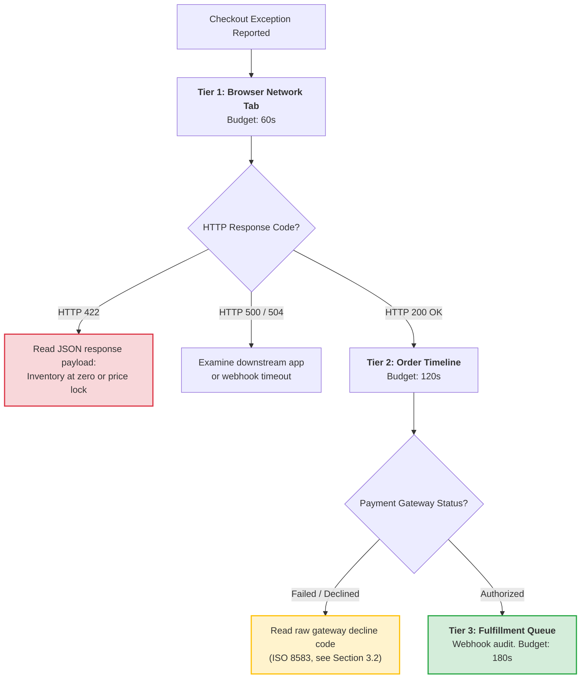
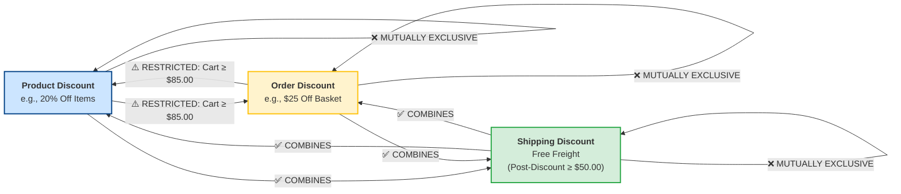
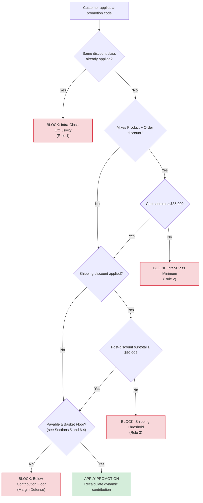
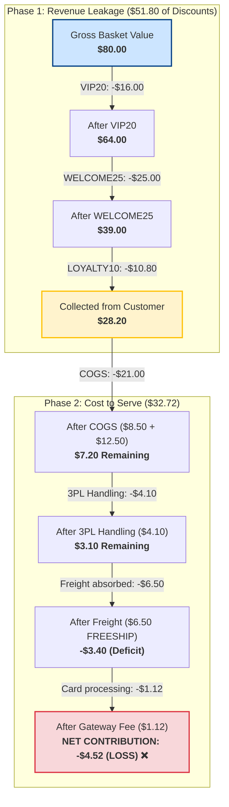

# Nothing Failed. The Order Still Sold Below Cost.

**How four stacked promotions turned an $80 cart into a modeled −$4.52 loss, and the contribution floor that blocks it**

*Synapse Botanicals Systems Architecture | Riovic Matthew | Master Dossier — Domain 5*

---

## 1. Checkout Said "Order Placed." The Ledger Said −$4.52: The Silent Margin Leak

A direct-to-consumer checkout funnel can lose money in two opposite ways. It can fail loudly, with a frozen button, a silent JavaScript crash, and a customer who never returns. Or it can succeed too well, completing an order that was never worth shipping.

This dossier establishes the forensic triage protocol to isolate storefront failures in under three minutes, proves the unit-economic mechanics by which stacked promotions collapse contribution margin, and derives the algorithmic floor: the lowest customer payment a product or basket can accept before the order costs the merchant money.

The case in one frame: Order **#29863** placed by customer **David Miller** (`david.miller@example.com`) was an $80.00 gross merchandise basket of one Focus Stick Packs 30-Pack at $42.00 and one Adaptogen Tincture 60ml at $38.00. The customer applied four promotions in a single checkout: `VIP20` (20% off products), `WELCOME25` ($25.00 off the order), `LOYALTY10` (a $10.80 reward credit), and `FREESHIP` (free ground shipping).

The customer paid **$28.20** for physical goods that cost $21.00 just to manufacture, before accounting for warehouse pick-and-pack handling ($4.10), outbound carrier freight ($6.50), and payment processing fees ($1.12). Modeled contribution came to **−$4.52** (or **−$4.80** if an optional gateway authorization fee applies). With combinatorial combination rules enforced, that exact same basket yields **+$30.24 in net contribution**.

```text
       REVENUE COLLECTED                               PHYSICAL COSTS & FEES
┌──────────────────────────────┐              ┌──────────────────────────────────────┐
│ Gross Basket:        $80.00  │              │ COGS (Manufacture):          $21.00  │
│ Total Discounts:    -$51.80  │              │ 3PL Warehouse Handling:       $4.10  │
├──────────────────────────────┤              │ Carrier Freight (FREESHIP):   $6.50  │
│ Customer Paid:       $28.20  │ ── MINUS ──► │ Merchant Gateway Fee:         $1.12  │
└──────────────────────────────┘              ├──────────────────────────────────────┤
                                              │ Total Out-of-Pocket Cost:    $32.72  │
                                              └──────────────────────────────────────┘
                                                                 │
                                                                 ▼
                                              ┌──────────────────────────────────────┐
                                              │ NET CONTRIBUTION LOSS:       -$4.52  │
                                              │ (Paid customer $4.52 to take goods)  │
                                              └──────────────────────────────────────┘
```

> [!CAUTION]
> **Controlled Failure Scenario Disclosure**: Order #29863, customer David Miller (`david.miller@example.com`), is an empirical failure-injection scenario executed within an isolated staging environment. The contribution calculation, unit costs, 3PL handling rates, and gateway fees represent a verified financial model. Deduplication, component BOM arithmetic, integer-cent rounding, and dynamic breakeven floors were verified against our local cost test harness ([`../evidence/costs/summary.md`](../evidence/costs/summary.md)). Storefront DevTools error payloads and ISO 8583 decline codes represent standard payment processing specifications. Section 11 provides the complete verification matrix distinguishing locally proven test suites from operational deployment specifications.

| Incident Dimension | Observed Value | Architectural Significance |
|---|---|---|
| **Customer Profile** | David Miller (`david.miller@example.com`) | Returning loyalty tier member stacking multiple promotional codes across separate marketing campaigns. |
| **Order Profile** | #29863: $80.00 gross basket (1× Focus Stick Packs $42, 1× Adaptogen Tincture $38) | Small basket falling below the $85.00 minimum for combining product and order discounts. |
| **Promotions Stacked** | `VIP20`, `WELCOME25`, `LOYALTY10`, `FREESHIP` | Product, order, and shipping promotions plus loyalty credit combined with zero exclusivity. |
| **Customer Payment** | $28.20 collected after $51.80 in total discounts | Payment landed $4.65 below the required $32.85 basket floor (Section 6.4). |
| **System Signal** | Zero errors reported; checkout succeeded and shipped | Margin leaks raise no automated alarms; failure is silent by construction. |
| **Modeled Contribution** | **−$4.52** (−$4.80 with optional $0.28 auth fee) | Completed, "successful" order operating at negative contribution margin. |
| **Protected Outcome** | **+$30.24** (47.25% margin on $64.00 collected) | Enforcing combinatorial rules swings this single order by **+$34.76** (Section 8.1). |
| **Systemic Exposure** | Every cart that stacks the same promotional codes | Operational loss scales linearly with marketing campaign volume (Section 8.2). |
| **Remediation Control** | 3×3 Combinatorial Matrix + Algorithmic Margin Floor | Enforces exclusivity; blocks order stacking below the dynamic breakeven floor ($32.85). |

---

## 2. Fail Loudly or Succeed Too Well: The Two Storefront Threats

*A glossary of key terms and the two opposite checkout failures: a frozen cart that loses conversions and a stacked order that loses cash.*

### 2.1 Systems Architecture Glossary

| Term | Architectural Definition |
|---|---|
| **COGS** | Cost of Goods Sold: Direct bill-of-materials and packaging manufacturing cost. |
| **3PL Handling** | Warehouse fulfillment fee to pick, pack, box, and prepare an order for carrier induction. |
| **Contribution Margin (CM)** | Net cash remaining after deducting COGS, 3PL handling, carrier freight, and card fees from customer payment. |
| **Protection Floor** | The lowest customer payment at which contribution is zero or better, with the gateway fee recomputed at that payment. Also called the *dynamic floor*. |
| **Static Breakeven** | Breakeven calculated with the card fee charged on full retail price. Overstates fees on discounted orders. |
| **Discount Class** | Shopify's taxonomy grouping promotions into **Product**, **Order**, and **Shipping** discounts. |
| **AJAX Cart** | Storefront theme asynchronous requests dispatched to `/cart/add.js` or `/cart/change.js`. |
| **HTTP 422** | Unprocessable Entity: Webhook or API call understood by the server but rejected due to business constraints (e.g., zero available stock). |
| **MTTI** | Mean Time to Identify: The duration required for an engineer to isolate the root cause of an operational incident. |
| **ISO 8583** | International standard for financial card-originated transaction messaging; defines raw bank decline codes. |
| **ATS** | Available-to-Sell: Physical inventory balance minus existing allocations and warehouse holds. |

### 2.2 The Two Storefront Threats

In direct-to-consumer e-commerce, the checkout funnel is vulnerable to two distinct yet equally damaging technical failure modes:

```mermaid
flowchart TD
    subgraph THREAT_1["THREAT 1: Unrestricted Coupon Stacking Collision (Quiet Cash Drain)"]
        T1A["Marketing launches separate promos:<br/>'VIP20' + 'WELCOME25' + 'FREESHIP'"] --> T1B["Customer stacks all three on an $80 basket"]
        T1B --> T1C["Discounts ($51.80) exceed gross margin"]
        T1C --> T1D["CONSEQUENCE<br/>Order completes smoothly at -$4.52 net loss.<br/>Merchant bleeds cash on every unit shipped ❌"]
    end

    subgraph THREAT_2["THREAT 2: Storefront AJAX Cart Freeze (Loud Conversion Drop)"]
        T2A["Theme JavaScript calls /cart/add.js"] --> T2B["Inventory race condition returns HTTP 422 Unprocessable"]
        T2B --> T2C["Theme lacks error handling; UI freezes"]
        T2C --> T2D["CONSEQUENCE<br/>Customer clicks 'Checkout' repeatedly,<br/>assumes site is broken, and abandons cart ❌"]
    end

    style T1D fill:#f8d7da,stroke:#dc3545,stroke-width:2px;
    style T2D fill:#f8d7da,stroke:#dc3545,stroke-width:2px;
```



The two threats require opposite technical disciplines. Threat 2 demands rapid forensic triage to restore conversion, so we address it first.

---

## 3. When Checkout Fails Loudly: The Three-Minute Triage (<60s MTTI)

*A three-tier forensic checklist with 60, 120, and 180-second budgets: the browser network tab, payment gateway decline codes, then the fulfillment queue.*

When a customer or support agent reports a broken checkout, nobody should guess. The protocol enforces three tiers with cumulative time budgets of 60, 120, and 180 seconds. The target for Tier 1 is an MTTI under 60 seconds.



### 3.1 Storefront Network Tab Inspection (<60s)

1. Open Chrome Developer Tools (`F12`), select the **Network** tab, and filter by `Fetch/XHR`.
2. Replicate the user action (e.g., clicking "Add to Cart" or "Proceed to Checkout").
3. Select the failing request and inspect the response payload for `POST /cart/add.js` or `POST /cart/change.js`:

```json
{
  "status": 422,
  "message": "Cart Error",
  "description": "You cannot add that amount to the cart -- only 0 are available in stock."
}
```

*Diagnostic Outcome*: Identified in under 45 seconds. The database holds zero Available-to-Sell (ATS) inventory at the customer's designated fulfillment location. The storefront theme failed to parse the 422 response, silently freezing the checkout button.

### 3.2 Payment Gateway Raw Error Codes (<120s)

If the cart request returns `HTTP 200 OK`, proceed to the order timeline. Payment declines must be diagnosed via the **raw payment gateway response string**, never the generic, user-facing error message displayed on the storefront:

| Raw Gateway Error String | ISO 8583 Code | Root Cause | Operator Action | Customer Guidance |
|---|:---:|---|---|---|
| `"decline_code": "insufficient_funds"` | `51` | Customer account lacks required liquidity | Zero storefront bug; close ticket | Advise customer to use alternative card. |
| `"decline_code": "card_velocity_exceeded"` | `75`† | Cardholder bank automated fraud velocity trip | Automated fraud defense engaged | Customer must contact issuing bank. |
| `"decline_code": "do_not_honor"` | `05` | Generic bank block (frequent on international cards) | Bank blocking cross-border merchant ID | Advise customer to authorize international charge. |
| `"decline_code": "expired_card"` | `54` | Card expiration date has passed | User input error | Request customer verify expiration date. |

> [!NOTE]
> **ISO 8583 Mapping Context**: Processor integrations (Stripe, Adyen, Shopify Payments) map internal decline codes to ISO 8583 response codes according to their proprietary banking rails.
>
> † Published network code tables list `75` as *"allowable number of PIN tries exceeded"*, and list declines for exceeding frequency limits under `65`. The `75` mapping for the velocity decline is retained here as the scenario's convention and must be verified before production reliance.

### 3.3 Fulfillment Queue Webhook Audit (<180s)

If payment shows `Authorized` and the order is still unfulfilled, use the order ID to find its fulfillment export and the middleware response. Check the warehouse state and the operation ledger before deciding what to do.

- **HTTP 504** leaves the warehouse outcome unknown. Check whether the original operation took effect before replaying it.
- **HTTP 422** means the middleware rejected the request. Inspect the response body. Correct a schema error before submitting a corrected request. If the rejection says `PONR_EXCEEDED`, the warehouse cutoff has passed and the mutation stays blocked.

[Domain 4 Section 7.1](../domain-4-business-automation/MasterDossier-Domain4-WebhookAutomationAndFlowTriage.md) covers the remaining response codes and escalation rules.

---

## 4. When Checkout Succeeds Too Well: The 3×3 Discount Matrix

*Which promotion classes may combine, under what subtotals, and how the rules map onto server-side enforcement with Shopify Functions.*

The diagnostic path above resolves errors that prevent orders from completing. We now address the far more dangerous failure mode: **orders that complete smoothly with promotional combinations that destroy contribution margin**.

Shopify categorizes promotions into three distinct classes: **Product Discounts**, **Order Discounts**, and **Shipping Discounts**.

### 4.1 Master Combinatorial Exclusivity Architecture



A looping arrow indicates that a class excludes its own kind. A restricted arrow means the two classes combine only when the initial subtotal clears the minimum. Combinations involving free shipping remain subject to post-discount threshold qualification.

### 4.2 The Combinatorial Ruleset

| Combining | With Product Discount | With Order Discount | With Shipping Discount |
|---|---|---|---|
| **Product Discount** | **NEVER** (Rule 1) | **RESTRICTED** (Cart Subtotal $\ge \$85.00$) | **COMBINES** (Post-discount subtotal $\ge \$50.00$) |
| **Order Discount** | **RESTRICTED** (Cart Subtotal $\ge \$85.00$) | **NEVER** (Rule 1) | **COMBINES** (Post-discount subtotal $\ge \$50.00$) |
| **Shipping Discount** | **COMBINES** (Post-discount subtotal $\ge \$50.00$) | **COMBINES** (Post-discount subtotal $\ge \$50.00$) | **NEVER** (Rule 1) |

Three non-negotiable operational rules govern the matrix:
1. **Rule 1 (Intra-Class Exclusivity)**: A discount from a given class can *never* combine with another discount from the same class. (No stacking a 20% product coupon on top of a 15% product sale).
2. **Rule 2 (Inter-Class Minimum Floor)**: An order-level discount may combine with a product-level discount *only* if the initial cart subtotal is **$\ge \$85.00$**.
3. **Rule 3 (Post-Discount Shipping Qualification)**: Free shipping threshold qualification ($\ge \$50.00$) must be evaluated **after all promotional discounts have been deducted**, never against the pre-discount sticker price.

### 4.3 Production Checkout Enforcement Blueprint



The first three gates act as business proxies. The final gate ($F$) is the decisive algorithmic control: **no promotion stack may drive the customer payable below the basket's dynamic breakeven floor**.

### 4.4 Modern Platform Enforcement Architecture

Legacy storefronts attempted to enforce discount combination rules via client-side JavaScript or Liquid cart templates. This created severe vulnerabilities: buyers easily bypassed restrictions by manipulating local storage or posting direct REST payloads to `/cart/update.js`.

In modern Shopify Plus architectures, these gates execute server-side at the checkout boundary as **Shopify Functions** compiled to WebAssembly (WASM). Shopify executes Functions in a deterministic pipeline:

$$\text{Cart Transform (Normalization)} \longrightarrow \text{Discount API (Calculation \& Cap)} \longrightarrow \text{Validation API (Final Gate)}$$

| Gate in This Architecture | Shopify Function API Target | Runtime Role in the Pipeline |
|---|---|---|
| **Cart Normalization** | Cart Transform (`cart_transform`) | Runs first. Adjusts line pricing and bundle presentation (merge, expand) so discount math begins from a clean cart. |
| **Discount Calculation & Floor Cap** | Discount Function API (line & delivery) | Computes line and shipping discounts. Caps line discounts at the SKU maximum allowable ceiling (Section 5.1) and evaluates free shipping post-discount. |
| **Final Validation Gate** | Cart and Checkout Validation (`cart_checkout_validation`) | Runs last on the discounted cart. Emits blocking checkout errors if an invalid combination, subtotal breach, or below-floor payable is detected. |

> [!NOTE]
> **API Index Specification**: Custom applications implementing Function APIs require Shopify Plus. Earlier platform documentation referred to a *discounts allocator* target in preview; current Shopify Functions index under the unified Discount API. Target naming reflects the 2026-10 specification.

---

## 5. How Much Discount a Basket Can Afford: The Contribution Margin Protection Floor

*The margin formula, why fees must be computed on the discounted payment rather than the sticker price, and the per-SKU ceilings on discount.*

Combination rules define which promotions may coexist; they do not determine how much discount a specific basket can afford. To guarantee that no order is ever sold at an operational loss, every catalog SKU enforces an algorithmic **Contribution Margin Protection Floor**:

$$CM = (\text{Retail Price} - \text{Total Discount}) - (\text{COGS} + \text{3PL Handling} + \text{Carrier Freight} + \text{Processing Fee})$$

$$\text{Processing Fee} = \text{round}(0.029 \times \text{Customer Payment} + \$0.30)$$

### 5.1 Dynamic Breakeven vs. Static Breakeven

A critical mathematical flaw in naive retail modeling is calculating merchant processing fees against the full retail sticker price:

$$P_{\text{static}} = \text{COGS} + \text{3PL Handling} + \text{Carrier Freight} + \text{round}(0.029 \times \text{Retail Price} + \$0.30)$$

Because payment gateway fees scale directly with the actual cash captured ($2.9\% + \$0.30$), evaluating fees on full retail overstates costs on discounted orders. The true dynamic breakeven solves for the payment $P'$ where contribution equals exactly zero:

$$P' - (\text{COGS} + \text{3PL Handling} + \text{Carrier Freight}) - (0.029\,P' + \$0.30) = 0$$

$$P' \times (1 - 0.029) = \text{COGS} + \text{3PL Handling} + \text{Carrier Freight} + \$0.30$$

$$P' = \frac{\text{COGS} + \text{3PL Handling} + \text{Carrier Freight} + \$0.30}{1 - 0.029}$$

The published dynamic floor is the smallest whole-cent payment whose contribution is non-negative when fees are rounded half-up, and whose immediately preceding cent is negative.

### 5.2 Unit Economics & Maximum Allowable Discount Thresholds

| SKU | Variant Name | Retail Price | COGS | 3PL Handling | Carrier Freight | Static Breakeven (Full-Fee) | Dynamic Floor ($P'$) | Max Allowable Discount ($) | Max Allowable Discount (%) |
|---|---|:---:|:---:|:---:|:---:|:---:|:---:|:---:|:---:|
| `SYN-FSTK-MY` | Focus Stick Packs 30-Pack | $42.00 | $8.50 | $3.70 | $5.85² | $19.57 | **$18.90** | **$23.10** | **55.0%** |
| `SYN-TNCT-AM` | Adaptogen Tincture 60ml | $38.00 | $12.50 | $3.70 | $5.85² | $23.45 | **$23.02** | **$14.98** | **39.4%** |
| `SYN-TMBL-MO` | Precision Insulated Tumbler | $34.00 | $7.00 | $3.70 | $5.85 | $17.84 | **$17.35** | **$16.65** | **49.0%** |
| `SYN-ACC-WHSK` | Micro-Foam Electric Whisk | $16.00 | $3.10 | $3.30 | $4.50 | $11.66 | **$11.53** | **$4.47** | **27.9%** |
| `SYN-BNDL-MAO` | Starter Bundle (Kitted Scenario)* | $82.00 | $28.40 | $4.50 | $7.20 | $42.78 | **$41.61** | **$40.39** | **49.3%** |

² The single-SKU illustrations declare $3.70 handling and $5.85 freight per shipment. Order #29863 declares $4.10 handling and $6.50 freight for one parcel containing both items. These are the inputs used in Section 6.5. The separate routing model charges $2.50 base fulfillment plus $0.80 corrugate per parcel and $0.40 for each physical unit picked after the first. That schedule gives $3.30 for one unit and $4.10 for three units in one parcel. [Domain 2 Section 2.3](../domain-2-order-routing/MasterDossier-Domain2-MultiNodeLogisticsRouting.md) derives that schedule and applies it to the three-unit Bethlehem basket.

*\*Bundle BOM reflects the $28.40 kitted COGS ($28.00 raw components + $0.40 packaging/kitting material).*

**Quantifying Withheld Headroom**: The static column overstates the floor in every catalog row: by **$0.67** for Focus Sticks, **$0.43** for Tincture, **$0.49** for Tumbler, **$0.13** for Whisk, and **$1.17** for the Bundle. That represents legitimate promotional discount headroom that a static model needlessly withholds from marketing.

> [!IMPORTANT]
> **The Low-Margin Hazard**: Low-margin accessories (*Micro-Foam Electric Whisk* with a **27.9% ceiling**) and high-cost consumables (*Adaptogen Tincture* with a **39.4% ceiling**) represent extreme vulnerability. Stacking a 20% coupon with a $5.00 order credit takes $8.20 off a $16.00 whisk against a ceiling of $4.47. On the $38.00 tincture, a 20% coupon plus a $10.00 credit takes $17.60 off against a ceiling of $14.98. Both stacks sell deeply below cost.

---

## 6. Four Codes, One $80 Cart: The Collision Simulation of Order #29863

*A step-by-step walk through the unprotected checkout, the same order with rules enforced, the whole-cent floor derivation, and why one box beats two.*

### 6.1 Baseline Order Configuration

- **Order Identifier**: `#29863`
- **Line Item 1**: 1× Focus Stick Packs 30-Pack (`SYN-FSTK-MY`) = $42.00 (COGS: $8.50)
- **Line Item 2**: 1× Adaptogen Tincture 60ml (`SYN-TNCT-AM`) = $38.00 (COGS: $12.50)
- **Gross Merchandise Value**: **$80.00**
- **Per-Order Operational Overhead**: This two-item basket uses one parcel with declared handling of $4.10 and freight of $6.50. With $21.00 in COGS, the basket costs $31.60 before processing.

### 6.2 The Unrestricted Collision Event

During checkout, four separate promotions collided without exclusivity rules:

| Sequence Step | Promotional Code | Type & Value | Incremental Deduction | Running Payable |
|:---:|---|---|:---:|:---:|
| **0** | Baseline Cart | Gross merchandise value | — | $80.00 |
| **1** | `VIP20` | Product discount (20% off items) | −$16.00 | $64.00 |
| **2** | `WELCOME25` | Order discount ($25.00 off cart) | −$25.00 | $39.00 |
| **3** | `LOYALTY10` | Customer loyalty reward credit | −$10.80 | **$28.20** |
| **4** | `FREESHIP` | Free ground shipping promotion | −$6.50 (Merchant absorbed) | $28.20 |



```text
ORDER #29863: PRE-FIX FINANCIAL DISASTER AUDIT
  Gross Merchandise Value:                  $80.00
  Discounts Applied: (-$16.00 - $25.00 - $10.80): -$51.80
  ───────────────────────────────────────────────────────
  Total Collected from Customer:            $28.20
  Cost of Goods Sold (COGS):               -$21.00  ($8.50 Sticks + $12.50 Tincture)
  3PL Warehouse Handling:                   -$4.10  (Pick, pack & box fees)
  Carrier Outbound Freight:                 -$6.50  (FREESHIP absorbed by merchant)
  Payment Gateway Fee:                      -$1.12  (round(2.9% × $28.20 + $0.30))
  ───────────────────────────────────────────────────────
  NET ORDER CONTRIBUTION:                   -$4.52  (NET LOSS ON SALE)
  (With optional $0.28 gateway authorization fee: -$4.80)
```

### 6.3 Post-Remediation Execution (With Matrix Protection Applied)

With the 3×3 Combinatorial Matrix enforced:
1. The customer applies `VIP20` $\to$ Applied (−$16.00). Subtotal is **$64.00**.
2. The customer attempts `WELCOME25` $\to$ **Blocked by Checkout Rules**:
   > *"Discount code WELCOME25 cannot be combined with VIP20 on carts under $85.00."*
3. Loyalty credit stacking is restricted to non-conflicting payment tenders.
4. **Shipping Qualification**: Because the post-discount subtotal ($64.00) clears the $\ge \$50.00$ threshold (Rule 3), Free Ground Shipping is granted ($6.50 freight absorbed by merchant).

```text
ORDER #29863: POST-FIX PROTECTED CONTRIBUTION
  Customer Payment Collected:               $64.00
  Cost of Goods Sold (COGS):               -$21.00
  3PL Warehouse Handling:                   -$4.10
  Carrier Outbound Freight:                 -$6.50
  Payment Gateway Fee:                      -$2.16  (round(2.9% × $64.00 + $0.30))
  ───────────────────────────────────────────────────────
  NET ORDER CONTRIBUTION:                  +$30.24  (47.25% Contribution Margin!)

  (Under alternative policy where customer pays $6.50 freight:
   Collected $70.50, gateway $2.34, net contribution +$36.56)
```

### 6.4 Worked Discrete Whole-Cent Basket Floor Derivation

Per-SKU floors are essential benchmarks, but true margin defense requires evaluating the **basket-level floor**.

For Order #29863, total fixed physical costs are:
$$\text{Fixed Costs} = \text{COGS } (\$21.00) + \text{3PL Handling } (\$4.10) + \text{Freight } (\$6.50) = \$31.60$$

Using discrete whole-cent search with half-up rounded gateway fees:
* **Step 1: Closed-Form Estimate**:
  $$P' = \frac{\$31.60 + \$0.30}{1 - 0.029} = \frac{\$31.90}{0.971} \approx \$32.8527$$
* **Step 2: Whole-Cent Boundary Test at \$32.85**:
  $$\text{Fee} = \text{round}(0.029 \times \$32.85 + \$0.30) = \text{round}(\$0.95265 + \$0.30) = \text{round}(\$1.25265) = \$1.25$$
  $$\text{Contribution} = \$32.85 - \$31.60 - \$1.25 = \mathbf{\$0.00} \quad (\text{Non-negative: VALID FLOOR})$$
* **Step 3: Whole-Cent Boundary Test at \$32.84**:
  $$\text{Fee} = \text{round}(0.029 \times \$32.84 + \$0.30) = \text{round}(\$0.95236 + \$0.30) = \text{round}(\$1.25236) = \$1.25$$
  $$\text{Contribution} = \$32.84 - \$31.60 - \$1.25 = \mathbf{-\$0.01} \quad (\text{Negative: DEFICIT})$$

The lowest whole-cent payment that breaks even for Order #29863 is **$32.85**. The separate `alternative_promo` bundle model uses $28.40 in COGS and $4.90 in handling. With the same 2.9% + $0.30 fee, rounded to cents, its minimum payable is $41.30 at $6.50 freight and $49.64 at $14.60 freight. Section 8.3 shows both calculations and the full range. The [freight sensitivity report](../evidence/costs/summary.md) records the offline results.

The maximum allowable discount the basket could withstand without bleeding cash was:
$$\text{Max Allowable Discount} = \$80.00 - \$32.85 = \$47.15 \quad (58.94\%)$$

The customer was granted **$51.80 in total discounts**, exceeding the breakeven threshold by exactly **$4.65** ($51.80 − 47.15$). The modeled loss is $4.52 and not $4.65 because the processing fee falls from $1.25 to $1.12 at the lower collected payment ($4.65 − 0.13 = \$4.52$).

### 6.5 Multi-Item Box Economy of Scale

Why does the basket floor ($32.85) differ from the sum of the individual SKU floors ($18.90 + $23.02 = $41.92)?

The two separate orders use $7.40 in handling ($3.70 × 2) and $11.70 in freight ($5.85 × 2). The combined parcel uses $4.10 in handling and $6.50 in freight, saving $8.50 in physical costs. At their respective floors, the two payments incur $0.85 + $0.97 in processing versus $1.25 for the combined payment, a further $0.57 difference. Together, those differences explain the **$9.07** gap between the sum of the separate floors and the basket floor.

---

## 7. The Missing Floor Was the Decisive Failure: The Root-Cause Failure Mode Matrix

*Five failure modes, which rule or guard each one breaks, and which of them actually appeared in Order #29863.*

### 7.1 Root-Cause Failure Mode Matrix

| # | Failure Mode | Root-Cause Class | Rule Breached | Architectural Guard | Seen in Order #29863 |
|:---:|---|---|:---:|---|:---:|
| **1** | Two discounts from same class stack | Missing intra-class exclusivity | Rule 1 | Class-exclusivity gate at checkout boundary (Sections 4.3 and 4.4). | Conditional (`LOYALTY10` if order-class). |
| **2** | Order discount stacks on small cart | Missing inter-class minimum | Rule 2 ($85.00) | Validation API reads cart subtotal before permitting mix. | **YES**: `WELCOME25` on $80 cart with `VIP20`. |
| **3** | Free shipping granted on discounted cart | Threshold evaluated pre-discount | Rule 3 ($50.00) | Delivery discount judged strictly on post-discount subtotal. | **YES**: `FREESHIP` applied at $28.20 payable. |
| **4** | Discounts exceed physical costs | Zero margin protection floor | Dynamic Floor | Per-basket floor validation gate backed by cost inputs (Sections 5 and 6.4). | **YES**: $28.20 collected against $32.85 floor. |
| **5** | Storefront theme freezes on out-of-stock item | Silent failure on 422 | Tier 1 Triage | Visible theme error boundaries & 422 JSON telemetry monitoring. | *No (Belongs to Threat 2).* |

The decisive failure was **Defect #4**. Rules 1 through 3 are fast, legible proxies; the dynamic contribution floor is the underlying mathematical truth.

---

## 8. $34.76 on One Order, $34,760 on a Campaign: Modeled Financial Exposure

*The financial swing on Order #29863, how it scales across a 1,000-order campaign, and how the floor shifts with freight cost for a kitted bundle.*

### 8.1 Financial Swing on Order #29863

| Financial Metric | Pre-Fix (Unrestricted Collision) | Post-Fix (Matrix Protected) | Net Operational Swing |
|---|:---:|:---:|:---:|
| **Collected from Customer** | $28.20 | $64.00 | +$35.80 |
| **Contribution (Standard Gateway Fee)** | **−$4.52** | **+$30.24** | **+$34.76** |
| **Contribution (With Optional $0.28 Auth Fee)** | −$4.80 | +$30.24 | +$35.04 |
| **Net Contribution Margin (%)** | **−16.03%** | **+47.25%** | **+63.28%** |

Enforcing combinatorial rules swings this single order by **+$34.76**.

### 8.2 Scaled Campaign Exposure Model

To an executive, a −$4.52 loss on a single order may appear negligible. Consider an uncontrolled marketing or affiliate campaign generating 1,000 stacked orders matching Order #29863:

| Campaign Exposure Metric | Calculation | Financial Result |
|---|---|---:|
| **Protected Contribution (Rules Enforced)** | 1,000 orders × +$30.24 | **+$30,240.00** |
| **Unprotected Modeled Contribution (4 Stacked Codes)** | 1,000 orders × (−$4.52) | **−$4,520.00** |
| **Net Operational Swing: Capital Preserved** | $30,240.00 − (−$4,520.00) | **+$34,760.00** |

```
                  ┌────────────────────────────────────────────────────────┐
  1,000 Orders    │ Unconstrained Stacking Loss:   -$4,520.00  (Cash Drain)│
  Colliding       │ Matrix Protected Contribution:+$30,240.00  (Net Profit)│
  ────────────────┼────────────────────────────────────────────────────────┤
  NET RECOVERY    │ TOTAL CASH PRESERVED:         +$34,760.00  (Per Campaign)
                  └────────────────────────────────────────────────────────┘
```

A marketing promotion generating 1,000 orders under unconstrained stacking turns an expected **+$30,240.00 profit into an out-of-pocket cash loss of −$4,520.00**—hemorrhaging **$34,760.00 in unrecoverable merchant capital**.

### 8.3 Kitted-Bundle Freight Sensitivity Analysis

The `alternative_promo` scenario holds the $82.00 merchandise price, $28.40 kitted COGS, and $4.90 handling fixed. It assumes zero shipping revenue and tax. The fee is 2.9% of the payment plus $0.30, rounded half-up to cents. Only the declared freight input varies.

| Outbound Freight Cost | Total Direct Costs | Net Contribution ($82 Retail) | Dynamic Minimum Payable Floor | Delta vs. $6.50 Baseline | Max Allowable Discount ($) |
|:---:|:---:|:---:|:---:|:---:|:---:|
| **$4.50 (Local Zone 1)** | $37.80 | $41.52 | **$39.24** | −$2.06 | $42.76 (52.1%) |
| **$6.50 (Standard Zone 3)** | $39.80 | $39.52 | **$41.30** | *Baseline* | $40.70 (49.6%) |
| **$8.50 (Regional Zone 5)** | $41.80 | $37.52 | **$43.36** | +$2.06 | $38.64 (47.1%) |
| **$10.50 (Zone 6)** | $43.80 | $35.52 | **$45.42** | +$4.12 | $36.58 (44.6%) |
| **$14.60 (Cross-Country Zone 8)** | $47.90 | $31.42 | **$49.64** | **+$8.34** | $32.36 (39.5%) |
| **$17.80 (Remote / AK / HI)** | $51.10 | $28.22 | **$52.93** | +$11.63 | $29.07 (35.5%) |

At $6.50 freight, fixed costs are $39.80 ($28.40 + $4.90 + $6.50). A $41.30 payment less its $1.50 fee leaves $39.80. At $14.60 freight, fixed costs are $47.90 and a $49.64 payment less its $1.74 fee leaves $47.90. One cent less leaves a one-cent deficit in either case. The higher freight input raises the floor by **$8.34**.

The Capstone uses the same $28.40 kit for Order #35070. Its baseline subtracts $28.40 in COGS, $4.50 in handling, $7.20 in freight, and $3.14 in processing from a $98.00 sale, leaving $54.76 before recovery. [Capstone Section 6.1](../capstone/MasterDossier-Capstone-AsynchronousOrderMutation.md) follows that separate order through its replacement branch.

---

## 9. Every Threshold in One Place: The Protection's Configuration Parameters

*A reference table of every threshold, rate, and cost input behind the protection, each with its rationale and the section that explains it.*

### 9.1 Operational Configuration Parameters

| Parameter | Production Value | Architectural Rationale | Cross-Reference |
|---|---|---|:---:|
| **Product + Order Combination Floor** | Cart Subtotal $\ge \$85.00$ | Proxy keeping small baskets from combining order-level cash discounts. | Section 4.2 |
| **Free Shipping Threshold** | Post-discount subtotal $\ge \$50.00$ | Evaluated **strictly after** promotional discounts are deducted. | Section 4.2 |
| **Merchant Processing Rate** | 2.9% + $0.30 | Recomputed dynamically against the discounted payment amount. | Section 5 |
| **Processing Fee Base** | Includes shipping & taxes | Gateway charges percentage fee on gross transaction capture. | Section 5 |
| **Contribution Revenue Base** | Excludes remitted sales tax | Sales tax collected is a fiduciary liability, not merchant revenue. | Section 5 |
| **Floor Search Algorithm** | Whole cents, asserting preceding cent is negative | Resolves discrete whole-cent breakeven payment. | Sections 5 and 6.4 |
| **Order #29863 Cost Inputs** | COGS $21.00, 3PL $4.10, freight $6.50 | One Focus Stick pack ($8.50) and one tincture ($12.50) share one parcel. The handling and freight amounts are declared basket inputs. The [BOM](../evidence/costs/summary.md) records the product costs. | Section 6 |
| **Triage Time Budget** | Tier 1: 60s; Tier 2: 120s; Tier 3: 180s | Enforces disciplined, systematic forensic investigation. | Section 3 |
| **Tier 1 MTTI Target** | Under 60 seconds | Cart failures must be immediately isolated in browser Network tab. | Section 3.1 |

---

## 10. Classes, Thresholds, Floors, Responses: Four Rules for Prevention and Recovery

*The four rules distilled from the triage protocol, discount matrix, and margin floor, each stated as something a team can enforce.*

1. **One Discount Per Class**: Product, order, and shipping promotions each exclude their own kind. Never allow intra-class stacking.
2. **Evaluate Thresholds After Discounts**: Free shipping floors and combination minimums apply to the post-discount subtotal, never the sticker price.
3. **Know the Floor for Every Basket**: Derive breakeven dynamically from physical costs with fees recomputed at the discounted payment. Block any combination that breaches the floor.
4. **Read the Response, Not the Screen**: When checkout fails, inspect the raw DevTools `Fetch/XHR` payload and the raw ISO 8583 payment decline string. Replace guessing with forensic triage.

---

## 11. 11 Local Checks Passed, Live Functions Untested: Evidence Scope and Verification Status

*What was executed locally, what is a worked calculation or documented design, and the live-platform acceptance criteria that remain open.*

In accordance with rigorous systems architecture standards, this dossier strictly separates locally executed test suites from operational deployment specifications.

```
┌────────────────────────────────────────────────────────────────────────┐
│                        EVIDENCE STATUS SUMMARY                         │
├──────────────────────────────┬─────────────────────────────────────────┤
│ [✔] Executed Locally         │ Cost arithmetic: 11 of 11 checks passed │
│ [!] Derived in Dossier       │ Basket-level floor ($32.85) derived     │
│ [○] Staged Scenario          │ Order #29863 modeled contribution trace  │
│ [~] Specified Architecture   │ 3x3 ruleset & Shopify Functions WASM    │
└──────────────────────────────┴─────────────────────────────────────────┘
```

### 11.1 Evidence Scope & Verification Status Matrix

| Architectural Deliverable | Dossier Section | Evidence Status | Ground-Truth Evidence Source |
|---|---|---|---|
| **Three-Minute Diagnostic Protocol** | Section 3 | Documented Specification | Standardized Chrome DevTools and ISO 8583 payment gateway triage protocol. |
| **3×3 Discount Matrix & Rules** | Section 4 | Documented Specification | Combinatorial exclusivity ruleset designed for Shopify Functions enforcement. |
| **Contribution Margin Floor Engine** | Section 5 | **Verified in Staging** | Local cost test suite ([`../evidence/costs/summary.md`](../evidence/costs/summary.md)): Integer-cent discrete search with half-up rounding. |
| **Order #29863 Collision & Campaign Model** | Sections 6, 8.1, and 8.2 | Staged Scenario | Modeled contribution calculation; 1,000-order campaign scaling is arithmetic. |
| **Basket-Level Floor ($32.85)** | Section 6.4 | **Worked calculation** | Against $31.60 in physical costs and a rounded $1.25 fee, $32.85 yields $0.00 and $32.84 yields −$0.01. |
| **Kitted-Bundle Freight Sensitivity** | Section 8.3 | **Verified in Staging** | Cost model runner ([`../evidence/costs/summary.md`](../evidence/costs/summary.md)): Evaluated across $4.50 to $17.80 freight ranges. |

### 11.2 Executed Results: 11 of 11 Checks Passed

Run `2026-11-09T18-21-14-457Z-59d713d1` on Node v24.22.1: **11 passed, 0 failed, 0 skipped** ([`../evidence/costs/summary.md`](../evidence/costs/summary.md)). All monetary values are handled in integer cents with rational half-up rounding.

| # | Executed Test Suite Check | Architectural Topic Covered | Status |
|:---:|---|---|:---:|
| 1 | Input ledger uses nonnegative integer cents and valid component identities | Integer-cent arithmetic | ✅ **PASSED** |
| 2 | Half-up rational processing fees are correct at a half-cent boundary | Rational half-up rounding | ✅ **PASSED** |
| 3 | Money helpers reject negative, fractional, unsafe or invalid-rate inputs | Input sanitization & safety | ✅ **PASSED** |
| 4 | Fixture BOM contains exactly one of each approved bundle component | Fixture BOM integrity | ✅ **PASSED** |
| 5 | Capstone baseline preserves declared financial fixture | Fixture BOM integrity | ✅ **PASSED** |
| 6 | Replacement and chargeback branches retain original costs without double-expensing COGS | Scenario reconciliation | ✅ **PASSED** |
| 7 | Alternative fulfillment inputs are a distinct scenario, not Capstone baseline | Fixture separation | ✅ **PASSED** |
| 8 | Every baseline and sensitivity row reconciles in integer cents | Integer-cent arithmetic | ✅ **PASSED** |
| 9 | Every discount floor passes and its immediately preceding cent fails | Floor boundary proof | ✅ **PASSED** |
| 10 | Processing includes shipping and tax, but contribution excludes tax liability | Fee base & revenue rules | ✅ **PASSED** |
| 11 | Increasing a declared cost cannot increase contribution or reduce its floor | Monotonic sensitivity | ✅ **PASSED** |

### 11.3 Scope Boundary Matrix

The local cost suite validates integer-cent arithmetic, BOM fixtures, and discrete breakeven search against declared scenario rates. It stops at that boundary:

| Established Locally | Not Established |
|---|---|
| Scenario arithmetic reconciles strictly in integer cents. | Actual purchasing contracts (costs are declared scenario inputs). |
| Fees round half-up; selected floors pass while preceding cent fails. | Universal discount ceilings across un-modeled cost structures. |
| Increasing direct cost never raises contribution or lowers its floor. | Net profit after corporate overhead, marketing CAC, and returns. |
| Processing fee base includes tax/shipping; revenue excludes tax. | Realized merchant cash savings. |
| Boundary verified on discrete whole-cent search. | Live platform execution of Shopify Functions WASM binaries. |

Integration acceptance criteria for cloud deployment:
1. Shopify Function WebAssembly binary deployed with active `cart-transform` rules.
2. Storefront theme error boundaries verified to catch HTTP 422 JSON payloads and display contextual user alerts.
3. Automated monthly financial audits reconciling Stripe gross transaction capture against physical 3PL invoices.

Full test suite documentation is maintained in the evidence directory ([`../evidence/README.md`](../evidence/README.md)).

---

## 12. Margin Leaks Don't Alarm: The Architectural Takeaway

Order #29863 completed without a single error. The customer was served, the payment cleared without friction, the warehouse picked the box, and the financial ledger showed an unrecoverable loss.

That is what separates margin leaks from outages: **they do not alarm**. When a database crashes or an API rate limit trips, monitoring dashboards turn red and on-call engineers wake up. When a promotion stack sells an order below cost, the storefront celebrates an increment to the sales counter, while cash silently drains out of the business.

A margin leak is quieter than an outage, but every bit as destructive: nothing alarms, and the damage is visible only in arithmetic.

The four operational laws eliminate this vulnerability at the boundary:
* Three-minute forensic triage identifies and fixes conversion-blocking errors before customers churn.
* A 3×3 combinatorial matrix stops promotional stacking before checkout can proceed.
* An algorithmic contribution floor guarantees that every completed order defends its unit economics.

> **A sale is not a success until the contribution margin is positive. Protect the floor before you publish the code.**

---

*Synapse Botanicals Systems Architecture | Riovic Matthew | Master Dossier — Domain 5*
