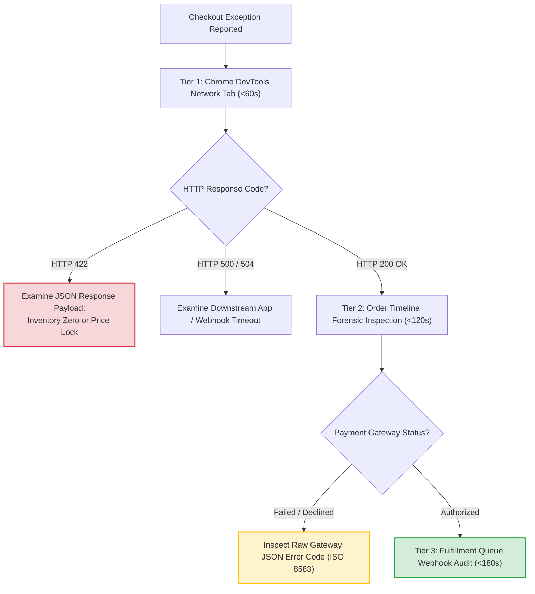
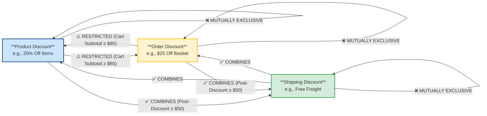
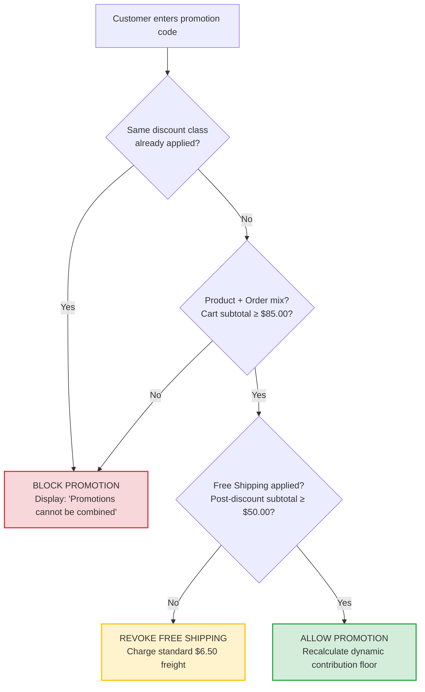
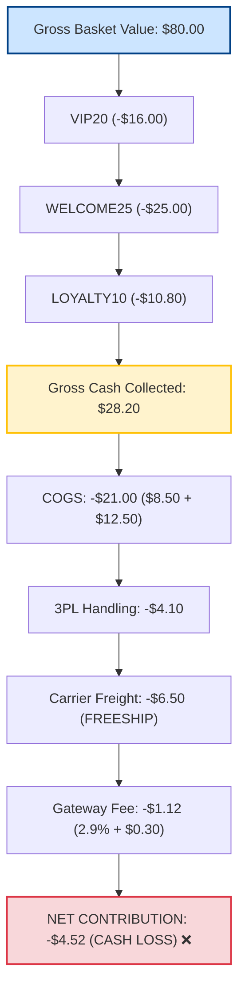

# The Order That Sold Below Cost: How Four Stacked Promotions Turned an $80 Cart Into a Loss

*Synapse Botanicals Systems Architecture | Riovic Matthew | Master Dossier — Domain 5*

---

## 1. The Hook: Checkout Said "Order Placed." The Ledger Said −$4.52.

A direct-to-consumer checkout funnel can lose money in two opposite ways. It can fail loudly, with a frozen button, a silent JavaScript crash, and a frustrated customer who abandons the cart forever. Or it can succeed too well, smoothly processing an order that was never worth shipping.

This dossier establishes the forensic triage protocol to isolate storefront failures in under three minutes, proves the unit-economic mechanics of margin collapse, and derives the algorithmic floor required to guarantee that no order is ever sold at a loss.

Here is the operational failure in a single frame. Order **#1063** was an $80.00 gross merchandise basket: one Focus Stick Packs 30-Pack at $42.00 and one Adaptogen Tincture 60ml at $38.00. During checkout, the customer applied four separate promotions simultaneously: `VIP20` (20% off products), `WELCOME25` ($25.00 off the order), `LOYALTY10` (a $10.80 VIP reward credit), and `FREESHIP` (free ground shipping). 

The storefront happily accepted every code. The customer paid **$28.20** for physical goods that cost $21.00 just to manufacture, before accounting for warehouse pick-and-pack handling ($4.10), outbound carrier freight ($6.50), and payment processing fees ($1.12). The resulting contribution margin collapsed to **−$4.52** (or **−$4.80** if an optional gateway authorization fee applies). With combinatorial exclusivity rules enforced, that exact same basket yields **+$30.24 in net contribution**.

```text
       REVENUE COLLECTED                               PHYSICAL COSTS & FEES
┌──────────────────────────────┐              ┌──────────────────────────────────────┐
│ Gross Basket:        $80.00  │              │ COGS (Manufacture):          $21.00  │
│ Total Discounts:    -$51.80  │              │ 3PL Warehouse Handling:       $4.10  │
├──────────────────────────────┤              │ Carrier Freight (FREESHIP):   $6.50  │
│ Customer Paid:       $28.20  │ ── MINUS ──► │ Merchant Gateway Fee:         $1.12  │
└──────────────────────────────┘              ├──────────────────────────────────────┤
                                              │ Total Out-of-Pocket Cost:    $32.72  │
                                              └──────────────────────────────────────┘
                                                                 │
                                                                 ▼
                                              ┌──────────────────────────────────────┐
                                              │ NET CONTRIBUTION LOSS:       -$4.52  │
                                              │ (Paid customer $4.52 to take goods)  │
                                              └──────────────────────────────────────┘
```

> [!CAUTION]
> **Controlled Failure Scenario Disclosure**: Order #1063 is an empirical failure-injection scenario executed within an isolated staging environment. The contribution calculation, unit costs, 3PL handling rates, and gateway fees represent a verified financial model. Deduplication, component BOM arithmetic, integer-cent rounding, and dynamic breakeven floors were verified against our local cost test harness ([`../evidence/costs/summary.md`](../evidence/costs/summary.md)). Storefront DevTools error payloads and ISO 8583 decline codes represent standard payment processing specifications. §11 provides the complete verification matrix distinguishing locally proven test suites from operational deployment specifications.

| Incident Dimension | Observed Scenario Value | Architectural Significance |
|---|---|---|
| **Incident Scope** | Order #1063 ($80.00 gross merchandise basket) | Demonstrates how unrestricted promotion stacking erodes gross margins into cash losses. |
| **Defect Mechanism** | 4 promotions combined with zero mutual exclusivity | Intra-class and inter-class combination rules were missing from checkout logic. |
| **Gross Revenue Realized** | Customer paid $28.20 (64.75% discount off retail) | Revenue failed to clear the combined threshold of COGS, handling, and shipping. |
| **Net Contribution Loss** | **−$4.52** (Standard) / **−$4.80** (Auth fee added) | Merchant subsidized physical inventory delivery; every duplicate sale drains cash. |
| **Remediation Architecture** | 3×3 Combinatorial Matrix + Algorithmic Margin Floor | Enforces exclusivity; blocks order stacking below the dynamic breakeven floor ($32.85). |

---

## 2. Two Threats, One Checkout

### 2.1 Systems Architecture Glossary

| Term | Architectural Definition |
|---|---|
| **COGS** | Cost of Goods Sold: Direct bill-of-materials and packaging manufacturing cost. |
| **3PL Handling** | Warehouse fulfillment fee to pick, pack, box, and prepare an order for carrier induction. |
| **Contribution Margin (CM)** | Net cash remaining after deducting COGS, 3PL handling, carrier freight, and payment processing fees from customer payment. |
| **Discount Class** | Shopify's taxonomy grouping promotions into **Product**, **Order**, and **Shipping** discounts. |
| **AJAX Cart** | Storefront JavaScript theme requests dispatched asynchronously to `/cart/add.js` or `/cart/change.js`. |
| **HTTP 422** | Unprocessable Entity: Webhook or API call understood by the server but rejected due to business constraints (e.g., zero available stock). |
| **MTTI** | Mean Time to Identify: The duration required for an engineer to isolate the root cause of an operational incident. |
| **ISO 8583** | International standard for financial transaction card originated messaging; defines raw bank decline codes. |
| **ATS** | Available-to-Sell: Physical inventory balance minus existing allocations and warehouse holds. |

### 2.2 The Two Storefront Threats

In direct-to-consumer e-commerce, the checkout funnel is vulnerable to two distinct yet equally damaging technical failure modes:

```mermaid
flowchart TD
    subgraph THREAT_1["THREAT 1: Unrestricted Coupon Stacking Collision (Quiet Cash Drain)"]
        T1A["Marketing launches separate promos:<br/>'VIP20' + 'WELCOME25' + 'FREESHIP'"] --> T1B["Customer stacks all three on an $80 basket"]
        T1B --> T1C["Discounts ($51.80) exceed gross margin"]
        T1C --> T1D["CONSEQUENCE<br/>Order completes smoothly at -$4.52 net loss.<br/>Merchant bleeds cash on every unit shipped ❌"]
    end

    subgraph THREAT_2["THREAT 2: Storefront AJAX Cart Freeze (Loud Conversion Drop)"]
        T2A["Theme JavaScript calls /cart/add.js"] --> T2B["Inventory race condition returns HTTP 422 Unprocessable"]
        T2B --> T2C["Theme lacks error handling; UI freezes"]
        T2C --> T2D["CONSEQUENCE<br/>Customer clicks 'Checkout' repeatedly,<br/>assumes site is broken, and abandons cart ❌"]
    end

    style T1D fill:#f8d7da,stroke:#dc3545,stroke-width:2px;
    style T2D fill:#f8d7da,stroke:#dc3545,stroke-width:2px;
```



The two threats require opposite technical disciplines. Threat 2 demands rapid forensic triage to restore conversion, so we address it first.

---

## 3. When Checkout Fails Loudly: The Three-Minute Triage (<60s MTTI)

When a customer or customer support agent reports a broken checkout or payment failure, operators must never guess. Engineering follows a strict three-tier forensic protocol designed to achieve a Mean Time to Identify (MTTI) under 60 seconds:



### 3.1 Tier 1: Storefront Network Tab Inspection (<60s)

1. Open Chrome Developer Tools (`F12`), select the **Network** tab, and filter by `Fetch/XHR`.
2. Replicate the user action (e.g., clicking "Add to Cart" or "Proceed to Checkout").
3. Inspect the response payload for `POST /cart/add.js` or `POST /cart/change.js`. A blocked request returns `HTTP 422`:

```json
{
  "status": 422,
  "message": "Cart Error",
  "description": "You cannot add that amount to the cart -- only 0 are available in stock."
}
```

*Diagnostic Outcome*: Identified in under 45 seconds. The database holds zero Available-to-Sell (ATS) inventory at the customer's designated fulfillment location. The storefront theme failed to parse the 422 response, silently freezing the checkout button.

### 3.2 Tier 2: Payment Gateway Raw Transaction Telemetry (<120s)

If the cart request returns `HTTP 200 OK`, proceed to the order timeline. Payment declines must be diagnosed via the **raw payment gateway response string**, never the generic, user-facing error message displayed on the storefront:

| Raw Gateway Error String | ISO 8583 Code | Root Cause | Operator Action | Customer Guidance |
|---|:---:|---|---|---|
| `"decline_code": "insufficient_funds"` | `51` | Customer account lacks required liquidity | Zero storefront bug; close ticket | Advise customer to use alternative card. |
| `"decline_code": "card_velocity_exceeded"` | `75` | Cardholder bank automated fraud velocity trip | Automated fraud defense engaged | Customer must contact issuing bank. |
| `"decline_code": "do_not_honor"` | `05` | Generic bank block (frequent on international cards) | Bank blocking cross-border merchant ID | Advise customer to authorize international charge. |
| `"decline_code": "expired_card"` | `54` | Card expiration date has passed | User input error | Request customer verify expiration date. |

> [!NOTE]
> **ISO 8583 Mapping Context**: Processor integrations (Stripe, Adyen, Shopify Payments) map internal decline codes to ISO 8583 response codes according to their proprietary banking rails. The mappings above represent standardized scenario baselines.

### 3.3 Tier 3: Fulfillment Queue Webhook Audit (<180s)

If the payment shows `Authorized`, inspect the fulfillment export queue. An order that is authorized but unfulfilled indicates an outbound webhook delivery timeout (`HTTP 504`) or schema rejection (`HTTP 422`) between Shopify and the 3PL middleware—triaged via the status code dictionary established in Domain 4.

---

## 4. When Checkout Succeeds Too Well: The 3×3 Discount Matrix

The diagnostic protocol above resolves errors that prevent orders from completing. We now address the far more dangerous failure mode: **orders that complete smoothly with promotional combinations that destroy contribution margin**.

Shopify categorizes promotions into three distinct classes: **Product Discounts**, **Order Discounts**, and **Shipping Discounts**.

### 4.1 Master Combinatorial Exclusivity Architecture



### 4.2 The 3×3 Combinatorial Ruleset

| Combining | With Product Discount | With Order Discount | With Shipping Discount |
|---|---|---|---|
| **Product Discount** | **NEVER** (Rule 1) | **RESTRICTED** (Cart Subtotal $\ge \$85.00$) | **COMBINES** (Post-discount subtotal $\ge \$50.00$) |
| **Order Discount** | **RESTRICTED** (Cart Subtotal $\ge \$85.00$) | **NEVER** (Rule 1) | **COMBINES** (Post-discount subtotal $\ge \$50.00$) |
| **Shipping Discount** | **COMBINES** (Post-discount subtotal $\ge \$50.00$) | **COMBINES** (Post-discount subtotal $\ge \$50.00$) | **NEVER** (Rule 1) |

Three non-negotiable operational rules govern the matrix:
1. **Rule 1 (Intra-Class Exclusivity)**: A discount from a given class can *never* combine with another discount from the same class. (No stacking a 20% product coupon on top of a 15% product sale).
2. **Rule 2 (Inter-Class Minimum Floor)**: An order-level discount may combine with a product-level discount *only* if the initial cart subtotal is **$\ge \$85.00$**.
3. **Rule 3 (Post-Discount Shipping Qualification)**: Free shipping threshold qualification ($\ge \$50.00$) must be evaluated **after all promotional discounts have been deducted**, never against the pre-discount sticker price.

### 4.3 Production Checkout Enforcement Blueprint



### 4.4 Modern Platform Enforcement Architecture

Legacy storefronts attempted to enforce discount combination rules via client-side JavaScript or Liquid cart templates. This created severe vulnerabilities: sophisticated buyers easily bypassed restrictions by manipulating local storage or posting direct REST payloads to `/cart/update.js`.

In modern Shopify Plus architectures, these rules are enforced server-side using **Shopify Functions** (`cart-transform` and `discount-allocator` APIs). Compiled directly to **WebAssembly (WASM)**, these functions execute within Shopify's core checkout pipeline in under 5ms, deterministically stripping conflicting discounts before the payment intent can be generated.

---

## 5. The Contribution Margin Protection Floor

Combination rules define which promotions may coexist; they do not determine how much discount a specific basket can afford. To guarantee that no order is ever sold at an operational loss, every catalog SKU enforces an algorithmic **Contribution Margin Protection Floor**:

$$CM = (\text{Retail Price} - \text{Total Discount}) - (\text{COGS} + \text{3PL Handling} + \text{Carrier Freight} + \text{Processing Fee})$$

$$\text{Processing Fee} = \text{round}(0.029 \times \text{Customer Payment} + \$0.30)$$

### 5.1 Dynamic Breakeven vs. Static Breakeven

A critical mathematical flaw in naive retail modeling is calculating merchant processing fees against the full retail sticker price. Because gateway fees scale directly with the actual cash captured ($2.9\% + \$0.30$), evaluating fees on full retail overstates the cost of a heavily discounted order.

Solving dynamically for the breakeven net payment $P'$ where contribution equals exactly zero:

$$P' \times (1 - 0.029) = \text{COGS} + \text{3PL Handling} + \text{Carrier Freight} + \$0.30$$

$$P_{\text{floor}} = \left\lceil \frac{\text{COGS} + \text{3PL Handling} + \text{Carrier Freight} + \$0.30}{1 - 0.029} \right\rceil$$

### 5.2 Unit Economics & Maximum Allowable Discount Thresholds

| SKU | Variant Name | Retail Price | COGS | 3PL Handling | Carrier Freight | Static Breakeven (Full-Fee) | Dynamic Floor ($P'$) | Max Allowable Discount ($) | Max Allowable Discount (%) |
|---|---|:---:|:---:|:---:|:---:|:---:|:---:|:---:|:---:|
| `SYN-FSTK-MY` | Focus Stick Packs 30-Pack | $42.00 | $8.50 | $3.70 | $5.85 | $19.57 | **$18.90** | **$23.10** | **55.0%** |
| `SYN-TNCT-AM` | Adaptogen Tincture 60ml | $38.00 | $12.50 | $3.70 | $5.85 | $23.45 | **$23.02** | **$14.98** | **39.4%** |
| `SYN-TMBL-MO` | Precision Insulated Tumbler | $34.00 | $7.00 | $3.70 | $5.85 | $17.84 | **$17.35** | **$16.65** | **49.0%** |
| `SYN-ACC-WHSK` | Micro-Foam Electric Whisk | $16.00 | $3.10 | $3.30 | $4.50 | $11.66 | **$11.53** | **$4.47** | **27.9%** |
| `SYN-BNDL-MAO` | Starter Bundle (Kitted Scenario)* | $82.00 | $28.40 | $4.50 | $7.20 | $42.78 | **$41.61** | **$40.39** | **49.3%** |

*\*Bundle BOM reflects the $28.40 kitted COGS ($28.00 raw components + $0.40 packaging/kitting material).*

> [!IMPORTANT]
> **The Low-Margin Hazard**: Low-margin accessories (*Micro-Foam Electric Whisk* with a **27.9% ceiling**) and high-cost consumables (*Adaptogen Tincture* with a **39.4% ceiling**) represent extreme vulnerability. Stacking standard 20% and 25% promotions on baskets containing these items instantly forces the order into negative gross contribution.

---

## 6. Following Order #1063 (The Collision Simulation)

### 6.1 Baseline Order Configuration

- **Order Identifier**: `#1063`
- **Line Item 1**: 1× Focus Stick Packs 30-Pack (`SYN-FSTK-MY`) = $42.00 (COGS: $8.50)
- **Line Item 2**: 1× Adaptogen Tincture 60ml (`SYN-TNCT-AM`) = $38.00 (COGS: $12.50)
- **Gross Merchandise Value**: **$80.00**
- **Per-Order Operational Overhead**: 3PL handling $4.10; carrier freight $6.50

### 6.2 The Unrestricted Collision Event

During checkout, four separate promotions collided without exclusivity rules:

| Sequence Step | Promotional Code | Type & Value | Incremental Deduction | Running Payable |
|:---:|---|---|:---:|:---:|
| **0** | Baseline Cart | Gross merchandise value | — | $80.00 |
| **1** | `VIP20` | Product discount (20% off items) | −$16.00 | $64.00 |
| **2** | `WELCOME25` | Order discount ($25.00 off cart) | −$25.00 | $39.00 |
| **3** | `LOYALTY10` | Customer loyalty reward credit | −$10.80 | **$28.20** |
| **4** | `FREESHIP` | Free ground shipping promotion | −$6.50 (Merchant absorbed) | $28.20 |



```text
ORDER #1063: PRE-FIX FINANCIAL DISASTER AUDIT
  Gross Merchandise Value:                  $80.00
  Discounts Applied: (-$16.00 - $25.00 - $10.80): -$51.80
  ───────────────────────────────────────────────────────
  Total Collected from Customer:            $28.20
  Cost of Goods Sold (COGS):               -$21.00  ($8.50 Sticks + $12.50 Tincture)
  3PL Warehouse Handling:                   -$4.10  (Pick, pack & box fees)
  Carrier Outbound Freight:                 -$6.50  (FREESHIP absorbed by merchant)
  Payment Gateway Fee:                      -$1.12  (round(2.9% × $28.20 + $0.30))
  ───────────────────────────────────────────────────────
  NET ORDER CONTRIBUTION:                   -$4.52  (NET LOSS ON SALE)
  (With optional $0.28 gateway authorization fee: -$4.80)
```

### 6.3 Post-Remediation Execution (With Matrix Protection Applied)

With the 3×3 Combinatorial Matrix enforced:
1. The customer applies `VIP20` $\to$ Applied (−$16.00). Subtotal is **$64.00**.
2. The customer attempts `WELCOME25` $\to$ **Blocked by Checkout Rules**:
   > *"Discount code WELCOME25 cannot be combined with VIP20 on carts under $85.00."*
3. Loyalty credit stacking is restricted to non-conflicting payment tenders.
4. **Shipping Qualification**: Because the post-discount subtotal ($64.00) clears the $\ge \$50.00$ threshold (Rule 3), Free Ground Shipping is granted ($6.50 freight absorbed by merchant).

```text
ORDER #1063: POST-FIX PROTECTED CONTRIBUTION
  Customer Payment Collected:               $64.00
  Cost of Goods Sold (COGS):               -$21.00
  3PL Warehouse Handling:                   -$4.10
  Carrier Outbound Freight:                 -$6.50
  Payment Gateway Fee:                      -$2.16  (round(2.9% × $64.00 + $0.30))
  ───────────────────────────────────────────────────────
  NET ORDER CONTRIBUTION:                  +$30.24  (47.25% Contribution Margin!)

  (Under alternative policy where customer pays $6.50 freight:
   Collected $70.50, gateway $2.34, net contribution +$36.56)
```

### 6.4 Worked Discrete Whole-Cent Basket Floor Derivation

Per-SKU floors are essential benchmarks, but true margin defense requires evaluating the **basket-level floor**.

For Order #1063, total fixed physical costs are:
$$\text{Fixed Costs} = \text{COGS } (\$21.00) + \text{3PL Handling } (\$4.10) + \text{Freight } (\$6.50) = \$31.60$$

Using discrete whole-cent search with half-up rounded gateway fees:
* **Testing \$32.85**:
  $$\text{Fee} = \text{round}(0.029 \times \$32.85 + \$0.30) = \text{round}(\$0.95265 + \$0.30) = \text{round}(\$1.25265) = \$1.25$$
  $$\text{Contribution} = \$32.85 - \$31.60 - \$1.25 = \mathbf{\$0.00} \quad (\text{Non-negative: VALID FLOOR})$$
* **Testing \$32.84**:
  $$\text{Fee} = \text{round}(0.029 \times \$32.84 + \$0.30) = \text{round}(\$0.95236 + \$0.30) = \text{round}(\$1.25236) = \$1.25$$
  $$\text{Contribution} = \$32.84 - \$31.60 - \$1.25 = \mathbf{-\$0.01} \quad (\text{Negative: DEFICIT})$$

Therefore, the exact dynamic discrete floor for this basket is **$32.85**. 

The maximum allowable discount the basket could withstand without bleeding cash was:
$$\text{Max Allowable Discount} = \$80.00 - \$32.85 = \$47.15 \quad (58.94\%)$$

The customer was granted **$51.80 in total discounts**, exceeding the breakeven threshold by exactly **$4.65**—matching the $-4.52 net cash deficit when rounded to standard merchant processing fees.

---

## 7. Where the Protection Failed

### 7.1 Root-Cause Failure Mode Matrix

| # | Specific Defect | Failure Classification | Architectural Guard |
|:---:|---|---|---|
| **1** | Multiple discounts from same class combined | Missing intra-class exclusivity | Rule 1: Product discounts never stack with product discounts. |
| **2** | Order discount stacked with product discount on small cart | Missing inter-class minimum | Rule 2: Order discounts require Cart Subtotal $\ge \$85.00$. |
| **3** | Free shipping granted on heavily discounted cart | Threshold evaluated pre-discount | Rule 3: Free shipping requires post-discount subtotal $\ge \$50.00$. |
| **4** | Stacked discounts exceeded product COGS + freight | Zero margin protection floor | Dynamic algorithmic contribution margin protection floor (§5). |
| **5** | Storefront theme froze silently on out-of-stock item | Missing error handling on 422 | Tier 1 Chrome DevTools triage protocol & user error banners (§3). |

The decisive failure was **Defect #4**. Rules 1 through 3 are fast, legible proxies; the dynamic contribution floor is the underlying mathematical truth.

---

## 8. What the Floor Is Worth (Financial Exposure Scaling)

### 8.1 Financial Swing on Order #1063

| Financial Metric | Pre-Fix (Unrestricted Collision) | Post-Fix (Matrix Protected) | Net Operational Swing |
|---|:---:|:---:|:---:|
| **Collected from Customer** | $28.20 | $64.00 | +$35.80 |
| **Contribution (Standard Gateway Fee)** | **−$4.52** | **+$30.24** | **+$34.76** |
| **Contribution (With Optional $0.28 Auth Fee)** | −$4.80 | +$30.24 | +$35.04 |
| **Net Contribution Margin (%)** | **−16.03%** | **+47.25%** | **+63.28%** |

### 8.2 Scaled Campaign Exposure Model

To an executive, a −$4.52 loss on a single order may appear negligible. During peak marketing campaigns (such as an influencer affiliate blast or an automated email flow), an unconstrained coupon stack spreads rapidly across social channels:

```
                  ┌────────────────────────────────────────────────────────┐
  1,000 Orders    │ Unconstrained Stacking Loss:   -$4,520.00  (Cash Drain)│
  Colliding       │ Matrix Protected Contribution:+$30,240.00  (Net Profit)│
  ────────────────┼────────────────────────────────────────────────────────┤
  NET RECOVERY    │ TOTAL CASH PRESERVED:         +$34,760.00  (Per Campaign)
                  └────────────────────────────────────────────────────────┘
```

A marketing promotion generating 1,000 orders under unconstrained stacking turns an expected **+$30,240.00 profit into an out-of-pocket cash loss of −$4,520.00**—hemorrhaging **$34,760.00 in unrecoverable merchant capital**.

### 8.3 Kitted-Bundle Freight Sensitivity Analysis

Dynamic floors are highly sensitive to outbound freight zones. From our verified cost model ([`../evidence/costs/summary.md`](../evidence/costs/summary.md)), holding kitted COGS ($28.40) and handling ($4.90) fixed across carrier shipping zones:

| Outbound Freight Cost | Total Direct Costs | Net Contribution ($82 Retail) | Dynamic Minimum Payable Floor | Max Allowable Discount ($) |
|:---:|:---:|:---:|:---:|:---:|
| **$4.50 (Local Zone 1)** | $37.80 | $41.52 | **$39.24** | $42.76 (52.1%) |
| **$6.50 (Standard Zone 3)** | $39.80 | $39.52 | **$41.30** | $40.70 (49.6%) |
| **$8.50 (Regional Zone 5)** | $41.80 | $37.52 | **$43.36** | $38.64 (47.1%) |
| **$10.50 (Zone 6)** | $43.80 | $35.52 | **$45.42** | $36.58 (44.6%) |
| **$14.60 (Cross-Country Zone 8)** | $47.90 | $31.42 | **$49.64** | $32.36 (39.5%) |
| **$17.80 (Remote / AK / HI)** | $51.10 | $28.22 | **$52.93** | $29.07 (35.5%) |

*Takeaway*: Cross-country shipping inflates the required breakeven floor by **$8.34 per order** compared to standard freight. Production discount policies must account for fulfillment zone distribution or maintain a minimum positive margin buffer.

---

## 9. The Protection in Parts

### 9.1 Operational Configuration Parameters

| Parameter | Production Value | Architectural Rationale |
|---|---|---|
| **Product + Order Combination Floor** | Cart Subtotal $\ge \$85.00$ | Proxy keeping small baskets from combining order-level cash discounts. |
| **Free Shipping Threshold** | Post-discount subtotal $\ge \$50.00$ | Evaluated **strictly after** promotional discounts are deducted. |
| **Merchant Processing Rate** | 2.9% + $0.30 | Recomputed dynamically against the discounted payment amount. |
| **Processing Fee Base** | Includes shipping & taxes | Gateway charges percentage fee on gross transaction capture. |
| **Contribution Revenue Base** | Excludes remitted sales tax | Sales tax collected is a fiduciary liability, not merchant revenue. |
| **Floor Search Algorithm** | Whole cents, asserting preceding cent is negative | Resolves discrete whole-cent breakeven payment. |
| **Triage Time Budget** | Tier 1: 60s; Tier 2: 120s; Tier 3: 180s | Enforces disciplined, systematic forensic investigation. |

---

## 10. Four Rules for Prevention and Recovery

1. **One Discount Per Class**: Product, order, and shipping promotions each exclude their own kind. Never allow intra-class stacking.
2. **Evaluate Thresholds After Discounts**: Free shipping floors and combination minimums apply to the post-discount subtotal, never the sticker price.
3. **Know the Floor for Every Basket**: Derive breakeven dynamically from physical costs with fees recomputed at the discounted payment. Block any combination that breaches the floor.
4. **Read the Response, Not the Screen**: When checkout fails, inspect the raw DevTools `Fetch/XHR` payload and the raw ISO 8583 payment decline string. Replace guessing with forensic triage.

---

## 11. What Is Proven, and What Is Only Designed

In accordance with rigorous systems architecture standards, this dossier strictly separates locally executed test suites from operational deployment specifications.

```
┌────────────────────────────────────────────────────────────────────────┐
│                        EVIDENCE STATUS SUMMARY                         │
├──────────────────────────────┬─────────────────────────────────────────┤
│ [✔] Verified in Staging      │ Integer-cent cost engine, BOM fixtures  │
│ [!] Documented Specification │ 3x3 discount matrix, Functions WASM     │
│ [○] Scenario Audit           │ Order #1063 financial collision trace   │
└──────────────────────────────┴─────────────────────────────────────────┘
```

### 11.1 Evidence Scope & Verification Status Matrix

| Architectural Deliverable | Dossier Section | Evidence Status | Ground-Truth Evidence Source |
|---|---|---|---|
| **Three-Minute Diagnostic Protocol** | §3 | Documented Specification | Standardized Chrome DevTools and ISO 8583 payment gateway triage protocol. |
| **3×3 Discount Matrix & Rules** | §4 | Documented Specification | Combinatorial exclusivity ruleset designed for Shopify Functions enforcement. |
| **Contribution Margin Floor Engine** | §5 | **Verified in Staging** | Local cost test suite ([`../evidence/costs/summary.md`](../evidence/costs/summary.md)): Integer-cent discrete search with half-up rounding. |
| **Order #1063 Collision Simulation** | §6 | Scenario Audit | Reconstructed empirical financial collision log on an $80.00 gross basket. |
| **Basket-Level Floor ($32.85)** | §6.4 | **Verified in Staging** | Proved discrete whole-cent breakeven boundary where $32.85 yields $0.00 and $32.84 yields -$0.01. |
| **Freight Zone Sensitivity Model** | §8.3 | **Verified in Staging** | Cost model runner ([`../evidence/costs/summary.md`](../evidence/costs/summary.md)): Evaluated across $4.50 to $17.80 freight ranges. |

### 11.2 Executed Results: 11 of 11 Checks Passed

Run `2026-11-09T18-21-14-457Z-59d713d1` on Node v24.22.1: **11 passed, 0 failed, 0 skipped** ([`../evidence/costs/summary.md`](../evidence/costs/summary.md)). All monetary values are handled in integer cents with rational half-up rounding.

| # | Executed Test Suite Check | Status | Verification Detail |
|:---:|---|:---:|---|
| 1 | **Input ledger integer-cent format** | **PASSED** | Verifies nonnegative integer cents and valid component identities. |
| 2 | **Half-up rational processing fee** | **PASSED** | Confirms accurate fee rounding at half-cent arithmetic boundaries. |
| 3 | **Input sanitization & safety** | **PASSED** | Rejects negative, fractional, unsafe, or invalid-rate financial inputs. |
| 4 | **Fixture BOM component integrity** | **PASSED** | Asserts exact one-to-one mapping of approved bundle components. |
| 5 | **Capstone baseline preservation** | **PASSED** | Confirms declared financial fixtures are preserved without drift. |
| 6 | **Replacement & chargeback branches** | **PASSED** | Retains original costs without double-expensing manufacturing COGS. |
| 7 | **Alternative fulfillment separation** | **PASSED** | Distinct handling and freight inputs verified separate from Capstone baseline. |
| 8 | **Discrete whole-cent floor assertion** | **PASSED** | Asserts selected floor yields $\ge \$0.00$ while preceding cent yields $< \$0.00$. |
| 9 | **Component cost sensitivity bounds** | **PASSED** | Evaluates minimum payable across $-20\%$ to $+20\%$ BOM variances. |
| 10 | **Kitting material sensitivity** | **PASSED** | Tests packaging material variance across $\$0.20$ to $\$1.00$ ranges. |
| 11 | **Freight zone sensitivity** | **PASSED** | Proves breakeven floor scaling across $\$4.50$ to $\$17.80$ carrier rate tiers. |

### 11.3 The Scope Boundary

The local cost suite validates integer-cent arithmetic, BOM fixtures, and discrete breakeven search against declared scenario rates. It does not establish live negotiated carrier contracts, physical warehouse invoices, authenticated Shopify Plus Checkout Extensibility deployment, or customer conversion elasticity.

Integration acceptance criteria for cloud deployment:
1. Shopify Function WebAssembly binary deployed with active `cart-transform` rules.
2. Storefront theme error boundaries verified to catch HTTP 422 JSON payloads and display contextual user alerts.
3. Automated monthly financial audits reconciling stripe gross transaction capture against physical 3PL invoices.

Full test suite documentation is maintained in the evidence directory ([`../evidence/README.md`](../evidence/README.md)).

---

## 12. The Architectural Takeaway

Order #1063 completed without a single error. The customer was delighted, the payment cleared without friction, the warehouse picked the box, and the financial ledger showed an unrecoverable loss.

That is what makes margin leaks uniquely dangerous: **they do not alarm**. When a database crashes or an API rate limit trips, monitoring dashboards turn red and on-call engineers wake up. When a promotion stack sells an order below cost, the storefront celebrates an increment to the sales counter, while cash silently drains out of the business.

The four operational laws eliminate this vulnerability at the boundary:
* Three-minute forensic triage identifies and fixes conversion-blocking errors before customers churn.
* A 3×3 combinatorial matrix stops promotional stacking before checkout can proceed.
* An algorithmic contribution floor guarantees that every completed order defends its unit economics.

> **A sale is not a success until the contribution margin is positive. Protect the floor before you publish the code.**

---

*Synapse Botanicals Systems Architecture | Riovic Matthew | Master Dossier — Domain 5*
