# Frontline Helpdesk Automation & Safe Order Actions

> **Empirical staging simulation.** Synapse Botanicals is a technical operations sandbox used to stress-test e-commerce failure modes with synthetic customer and order fixtures. Commercial charges and financial outcomes are scenario inputs and calculations. The verification section distinguishes supplied trace excerpts, reproducible model results, and acceptance criteria for the designed controls. No production customer data or live fulfillment is represented.

## 1. Executive Context & Failure Mode

A customer modification request may wait longer than the warehouse's remaining edit window. Gorgias supplies intent and operator context; a backend coordinator verifies authorization and shipment eligibility before performing order actions. The target is confirmation before the warehouse cutoff, not zero latency or guaranteed elimination of races.

The example network contains Allentown (`LOC-PA-01`) and Reno (`LOC-NV-02`). Automatic edits stop at wave release. Polling, export and wave timers are separate integration settings. A Shopify fulfillment hold does not prove that an already-exported warehouse pick has stopped.

## 2. Governance & Architecture Protocol

### 2.1 Request and state contract

These are middleware action contracts, not literal native Gorgias template syntax. The selected Gorgias rule/action configuration must supply supported authentication and mappings. The agent sidebar never receives the Shopify Admin token.

```json
{
  "operation_id": "address-edit-T-10842",
  "ticket_id": "T-10842",
  "shopify_order_gid": "gid://shopify/Order/5920194812",
  "expected_order_version": "revision-from-current-read",
  "intent": "ADDRESS_EDIT"
}
```

Match the authenticated customer to one authorized order; ambiguous matches remain pending. Resolve every affected fulfillment order and remaining shipment. Persist one operation and serialize competing edits. Intent classification does not authorize a mutation.

```mermaid
stateDiagram-v2
    [*] --> REQUESTED
    REQUESTED --> HOLD_PENDING: Authorized customer and eligible shipment
    HOLD_PENDING --> HOLD_CONFIRMED: Shopify and WMS confirm
    HOLD_PENDING --> UNKNOWN: Timeout or ambiguous response
    HOLD_PENDING --> REJECTED: Cutoff or business rejection
    UNKNOWN --> HOLD_CONFIRMED: Reconciliation confirms hold
    UNKNOWN --> REJECTED: Reconciliation confirms ineligibility
    HOLD_CONFIRMED --> UPDATE_PENDING: Reserve inventory and validate totals
    UPDATE_PENDING --> RECONCILE: Read back both systems
    RECONCILE --> RELEASED: Matching version; release owned hold
    RECONCILE --> MANUAL_REVIEW: Partial or unknown result
```



### 2.2 Shopify and WMS controls

```graphql
mutation HoldForAddressEdit($id: ID!, $hold: FulfillmentOrderHoldInput!) {
  fulfillmentOrderHold(id: $id, fulfillmentHold: $hold) {
    fulfillmentOrder { id status fulfillmentHolds { id handle heldByRequestingApp } }
    userErrors { field message }
  }
}
```

Variables (replace the fulfillment-order GID with the resolved resource):

```json
{
  "id": "gid://shopify/FulfillmentOrder/881920149012",
  "hold": {
    "reason": "INCORRECT_ADDRESS",
    "reasonNotes": "Authorized address edit; Gorgias T-10842",
    "handle": "address-edit-T-10842"
  }
}
```

Send GraphQL requests to `POST https://{shop}.myshopify.com/admin/api/2026-01/graphql.json` with `Content-Type: application/json` and the server-held `X-Shopify-Access-Token`. Inspect top-level `errors` and mutation `userErrors`, even after HTTP 200. The hold operation requires `write_merchant_managed_fulfillment_orders` or `write_third_party_fulfillment_orders`, plus the applicable `fulfill_and_ship_orders` permission. Resolve access for the actual fulfillment ownership; granted scopes also limit which resources can be read.

Persist the returned hold ID and handle. Release only the intended IDs:

```graphql
mutation ReleaseOwnedHold($id: ID!, $holdIds: [ID!]!) {
  fulfillmentOrderReleaseHold(id: $id, holdIds: $holdIds) {
    fulfillmentOrder { id status fulfillmentHolds { id handle } }
    userErrors { field message }
  }
}
```

Omitting the platform's optional `holdIds` argument releases all holds; this integration always supplies it. A successful Shopify operation is followed by separate WMS confirmation. The legacy REST hold route, where an existing integration uses REST, is `/admin/api/2026-01/fulfillment_orders/{id}/hold.json` with a nested `fulfillment_hold` body; release uses `/release_hold.json`. GraphQL and REST reason casing/payloads are not interchangeable.


The WMS adapter separately requests a conditional physical hold and records shipment ID, provider status, normalized state, order revision and confirmation time. Native ShipBob routes and status fields are taken from the chosen provider API, not invented from sidebar labels. Unknown outcomes prevent editing and success messages.

### 2.3 Operator prerequisites

1. Verify customer/order identity and current eligible physical state.
2. Confirm Shopify and affected WMS holds; distinguish them from ticket tags.
3. Normalize an address using a CASS-certified provider; resolve DPV warnings with the customer.
4. For a supported unfulfilled flavor swap, reserve replacement quantity and retain at least five ATS units after reservation as scenario safety stock.
5. Reconcile tax, discounts, shipping and payment balance through the supported order-edit workflow. Equal listed price is not sufficient.
6. Read back the updated Shopify/WMS version and destination or item allocation.
7. Release only this workflow's hold IDs; preserve unrelated holds and reconcile the release result.

## 3. Rules, Decision Matrix & Macro Playbooks

### 3.1 R-01 — Address intent

Eligibility is `(recognized intent) AND (authorized customer/order match) AND (eligible unfulfilled shipment) AND (pre-cutoff WMS state)`. Any OR conditions are grouped inside their relevant clause. Match using the configured Gorgias operator or an integration classifier tested with positive/negative examples; this blueprint does not assume PCRE flags or an undocumented secret interpolation syntax.

| Coordinator outcome | Ticket state | Operator message |
|---|---|---|
| Durable request accepted | CS-ADDR-HOLD-PENDING | Hold requested; warehouse confirmation pending. Do not edit. |
| Shopify and WMS confirm | CS-ADDR-HOLD-APPLIED | Affected shipment held; proceed under checklist. |
| Cutoff/business rejection | CS-ADDR-HOLD-REJECTED | No edit; escalate permitted recovery. |
| Timeout/ambiguous result | CS-ADDR-HOLD-UNKNOWN | Reconciliation required; do not promise a stopped shipment. |

Remove PENDING when a terminal confirmation/rejection is recorded. Tags communicate state; the durable operation ledger prevents duplicates. Repeated messages reuse or reconcile the active operation instead of starting competing holds.

### 3.2 R-02 — Cancellation after cutoff

A wave-released, picked or packed order is outside automatic frontline cancellation. Check warehouse stop/rework before carrier tender. After confirmed tender, evaluate carrier eligibility. An operator action cannot assume a Shopify status proves dispatch or that a carrier request succeeded.

### 3.3 Damage and replacement approval

Damage intent creates `CS-CLAIM-PENDING`. Verify order/shipment identity, evidence, policy eligibility and prior refunds/replacements. Approval changes state to `CS-CLAIM-VERIFIED`; a durable claim ID authorizes at most one replacement operation. Reserve inventory and link the replacement shipment to the claim. Carrier tracing records request, acceptance and resolution separately; staging uses simulated submissions.

### 3.4 M-01 — Confirmed address update

Use only after both systems confirm the new address and safe release:

> Your shipping address has been updated to the address confirmed in this ticket. The warehouse has acknowledged the updated shipment details. We will send tracking when dispatch is confirmed.

If release is still pending, report that state instead of using this completion response.

### 3.5 M-02 — Supported flavor swap

Use only after reservation, supported order edit, financial reconciliation and downstream confirmation:

> Your approved item change is confirmed. The warehouse has acknowledged the updated items. Any payment adjustment has been handled as agreed in this ticket.

### 3.6 M-04 — Post-cutoff request

> Your order has passed our standard edit cutoff. We are checking whether the warehouse or carrier can stop or redirect it. An intercept request is not a guarantee; we will confirm the outcome and available next steps.

Record intercept status as REQUESTED, ACCEPTED, SUCCEEDED or FAILED using the actual carrier evidence. Retain the affected shipment and ticket links.

Returned dietary supplements are identified and quarantined for documented quality-control disposition. Synapse applies a conservative company policy against returning customer-delivered ingestibles to sellable stock. This disposal policy is separate from the regulatory requirements governing returned supplements in 21 CFR Part 111, Subpart N. Assess durable bundle components separately; inventory write-offs use cost, not retail price. Ordinary carrier tracking does not establish product temperature history. Product classification and the applicable quality procedure must be confirmed before operational deployment.

## 4. Empirical Verification & Run Sheet

### 4.1 Timing and economic interpretation

The supplied scenario compares 4.2 hours with 14 minutes FRT. Since 4.2 hours=252 minutes, reduction is `(252−14)/252=94.44%`, or an eighteenfold decrease in the mean interval. FRT begins at ticket creation and ends at the first qualifying agent response; an automated hold receipt is measured separately.

The supplied 8.4-second interval concerns email ingress to Shopify hold acknowledgment, not confirmed WMS stop. A complete measurement additionally records WMS confirmation and the remaining time before wave release. The under-ten-second classifier objective is separate from both intervals.

The eighteen-to-zero monthly incident scenario has eighteen avoided events. Savings are calculated as `sum(avoided COGS + freight + handling + other avoidable costs − intervention cost)` for the same period. A $4,200 savings input implies $233.33 per event on average and is a sensitivity assumption until case-level costs establish it. For comparison, the Capstone's $98.60 recovery deterioration applied to eighteen otherwise identical events gives **$1,774.80**, before intervention costs; that is a different specified cost scenario, not measured monthly savings.

### 4.2 Acceptance cases

| Case | Required assertion |
|---|---|
| Authorized queued edit | Matching revision and owned-hold release |
| Duplicate concurrent tickets | One active operation and business effect |
| Wrong customer or ambiguous order | No mutation |
| Timeout after remote success | Reconcile; no duplicate hold/replacement |
| Post-cutoff request | Reject edit; accurate M-04 response |
| Unrelated fraud hold | Preserved |
| Multi-node/partial order | Only eligible remaining quantities affected |
| Replacement already created | Existing result returned |
| Stale replay | Current version wins; old edit rejected |

A recorded run includes ticket/order/operation IDs, API/configuration version, input, expected transitions, actual responses, timestamps and pass/fail. The supplied timing summaries are not a substitute for the complete cohort or proof that every designed case has been executed.

## 5. Technical References

- [Shopify Admin GraphQL, version 2026-01](https://shopify.dev/docs/api/admin-graphql/2026-01) — schema and mutation contracts; schema checked using the official `@shopify/dev-mcp` package's versioned introspection data.
- [Shopify 2026-01 REST fulfillment-order resource](https://github.com/Shopify/shopify-app-js/blob/1fcfb8044bdd50af1b4a09fbd6d98a90fe916da8/packages/apps/shopify-api/rest/admin/2026-01/fulfillment_order.ts).
- [21 CFR Part 111, Subpart N](https://www.ecfr.gov/current/title-21/chapter-I/subchapter-B/part-111/subpart-N) — returned dietary supplements; applicability depends on product classification.

- [Gorgias HTTP integration documentation](https://developers.gorgias.com/docs/http-integration) — confirm native rule/action and secret configuration for the deployed account.
